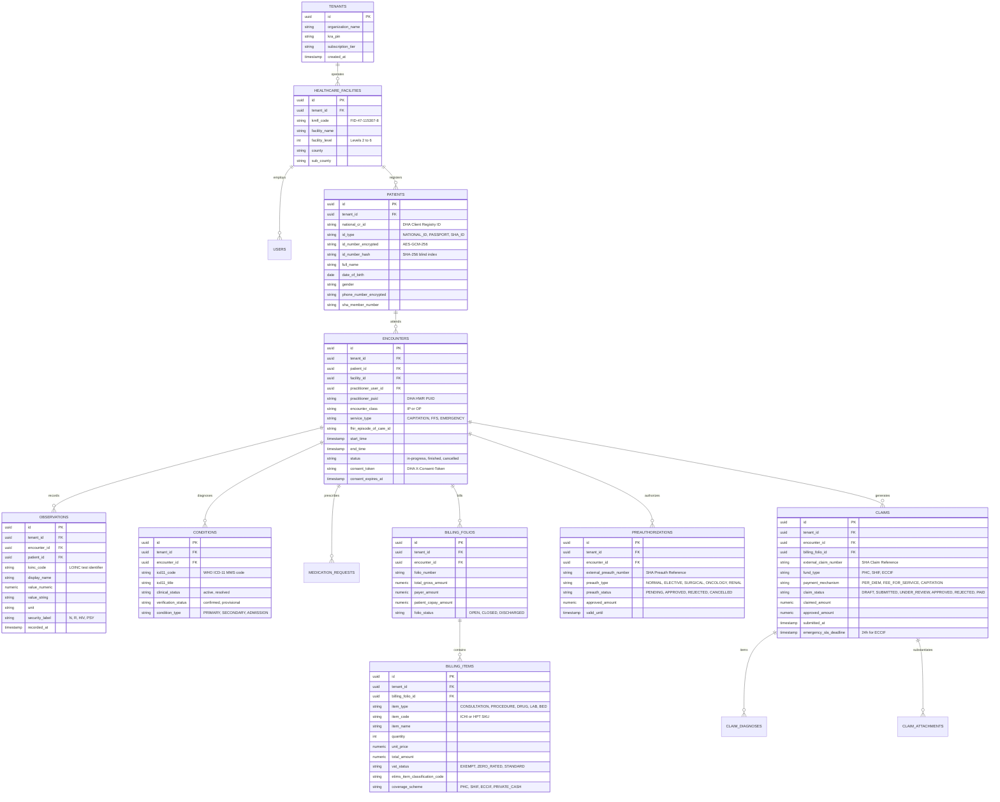

# COMKEY AFYA POA — Data Architecture, ERD & Multi-Tenant Security Design

**Document Identifier:** `ARCH-DATA-2026-V1`  
**System:** COMKEY AFYA POA (Multi-Tenant HMIS SaaS for Kenyan Healthcare Facilities)  
**Author:** Principal Software Architect & Healthcare Technology Compliance Researcher  
**Status:** Architecture Proposal (Awaiting Approval)  
**Date:** October 19, 2026  
**Primary Engine:** PostgreSQL 16 Enterprise with Row-Level Security (RLS)  

---

## 1. Multi-Tenant Data Isolation Architecture (PostgreSQL RLS)

To strictly satisfy the **Data Protection Act 2019** and prevent inadvertent cross-tenant data leakage in a multi-tenant cloud SaaS, COMKEY AFYA POA employs **Row-Level Security (RLS) enforced natively at the PostgreSQL database engine layer**, rather than relying solely on application-level `WHERE tenant_id = ?` clauses.

### 1.1 RLS Enforcement Mechanics
Every tenant-scoped table contains an indexed, immutable `tenant_id UUID NOT NULL` column referencing the `tenants` table.

```
[Incoming HTTP Request]
        |
        v
[NestJS TenantContextInterceptor]
  - Validates authenticated user's JWT
  - Extracts tenant_id from claims
        |
        v
[Database Connection Pool Checkout]
  - Begins Transaction
  - Sets transaction session variable:
      SET LOCAL app.current_tenant_id = 'c4b8e88e-4a9c-48be-85b1-6a4a6e8f0001';
        |
        v
[PostgreSQL Query Execution]
  - PostgreSQL RLS Policy automatically evaluates:
      USING (tenant_id = NULLIF(current_setting('app.current_tenant_id', true), '')::uuid)
  - Records belonging to other tenants are completely invisible to the query execution plan
        |
        v
[Transaction Commit & Connection Return]
  - Session variable clears upon transaction completion
```

### 1.2 DDL Implementation: Tenant RLS Blueprint

```sql
-- 1. Enable RLS on core clinical and financial tables
ALTER TABLE patients ENABLE ROW LEVEL SECURITY;
ALTER TABLE encounters ENABLE ROW LEVEL SECURITY;
ALTER TABLE observations ENABLE ROW LEVEL SECURITY;
ALTER TABLE billing_folios ENABLE ROW LEVEL SECURITY;
ALTER TABLE billing_items ENABLE ROW LEVEL SECURITY;
ALTER TABLE claims ENABLE ROW LEVEL SECURITY;
ALTER TABLE preauthorizations ENABLE ROW LEVEL SECURITY;

-- 2. Force RLS for table owners to avoid accidental superuser bypass in migrations
ALTER TABLE patients FORCE ROW LEVEL SECURITY;
ALTER TABLE encounters FORCE ROW LEVEL SECURITY;
ALTER TABLE observations FORCE ROW LEVEL SECURITY;
ALTER TABLE billing_folios FORCE ROW LEVEL SECURITY;
ALTER TABLE billing_items FORCE ROW LEVEL SECURITY;
ALTER TABLE claims FORCE ROW LEVEL SECURITY;
ALTER TABLE preauthorizations FORCE ROW LEVEL SECURITY;

-- 3. Define the universal tenant isolation policy
CREATE POLICY tenant_isolation_policy ON patients
    FOR ALL
    USING (tenant_id = NULLIF(current_setting('app.current_tenant_id', true), '')::uuid)
    WITH CHECK (tenant_id = NULLIF(current_setting('app.current_tenant_id', true), '')::uuid);

CREATE POLICY tenant_isolation_policy ON encounters
    FOR ALL
    USING (tenant_id = NULLIF(current_setting('app.current_tenant_id', true), '')::uuid)
    WITH CHECK (tenant_id = NULLIF(current_setting('app.current_tenant_id', true), '')::uuid);

CREATE POLICY tenant_isolation_policy ON claims
    FOR ALL
    USING (tenant_id = NULLIF(current_setting('app.current_tenant_id', true), '')::uuid)
    WITH CHECK (tenant_id = NULLIF(current_setting('app.current_tenant_id', true), '')::uuid);
```

---

## 2. Entity-Relationship Model (ERD)

The data model directly reflects healthcare domain boundaries while maintaining strict semantic alignment with **HL7® FHIR® R4** resources:



---

## 3. Initial Data Dictionary & FHIR R4 Semantic Mapping

| Database Table | Column Name | Data Type | Constraints / Attributes | FHIR R4 Element Mapping | Technical Description & Regulatory Context |
| :--- | :--- | :--- | :--- | :--- | :--- |
| `tenants` | `id` | `UUID` | `PRIMARY KEY, DEFAULT gen_random_uuid()` | N/A | SaaS tenant identifier (hospital organization). |
| `tenants` | `organization_name` | `VARCHAR(255)` | `NOT NULL` | N/A | Registered legal entity name. |
| `tenants` | `kra_pin` | `VARCHAR(11)` | `NOT NULL, UNIQUE` | N/A | KRA Tax PIN of the operating entity. |
| `healthcare_facilities` | `kmfl_code` | `VARCHAR(32)` | `NOT NULL, UNIQUE` | `Organization.identifier` | Official FR / Master Facility code (e.g., `FID-47-115307-8`). Used in `X-Facility-Id` header. |
| `patients` | `national_cr_id` | `VARCHAR(64)` | `NULLABLE, INDEXED` | `Patient.identifier (system="dha:cr")` | Canonical Beneficiary ID from DHA Client Registry. |
| `patients` | `id_number_encrypted`| `TEXT` | `NOT NULL` | `Patient.identifier.value` | AES-256-GCM encrypted National ID or Birth Certificate number. |
| `patients` | `id_number_hash` | `CHAR(64)` | `NOT NULL, INDEXED` | N/A | HMAC-SHA256 blind index for exact-match patient search without decryption. |
| `patients` | `sha_member_number` | `VARCHAR(32)` | `NULLABLE, INDEXED` | `Coverage.beneficiary` | Beneficiary SHA insurance policy number. |
| `encounters` | `encounter_class` | `VARCHAR(16)` | `NOT NULL, CHECK (IN ('IP', 'OP'))` | `Encounter.class` | Inpatient (`IP`) or Outpatient (`OP`). Direct input into DHA/SHA scenarios. |
| `encounters` | `service_type` | `VARCHAR(32)` | `NOT NULL` | `Encounter.serviceType` | `CAPITATION`, `FFS`, or `EMERGENCY`. Governs fund routing. |
| `encounters` | `practitioner_puid` | `VARCHAR(64)` | `NOT NULL` | `Practitioner.identifier (system="dha:hwr")`| DHA Health Worker Registry PUID. Transmitted on clinical reads. |
| `encounters` | `consent_token` | `TEXT` | `NULLABLE` | N/A | Temporary visit consent token returned by `POST /shr/consents/{id}/verify`. |
| `observations` | `loinc_code` | `VARCHAR(32)` | `NOT NULL, INDEXED` | `Observation.code.coding (system="loinc")` | Standardized LOINC laboratory or clinical observation code. |
| `observations` | `security_label` | `VARCHAR(16)` | `NOT NULL, DEFAULT 'N'` | `Observation.meta.security` | Confidentiality: `N` (Normal), `R` (Restricted), `HIV`, `PSY`, `SUD`. |
| `conditions` | `icd11_code` | `VARCHAR(32)` | `NOT NULL, INDEXED` | `Condition.code.coding (system="who:icd11")` | WHO ICD-11 Morbidity code. Mandatory for DHA/SHA claims. |
| `claims` | `fund_type` | `VARCHAR(16)` | `NOT NULL, CHECK (IN ('PHC', 'SHIF', 'ECCIF'))` | `Claim.insurance` | Target national health financing fund under SHIA 2023. |
| `claims` | `emergency_sla_deadline` | `TIMESTAMP` | `NULLABLE` | N/A | Strict 24-hour deadline tracker for ECCIF emergency claims. |
| `billing_items` | `vat_status` | `VARCHAR(16)` | `NOT NULL, DEFAULT 'EXEMPT'` | N/A | VAT classification under Kenyan VAT Act 2013 (`EXEMPT` for health services). |
| `billing_items` | `etims_item_classification_code` | `VARCHAR(32)`| `NOT NULL` | N/A | Mandatory KRA eTIMS goods/services classification code. |

---

## 4. Cryptographic Security & Field-Level Encryption Design

In strict compliance with **Section 44 of the Data Protection Act, 2019**, sensitive personal data (identifiable health parameters, national identification numbers, phone numbers) must remain encrypted at all times.

```
+-----------------------------------------------------------------------------------+
|                        THREE-TIER ENCRYPTION ARCHITECTURE                         |
|                                                                                   |
|  [Tier 1: Encryption in Transit]                                                  |
|    - TLS 1.3 enforced across all inbound and outbound HTTP connections            |
|    - Strict Cipher Suites: TLS_AES_256_GCM_SHA384, TLS_CHACHA20_POLY1305_SHA256   |
|    - HSTS enforced (Strict-Transport-Security: max-age=63072000; includeSubDomains|
|                                                                                   |
|  [Tier 2: Encryption at Rest]                                                     |
|    - Transparent Data Encryption (TDE) on PostgreSQL storage volumes (LUKS/dm-crypt|
|    - S3 Bucket Server-Side Encryption with Customer-Managed Keys (SSE-KMS / AES-256|
|                                                                                   |
|  [Tier 3: Application-Layer Field Encryption (Sensitive Columns)]                 |
|    - Algorithm: AES-256-GCM with unique 96-bit Initialization Vector (IV) per row |
|    - Keys managed via Hardware Security Module (HSM) / KMS                        |
|    - Searchability: HMAC-SHA256 Blind Indexing with rotating pepper               |
+-----------------------------------------------------------------------------------+
```

### 4.1 Blind Indexing Pattern for Encrypted Search
To allow hospital receptionists to search for patients by National ID without decrypting the entire database table into memory, COMKEY AFYA POA computes a deterministic blind index:

$$\text{blind\_index} = \text{HMAC-SHA256}(\text{normalized\_id\_number}, \text{secret\_pepper})$$

* The `id_number_encrypted` stores the non-deterministic `AES-256-GCM` ciphertext (containing random IV + auth tag).
* The `id_number_hash` stores the deterministic blind index, indexed via standard B-Tree index, enabling instantaneous $O(1)$ equality lookups without exposing plaintext identification numbers to database logs.

---

## 5. API Conventions & Authentication Architecture

### 5.1 Internal & Client API Protocol Conventions
* **Architecture:** Resource-oriented RESTful JSON APIs adhering to JSON:API / RFC 7807 problem details error specifications.
* **Date/Time Standard:** Strict ISO 8601 UTC representation (`YYYY-MM-DDTHH:mm:ss.sssZ`).
* **Idempotency:** All state-mutating operations (`POST`, `PUT`, `DELETE`) require an `Idempotency-Key: UUIDv4` header, cached in Redis for 24 hours to prevent duplicate billings or claims dispatches during connectivity retries.
* **Pagination:** Keyset / cursor-based pagination using opaque base64-encoded tokens (`?cursor=eyJpZCI...&limit=50`). Offset-based pagination is prohibited on clinical datasets.

### 5.2 User Authentication & Session Security (Hospital Staff)
Hospital clinicians, nurses, and cashiers authenticate using a hardened, zero-trust session model:

```
[Staff Login Attempt]
  --> POST /api/v1/auth/login (email, password_hash, TOTP_2FA_token)
  <-- Returns:
        - Access Token: Short-lived JWT (15-minute expiry)
        - Refresh Token: Stored in HTTP-only, Secure, SameSite=Strict cookie (8-hour expiry)
```

#### JWT Claims Specification (Internal Application JWT):
```json
{
  "sub": "u-9843-4a1e-87bf-938210349812",
  "tenant_id": "c4b8e88e-4a9c-48be-85b1-6a4a6e8f0001",
  "facility_id": "fac-01-9843-112349",
  "kmfl_code": "FID-47-115307-8",
  "roles": ["DOCTOR", "SURGEON"],
  "puid": "PUID-KMPDC-2024-88492",
  "name": "Dr. Wanjiku Kimani",
  "iat": 1792398000,
  "exp": 1792398900
}
```

* **Role-Based Access Control (RBAC):** Hierarchical roles: `HOSPITAL_ADMIN`, `DOCTOR`, `NURSE`, `PHARMACIST`, `LAB_TECH`, `CASHIER`, `CLAIMS_OFFICER`.
* **Practitioner PUID Binding:** If a user holds the `DOCTOR` role, their user record **MUST** have an authenticated DHA Health Worker Registry PUID. Any attempt to chart prescriptions or initiate emergency doctor consent without a verified PUID is rejected by the API gateway.
