# COMKEY AFYA POA — Entity-Relationship Diagram & Data Dictionary

**Document Identifier:** `ARCH-DATA-DICT-2026-V1`  
**System:** COMKEY AFYA POA (Multi-Tenant HMIS SaaS for Kenyan Healthcare Facilities)  
**Status:** Approved & Implemented in Production Schema  
**Database Engine:** PostgreSQL 16+ Enterprise  
**Isolation Architecture:** Native Engine-Level Row-Level Security (`FORCE ROW LEVEL SECURITY`) with `afyapoa_app` Non-Superuser Execution Role  
**Date:** October 19, 2026  

---

## 1. High-Level Architecture Overview

COMKEY AFYA POA enforces strict multi-tenant isolation across all domain entities using PostgreSQL Row-Level Security (RLS). Every tenant-owned table features:
1. An indexed `tenant_id UUID NOT NULL` foreign key referencing `tenants(id)` with `ON DELETE RESTRICT` or `CASCADE`.
2. PostgreSQL `ENABLE ROW LEVEL SECURITY` and `FORCE ROW LEVEL SECURITY`.
3. Strict isolation policies:
   - Super-Admin bypass: `(current_setting('app.is_super_admin', true) = 'true')`
   - Tenant isolation: `(tenant_id = NULLIF(current_setting('app.current_tenant_id', true), '')::uuid)`
4. Dedicated non-superuser runtime role (`afyapoa_app`) lacking `BYPASSRLS` privileges.

---

## 2. Updated Entity-Relationship Diagram (ERD)

```mermaid
erDiagram
    TENANTS ||--o{ FACILITIES : "operates"
    TENANTS ||--o{ USERS : "employs"
    TENANTS ||--o{ USER_SESSIONS : "authenticates"
    TENANTS ||--o{ PASSWORD_RESETS : "recovers"
    TENANTS ||--o{ PRACTITIONER_PROFILES : "registers"
    TENANTS ||--o{ PATIENT_IDENTIFIERS : "identifies"
    TENANTS ||--o{ PATIENT_RECORDS : "manages"
    TENANTS ||--o{ AUDIT_EVENTS : "records"
    TENANTS ||--o{ INTEGRATION_CONFIGS : "configures"
    TENANTS ||--o{ EXTERNAL_REFERENCES : "maps"
    TENANTS ||--o{ JOB_EXECUTIONS : "enqueues"
    TENANTS ||--o{ FILE_METADATA : "stores"
    TENANTS ||--o{ APP_CONFIGURATIONS : "toggles"
    TENANTS ||--o{ WORKFLOW_STATE_TRANSITIONS : "tracks"
    TENANTS ||--o{ ENCOUNTERS : "hosts"
    TENANTS ||--o{ TRIAGE_VITALS : "records"
    TENANTS ||--o{ PATIENT_ALLERGIES : "tracks"
    TENANTS ||--o{ CLINICAL_NOTES : "documents"
    TENANTS ||--o{ CLINICAL_NOTE_AMENDMENTS : "amends"

    FACILITIES ||--o{ USERS : "assigned_to"
    FACILITIES ||--o{ PRACTITIONER_PROFILES : "primary_facility"
    FACILITIES ||--o{ PATIENT_IDENTIFIERS : "assigned_at"
    FACILITIES ||--o{ PATIENT_RECORDS : "origin_facility"
    FACILITIES ||--o{ INTEGRATION_CONFIGS : "facility_override"
    FACILITIES ||--o{ APP_CONFIGURATIONS : "facility_flag"
    FACILITIES ||--o{ ENCOUNTERS : "conducts"

    PATIENT_RECORDS ||--o{ ENCOUNTERS : "attends"
    PATIENT_RECORDS ||--o{ PATIENT_ALLERGIES : "manifests"

    ENCOUNTERS ||--o{ TRIAGE_VITALS : "assesses"
    ENCOUNTERS ||--o{ CLINICAL_NOTES : "records"

    CLINICAL_NOTES ||--o{ CLINICAL_NOTE_AMENDMENTS : "revises"

    %% Phase 2: Inpatient & Ward / Bed Subsystem
    FACILITIES ||--o{ WARDS : "houses"
    WARDS ||--o{ BEDS : "contains"
    PATIENTS ||--o{ INPATIENT_ADMISSIONS : "admitted"
    WARDS ||--o{ INPATIENT_ADMISSIONS : "assigned_ward"
    BEDS ||--o{ INPATIENT_ADMISSIONS : "assigned_bed"
    INPATIENT_ADMISSIONS ||--o{ INPATIENT_BED_TRANSFERS : "transfers"

    %% Phase 2: Operating Theatres & Surgeries
    FACILITIES ||--o{ THEATRES : "operates"
    THEATRES ||--o{ THEATRE_BOOKINGS : "schedules"
    PATIENTS ||--o{ THEATRE_BOOKINGS : "undergoes"

    %% Phase 2: Maternity & Newborn
    PATIENTS ||--o{ MATERNITY_DELIVERIES : "mother_of"
    MATERNITY_DELIVERIES ||--o{ NEWBORN_PROFILES : "births"
    PATIENTS ||--o{ NEWBORN_PROFILES : "newborn_identity"

    %% Phase 2: Radiology & Diagnostic Imaging
    PATIENTS ||--o{ RADIOLOGY_ORDERS : "receives_order"
    RADIOLOGY_ORDERS ||--o{ RADIOLOGY_REPORTS : "results_in"

    %% Phase 2: Referrals & Appointments
    PATIENTS ||--o{ REFERRALS : "referred"
    PATIENTS ||--o{ APPOINTMENTS : "books"

    %% Phase 2: Medical Supplies & Procurement
    FACILITIES ||--o{ PROCUREMENT_ORDERS : "issues"
    PROCUREMENT_ORDERS ||--o{ PROCUREMENT_ORDER_ITEMS : "contains"
    PROCUREMENT_ORDERS ||--o{ GOODS_RECEIVED_NOTES : "receives"

    %% Phase 2: Private Insurance Adapters
    PATIENTS ||--o{ INSURANCE_POLICIES : "holds"
    INSURANCE_POLICIES ||--o{ INSURANCE_AUTHORIZATIONS : "preauthorizes"

    %% Phase 2: Rosters & Departmental Assignments
    FACILITIES ||--o{ DEPARTMENTS : "organizes"
    DEPARTMENTS ||--o{ STAFF_ROSTERS : "schedules"
    STAFF_ROSTERS ||--o{ STAFF_ROSTER_SHIFTS : "assigns"
    USERS ||--o{ STAFF_ROSTER_SHIFTS : "works"

    USERS ||--o{ PRACTITIONER_PROFILES : "identity"
    USERS ||--o{ USER_SESSIONS : "owns"
    USERS ||--o{ PASSWORD_RESETS : "requests"
    USERS ||--o{ PATIENT_RECORDS : "authors"
    USERS ||--o{ AUDIT_EVENTS : "triggers"
    USERS ||--o{ WORKFLOW_STATE_TRANSITIONS : "transitions_by"
    USERS ||--o{ FILE_METADATA : "uploaded_by"
    USERS ||--o{ ENCOUNTERS : "attends_to"
    USERS ||--o{ TRIAGE_VITALS : "assessed_by"
    USERS ||--o{ CLINICAL_NOTES : "authored_by"
    USERS ||--o{ CLINICAL_NOTE_AMENDMENTS : "amended_by"

    TENANTS {
        uuid id PK
        varchar code UK
        varchar name
        varchar tier
        varchar status
        jsonb settings
        timestamp created_at
        timestamp updated_at
    }

    FACILITIES {
        uuid id PK
        uuid tenant_id FK
        varchar kmfl_code UK
        varchar name
        varchar level
        varchar county
        varchar sub_county
        text physical_address
        varchar contact_phone
        varchar contact_email
        varchar sha_contract_code
        varchar dha_hie_endpoint
        varchar kra_pin
        jsonb metadata
        timestamp created_at
        timestamp updated_at
    }

    USERS {
        uuid id PK
        uuid tenant_id FK
        uuid facility_id FK
        varchar username
        varchar email
        varchar phone_number
        varchar password_hash
        varchar full_name
        varchar role
        jsonb permissions
        boolean is_active
        boolean mfa_enabled
        varchar mfa_secret
        timestamp last_login_at
        timestamp created_at
        timestamp updated_at
    }

    PRACTITIONER_PROFILES {
        uuid id PK
        uuid tenant_id FK
        uuid user_id FK, UK
        uuid primary_facility_id FK
        varchar council_registration_number UK
        varchar council_type
        varchar qualification
        varchar specialty
        date license_valid_until
        boolean is_verified
        timestamp created_at
        timestamp updated_at
    }

    USER_SESSIONS {
        uuid id PK
        uuid tenant_id FK
        uuid user_id FK
        varchar session_token UK
        varchar refresh_token_hash
        varchar ip_address
        varchar user_agent
        boolean is_revoked
        timestamp expires_at
        timestamp created_at
    }

    PASSWORD_RESETS {
        uuid id PK
        uuid tenant_id FK
        uuid user_id FK
        varchar token_hash UK
        boolean is_used
        timestamp expires_at
        timestamp created_at
    }

    PATIENT_IDENTIFIERS {
        uuid id PK
        uuid tenant_id FK
        uuid facility_id FK
        uuid patient_id
        varchar system
        varchar value_blind_index
        text value_encrypted
        varchar status
        timestamp assigned_at
        timestamp created_at
        timestamp updated_at
    }

    PATIENT_RECORDS {
        uuid id PK
        uuid tenant_id FK
        uuid facility_id FK
        uuid created_by_id FK
        varchar record_type
        text title
        jsonb payload
        varchar status
        timestamp created_at
        timestamp updated_at
    }

    AUDIT_EVENTS {
        uuid id PK
        uuid tenant_id FK
        uuid user_id FK
        varchar action
        varchar resource
        varchar resource_id
        varchar client_ip
        varchar user_agent
        text details
        varchar previous_hash
        varchar event_hash
        timestamp created_at
    }

    INTEGRATION_CONFIGS {
        uuid id PK
        uuid tenant_id FK
        uuid facility_id FK
        varchar system_type
        varchar environment
        text endpoint_url
        varchar auth_type
        text credentials_encrypted
        jsonb headers
        boolean is_enabled
        jsonb rate_limit_settings
        timestamp created_at
        timestamp updated_at
    }

    EXTERNAL_REFERENCES {
        uuid id PK
        uuid tenant_id FK
        varchar internal_entity_type
        uuid internal_entity_id
        varchar external_system
        varchar external_id
        varchar external_version
        varchar sync_status
        jsonb sync_metadata
        timestamp last_synced_at
        timestamp created_at
        timestamp updated_at
    }

    JOB_EXECUTIONS {
        uuid id PK
        uuid tenant_id FK
        varchar queue_name
        varchar job_type
        varchar job_id
        varchar status
        integer attempts
        integer max_attempts
        jsonb payload
        jsonb result
        text error_message
        timestamp scheduled_at
        timestamp started_at
        timestamp completed_at
        timestamp created_at
        timestamp updated_at
    }

    FILE_METADATA {
        uuid id PK
        uuid tenant_id FK
        uuid uploaded_by_id FK
        varchar original_file_name
        varchar sanitized_file_name
        varchar mime_type
        integer file_size_bytes
        varchar sha256_checksum
        varchar storage_driver
        varchar storage_path UK
        varchar access_level
        varchar entity_type
        uuid entity_id
        jsonb metadata
        timestamp created_at
        timestamp updated_at
    }

    APP_CONFIGURATIONS {
        uuid id PK
        uuid tenant_id FK
        uuid facility_id FK
        varchar config_key
        varchar value_type
        text raw_value
        jsonb parsed_value
        boolean is_secret
        text description
        timestamp created_at
        timestamp updated_at
    }

    WORKFLOW_STATE_TRANSITIONS {
        uuid id PK
        uuid tenant_id FK
        varchar entity_type
        uuid entity_id
        varchar from_state
        varchar to_state
        varchar trigger
        integer version
        uuid transitioned_by_id FK
        text reason
        jsonb metadata
        timestamp created_at
    }

    WARDS {
        uuid id PK
        uuid tenant_id FK
        uuid facility_id FK
        varchar code
        varchar name
        varchar gender_restriction
        varchar specialty
        varchar floor_location
        integer total_beds
        boolean active
    }

    BEDS {
        uuid id PK
        uuid tenant_id FK
        uuid ward_id FK
        varchar bed_number
        varchar bed_type
        varchar status
        numeric daily_rate
        integer version
        boolean is_active
    }

    INPATIENT_ADMISSIONS {
        uuid id PK
        uuid tenant_id FK
        uuid facility_id FK
        varchar admission_number UK
        uuid patient_id FK
        uuid encounter_id FK
        uuid admitting_practitioner_id FK
        uuid attending_practitioner_id FK
        timestamp admission_date
        varchar admission_type
        varchar admission_diagnosis_icd11
        varchar status
        uuid current_ward_id FK
        uuid current_bed_id FK
        timestamp discharge_date
        varchar discharge_disposition
        varchar final_diagnosis_icd11
    }

    INPATIENT_BED_TRANSFERS {
        uuid id PK
        uuid tenant_id FK
        uuid admission_id FK
        uuid from_ward_id FK
        uuid from_bed_id FK
        uuid to_ward_id FK
        uuid to_bed_id FK
        timestamp transfer_date
        text reason
    }

    THEATRES {
        uuid id PK
        uuid tenant_id FK
        uuid facility_id FK
        varchar code
        varchar name
        varchar theatre_type
        boolean active
    }

    THEATRE_BOOKINGS {
        uuid id PK
        uuid tenant_id FK
        uuid theatre_id FK
        uuid patient_id FK
        varchar booking_number UK
        timestamp scheduled_start_time
        timestamp scheduled_end_time
        varchar urgency
        varchar status
        jsonb who_checklist_sign_in
        jsonb who_checklist_time_out
        jsonb who_checklist_sign_out
    }

    MATERNITY_DELIVERIES {
        uuid id PK
        uuid tenant_id FK
        uuid patient_id FK
        timestamp delivery_date
        varchar delivery_mode
        varchar delivery_outcome
        numeric estimated_blood_loss_ml
        varchar perineal_tear
        jsonb partograph_summary
    }

    NEWBORN_PROFILES {
        uuid id PK
        uuid tenant_id FK
        uuid delivery_id FK
        uuid patient_id FK
        varchar birth_order
        integer apgar_1min
        integer apgar_5min
        integer apgar_10min
        numeric birth_weight_grams
        varchar status
    }

    RADIOLOGY_ORDERS {
        uuid id PK
        uuid tenant_id FK
        uuid patient_id FK
        varchar order_number UK
        varchar modality
        varchar body_site
        text clinical_indication
        varchar urgency
        varchar status
        boolean is_confidential_specialist
    }

    RADIOLOGY_REPORTS {
        uuid id PK
        uuid tenant_id FK
        uuid order_id FK
        varchar report_number UK
        uuid radiologist_id FK
        text findings
        text impression
        varchar status
        varchar pacs_study_instance_uid
        text amendment_reason
    }

    REFERRALS {
        uuid id PK
        uuid tenant_id FK
        uuid patient_id FK
        varchar referral_number UK
        varchar direction
        varchar destination_kmfl_code
        varchar transport_type
        varchar priority
        varchar status
        text counter_referral_summary
        timestamp counter_referral_date
    }

    APPOINTMENTS {
        uuid id PK
        uuid tenant_id FK
        uuid patient_id FK
        uuid practitioner_id FK
        timestamp scheduled_start_time
        timestamp scheduled_end_time
        varchar service_type
        varchar status
        text cancellation_reason
    }

    PROCUREMENT_ORDERS {
        uuid id PK
        uuid tenant_id FK
        uuid facility_id FK
        varchar po_number UK
        varchar supplier_name
        numeric total_amount
        varchar status
        uuid approved_by_user_id FK
    }

    PROCUREMENT_ORDER_ITEMS {
        uuid id PK
        uuid tenant_id FK
        uuid order_id FK
        varchar item_name
        varchar item_type
        integer quantity_ordered
        numeric unit_price
    }

    GOODS_RECEIVED_NOTES {
        uuid id PK
        uuid tenant_id FK
        uuid procurement_order_id FK
        varchar grn_number UK
        varchar delivery_note_number
        varchar inspection_status
        varchar batch_lot_number
        date expiry_date
        varchar storage_bin_location
    }

    INSURANCE_POLICIES {
        uuid id PK
        uuid tenant_id FK
        uuid patient_id FK
        varchar payer
        varchar policy_number
        varchar member_number
        varchar status
        numeric inpatient_limit
        numeric outpatient_limit
        numeric copay_amount
    }

    INSURANCE_AUTHORIZATIONS {
        uuid id PK
        uuid tenant_id FK
        uuid policy_id FK
        varchar authorization_number UK
        numeric requested_amount
        numeric approved_amount
        varchar status
    }

    DEPARTMENTS {
        uuid id PK
        uuid tenant_id FK
        uuid facility_id FK
        varchar code
        varchar name
        boolean active
    }

    STAFF_ROSTERS {
        uuid id PK
        uuid tenant_id FK
        uuid department_id FK
        varchar month
        integer year
        varchar status
        timestamp published_at
    }

    STAFF_ROSTER_SHIFTS {
        uuid id PK
        uuid tenant_id FK
        uuid roster_id FK
        uuid staff_id FK
        date shift_date
        varchar shift_type
    }
```

---

## 3. Data Dictionary

### 3.1 Organization & Facilities

#### Table: `tenants`
*Primary top-level organization representing a hospital network, county health department, or clinic chain.*

| Column Name | Data Type | Nullable | Constraints & Defaults | Description |
| :--- | :--- | :--- | :--- | :--- |
| `id` | `UUID` | No | PK, `gen_random_uuid()` | Unique immutable organization identifier. |
| `code` | `VARCHAR(64)` | No | UNIQUE | URL-safe machine code (e.g., `tenant-nmhg`). |
| `name` | `VARCHAR(255)` | No | — | Legal organization display name. |
| `tier` | `VARCHAR(32)` | No | Default `'STANDARD'` | SaaS service tier (`STANDARD`, `PROFESSIONAL`, `ENTERPRISE`). |
| `status` | `VARCHAR(32)` | No | Default `'ACTIVE'` | Account status (`ACTIVE`, `SUSPENDED`, `TERMINATED`). |
| `settings` | `JSONB` | Yes | Default `'{}'` | Tenant-wide configuration and localization properties. |
| `created_at` | `TIMESTAMPTZ` | No | Default `now()` | Timestamp of organization creation. |
| `updated_at` | `TIMESTAMPTZ` | No | Default `now()` | Timestamp of last modification. |

#### Table: `facilities`
*Physical or administrative healthcare facility operating under a parent organization.*

| Column Name | Data Type | Nullable | Constraints & Defaults | Description |
| :--- | :--- | :--- | :--- | :--- |
| `id` | `UUID` | No | PK, `gen_random_uuid()` | Unique facility identifier. |
| `tenant_id` | `UUID` | No | FK `tenants(id)` ON DELETE RESTRICT | Owning tenant organization. |
| `kmfl_code` | `VARCHAR(64)` | No | UNIQUE | Official Kenya Master Health Facility List (KMFL/MFL) code. |
| `name` | `VARCHAR(255)` | No | — | Facility display name. |
| `level` | `VARCHAR(32)` | No | — | Kenya Health Care System level (`LEVEL_2` through `LEVEL_6`). |
| `county` | `VARCHAR(64)` | No | — | Kenyan County location (e.g., Nairobi, Kisumu, Mombasa). |
| `sub_county` | `VARCHAR(64)` | No | — | Sub-County jurisdiction. |
| `physical_address` | `TEXT` | Yes | — | Street address / land reference. |
| `contact_phone` | `VARCHAR(32)` | Yes | — | Primary official contact telephone number. |
| `contact_email` | `VARCHAR(255)` | Yes | — | Primary official contact email address. |
| `sha_contract_code` | `VARCHAR(64)` | Yes | — | Social Health Authority (SHA) empanelment contract code. |
| `dha_hie_endpoint` | `VARCHAR(512)` | Yes | — | Dedicated DHA HIE integration gateway endpoint URL. |
| `kra_pin` | `VARCHAR(32)` | Yes | — | Kenya Revenue Authority Tax PIN. |
| `metadata` | `JSONB` | Yes | Default `'{}'` | Facility operational attributes. |
| `created_at` | `TIMESTAMPTZ` | No | Default `now()` | Facility creation timestamp. |
| `updated_at` | `TIMESTAMPTZ` | No | Default `now()` | Facility modification timestamp. |

---

### 3.2 Users, Authentication & Identity

#### Table: `users`
*System operators, clinicians, nurses, pharmacists, and administrators.*

| Column Name | Data Type | Nullable | Constraints & Defaults | Description |
| :--- | :--- | :--- | :--- | :--- |
| `id` | `UUID` | No | PK, `gen_random_uuid()` | Unique user identifier. |
| `tenant_id` | `UUID` | No | FK `tenants(id)` ON DELETE RESTRICT | Owning organization identifier. |
| `facility_id` | `UUID` | Yes | FK `facilities(id)` ON DELETE SET NULL | Primary facility assigned to user. |
| `username` | `VARCHAR(64)` | No | — | Organization-scoped login username. |
| `email` | `VARCHAR(255)` | No | — | Email address for notifications and recovery. |
| `phone_number` | `VARCHAR(32)` | Yes | — | E.164 phone number for MFA / SMS alerts. |
| `password_hash` | `VARCHAR(255)` | No | — | Salted bcrypt hash ($2b$12$) of user password. |
| `full_name` | `VARCHAR(255)` | No | — | Full legal name. |
| `role` | `VARCHAR(32)` | No | — | Role designation (`PLATFORM_SUPER_ADMIN`, `HOSPITAL_ADMIN`, `CLINICIAN`, etc.). |
| `permissions` | `JSONB` | Yes | Default `'[]'` | Granular attribute-based authorization permissions. |
| `is_active` | `BOOLEAN` | No | Default `true` | Account activation flag. |
| `mfa_enabled` | `BOOLEAN` | No | Default `false` | Indicates whether TOTP MFA is active. |
| `mfa_secret` | `VARCHAR(128)` | Yes | — | Base32-encoded AES-256-GCM encrypted TOTP secret. |
| `last_login_at` | `TIMESTAMPTZ` | Yes | — | Timestamp of most recent authentication. |
| `created_at` | `TIMESTAMPTZ` | No | Default `now()` | User creation timestamp. |
| `updated_at` | `TIMESTAMPTZ` | No | Default `now()` | User modification timestamp. |
*Uniqueness Constraints:* `UNIQUE (tenant_id, username)` and `UNIQUE (tenant_id, email)`.

#### Table: `practitioner_profiles`
*Professional statutory license verification for healthcare workers.*

| Column Name | Data Type | Nullable | Constraints & Defaults | Description |
| :--- | :--- | :--- | :--- | :--- |
| `id` | `UUID` | No | PK, `gen_random_uuid()` | Practitioner record ID. |
| `tenant_id` | `UUID` | No | FK `tenants(id)` ON DELETE RESTRICT | Owning tenant identifier. |
| `user_id` | `UUID` | No | FK `users(id)` ON DELETE CASCADE, UNIQUE | Associated user account. |
| `primary_facility_id` | `UUID` | Yes | FK `facilities(id)` ON DELETE SET NULL | Base healthcare facility. |
| `council_registration_number` | `VARCHAR(64)` | No | UNIQUE | Statutory council registration number. |
| `council_type` | `VARCHAR(32)` | No | — | Regulatory board (`KMPDC`, `NCK`, `PPB`, `KMLTTB`, `COC`). |
| `qualification` | `VARCHAR(128)` | Yes | — | Professional degree/qualification (e.g., MBChB, BPharm). |
| `specialty` | `VARCHAR(128)` | Yes | — | Clinical sub-specialty. |
| `license_valid_until` | `DATE` | Yes | — | Annual license expiration date. |
| `is_verified` | `BOOLEAN` | No | Default `false` | Statutory registry verification status. |
| `created_at` | `TIMESTAMPTZ` | No | Default `now()` | Record creation timestamp. |
| `updated_at` | `TIMESTAMPTZ` | No | Default `now()` | Record modification timestamp. |

#### Table: `user_sessions`
*Cryptographically tracked active user login sessions.*

| Column Name | Data Type | Nullable | Constraints & Defaults | Description |
| :--- | :--- | :--- | :--- | :--- |
| `id` | `UUID` | No | PK, `gen_random_uuid()` | Unique session identifier. |
| `tenant_id` | `UUID` | No | FK `tenants(id)` ON DELETE CASCADE | Owning organization identifier. |
| `user_id` | `UUID` | No | FK `users(id)` ON DELETE CASCADE | Authenticated user account. |
| `session_token` | `VARCHAR(128)` | No | UNIQUE | Opaque random session token. |
| `refresh_token_hash` | `VARCHAR(255)` | Yes | — | SHA-256 hash of refresh token. |
| `ip_address` | `VARCHAR(45)` | Yes | — | IPv4/IPv6 client address. |
| `user_agent` | `VARCHAR(512)` | Yes | — | Browser/client User-Agent string. |
| `is_revoked` | `BOOLEAN` | No | Default `false` | Session invalidation flag. |
| `expires_at` | `TIMESTAMPTZ` | No | — | Expiration time of the session. |
| `created_at` | `TIMESTAMPTZ` | No | Default `now()` | Login timestamp. |

#### Table: `password_resets`
*One-time password recovery tokens.*

| Column Name | Data Type | Nullable | Constraints & Defaults | Description |
| :--- | :--- | :--- | :--- | :--- |
| `id` | `UUID` | No | PK, `gen_random_uuid()` | Reset request ID. |
| `tenant_id` | `UUID` | No | FK `tenants(id)` ON DELETE CASCADE | Owning tenant identifier. |
| `user_id` | `UUID` | No | FK `users(id)` ON DELETE CASCADE | Target user account. |
| `token_hash` | `VARCHAR(255)` | No | UNIQUE | SHA-256 hash of random reset token. |
| `is_used` | `BOOLEAN` | No | Default `false` | Consumption status flag. |
| `expires_at` | `TIMESTAMPTZ` | No | — | Expiration timestamp (typically 1 hour). |
| `created_at` | `TIMESTAMPTZ` | No | Default `now()` | Request creation timestamp. |

---

### 3.3 Patient Identity & Demonstration Clinical Records

#### Table: `patient_identifiers`
*FHIR-compliant patient identifier mapping supporting blind indexing and encryption for Kenyan statutory identifiers.*

| Column Name | Data Type | Nullable | Constraints & Defaults | Description |
| :--- | :--- | :--- | :--- | :--- |
| `id` | `UUID` | No | PK, `gen_random_uuid()` | Unique identifier entry ID. |
| `tenant_id` | `UUID` | No | FK `tenants(id)` ON DELETE CASCADE | Owning organization identifier. |
| `facility_id` | `UUID` | Yes | FK `facilities(id)` ON DELETE SET NULL | Facility where identifier was assigned. |
| `patient_id` | `UUID` | No | Indexed | Logical patient reference identifier. |
| `system` | `VARCHAR(64)` | No | — | Identifier namespace (`NATIONAL_ID`, `SHA_NUMBER`, `UPI`, `PASSPORT_NUMBER`, `BIRTH_CERTIFICATE`, `MRN`). |
| `value_blind_index` | `VARCHAR(64)` | No | — | HMAC-SHA256 search token computed with pepper. |
| `value_encrypted` | `TEXT` | No | — | AES-256-GCM ciphertext of raw identifier. |
| `status` | `VARCHAR(32)` | No | Default `'ACTIVE'` | Status (`ACTIVE`, `SUPERSEDED`, `REVOKED`). |
| `assigned_at` | `TIMESTAMPTZ` | No | Default `now()` | Issuance/assignment timestamp. |
| `created_at` | `TIMESTAMPTZ` | No | Default `now()` | Row creation timestamp. |
| `updated_at` | `TIMESTAMPTZ` | No | Default `now()` | Row update timestamp. |
*Uniqueness Constraints:* `UNIQUE (tenant_id, system, value_blind_index)`.

#### Table: `patient_records`
*Demonstration tenant-isolated patient clinical record entity.*

| Column Name | Data Type | Nullable | Constraints & Defaults | Description |
| :--- | :--- | :--- | :--- | :--- |
| `id` | `UUID` | No | PK, `gen_random_uuid()` | Unique record identifier. |
| `tenant_id` | `UUID` | No | FK `tenants(id)` ON DELETE CASCADE | Owning organization identifier. |
| `facility_id` | `UUID` | Yes | FK `facilities(id)` ON DELETE SET NULL | Facility recording the entry. |
| `created_by_id` | `UUID` | Yes | FK `users(id)` ON DELETE SET NULL | Authoring practitioner. |
| `record_type` | `VARCHAR(32)` | No | — | Record category (`TRIAGE`, `CONSULTATION`, `LAB_RESULT`, `PRESCRIPTION`). |
| `title` | `TEXT` | No | — | Summary title. |
| `payload` | `JSONB` | Yes | Default `'{}'` | Clinical data payload. |
| `status` | `VARCHAR(32)` | No | Default `'DRAFT'` | Clinical workflow state. |
| `created_at` | `TIMESTAMPTZ` | No | Default `now()` | Entry creation timestamp. |
| `updated_at` | `TIMESTAMPTZ` | No | Default `now()` | Entry update timestamp. |

---

### 3.4 Audit Trail & Compliance

#### Table: `audit_events`
*WORM (Write Once, Read Many) tamper-evident audit log with cryptographic SHA-256 hash chaining.*

| Column Name | Data Type | Nullable | Constraints & Defaults | Description |
| :--- | :--- | :--- | :--- | :--- |
| `id` | `UUID` | No | PK, `gen_random_uuid()` | Unique audit event ID. |
| `tenant_id` | `UUID` | No | FK `tenants(id)` ON DELETE CASCADE | Owning organization identifier. |
| `user_id` | `UUID` | Yes | FK `users(id)` ON DELETE SET NULL | Acting user ID (null for system jobs). |
| `action` | `VARCHAR(64)` | No | — | Standardized action enum from `AuditEventType`. |
| `resource` | `VARCHAR(64)` | No | — | Target entity/controller name. |
| `resource_id` | `VARCHAR(64)` | Yes | — | Target entity ID. |
| `client_ip` | `VARCHAR(45)` | Yes | — | Client IPv4/IPv6 address. |
| `user_agent` | `VARCHAR(512)` | Yes | — | Client User-Agent string. |
| `details` | `TEXT` | Yes | — | Structured JSON or text description. |
| `previous_hash` | `VARCHAR(64)` | No | — | SHA-256 hash of immediately preceding event. |
| `event_hash` | `VARCHAR(64)` | No | — | SHA-256 hash of (previous_hash + payload + timestamp). |
| `created_at` | `TIMESTAMPTZ` | No | Default `now()` | Immutable event timestamp. |
*Security Policy:* RLS allows `SELECT` and `INSERT`. `UPDATE` and `DELETE` policies are omitted, ensuring immutability.

---

### 3.5 Shared Infrastructure & Operations

#### Table: `integration_configs`
*Gateway configuration for external regulatory and financial interfaces (DHA, SHA, KRA, M-PESA).*

| Column Name | Data Type | Nullable | Constraints & Defaults | Description |
| :--- | :--- | :--- | :--- | :--- |
| `id` | `UUID` | No | PK, `gen_random_uuid()` | Unique configuration ID. |
| `tenant_id` | `UUID` | No | FK `tenants(id)` ON DELETE CASCADE | Owning tenant identifier. |
| `facility_id` | `UUID` | Yes | FK `facilities(id)` ON DELETE CASCADE | Optional facility-specific override. |
| `system_type` | `VARCHAR(32)` | No | — | System (`DHA_HIE`, `SHA_CLAIMS`, `KRA_ETIMS`, `MPESA_DARJA`). |
| `environment` | `VARCHAR(16)` | No | Default `'SANDBOX'` | Environment (`SANDBOX`, `PRODUCTION`). |
| `endpoint_url` | `TEXT` | No | — | Target REST/FHIR base URL. |
| `auth_type` | `VARCHAR(32)` | No | Default `'OAUTH2'` | Auth mode (`OAUTH2`, `API_KEY`, `MUTUAL_TLS`, `BASIC`). |
| `credentials_encrypted` | `TEXT` | Yes | — | AES-256-GCM encrypted API keys / secret tokens. |
| `headers` | `JSONB` | Yes | Default `'{}'` | Custom HTTP request headers. |
| `is_enabled` | `BOOLEAN` | No | Default `false` | Gateway operational status. |
| `rate_limit_settings` | `JSONB` | Yes | Default `'{}'` | RPS / concurrency limits. |
| `created_at` | `TIMESTAMPTZ` | No | Default `now()` | Configuration creation timestamp. |
| `updated_at` | `TIMESTAMPTZ` | No | Default `now()` | Configuration modification timestamp. |
*Uniqueness Constraints:* `UNIQUE (tenant_id, facility_id, system_type)`.

#### Table: `external_references`
*Bidirectional synchronization mapping between internal entity IDs and external regulatory IDs.*

| Column Name | Data Type | Nullable | Constraints & Defaults | Description |
| :--- | :--- | :--- | :--- | :--- |
| `id` | `UUID` | No | PK, `gen_random_uuid()` | Unique mapping record ID. |
| `tenant_id` | `UUID` | No | FK `tenants(id)` ON DELETE CASCADE | Owning organization identifier. |
| `internal_entity_type` | `VARCHAR(32)` | No | — | Internal model (`PATIENT`, `ENCOUNTER`, `CLAIM`, `INVOICE`, `LAB_ORDER`). |
| `internal_entity_id` | `UUID` | No | — | Internal entity primary key. |
| `external_system` | `VARCHAR(32)` | No | — | Target external platform (`DHA_HIE`, `SHA_CLAIMS`, `KRA_ETIMS`, `MPESA`). |
| `external_id` | `VARCHAR(128)` | No | — | External platform primary ID / transaction code. |
| `external_version` | `VARCHAR(32)` | Yes | — | Resource version on external system. |
| `sync_status` | `VARCHAR(32)` | No | Default `'PENDING'` | Status (`PENDING`, `SYNCED`, `FAILED`, `SUPERSEDED`). |
| `sync_metadata` | `JSONB` | Yes | Default `'{}'` | Last response payload or error details. |
| `last_synced_at` | `TIMESTAMPTZ` | Yes | — | Timestamp of last synchronization. |
| `created_at` | `TIMESTAMPTZ` | No | Default `now()` | Mapping creation timestamp. |
| `updated_at` | `TIMESTAMPTZ` | No | Default `now()` | Mapping update timestamp. |
*Uniqueness Constraints:* `UNIQUE (tenant_id, internal_entity_type, internal_entity_id, external_system)`.

#### Table: `job_executions`
*Durable audit and monitoring tracking for BullMQ background workers.*

| Column Name | Data Type | Nullable | Constraints & Defaults | Description |
| :--- | :--- | :--- | :--- | :--- |
| `id` | `UUID` | No | PK, `gen_random_uuid()` | Execution tracking ID. |
| `tenant_id` | `UUID` | No | FK `tenants(id)` ON DELETE CASCADE | Owning organization identifier. |
| `queue_name` | `VARCHAR(64)` | No | — | BullMQ queue identifier (`dha-sync`, `sha-claims`, `file-processing`, `notifications`). |
| `job_type` | `VARCHAR(64)` | No | — | Job worker handler type. |
| `job_id` | `VARCHAR(128)` | No | — | Queue-specific job identifier. |
| `status` | `VARCHAR(32)` | No | Default `'QUEUED'` | Execution state (`QUEUED`, `PROCESSING`, `COMPLETED`, `FAILED`, `CANCELLED`). |
| `attempts` | `INTEGER` | No | Default `0` | Current retry attempt count. |
| `max_attempts` | `INTEGER` | No | Default `3` | Maximum permitted retry attempts. |
| `payload` | `JSONB` | Yes | Default `'{}'` | Tenant-scoped job payload. |
| `result` | `JSONB` | Yes | — | Job completion result payload. |
| `error_message` | `TEXT` | Yes | — | Last failure stack trace / error message. |
| `scheduled_at` | `TIMESTAMPTZ` | Yes | — | Scheduled future execution timestamp. |
| `started_at` | `TIMESTAMPTZ` | Yes | — | Worker pickup timestamp. |
| `completed_at` | `TIMESTAMPTZ` | Yes | — | Worker completion timestamp. |
| `created_at` | `TIMESTAMPTZ` | No | Default `now()` | Enqueue timestamp. |
| `updated_at` | `TIMESTAMPTZ` | No | Default `now()` | Record update timestamp. |

#### Table: `file_metadata`
*Secure object storage metadata catalog with tenant-isolated paths and SHA-256 checksums.*

| Column Name | Data Type | Nullable | Constraints & Defaults | Description |
| :--- | :--- | :--- | :--- | :--- |
| `id` | `UUID` | No | PK, `gen_random_uuid()` | Unique file metadata ID. |
| `tenant_id` | `UUID` | No | FK `tenants(id)` ON DELETE CASCADE | Owning organization identifier. |
| `uploaded_by_id` | `UUID` | Yes | FK `users(id)` ON DELETE SET NULL | User who uploaded the object. |
| `original_file_name` | `VARCHAR(255)` | No | — | Original client file name. |
| `sanitized_file_name` | `VARCHAR(255)` | No | — | Normalized path-safe file name. |
| `mime_type` | `VARCHAR(128)` | No | — | Standard IANA media type. |
| `file_size_bytes` | `INTEGER` | No | — | Object size in bytes. |
| `sha256_checksum` | `VARCHAR(64)` | No | — | SHA-256 digest of stored bytes. |
| `storage_driver` | `VARCHAR(32)` | No | Default `'LOCAL_DISK'` | Storage backend (`LOCAL_DISK`, `S3`, `GCS`, `AZURE_BLOB`). |
| `storage_path` | `VARCHAR(512)` | No | UNIQUE | Partitioned storage key (`tenants/{tenantId}/{entityType}/{year}/{id}`). |
| `access_level` | `VARCHAR(32)` | No | Default `'CONFIDENTIAL'` | Data classification (`PUBLIC`, `ORGANIZATION`, `CONFIDENTIAL`, `RESTRICTED`). |
| `entity_type` | `VARCHAR(32)` | Yes | — | Associated business entity model. |
| `entity_id` | `UUID` | Yes | — | Associated business entity ID. |
| `metadata` | `JSONB` | Yes | Default `'{}'` | EXIF, clinical DICOM tags, or storage headers. |
| `created_at` | `TIMESTAMPTZ` | No | Default `now()` | Upload timestamp. |
| `updated_at` | `TIMESTAMPTZ` | No | Default `now()` | Modification timestamp. |

#### Table: `app_configurations`
*Hierarchical dynamic configuration parameters and feature flags.*

| Column Name | Data Type | Nullable | Constraints & Defaults | Description |
| :--- | :--- | :--- | :--- | :--- |
| `id` | `UUID` | No | PK, `gen_random_uuid()` | Configuration row ID. |
| `tenant_id` | `UUID` | No | FK `tenants(id)` ON DELETE CASCADE | Owning organization identifier. |
| `facility_id` | `UUID` | Yes | FK `facilities(id)` ON DELETE CASCADE | Optional facility-specific flag override. |
| `config_key` | `VARCHAR(128)` | No | — | Configuration key identifier (e.g., `feature.sha_automated_claim`). |
| `value_type` | `VARCHAR(32)` | No | Default `'STRING'` | Type descriptor (`STRING`, `NUMBER`, `BOOLEAN`, `JSON`). |
| `raw_value` | `TEXT` | No | — | Raw string value. |
| `parsed_value` | `JSONB` | Yes | — | Structured JSON value. |
| `is_secret` | `BOOLEAN` | No | Default `false` | Redaction flag for logs and public APIs. |
| `description` | `TEXT` | Yes | — | Operational purpose of this setting. |
| `created_at` | `TIMESTAMPTZ` | No | Default `now()` | Creation timestamp. |
| `updated_at` | `TIMESTAMPTZ` | No | Default `now()` | Update timestamp. |
*Uniqueness Constraints:* `UNIQUE (tenant_id, facility_id, config_key)`.

#### Table: `workflow_state_transitions`
*Immutable transition log with monotonic versioning for clinical records, orders, claims, and invoices.*

| Column Name | Data Type | Nullable | Constraints & Defaults | Description |
| :--- | :--- | :--- | :--- | :--- |
| `id` | `UUID` | No | PK, `gen_random_uuid()` | Transition event ID. |
| `tenant_id` | `UUID` | No | FK `tenants(id)` ON DELETE CASCADE | Owning organization identifier. |
| `entity_type` | `VARCHAR(32)` | No | — | Workflow entity model (`CLINICAL_NOTE`, `CLAIM`, `PRESCRIPTION`, `INVOICE`, `LAB_ORDER`). |
| `entity_id` | `UUID` | No | — | Business entity primary key. |
| `from_state` | `VARCHAR(32)` | Yes | — | Prior state (null for initial entity creation). |
| `to_state` | `VARCHAR(32)` | No | — | Resulting state. |
| `trigger` | `VARCHAR(32)` | No | — | Action trigger (`SUBMIT`, `SIGN`, `APPROVE`, `REJECT`, `DISPENSE`, `PAY`, `CANCEL`). |
| `version` | `INTEGER` | No | — | Monotonically increasing version number for the entity. |
| `transitioned_by_id` | `UUID` | Yes | FK `users(id)` ON DELETE SET NULL | User who initiated the state change. |
| `reason` | `TEXT` | Yes | — | Clinical or administrative justification. |
| `metadata` | `JSONB` | Yes | Default `'{}'` | Snapshot of entity attributes at transition. |
| `created_at` | `TIMESTAMPTZ` | No | Default `now()` | Transition execution timestamp. |
#### Table: `patients`
*Authoritative master patient index and demographic record for a hospital organization with field-level encryption, blind indexing, and DHA/SHA identity tracking.*

| Column Name | Data Type | Nullable | Constraints & Defaults | Description |
| :--- | :--- | :--- | :--- | :--- |
| `id` | `UUID` | No | PK, `gen_random_uuid()` | Unique internal patient record ID. |
| `tenant_id` | `UUID` | No | FK `tenants(id)` ON DELETE CASCADE | Owning organization identifier (RLS key). |
| `primary_facility_id` | `UUID` | No | FK `facilities(id)` ON DELETE RESTRICT | Primary registration facility ID. |
| `mrn` | `VARCHAR(64)` | No | — | Medical Record Number (e.g. `MRN-YYYYMM-XXXX`). |
| `first_name` | `VARCHAR(100)` | No | — | Patient given name. |
| `middle_name` | `VARCHAR(100)` | Yes | — | Patient middle name. |
| `last_name` | `VARCHAR(100)` | No | — | Patient family name. |
| `date_of_birth` | `VARCHAR(32)` | No | — | Date of birth (ISO `YYYY-MM-DD`). |
| `is_dob_estimated` | `BOOLEAN` | No | Default `false` | Indicator if DOB was estimated upon registration. |
| `gender` | `VARCHAR(32)` | No | — | Gender identity (`MALE`, `FEMALE`, `OTHER`, `UNKNOWN`). |
| `blood_group` | `VARCHAR(16)` | Yes | — | ABO/Rh blood group (e.g. `O_POSITIVE`, `B_NEGATIVE`). |
| `phone_encrypted` | `TEXT` | Yes | — | AES-256-GCM ciphertext of primary phone number. |
| `phone_blind_index` | `VARCHAR(64)` | Yes | — | HMAC-SHA256 blind index for exact search on phone. |
| `phone_masked` | `VARCHAR(32)` | Yes | — | Privacy-masked phone display (`+254 7XX XXX 890`). |
| `email` | `VARCHAR(255)` | Yes | — | Contact email address. |
| `physical_address` | `TEXT` | Yes | — | Residential physical location details. |
| `county` | `VARCHAR(100)` | Yes | — | Kenyan county (e.g. `Nairobi`, `Mombasa`, `Kisumu`). |
| `sub_county` | `VARCHAR(100)` | Yes | — | Kenyan sub-county administrative unit. |
| `ward` | `VARCHAR(100)` | Yes | — | Electoral ward. |
| `village` | `VARCHAR(100)` | Yes | — | Estate, village, or landmark. |
| `postal_code` | `VARCHAR(32)` | Yes | — | Postal delivery code. |
| `nationality` | `VARCHAR(64)` | No | Default `'KENYAN'` | Citizen nationality. |
| `marital_status` | `VARCHAR(32)` | Yes | — | Marital status (`SINGLE`, `MARRIED`, `DIVORCED`, `WIDOWED`). |
| `emergency_contact` | `TEXT` | Yes | — | JSON object with name, relationship, phone, altPhone. |
| `is_emergency_unknown`| `BOOLEAN` | No | Default `false` | True for trauma/unidentified emergency intakes. |
| `status` | `VARCHAR(32)` | No | Default `'ACTIVE'` | Patient lifecycle status (`ACTIVE`, `INACTIVE`, `DECEASED`, `MERGED`). |
| `identity_status` | `VARCHAR(32)` | No | Default `'LOCAL_ONLY'` | National identity status (`LOCAL_ONLY`, `PENDING_VERIFICATION`, `VERIFIED_EXTERNAL`, `RECONCILED`). |
| `dha_crid` | `VARCHAR(64)` | Yes | — | DHA Client Registry ID (CRID). |
| `sha_number` | `VARCHAR(64)` | Yes | — | Social Health Authority member number. |
| `upi` | `VARCHAR(64)` | Yes | — | National Unique Patient Identifier (UPI). |
| `reconciled_into_patient_id` | `UUID` | Yes | FK `patients(id)` | Pointer to survivor record if status is `MERGED`. |
| `reconciliation_notes` | `TEXT` | Yes | — | Justification for merge or deduplication action. |
| `created_at` | `TIMESTAMPTZ` | No | Default `now()` | Patient creation timestamp. |
| `updated_at` | `TIMESTAMPTZ` | No | Default `now()` | Demographic record modification timestamp. |
*Uniqueness Constraints:* `UNIQUE (tenant_id, mrn)`.  
*Indexes:* `(tenant_id, phone_blind_index)`, `(tenant_id, status)`, `(tenant_id, identity_status)`, `(tenant_id, dha_crid)`, `(tenant_id, primary_facility_id)`.

#### Table: `patient_identifiers`
*Cryptographically secured identity markers (Kenyan National ID, Passport, Birth Certificate, DHA CRID, Alien ID) with blind indexing and verification provenance.*

| Column Name | Data Type | Nullable | Constraints & Defaults | Description |
| :--- | :--- | :--- | :--- | :--- |
| `id` | `UUID` | No | PK, `gen_random_uuid()` | Unique identifier entry ID. |
| `tenant_id` | `UUID` | No | FK `tenants(id)` ON DELETE CASCADE | Owning organization identifier (RLS key). |
| `facility_id` | `UUID` | Yes | FK `facilities(id)` ON DELETE SET NULL | Facility where identifier was documented. |
| `patient_id` | `UUID` | Yes | FK `patients(id)` ON DELETE CASCADE | Associated patient record. |
| `system` | `VARCHAR(64)` | No | — | Identifier authority (`KENYA_NATIONAL_ID`, `PASSPORT`, `BIRTH_CERTIFICATE`, `DHA_CRID`, `NATIONAL_UPI`, `SHA_NUMBER`, `ALIEN_ID`). |
| `value_encrypted` | `TEXT` | No | — | AES-256-GCM ciphertext of raw identifier value. |
| `value_blind_index` | `VARCHAR(64)` | No | — | HMAC-SHA256 blind index for exact match search. |
| `value_masked` | `VARCHAR(64)` | No | — | Privacy-masked representation (e.g. `******45`). |
| `status` | `VARCHAR(32)` | No | Default `'ACTIVE'` | Identifier state (`ACTIVE`, `REVOKED`, `SUPERSEDED`). |
| `is_primary` | `BOOLEAN` | No | Default `false` | Primary national identity marker indicator. |
| `patient_alias` | `VARCHAR(100)` | No | — | Synthetic pseudonym for non-sensitive cross-referencing. |
| `issuing_authority` | `VARCHAR(64)` | Yes | — | Issuing government agency (e.g. `National Registration Bureau`). |
| `verification_status`| `VARCHAR(32)` | No | Default `'UNVERIFIED'` | Provenance state (`UNVERIFIED`, `PHYSICAL_DOCUMENT_SIGHTED`, `VERIFIED_EXTERNAL`). |
| `verification_method`| `VARCHAR(64)` | Yes | — | Verification modality (`PHYSICAL_INSPECTION`, `DHA_CLIENT_REGISTRY`, `IPRS_LOOKUP`). |
| `verified_at` | `TIMESTAMPTZ` | Yes | — | Timestamp verification was completed. |
| `verified_by` | `UUID` | Yes | FK `users(id)` ON DELETE SET NULL | Staff member who verified the document. |
| `notes` | `TEXT` | Yes | — | Staff verification notes or remarks. |
| `created_at` | `TIMESTAMPTZ` | No | Default `now()` | Identifier creation timestamp. |
| `updated_at` | `TIMESTAMPTZ` | No | Default `now()` | Identifier modification timestamp. |
*Uniqueness Constraints:* `UNIQUE (tenant_id, system, value_blind_index)`.  
*Indexes:* `(tenant_id, system, status)`, `(tenant_id, facility_id)`, `(tenant_id, patient_id)`.

#### Table: `patient_consents`
*Statutory consent records under Kenya Data Protection Act 2019 Sections 30/32 and DHA HIE consent directives.*

| Column Name | Data Type | Nullable | Constraints & Defaults | Description |
| :--- | :--- | :--- | :--- | :--- |
| `id` | `UUID` | No | PK, `gen_random_uuid()` | Consent record ID. |
| `tenant_id` | `UUID` | No | FK `tenants(id)` ON DELETE CASCADE | Owning organization identifier (RLS key). |
| `facility_id` | `UUID` | Yes | FK `facilities(id)` ON DELETE SET NULL | Facility capturing consent. |
| `patient_id` | `UUID` | No | FK `patients(id)` ON DELETE CASCADE | Associated patient record. |
| `consent_type` | `VARCHAR(64)` | No | — | Purpose category (`GENERAL_DATA_PROCESSING`, `HIE_SHR_SHARING`, `RESEARCH_ANALYTICS`, `EMERGENCY_OVERRIDE`). |
| `status` | `VARCHAR(32)` | No | Default `'GRANTED'` | Consent state (`GRANTED`, `REVOKED`, `EXPIRED`). |
| `channel` | `VARCHAR(32)` | No | Default `'WRITTEN_FORM'` | Capture medium (`WRITTEN_FORM`, `VERBAL_WITNESSED`, `SMS_OTP`, `BIOMETRIC`). |
| `policy_version` | `VARCHAR(32)` | No | Default `'KE-DPA-2019-V1'` | Legal privacy notice policy version. |
| `granted_at` | `TIMESTAMPTZ` | No | Default `now()` | Timestamp consent was granted. |
| `expires_at` | `TIMESTAMPTZ` | Yes | — | Optional expiry timestamp. |
| `revoked_at` | `TIMESTAMPTZ` | Yes | — | Timestamp consent was revoked. |
| `revocation_reason` | `TEXT` | Yes | — | Patient justification for revoking consent. |
| `captured_by_id` | `UUID` | Yes | FK `users(id)` ON DELETE SET NULL | Staff member capturing the consent. |
| `witness_name` | `VARCHAR(255)` | Yes | — | Witness name for verbal or assisted consent. |
| `otp_reference` | `VARCHAR(64)` | Yes | — | SMS OTP verification reference if electronic. |
| `metadata` | `TEXT` | Yes | — | Additional consent context or signatures. |
| `created_at` | `TIMESTAMPTZ` | No | Default `now()` | Record creation timestamp. |
| `updated_at` | `TIMESTAMPTZ` | No | Default `now()` | Record update timestamp. |
*Indexes:* `(tenant_id, patient_id)`, `(tenant_id, consent_type, status)`.

#### Table: `patient_reconciliations`
*Audit trail of candidate duplicate detections, manual reviews, and safe non-destructive record merges.*

| Column Name | Data Type | Nullable | Constraints & Defaults | Description |
| :--- | :--- | :--- | :--- | :--- |
| `id` | `UUID` | No | PK, `gen_random_uuid()` | Reconciliation log ID. |
| `tenant_id` | `UUID` | No | FK `tenants(id)` ON DELETE CASCADE | Owning organization identifier (RLS key). |
| `source_patient_id` | `UUID` | No | FK `patients(id)` ON DELETE CASCADE | Duplicate/secondary record being merged/flagged. |
| `target_patient_id` | `UUID` | No | FK `patients(id)` ON DELETE CASCADE | Primary/surviving record retained. |
| `status` | `VARCHAR(32)` | No | — | Reconciliation status (`FLAGGED_DUPLICATE`, `CONFIRMED_MERGED`, `DISMISSED_FALSE_POSITIVE`). |
| `confidence_score` | `VARCHAR(16)` | No | — | Match confidence score (0.00 to 1.00). |
| `match_reasons` | `TEXT` | No | — | JSON string array of match vectors (name, DOB, phone, ID). |
| `action_notes` | `TEXT` | Yes | — | Staff clinical justification for the reconciliation. |
| `reconciled_by_id` | `UUID` | Yes | FK `users(id)` ON DELETE SET NULL | Authorized staff with `PATIENT_RECONCILE` permission. |
| `reconciled_at` | `TIMESTAMPTZ` | Yes | — | Timestamp reconciliation was finalized. |
| `created_at` | `TIMESTAMPTZ` | No | Default `now()` | Record creation timestamp. |
| `updated_at` | `TIMESTAMPTZ` | No | Default `now()` | Record update timestamp. |
*Indexes:* `(tenant_id, source_patient_id)`, `(tenant_id, target_patient_id)`, `(tenant_id, status)`.

#### Table: `patient_access_logs`
*Granular record-level access audit trail under Kenya DPA 2019 Section 41 (Data Security and Auditability).*

| Column Name | Data Type | Nullable | Constraints & Defaults | Description |
| :--- | :--- | :--- | :--- | :--- |
| `id` | `UUID` | No | PK, `gen_random_uuid()` | Access event ID. |
| `tenant_id` | `UUID` | No | FK `tenants(id)` ON DELETE CASCADE | Owning organization identifier (RLS key). |
| `patient_id` | `UUID` | No | FK `patients(id)` ON DELETE CASCADE | Patient record accessed. |
| `accessed_by_id` | `UUID` | Yes | FK `users(id)` ON DELETE SET NULL | User who accessed the record. |
| `purpose` | `VARCHAR(64)` | No | — | Access justification (`CLINICAL_TREATMENT`, `TRIAGE`, `BILLING`, `ADMINISTRATION`, `AUDIT_REVIEW`). |
| `access_type` | `VARCHAR(32)` | No | — | Access modality (`VIEW_DEMOGRAPHICS`, `VIEW_CLINICAL_HISTORY`, `EXPORT_RECORD`). |
| `ip_address` | `VARCHAR(45)` | Yes | — | Client IPv4/IPv6 address. |
| `user_agent` | `VARCHAR(512)` | Yes | — | HTTP Client user agent string. |
| `details` | `TEXT` | Yes | — | Contextual details or audit note. |
| `accessed_at` | `TIMESTAMPTZ` | No | Default `now()` | Access event timestamp. |
*Indexes:* `(tenant_id, patient_id)`, `(tenant_id, accessed_by_id)`, `(tenant_id, accessed_at)`.

#### Table: `encounters`
*Outpatient and emergency patient encounters, lifecycle state, priority queues, and practitioner attribution.*

| Column Name | Data Type | Nullable | Constraints & Defaults | Description |
| :--- | :--- | :--- | :--- | :--- |
| `id` | `UUID` | No | PK, `gen_random_uuid()` | Unique encounter identifier. |
| `tenant_id` | `UUID` | No | FK `tenants(id)` ON DELETE CASCADE | Owning organization identifier (RLS key). |
| `facility_id` | `UUID` | No | FK `facilities(id)` ON DELETE CASCADE | Healthcare facility where encounter occurs. |
| `patient_id` | `UUID` | No | FK `patients(id)` ON DELETE CASCADE | Associated registered patient. |
| `encounter_number` | `VARCHAR(64)` | No | — | Unique encounter sequence reference (e.g. `ENC-202610-0012`). |
| `encounter_type` | `VARCHAR(32)` | No | Default `'WALK_IN'` | Intake modality (`WALK_IN`, `APPOINTMENT`, `EMERGENCY`, `REFERRAL`). |
| `status` | `VARCHAR(32)` | No | Default `'ARRIVED'` | Lifecycle status (`PLANNED`, `ARRIVED`, `TRIAGED`, `IN_PROGRESS`, `ON_HOLD`, `COMPLETED`, `CANCELLED`, `REOPENED`). |
| `priority` | `VARCHAR(32)` | No | Default `'ROUTINE'` | Triage priority (`RESUSCITATION`, `EMERGENCY`, `URGENT`, `SEMI_URGENT`, `ROUTINE`). |
| `service_department` | `VARCHAR(64)` | No | Default `'OPD_GENERAL'` | Clinic service (`OPD_GENERAL`, `OPD_SPECIALIZED`, `EMERGENCY`, `MCH_FP`, `DENTAL`, `EYE_CLINIC`). |
| `reason_for_visit` | `TEXT` | No | — | Chief complaint or registration reason. |
| `admitting_practitioner_id`| `UUID` | Yes | FK `users(id)` ON DELETE SET NULL | Staff member who admitted / checked in the patient. |
| `attending_practitioner_id`| `UUID` | Yes | FK `users(id)` ON DELETE SET NULL | Primary clinician assigned to the encounter. |
| `start_time` | `TIMESTAMPTZ` | No | Default `now()` | Check-in or arrival timestamp. |
| `end_time` | `TIMESTAMPTZ` | Yes | — | Encounter closure timestamp. |
| `closure_summary` | `TEXT` | Yes | — | Final discharge or outpatient conclusion summary. |
| `reopening_reason` | `TEXT` | Yes | — | Mandatory administrative/clinical justification for reopening ($\ge 10$ chars). |
| `reopened_by_id` | `UUID` | Yes | FK `users(id)` ON DELETE SET NULL | Staff member who reopened the encounter. |
| `reopened_at` | `TIMESTAMPTZ` | Yes | — | Timestamp encounter was reopened. |
| `metadata` | `TEXT` | Yes | — | Additional operational context or flags. |
| `created_at` | `TIMESTAMPTZ` | No | Default `now()` | Record creation timestamp. |
| `updated_at` | `TIMESTAMPTZ` | No | Default `now()` | Record modification timestamp. |
*Uniqueness Constraints:* `UNIQUE (tenant_id, encounter_number)`.  
*Indexes:* `(tenant_id, status)`, `(tenant_id, patient_id)`, `(tenant_id, attending_practitioner_id)`, `(tenant_id, facility_id, created_at)`.

#### Table: `triage_vitals`
*Physiological measurements and triage priority assessments captured with Kenyan medical units.*

| Column Name | Data Type | Nullable | Constraints & Defaults | Description |
| :--- | :--- | :--- | :--- | :--- |
| `id` | `UUID` | No | PK, `gen_random_uuid()` | Unique triage observation ID. |
| `tenant_id` | `UUID` | No | FK `tenants(id)` ON DELETE CASCADE | Owning organization identifier (RLS key). |
| `facility_id` | `UUID` | No | FK `facilities(id)` ON DELETE CASCADE | Healthcare facility where vitals were taken. |
| `encounter_id` | `UUID` | No | FK `encounters(id)` ON DELETE CASCADE | Associated clinical encounter. |
| `patient_id` | `UUID` | No | FK `patients(id)` ON DELETE CASCADE | Associated patient record. |
| `assessed_by_id` | `UUID` | No | FK `users(id)` ON DELETE RESTRICT | Triage nurse or practitioner capturing vitals. |
| `assessed_at` | `TIMESTAMPTZ` | No | Default `now()` | Physiological observation timestamp. |
| `priority` | `VARCHAR(32)` | No | — | Assigned priority category. |
| `systolic_bp` | `INTEGER` | Yes | — | Systolic blood pressure (mmHg). |
| `diastolic_bp` | `INTEGER` | Yes | — | Diastolic blood pressure (mmHg). |
| `heart_rate` | `INTEGER` | Yes | — | Heart rate / pulse (beats per minute). |
| `respiratory_rate` | `INTEGER` | Yes | — | Respiratory rate (breaths per minute). |
| `temperature` | `NUMERIC(4,1)` | Yes | — | Body temperature (°C). |
| `oxygen_saturation` | `INTEGER` | Yes | — | Oxygen saturation SpO2 (%). |
| `weight_kg` | `NUMERIC(5,2)` | Yes | — | Patient body weight (kg). |
| `height_cm` | `NUMERIC(5,1)` | Yes | — | Patient height (cm). |
| `bmi` | `NUMERIC(4,1)` | Yes | — | Auto-computed Body Mass Index ($kg/m^2$). |
| `blood_glucose` | `NUMERIC(5,2)` | Yes | — | Capillary blood glucose ($mmol/L$). |
| `avpu` | `VARCHAR(16)` | Yes | — | Neurological AVPU scale (`ALERT`, `VOICE`, `PAIN`, `UNRESPONSIVE`). |
| `triage_notes` | `TEXT` | Yes | — | Qualitative triage observations. |
| `created_at` | `TIMESTAMPTZ` | No | Default `now()` | Record creation timestamp. |
| `updated_at` | `TIMESTAMPTZ` | No | Default `now()` | Record modification timestamp. |
*Indexes:* `(tenant_id, encounter_id)`, `(tenant_id, patient_id)`, `(tenant_id, assessed_at)`.

#### Table: `patient_allergies`
*Known adverse reactions and allergies to substances, foods, drugs, and environmental agents.*

| Column Name | Data Type | Nullable | Constraints & Defaults | Description |
| :--- | :--- | :--- | :--- | :--- |
| `id` | `UUID` | No | PK, `gen_random_uuid()` | Allergy record ID. |
| `tenant_id` | `UUID` | No | FK `tenants(id)` ON DELETE CASCADE | Owning organization identifier (RLS key). |
| `patient_id` | `UUID` | No | FK `patients(id)` ON DELETE CASCADE | Associated patient record. |
| `recorded_by_id` | `UUID` | No | FK `users(id)` ON DELETE RESTRICT | Practitioner documenting the allergy. |
| `allergen` | `VARCHAR(255)` | No | — | Name of the allergen substance (e.g. `Penicillin`, `Latex`). |
| `allergen_type` | `VARCHAR(32)` | No | Default `'MEDICATION'` | Category (`MEDICATION`, `FOOD`, `ENVIRONMENTAL`, `BIOLOGICAL`, `OTHER`). |
| `severity` | `VARCHAR(32)` | No | Default `'MODERATE'` | Reaction severity (`MILD`, `MODERATE`, `SEVERE`, `LIFE_THREATENING`). |
| `clinical_status` | `VARCHAR(32)` | No | Default `'ACTIVE'` | Clinical status (`ACTIVE`, `INACTIVE`, `RESOLVED`). |
| `verification_status`| `VARCHAR(32)` | No | Default `'CONFIRMED'` | Verification status (`UNCONFIRMED`, `CONFIRMED`, `REFUTED`, `ENTERED_IN_ERROR`). |
| `reaction` | `TEXT` | Yes | — | Description of symptoms/reaction (e.g. `Anaphylaxis`, `Urticaria`). |
| `onset_date` | `DATE` | Yes | — | Approximate date/year of first known onset. |
| `notes` | `TEXT` | Yes | — | Additional clinical comments. |
| `created_at` | `TIMESTAMPTZ` | No | Default `now()` | Record creation timestamp. |
| `updated_at` | `TIMESTAMPTZ` | No | Default `now()` | Record modification timestamp. |
*Indexes:* `(tenant_id, patient_id)`, `(tenant_id, clinical_status)`.

#### Table: `clinical_notes`
*Encounter clinical documentation (SOAP, H&P, consultation, progress, discharge) with digital signature & statutory immutability.*

| Column Name | Data Type | Nullable | Constraints & Defaults | Description |
| :--- | :--- | :--- | :--- | :--- |
| `id` | `UUID` | No | PK, `gen_random_uuid()` | Unique clinical note ID. |
| `tenant_id` | `UUID` | No | FK `tenants(id)` ON DELETE CASCADE | Owning organization identifier (RLS key). |
| `facility_id` | `UUID` | No | FK `facilities(id)` ON DELETE CASCADE | Healthcare facility where note was authored. |
| `encounter_id` | `UUID` | No | FK `encounters(id)` ON DELETE CASCADE | Associated clinical encounter. |
| `patient_id` | `UUID` | No | FK `patients(id)` ON DELETE CASCADE | Associated patient record. |
| `author_id` | `UUID` | No | FK `users(id)` ON DELETE RESTRICT | Clinician/practitioner authoring the note. |
| `note_type` | `VARCHAR(32)` | No | Default `'SOAP_NOTE'` | Note schema (`SOAP_NOTE`, `HISTORY_AND_PHYSICAL`, `CONSULTATION_NOTE`, `PROGRESS_NOTE`, `DISCHARGE_SUMMARY`). |
| `status` | `VARCHAR(32)` | No | Default `'DRAFT'` | Note state (`DRAFT`, `FINALIZED`, `AMENDED`). |
| `subjective` | `TEXT` | Yes | — | Subjective symptoms, history of presenting illness. |
| `objective` | `TEXT` | Yes | — | Objective clinical findings, examination results. |
| `assessment` | `TEXT` | Yes | — | Clinical assessment / clinical impressions. |
| `plan` | `TEXT` | Yes | — | Outpatient management, investigations, prescriptions. |
| `free_text` | `TEXT` | Yes | — | Narrative unstructured clinical record. |
| `effective_time` | `TIMESTAMPTZ` | No | Default `now()` | Clinical observation timestamp. |
| `signed_by_id` | `UUID` | Yes | FK `users(id)` ON DELETE SET NULL | Practitioner who finalized and signed the note. |
| `signed_at` | `TIMESTAMPTZ` | Yes | — | Timestamp of final signature. |
| `digital_signature`| `TEXT` | Yes | — | Cryptographic SHA-256 signature binding author, encounter, and content. |
| `created_at` | `TIMESTAMPTZ` | No | Default `now()` | Record entry timestamp. |
| `updated_at` | `TIMESTAMPTZ` | No | Default `now()` | Record modification timestamp. |
*Indexes:* `(tenant_id, encounter_id)`, `(tenant_id, patient_id)`, `(tenant_id, author_id)`, `(tenant_id, status)`.

#### Table: `clinical_note_amendments`
*Statutory addendum corrections and amendments to finalized clinical notes with author provenance.*

| Column Name | Data Type | Nullable | Constraints & Defaults | Description |
| :--- | :--- | :--- | :--- | :--- |
| `id` | `UUID` | No | PK, `gen_random_uuid()` | Unique amendment record ID. |
| `tenant_id` | `UUID` | No | FK `tenants(id)` ON DELETE CASCADE | Owning organization identifier (RLS key). |
| `clinical_note_id` | `UUID` | No | FK `clinical_notes(id)` ON DELETE CASCADE | Target finalized note being corrected. |
| `amended_by_id` | `UUID` | No | FK `users(id)` ON DELETE RESTRICT | Authorized clinician recording the addendum. |
| `reason` | `TEXT` | No | — | Clinical rationale or justification for amendment ($\ge 10$ chars). |
| `addendum_text` | `TEXT` | No | — | Additive clinical correction or supplementary findings. |
| `amended_at` | `TIMESTAMPTZ` | No | Default `now()` | Timestamp amendment was recorded. |
| `created_at` | `TIMESTAMPTZ` | No | Default `now()` | Record creation timestamp. |
#### Table: `terminology_catalogues`
*System-wide authoritative clinical terminology catalogues imported under Kenyan digital health standards.*

| Column Name | Data Type | Nullable | Constraints & Defaults | Description |
| :--- | :--- | :--- | :--- | :--- |
| `id` | `UUID` | No | PK, `gen_random_uuid()` | Unique catalogue identifier. |
| `coding_system` | `VARCHAR(64)` | No | — | Coding system (`ICD_11_MMS`, `ICD_10`, `LOINC_2_76`, `KEML_2023`, `SNOMED_CT`). |
| `name` | `VARCHAR(255)` | No | — | Official catalogue display name (e.g. `WHO ICD-11 MMS Release 2024-01`). |
| `version` | `VARCHAR(64)` | No | — | Release version string (e.g. `2024-01`, `v2.76`). |
| `uri` | `VARCHAR(512)` | No | — | Canonical URI identifier (e.g. `http://id.who.int/icd11/mms`, `http://loinc.org`). |
| `publisher` | `VARCHAR(255)` | No | — | Authoritative publisher (`World Health Organization`, `Regenstrief Institute`, `Kenya MOH`). |
| `effective_date` | `DATE` | No | — | Date catalogue came into formal effect. |
| `status` | `VARCHAR(32)` | No | Default `'ACTIVE'` | Catalogue status (`ACTIVE`, `SUPERSEDED`, `RETIRED`). |
| `is_authorized` | `BOOLEAN` | No | Default `true` | Regulatory authorization status for clinical use in Kenya. |
| `concept_count` | `INTEGER` | No | Default `0` | Total number of valid active concepts in this catalogue version. |
| `metadata` | `TEXT` | Yes | — | Technical provenance, import manifest, source license details. |
| `created_at` | `TIMESTAMPTZ` | No | Default `now()` | Import record creation timestamp. |
| `updated_at` | `TIMESTAMPTZ` | No | Default `now()` | Record modification timestamp. |
*Uniqueness Constraints:* `UNIQUE (coding_system, version)`.  
*Indexes:* `(status)`, `(coding_system)`.

#### Table: `terminology_concepts`
*Granular clinical concepts, official alphanumeric codes, descriptions, and FHIR designations.*

| Column Name | Data Type | Nullable | Constraints & Defaults | Description |
| :--- | :--- | :--- | :--- | :--- |
| `id` | `UUID` | No | PK, `gen_random_uuid()` | Unique concept identifier. |
| `catalogue_id` | `UUID` | No | FK `terminology_catalogues(id)` ON DELETE CASCADE | Associated versioned terminology catalogue. |
| `coding_system` | `VARCHAR(64)` | No | — | Coding system (`ICD_11_MMS`, `ICD_10`, `LOINC_2_76`, `KEML_2023`, `SNOMED_CT`). |
| `code` | `VARCHAR(64)` | No | — | Official code string (e.g. `BA00`, `1F40`, `2160-0`, `C09AA02`). |
| `display` | `VARCHAR(512)` | No | — | Official preferred clinical term. |
| `definition` | `TEXT` | Yes | — | Clinical concept definition and diagnostic guidance. |
| `parent_code` | `VARCHAR(64)` | Yes | — | Hierarchical parent code for tree navigation. |
| `is_leaf` | `BOOLEAN` | No | Default `true` | Flag indicating whether this is a selectable leaf-level code. |
| `is_active` | `BOOLEAN` | No | Default `true` | Active status (false if deprecated by publishing authority). |
| `effective_start` | `DATE` | No | — | Effective start date of the concept. |
| `effective_end` | `DATE` | Yes | — | Deprecation date (null if currently active). |
| `properties` | `TEXT` | Yes | — | JSON attributes (e.g. LOINC component, scale, specimen, ATC class). |
| `created_at` | `TIMESTAMPTZ` | No | Default `now()` | Concept import timestamp. |
*Uniqueness Constraints:* `UNIQUE (catalogue_id, code)`.  
*Indexes:* `(coding_system, code)`, `(coding_system, is_active)`, `(coding_system, display)`.

#### Table: `diagnoses`
*Encounter-bound patient clinical diagnoses conforming strictly to verified Kenyan terminology.*

| Column Name | Data Type | Nullable | Constraints & Defaults | Description |
| :--- | :--- | :--- | :--- | :--- |
| `id` | `UUID` | No | PK, `gen_random_uuid()` | Unique diagnosis record ID. |
| `tenant_id` | `UUID` | No | FK `tenants(id)` ON DELETE CASCADE | Owning organization identifier (RLS key). |
| `facility_id` | `UUID` | No | FK `facilities(id)` ON DELETE CASCADE | Facility where diagnosis was documented. |
| `encounter_id` | `UUID` | No | FK `encounters(id)` ON DELETE CASCADE | Associated clinical encounter. |
| `patient_id` | `UUID` | No | FK `patients(id)` ON DELETE CASCADE | Associated patient record. |
| `recorded_by_id` | `UUID` | No | FK `users(id)` ON DELETE RESTRICT | Clinician recording the diagnosis. |
| `concept_id` | `UUID` | Yes | FK `terminology_concepts(id)` ON DELETE SET NULL | Reference to validated terminology concept. |
| `coding_system` | `VARCHAR(64)` | No | — | Coding system (`ICD_11_MMS` Kenya Standard, `ICD_10`). |
| `code` | `VARCHAR(64)` | No | — | Verified alphanumeric diagnosis code. |
| `display` | `VARCHAR(512)` | No | — | Clinical display name. |
| `diagnosis_type` | `VARCHAR(32)` | No | Default `'WORKING'` | Type (`WORKING`, `PRESUMPTIVE`, `CONFIRMED`, `DIFFERENTIAL`, `DISCHARGE`). |
| `clinical_status` | `VARCHAR(32)` | No | Default `'ACTIVE'` | Clinical status (`ACTIVE`, `RECURRENCE`, `RELAPSE`, `INACTIVE`, `REMISSION`, `RESOLVED`). |
| `verification_status`| `VARCHAR(32)` | No | Default `'PROVISIONAL'` | Verification (`UNCONFIRMED`, `PROVISIONAL`, `DIFFERENTIAL`, `CONFIRMED`, `REFUTED`, `ENTERED_IN_ERROR`). |
| `certainty` | `VARCHAR(32)` | Yes | — | Diagnostic certainty (`CONFIRMED`, `PROBABLE`, `SUSPECTED`). |
| `is_primary` | `BOOLEAN` | No | Default `false` | Indicates the principal reason for the encounter. |
| `onset_date` | `DATE` | Yes | — | Approximate symptom onset date. |
| `recorded_at` | `TIMESTAMPTZ` | No | Default `now()` | Clinician entry timestamp. |
| `notes` | `TEXT` | Yes | — | Clinical rationale and supporting observations. |
| `created_at` | `TIMESTAMPTZ` | No | Default `now()` | Record creation timestamp. |
| `updated_at` | `TIMESTAMPTZ` | No | Default `now()` | Record modification timestamp. |
*Uniqueness Constraints:* `UNIQUE (tenant_id, encounter_id, coding_system, code)`.  
*Indexes:* `(tenant_id, encounter_id)`, `(tenant_id, patient_id)`, `(tenant_id, is_primary)`, `(tenant_id, code)`.

#### Table: `clinical_orders`
*Computerized Provider Order Entry (CPOE) order headers representing clinical ordering intent.*

| Column Name | Data Type | Nullable | Constraints & Defaults | Description |
| :--- | :--- | :--- | :--- | :--- |
| `id` | `UUID` | No | PK, `gen_random_uuid()` | Unique clinical order ID. |
| `tenant_id` | `UUID` | No | FK `tenants(id)` ON DELETE CASCADE | Owning organization identifier (RLS key). |
| `facility_id` | `UUID` | No | FK `facilities(id)` ON DELETE CASCADE | Facility where order was initiated. |
| `encounter_id` | `UUID` | No | FK `encounters(id)` ON DELETE CASCADE | Associated clinical encounter. |
| `patient_id` | `UUID` | No | FK `patients(id)` ON DELETE CASCADE | Associated patient record. |
| `ordering_practitioner_id` | `UUID` | No | FK `users(id)` ON DELETE RESTRICT | Clinician who initiated the order. |
| `order_number` | `VARCHAR(64)` | No | — | Unique sequential order identifier (e.g. `ORD-202610-0042`). |
| `order_type` | `VARCHAR(32)` | No | — | Order modality (`MEDICATION_REQUEST`, `LAB_SERVICE_REQUEST`, `RADIOLOGY_SERVICE_REQUEST`, `PROCEDURE_REQUEST`). |
| `intent` | `VARCHAR(32)` | No | Default `'ORDER'` | FHIR order intent (`ORDER`, `PROPOSAL`, `PLAN`, `ORIGINAL_ORDER`). |
| `priority` | `VARCHAR(32)` | No | Default `'ROUTINE'` | Order urgency (`ROUTINE`, `URGENT`, `ASAP`, `STAT`). |
| `status` | `VARCHAR(32)` | No | Default `'DRAFT'` | Order state (`DRAFT`, `ACTIVE`, `AUTHORIZED`, `SUSPENDED`, `CANCELLED`, `COMPLETED`, `ENTERED_IN_ERROR`, `AMENDED`). |
| `clinical_indication` | `TEXT` | Yes | — | Clinical diagnostic reason or justification for order. |
| `ordered_at` | `TIMESTAMPTZ` | No | Default `now()` | Order submission timestamp. |
| `authorized_by_id` | `UUID` | Yes | FK `users(id)` ON DELETE SET NULL | Authorized clinician who reviewed and signed the order. |
| `authorized_at` | `TIMESTAMPTZ` | Yes | — | Timestamp of formal authorization. |
| `authorization_signature` | `TEXT` | Yes | — | SHA-256 digital signature of authorization. |
| `cancelled_by_id` | `UUID` | Yes | FK `users(id)` ON DELETE SET NULL | Clinician who cancelled the order. |
| `cancelled_at` | `TIMESTAMPTZ` | Yes | — | Timestamp of cancellation. |
| `cancellation_reason` | `TEXT` | Yes | — | Mandatory statutory reason for cancellation ($\ge 10$ chars). |
| `superseded_by_order_id` | `UUID` | Yes | Self-reference FK `clinical_orders(id)` | ID of amending replacement order if amended. |
| `duplicate_hash` | `VARCHAR(64)` | Yes | — | SHA-256 duplicate fingerprint `(tenant, patient, type, itemCode)`. |
| `duplicate_override_reason` | `TEXT` | Yes | — | Clinician rationale if duplicate guard was overridden ($\ge 10$ chars). |
| `duplicate_overridden_by_id` | `UUID` | Yes | FK `users(id)` ON DELETE SET NULL | Clinician who confirmed the duplicate override. |
| `created_at` | `TIMESTAMPTZ` | No | Default `now()` | Record creation timestamp. |
| `updated_at` | `TIMESTAMPTZ` | No | Default `now()` | Record modification timestamp. |
*Uniqueness Constraints:* `UNIQUE (tenant_id, order_number)`.  
*Indexes:* `(tenant_id, encounter_id)`, `(tenant_id, patient_id)`, `(tenant_id, ordering_practitioner_id)`, `(tenant_id, status)`, `(tenant_id, order_type)`, `(tenant_id, duplicate_hash)`.

#### Table: `medication_requests`
*Medication prescription details adhering to the Kenya Essential Medicines List (KEML 2023) / WHO ATC.*

| Column Name | Data Type | Nullable | Constraints & Defaults | Description |
| :--- | :--- | :--- | :--- | :--- |
| `id` | `UUID` | No | PK, `gen_random_uuid()` | Unique medication request detail ID. |
| `tenant_id` | `UUID` | No | FK `tenants(id)` ON DELETE CASCADE | Owning organization identifier (RLS key). |
| `order_id` | `UUID` | No | FK `clinical_orders(id)` ON DELETE CASCADE | Parent clinical order record. |
| `medication_concept_id` | `UUID` | Yes | FK `terminology_concepts(id)` ON DELETE SET NULL | Terminology concept link. |
| `coding_system` | `VARCHAR(64)` | No | — | Coding system (`KEML_2023`, `ATC`, `SNOMED_CT`). |
| `medication_code` | `VARCHAR(64)` | No | — | Alphanumeric ATC / KEML code (e.g. `C09AA02`, `P01BF01`). |
| `medication_name` | `VARCHAR(512)` | No | — | Full generic name with strength and formulation. |
| `dosage` | `VARCHAR(128)` | No | — | Dose amount per administration (e.g. `10mg`, `500mg`). |
| `dosage_unit` | `VARCHAR(32)` | No | Default `'mg'` | Unit of measurement. |
| `route` | `VARCHAR(32)` | No | Default `'ORAL'` | Administration route (`ORAL`, `INTRAVENOUS`, `INTRAMUSCULAR`, etc.). |
| `frequency` | `VARCHAR(32)` | No | Default `'OD'` | Posology schedule (`OD`, `BD`, `TDS`, `QID`, `PRN`, `STAT`). |
| `duration` | `INTEGER` | No | Default `1` | Length of course. |
| `duration_unit` | `VARCHAR(32)` | No | Default `'DAYS'` | Duration unit (`HOURS`, `DAYS`, `WEEKS`, `MONTHS`). |
| `quantity` | `NUMERIC(10,2)`| No | — | Total quantity to dispense. |
| `quantity_unit` | `VARCHAR(32)` | No | Default `'TABLETS'` | Unit of dispensation (`TABLETS`, `CAPSULES`, `ML`, `VIALS`, `AMPOULES`). |
| `refills_authorized` | `INTEGER` | No | Default `0` | Number of authorized repeats. |
| `is_prn` | `BOOLEAN` | No | Default `false` | Pro re nata (as needed) administration flag. |
| `prn_reason` | `VARCHAR(255)` | Yes | — | Indication for PRN administration (e.g. `For temperature > 38.5C`). |
| `instructions` | `TEXT` | Yes | — | Explicit administration guidance for patient / nurse. |
| `substitution_allowed` | `BOOLEAN` | No | Default `true` | Allows generic equivalent substitution by licensed pharmacist. |
| `created_at` | `TIMESTAMPTZ` | No | Default `now()` | Record creation timestamp. |
| `updated_at` | `TIMESTAMPTZ` | No | Default `now()` | Record modification timestamp. |
*Indexes:* `(tenant_id, order_id)`, `(tenant_id, medication_code)`.

#### Table: `service_requests`
*Diagnostic laboratory, imaging, and clinical procedure service requests adhering to LOINC v2.76.*

| Column Name | Data Type | Nullable | Constraints & Defaults | Description |
| :--- | :--- | :--- | :--- | :--- |
| `id` | `UUID` | No | PK, `gen_random_uuid()` | Unique diagnostic request detail ID. |
| `tenant_id` | `UUID` | No | FK `tenants(id)` ON DELETE CASCADE | Owning organization identifier (RLS key). |
| `order_id` | `UUID` | No | FK `clinical_orders(id)` ON DELETE CASCADE | Parent clinical order record. |
| `service_concept_id` | `UUID` | Yes | FK `terminology_concepts(id)` ON DELETE SET NULL | Terminology concept link. |
| `coding_system` | `VARCHAR(64)` | No | — | Coding system (`LOINC_2_76`, `SNOMED_CT`). |
| `service_code` | `VARCHAR(64)` | No | — | Official LOINC code (e.g. `2160-0`, `57021-8`, `718-7`). |
| `service_name` | `VARCHAR(512)` | No | — | Official test or procedure name. |
| `category` | `VARCHAR(32)` | No | Default `'LABORATORY'` | Service category (`LABORATORY`, `RADIOLOGY`, `SURGICAL_PROCEDURE`). |
| `specimen_type` | `VARCHAR(64)` | Yes | — | Specimen protocol (`SERUM`, `WHOLE_BLOOD`, `PLASMA`, `URINE`, `STOOL`). |
| `body_site` | `VARCHAR(128)` | Yes | — | Anatomical location (e.g. for imaging or biopsy). |
| `clinical_notes` | `TEXT` | Yes | — | Additional clinical guidance for pathologist or radiologist. |
| `created_at` | `TIMESTAMPTZ` | No | Default `now()` | Record creation timestamp. |
| `updated_at` | `TIMESTAMPTZ` | No | Default `now()` | Record modification timestamp. |
*Indexes:* `(tenant_id, order_id)`, `(tenant_id, service_code)`, `(tenant_id, category)`.

#### Table: `lab_test_catalog`
*Comprehensive master laboratory test catalogue with departments, LOINC coding, turnaround times, and clinical indications.*

| Column Name | Data Type | Nullable | Constraints & Defaults | Description |
| :--- | :--- | :--- | :--- | :--- |
| `id` | `UUID` | No | PK, `gen_random_uuid()` | Unique lab test catalogue entry ID. |
| `tenant_id` | `UUID` | No | FK `tenants(id)` ON DELETE CASCADE | Owning organization identifier (RLS key). |
| `test_code` | `VARCHAR(64)` | No | — | Alphanumeric test identifier or official LOINC code (e.g. `718-7`, `2160-0`). |
| `coding_system` | `VARCHAR(64)` | No | Default `'LOINC'` | Coding system authority (`LOINC`, `LOCAL`). |
| `test_name` | `VARCHAR(255)` | No | — | Canonical lab test title. |
| `department` | `VARCHAR(64)` | No | — | Clinical laboratory bench (`HEMATOLOGY`, `CLINICAL_CHEMISTRY`, `PARASITOLOGY`, `MICROBIOLOGY`, etc.). |
| `specimen_type` | `VARCHAR(64)` | No | — | Standard specimen requirement (`WHOLE_BLOOD`, `SERUM`, `PLASMA`, `URINE`, etc.). |
| `suggested_container` | `VARCHAR(64)` | Yes | — | Vacutainer or receptacle specification (`EDTA_TUBE_LAVENDER`, `SST_TUBE_GOLD`, etc.). |
| `target_tat_minutes` | `INTEGER` | No | Default `60` | SLA turnaround-time objective in minutes. |
| `is_active` | `BOOLEAN` | No | Default `true` | Ordering availability toggle. |
| `created_at` | `TIMESTAMPTZ` | No | Default `now()` | Record creation timestamp. |
| `updated_at` | `TIMESTAMPTZ` | No | Default `now()` | Record modification timestamp. |
*Uniqueness Constraints:* `UNIQUE (tenant_id, test_code)`.  
*Indexes:* `(tenant_id, department)`, `(tenant_id, is_active)`.

#### Table: `lab_reference_ranges`
*Version-controlled clinical reference ranges with strict provenance (WHO, KEMRI, CDC).*

| Column Name | Data Type | Nullable | Constraints & Defaults | Description |
| :--- | :--- | :--- | :--- | :--- |
| `id` | `UUID` | No | PK, `gen_random_uuid()` | Unique reference range rule ID. |
| `tenant_id` | `UUID` | No | FK `tenants(id)` ON DELETE CASCADE | Owning organization identifier (RLS key). |
| `catalog_id` | `UUID` | No | FK `lab_test_catalog(id)` ON DELETE CASCADE | Parent catalog entry. |
| `gender` | `VARCHAR(16)` | Yes | — | Biological sex specificity (`MALE`, `FEMALE`, or null for all). |
| `age_low_days` | `INTEGER` | Yes | — | Lower age threshold in days. |
| `age_high_days` | `INTEGER` | Yes | — | Upper age threshold in days. |
| `low_numeric` | `NUMERIC(10,4)` | Yes | — | Standard normal lower limit. |
| `high_numeric` | `NUMERIC(10,4)` | Yes | — | Standard normal upper limit. |
| `critical_low_numeric` | `NUMERIC(10,4)` | Yes | — | Life-threatening panic low threshold. |
| `critical_high_numeric` | `NUMERIC(10,4)` | Yes | — | Life-threatening panic high threshold. |
| `textual_range` | `VARCHAR(255)` | Yes | — | Expected qualitative range (e.g. `'Negative'`, `'Non-reactive'`). |
| `unit` | `VARCHAR(32)` | Yes | — | Canonical unit of measurement (`g/dL`, `µmol/L`, etc.). |
| `source` | `VARCHAR(255)` | No | — | Authoritative guideline citation (e.g. `WHO Guidelines on Hemoglobin Concentrations 2024`). |
| `source_version` | `VARCHAR(64)` | No | — | Version tag of clinical guideline (e.g. `v3.2.1`). |
| `created_at` | `TIMESTAMPTZ` | No | Default `now()` | Record creation timestamp. |
| `updated_at` | `TIMESTAMPTZ` | No | Default `now()` | Record modification timestamp. |
*Indexes:* `(tenant_id, catalog_id)`.

#### Table: `lab_specimens`
*Specimen collection, tracking barcodes, pre-analytical quality checks, and chain of custody.*

| Column Name | Data Type | Nullable | Constraints & Defaults | Description |
| :--- | :--- | :--- | :--- | :--- |
| `id` | `UUID` | No | PK, `gen_random_uuid()` | Unique specimen identifier. |
| `tenant_id` | `UUID` | No | FK `tenants(id)` ON DELETE CASCADE | Owning organization identifier (RLS key). |
| `facility_id` | `UUID` | No | FK `facilities(id)` ON DELETE CASCADE | Facility where drawn/received. |
| `patient_id` | `UUID` | No | FK `patient_records(id)` ON DELETE CASCADE | Subject patient record. |
| `order_id` | `UUID` | No | FK `clinical_orders(id)` ON DELETE CASCADE | Underlying clinical order. |
| `accession_number` | `VARCHAR(64)` | No | — | Human-readable accession number (`ACC-YYYYMM-XXXXX`). |
| `barcode` | `VARCHAR(64)` | No | — | Machine-scannable barcode code (`BC-YYYYMM-XXXXX`). |
| `specimen_type` | `VARCHAR(64)` | No | — | Specimen category (`WHOLE_BLOOD`, `SERUM`, `URINE`, etc.). |
| `container_type` | `VARCHAR(64)` | No | — | Collection receptacle (`EDTA_TUBE_LAVENDER`, `SST_TUBE_GOLD`, etc.). |
| `volume_ml` | `NUMERIC(6,2)` | Yes | — | Volume drawn in milliliters. |
| `collection_site` | `VARCHAR(128)` | Yes | — | Anatomical puncture site (`Left antecubital fossa`). |
| `collected_by_id` | `UUID` | Yes | FK `users(id)` ON DELETE SET NULL | Phlebotomist / collector user ID. |
| `collected_at` | `TIMESTAMPTZ` | Yes | — | Physical collection timestamp. |
| `received_by_id` | `UUID` | Yes | FK `users(id)` ON DELETE SET NULL | Lab receiving technologist user ID. |
| `received_at` | `TIMESTAMPTZ` | Yes | — | Bench arrival timestamp. |
| `status` | `VARCHAR(32)` | No | Default `'PENDING_COLLECTION'` | Lifecycle state (`PENDING_COLLECTION`, `COLLECTED`, `IN_TRANSIT`, `RECEIVED_IN_LAB`, `PROCESSING`, `COMPLETED`, `REJECTED`). |
| `rejection_reason` | `VARCHAR(64)` | Yes | — | Pre-analytical rejection cause (`HEMOLYZED`, `CLOTTED`, `INSUFFICIENT_VOLUME`, etc.). |
| `rejection_notes` | `TEXT` | Yes | — | Detailed technologist observations on rejection. |
| `created_at` | `TIMESTAMPTZ` | No | Default `now()` | Record creation timestamp. |
| `updated_at` | `TIMESTAMPTZ` | No | Default `now()` | Record modification timestamp. |
*Uniqueness Constraints:* `UNIQUE (tenant_id, accession_number)`, `UNIQUE (tenant_id, barcode)`.  
*Indexes:* `(tenant_id, patient_id)`, `(tenant_id, order_id)`, `(tenant_id, status)`.

#### Table: `lab_results`
*Analytical laboratory results, automated abnormal flagging, and versioned correction provenance.*

| Column Name | Data Type | Nullable | Constraints & Defaults | Description |
| :--- | :--- | :--- | :--- | :--- |
| `id` | `UUID` | No | PK, `gen_random_uuid()` | Unique result record ID. |
| `tenant_id` | `UUID` | No | FK `tenants(id)` ON DELETE CASCADE | Owning organization identifier (RLS key). |
| `facility_id` | `UUID` | No | FK `facilities(id)` ON DELETE CASCADE | Analytical bench facility. |
| `specimen_id` | `UUID` | No | FK `lab_specimens(id)` ON DELETE CASCADE | Associated specimen. |
| `order_id` | `UUID` | No | FK `clinical_orders(id)` ON DELETE CASCADE | Clinical order reference. |
| `test_catalog_id` | `UUID` | No | FK `lab_test_catalog(id)` ON DELETE CASCADE | Test catalogue definition. |
| `test_code` | `VARCHAR(64)` | No | — | LOINC or canonical test code. |
| `test_name` | `VARCHAR(255)` | No | — | Display test name. |
| `department` | `VARCHAR(64)` | No | — | Bench department. |
| `numeric_value` | `NUMERIC(12,4)` | Yes | — | Quantitative observed value. |
| `text_value` | `TEXT` | Yes | — | Qualitative or descriptive findings. |
| `unit` | `VARCHAR(32)` | Yes | — | Unit of measure (`g/dL`, `µmol/L`). |
| `reference_range_low` | `NUMERIC(10,4)` | Yes | — | Snapshot low threshold at analysis. |
| `reference_range_high` | `NUMERIC(10,4)` | Yes | — | Snapshot high threshold at analysis. |
| `reference_range_text` | `VARCHAR(255)` | Yes | — | Formatted reference range text. |
| `reference_source` | `VARCHAR(255)` | Yes | — | Source guideline citation. |
| `reference_source_version` | `VARCHAR(64)` | Yes | — | Source version tag. |
| `abnormal_flag` | `VARCHAR(32)` | No | Default `'NORMAL'` | Automated clinical flag (`NORMAL`, `ABNORMAL`, `LOW`, `HIGH`, `CRITICAL_LOW`, `CRITICAL_HIGH`). |
| `technologist_id` | `UUID` | No | FK `users(id)` ON DELETE RESTRICT | Entry technologist user ID. |
| `entered_at` | `TIMESTAMPTZ` | No | Default `now()` | Result entry timestamp. |
| `status` | `VARCHAR(32)` | No | Default `'PRELIMINARY'` | Result status (`PRELIMINARY`, `VERIFIED`, `FINAL`, `CORRECTED`, `AMENDED`). |
| `verified_by_id` | `UUID` | Yes | FK `users(id)` ON DELETE SET NULL | Authorizing clinician/pathologist ID. |
| `verified_at` | `TIMESTAMPTZ` | Yes | — | Verification timestamp. |
| `verifier_role` | `VARCHAR(64)` | Yes | — | Role of verifying clinician. |
| `verification_signature` | `VARCHAR(255)` | Yes | — | Digital cryptographic verification signature. |
| `corrected_from_id` | `UUID` | Yes | FK `lab_results(id)` ON DELETE SET NULL | Prior superseded result ID. |
| `correction_reason` | `TEXT` | Yes | — | Mandatory clinical audit reason for modification ($\ge 10$ chars). |
| `notes` | `TEXT` | Yes | — | Analytical / instrument remarks. |
| `created_at` | `TIMESTAMPTZ` | No | Default `now()` | Record creation timestamp. |
| `updated_at` | `TIMESTAMPTZ` | No | Default `now()` | Record modification timestamp. |
*Indexes:* `(tenant_id, specimen_id)`, `(tenant_id, order_id)`, `(tenant_id, test_code)`, `(tenant_id, abnormal_flag)`, `(tenant_id, status)`.

#### Table: `diagnostic_reports`
*Aggregated diagnostic panels, clinician interpretation, and multi-tier authorized sign-off.*

| Column Name | Data Type | Nullable | Constraints & Defaults | Description |
| :--- | :--- | :--- | :--- | :--- |
| `id` | `UUID` | No | PK, `gen_random_uuid()` | Unique diagnostic report ID. |
| `tenant_id` | `UUID` | No | FK `tenants(id)` ON DELETE CASCADE | Owning organization identifier (RLS key). |
| `facility_id` | `UUID` | No | FK `facilities(id)` ON DELETE CASCADE | Authoring facility. |
| `order_id` | `UUID` | No | FK `clinical_orders(id)` ON DELETE CASCADE | Clinical order reference. |
| `encounter_id` | `UUID` | Yes | FK `encounters(id)` ON DELETE SET NULL | Clinical encounter context. |
| `patient_id` | `UUID` | No | FK `patient_records(id)` ON DELETE CASCADE | Subject patient. |
| `report_number` | `VARCHAR(64)` | No | — | Diagnostic report tracking number (`REP-YYYYMM-XXXXX`). |
| `title` | `VARCHAR(255)` | No | — | Canonical report title (e.g. `Complete Hematology Panel`). |
| `status` | `VARCHAR(32)` | No | Default `'PRELIMINARY'` | Report lifecycle (`REGISTERED`, `PARTIAL`, `PRELIMINARY`, `FINAL`, `AMENDED`, `CORRECTED`, `CANCELLED`). |
| `conclusion` | `TEXT` | Yes | — | Clinical interpretation and narrative impression. |
| `recommendations` | `TEXT` | Yes | — | Actionable follow-up guidance for attending clinician. |
| `author_id` | `UUID` | No | FK `users(id)` ON DELETE RESTRICT | Authoring bench technologist user ID. |
| `authorized_by_id` | `UUID` | Yes | FK `users(id)` ON DELETE SET NULL | Authorizing pathologist user ID. |
| `authorized_at` | `TIMESTAMPTZ` | Yes | — | Final sign-off timestamp. |
| `authorization_signature` | `VARCHAR(255)` | Yes | — | Pathologist electronic signature token. |
| `amendment_reason` | `TEXT` | Yes | — | Mandatory clinical amendment reason ($\ge 10$ chars). |
| `amended_from_id` | `UUID` | Yes | FK `diagnostic_reports(id)` ON DELETE SET NULL | Preceding finalized report ID. |
| `created_at` | `TIMESTAMPTZ` | No | Default `now()` | Record creation timestamp. |
| `updated_at` | `TIMESTAMPTZ` | No | Default `now()` | Record modification timestamp. |
*Uniqueness Constraints:* `UNIQUE (tenant_id, report_number)`.  
*Indexes:* `(tenant_id, order_id)`, `(tenant_id, encounter_id)`, `(tenant_id, patient_id)`, `(tenant_id, status)`.

#### Table: `lab_consumables`
*Laboratory consumables, tubes, test cassettes, and reagents with reorder thresholds.*

| Column Name | Data Type | Nullable | Constraints & Defaults | Description |
| :--- | :--- | :--- | :--- | :--- |
| `id` | `UUID` | No | PK, `gen_random_uuid()` | Unique consumable item ID. |
| `tenant_id` | `UUID` | No | FK `tenants(id)` ON DELETE CASCADE | Owning organization identifier (RLS key). |
| `facility_id` | `UUID` | Yes | FK `facilities(id)` ON DELETE CASCADE | Facility stock location. |
| `item_code` | `VARCHAR(64)` | No | — | Alphanumeric SKU (`VAC-EDTA-LAV`, `RDT-MAL-CASSETTE`). |
| `name` | `VARCHAR(255)` | No | — | Consumable item title. |
| `category` | `VARCHAR(64)` | No | — | Category (`BLOOD_COLLECTION_TUBES`, `RAPID_DIAGNOSTIC_CASSETTES`, `REAGENTS`, etc.). |
| `quantity_on_hand` | `INTEGER` | No | Default `0` | Available stock count. |
| `reorder_level` | `INTEGER` | No | Default `20` | Automated replenishment alert threshold. |
| `unit_of_measure` | `VARCHAR(32)` | No | Default `'units'` | Measure (`tubes`, `tests`, `mL`, `boxes`). |
| `manufacturer` | `VARCHAR(255)` | Yes | — | Manufacturing entity. |
| `lot_number` | `VARCHAR(64)` | Yes | — | Production batch lot number. |
| `expiry_date` | `VARCHAR(32)` | Yes | — | Expiration date string. |
| `is_active` | `BOOLEAN` | No | Default `true` | Inventory tracking toggle. |
| `created_at` | `TIMESTAMPTZ` | No | Default `now()` | Record creation timestamp. |
| `updated_at` | `TIMESTAMPTZ` | No | Default `now()` | Record modification timestamp. |
*Uniqueness Constraints:* `UNIQUE (tenant_id, facility_id, item_code)`.  
*Indexes:* `(tenant_id, category)`, `(tenant_id, is_active)`.

#### Table: `lab_consumable_deductions`
*Consumable deduction audit trail linked to specimen draws and test executions.*

| Column Name | Data Type | Nullable | Constraints & Defaults | Description |
| :--- | :--- | :--- | :--- | :--- |
| `id` | `UUID` | No | PK, `gen_random_uuid()` | Unique deduction audit ID. |
| `tenant_id` | `UUID` | No | FK `tenants(id)` ON DELETE CASCADE | Owning organization identifier (RLS key). |
| `facility_id` | `UUID` | No | FK `facilities(id)` ON DELETE CASCADE | Consuming facility. |
| `consumable_id` | `UUID` | No | FK `lab_consumables(id)` ON DELETE CASCADE | Consumable catalog item. |
| `specimen_id` | `UUID` | Yes | FK `lab_specimens(id)` ON DELETE SET NULL | Specimen collection link. |
| `order_id` | `UUID` | Yes | FK `clinical_orders(id)` ON DELETE SET NULL | Clinical order link. |
| `quantity_deducted` | `INTEGER` | No | — | Amount subtracted from inventory. |
| `reason` | `VARCHAR(64)` | No | Default `'TEST_EXECUTION'` | Deduction reason (`SPECIMEN_COLLECTION`, `TEST_EXECUTION`, `QUALITY_CONTROL`, `WASTAGE_DAMAGED`, `EXPIRATION`). |
| `deducted_by_id` | `UUID` | No | FK `users(id)` ON DELETE RESTRICT | Deducting technician user ID. |
| `deducted_at` | `TIMESTAMPTZ` | No | Default `now()` | Deduction timestamp. |
*Indexes:* `(tenant_id, consumable_id)`, `(tenant_id, specimen_id)`, `(tenant_id, order_id)`.

---

### 3.10 Pharmacy & Medication-Dispensing Domain (Tables 34–40)

#### Table: `pharmacy_products`
*Master medicine and medical-product catalogue aligned with Kenya Essential Medicines List (KEML 2023 8th Edition) and PPB drug scheduling.*

| Column Name | Data Type | Nullable | Constraints & Defaults | Description |
| :--- | :--- | :--- | :--- | :--- |
| `id` | `UUID` | No | PK, `gen_random_uuid()` | Unique product UUID. |
| `tenant_id` | `UUID` | No | FK `tenants(id)` ON DELETE CASCADE | Owning organization identifier (RLS key). |
| `item_code` | `VARCHAR(64)` | No | Unique per tenant | Unique pharmacy stock-keeping unit (SKU) code (e.g. `MED-AMX-500`). |
| `generic_name` | `VARCHAR(255)` | No | — | Official generic pharmacological name (e.g. `Amoxicillin`). |
| `brand_name` | `VARCHAR(255)` | Yes | — | Proprietary commercial brand name (e.g. `Amoxil`). |
| `atc_code` | `VARCHAR(32)` | Yes | — | WHO Anatomical Therapeutic Chemical code (e.g. `J01CA04`). |
| `keml_category` | `VARCHAR(64)` | Yes | — | Kenya Essential Medicines List therapeutic category. |
| `drug_schedule` | `VARCHAR(32)` | No | Default `'PART_1_POISON'` | Kenyan PPB Schedule (`PART_1_POISON`, `PART_2_POISON`, `OVER_THE_COUNTER`, `CONTROLLED_NARCOTIC`). |
| `category` | `VARCHAR(64)` | No | Default `'ORAL_SOLID'` | Physical form category (`ORAL_SOLID`, `ORAL_LIQUID`, `INJECTABLE`, `TOPICAL`, `INHALATION`, etc.). |
| `form` | `VARCHAR(64)` | No | — | Dosage form (`Capsule`, `Tablet`, `Vial`, `Suspension`). |
| `strength` | `VARCHAR(64)` | No | — | Strength quantity (`500`, `20/120`, `5`). |
| `strength_unit` | `VARCHAR(32)` | No | — | Unit of strength (`mg`, `g`, `ml`, `IU`). |
| `dispensing_unit` | `VARCHAR(32)` | No | Default `'TABLET'` | Smallest unit dispensed (`TABLET`, `CAPSULE`, `VIAL`, `ML`). |
| `packaging_unit` | `VARCHAR(32)` | No | Default `'BLISTER_PACK'` | Wholesale packing unit (`BOX`, `BLISTER_PACK`, `STRIP`, `TIN`). |
| `packaging_size` | `INTEGER` | No | Default `1` | Units per packaging pack. |
| `storage_condition` | `VARCHAR(32)` | No | Default `'ROOM_TEMPERATURE'` | Storage temperature requirement (`ROOM_TEMPERATURE`, `REFRIGERATED`, `FROZEN`, `COOL_DRY`). |
| `unit_price` | `NUMERIC(12,2)` | No | Default `0.00` | Baseline retail selling price in KES. |
| `reorder_level` | `INTEGER` | No | Default `50` | Low-stock automated alert threshold. |
| `max_stock_level` | `INTEGER` | Yes | Default `1000` | Target maximum inventory capacity. |
| `prescription_required` | `BOOLEAN` | No | Default `true` | Whether clinician prescription is mandatory prior to dispensing. |
| `controlled_substance` | `BOOLEAN` | No | Default `false` | True for PPB Part 1 Narcotics requiring double-lock and dual signature. |
| `is_active` | `BOOLEAN` | No | Default `true` | Product status toggle. |
| `created_at` | `TIMESTAMPTZ` | No | Default `now()` | Record creation timestamp. |
| `updated_at` | `TIMESTAMPTZ` | No | Default `now()` | Record modification timestamp. |
*Uniqueness Constraints:* `UNIQUE (tenant_id, item_code)`.  
*Indexes:* `(item_code)`, `(generic_name)`, `(atc_code)`, `(drug_schedule)`, `(category)`, `(tenant_id)`.

#### Table: `pharmacy_suppliers`
*Licensed pharmaceutical distributors, manufacturers, and procurement vendors.*

| Column Name | Data Type | Nullable | Constraints & Defaults | Description |
| :--- | :--- | :--- | :--- | :--- |
| `id` | `UUID` | No | PK, `gen_random_uuid()` | Unique supplier UUID. |
| `tenant_id` | `UUID` | No | FK `tenants(id)` ON DELETE CASCADE | Owning organization identifier (RLS key). |
| `supplier_code` | `VARCHAR(64)` | No | Unique per tenant | Unique supplier identifier (e.g. `SUP-KEMSA`). |
| `name` | `VARCHAR(255)` | No | — | Official registered company name. |
| `ppb_license_number` | `VARCHAR(128)` | Yes | — | Verified PPB Premise/Wholesale License Number. |
| `kra_pin` | `VARCHAR(64)` | Yes | — | Kenya Revenue Authority Tax PIN. |
| `contact_person` | `VARCHAR(128)` | Yes | — | Designated procurement representative. |
| `email` | `VARCHAR(255)` | Yes | — | Contact email address. |
| `phone` | `VARCHAR(64)` | Yes | — | Official telephone contact. |
| `physical_address` | `TEXT` | Yes | — | Physical office / warehouse premises. |
| `lead_time_days` | `INTEGER` | No | Default `7` | Expected consignment turnaround delivery time in days. |
| `is_active` | `BOOLEAN` | No | Default `true` | Active supplier status. |
| `created_at` | `TIMESTAMPTZ` | No | Default `now()` | Record creation timestamp. |
| `updated_at` | `TIMESTAMPTZ` | No | Default `now()` | Record modification timestamp. |
*Uniqueness Constraints:* `UNIQUE (tenant_id, supplier_code)`.  
*Indexes:* `(tenant_id, is_active)`.

#### Table: `pharmacy_batches`
*Individual production lots tracked by batch number, expiry date, storage bin, and FEFO allocation.*

| Column Name | Data Type | Nullable | Constraints & Defaults | Description |
| :--- | :--- | :--- | :--- | :--- |
| `id` | `UUID` | No | PK, `gen_random_uuid()` | Unique inventory batch UUID. |
| `tenant_id` | `UUID` | No | FK `tenants(id)` ON DELETE CASCADE | Owning organization identifier (RLS key). |
| `facility_id` | `UUID` | No | FK `facilities(id)` ON DELETE CASCADE | Physical facility holding the stock. |
| `product_id` | `UUID` | No | FK `pharmacy_products(id)` ON DELETE CASCADE | Catalogue item reference. |
| `batch_number` | `VARCHAR(64)` | No | — | Manufacturer production lot identifier. |
| `manufacturer` | `VARCHAR(255)` | Yes | — | Manufacturing laboratory. |
| `manufactured_date` | `TIMESTAMPTZ` | Yes | — | Production batch date. |
| `expiry_date` | `TIMESTAMPTZ` | No | — | Statutory expiration timestamp (FEFO order key). |
| `quantity_received` | `INTEGER` | No | — | Original received lot quantity. |
| `quantity_on_hand` | `INTEGER` | No | — | Current unreserved units in stock. |
| `quantity_reserved` | `INTEGER` | No | Default `0` | Reserved units allocated to active pending dispenses. |
| `unit_cost` | `NUMERIC(12,2)` | No | Default `0.00` | Procurement acquisition cost per unit in KES. |
| `selling_price` | `NUMERIC(12,2)` | No | Default `0.00` | Retail dispensary price per unit in KES. |
| `status` | `VARCHAR(32)` | No | Default `'ACTIVE'` | Batch lifecycle (`ACTIVE`, `DEPLETED`, `EXPIRED`, `QUARANTINED`). |
| `storage_bin` | `VARCHAR(64)` | Yes | — | Warehouse/dispensary shelf location. |
| `created_at` | `TIMESTAMPTZ` | No | Default `now()` | Record creation timestamp. |
| `updated_at` | `TIMESTAMPTZ` | No | Default `now()` | Record modification timestamp. |
*Uniqueness Constraints:* `UNIQUE (tenant_id, facility_id, product_id, batch_number)`.  
*Indexes:* `(tenant_id, facility_id, expiry_date)`, `(tenant_id, product_id, status)`.

#### Table: `pharmacy_stock_movements`
*Immutable audit ledger of all pharmaceutical inventory transactions. Never overwritten.*

| Column Name | Data Type | Nullable | Constraints & Defaults | Description |
| :--- | :--- | :--- | :--- | :--- |
| `id` | `UUID` | No | PK, `gen_random_uuid()` | Unique movement ledger ID. |
| `tenant_id` | `UUID` | No | FK `tenants(id)` ON DELETE CASCADE | Owning organization identifier (RLS key). |
| `facility_id` | `UUID` | No | FK `facilities(id)` ON DELETE CASCADE | Transacting facility. |
| `product_id` | `UUID` | No | FK `pharmacy_products(id)` ON DELETE CASCADE | Product transacted. |
| `batch_id` | `UUID` | Yes | FK `pharmacy_batches(id)` ON DELETE SET NULL | Batch transacted. |
| `movement_type` | `VARCHAR(64)` | No | — | Action (`RECEIPT`, `DISPENSATION`, `PARTIAL_DISPENSATION`, `RETURN_TO_STOCK`, `TRANSFER_OUT`, `TRANSFER_IN`, `ADJUSTMENT_DAMAGE`, `ADJUSTMENT_EXPIRED`, `ADJUSTMENT_DISCREPANCY`). |
| `quantity` | `INTEGER` | No | — | Quantity delta (negative for deductions, positive for inflows). |
| `quantity_before` | `INTEGER` | No | — | Pre-transaction on-hand balance. |
| `quantity_after` | `INTEGER` | No | — | Post-transaction on-hand balance. |
| `unit_cost` | `NUMERIC(12,2)` | Yes | — | Cost valuation at time of transaction. |
| `reference_type` | `VARCHAR(64)` | Yes | — | Source document type (`DISPENSE`, `RETURN`, `TRANSFER`, `PURCHASE_ORDER`, `AUDIT_ADJUSTMENT`). |
| `reference_id` | `UUID` | Yes | — | Foreign ID of source transaction. |
| `supplier_id` | `UUID` | Yes | FK `pharmacy_suppliers(id)` ON DELETE SET NULL | Supplier link on stock receipts. |
| `destination_facility_id` | `UUID` | Yes | FK `facilities(id)` ON DELETE SET NULL | Destination facility for inter-facility transfers. |
| `reason` | `VARCHAR(255)` | Yes | — | Mandatory clinical or administrative justification. |
| `notes` | `TEXT` | Yes | — | Additional audit details. |
| `performed_by_id` | `UUID` | No | FK `users(id)` ON DELETE RESTRICT | Transacting user ID. |
| `movement_date` | `TIMESTAMPTZ` | No | Default `now()` | Transaction timestamp. |
| `created_at` | `TIMESTAMPTZ` | No | Default `now()` | Record creation timestamp. |
| `updated_at` | `TIMESTAMPTZ` | No | Default `now()` | Record modification timestamp. |
*Indexes:* `(tenant_id, facility_id)`, `(tenant_id, product_id)`, `(tenant_id, batch_id)`, `(tenant_id, movement_type)`, `(tenant_id, movement_date)`.

#### Table: `medication_dispenses`
*Pharmacist dispensing events fulfilling CPOE medication requests.*

| Column Name | Data Type | Nullable | Constraints & Defaults | Description |
| :--- | :--- | :--- | :--- | :--- |
| `id` | `UUID` | No | PK, `gen_random_uuid()` | Unique dispense event UUID. |
| `tenant_id` | `UUID` | No | FK `tenants(id)` ON DELETE CASCADE | Owning organization identifier (RLS key). |
| `facility_id` | `UUID` | No | FK `facilities(id)` ON DELETE CASCADE | Dispensing facility. |
| `order_id` | `UUID` | No | FK `clinical_orders(id)` ON DELETE CASCADE | Clinical order reference. |
| `medication_request_id` | `UUID` | No | FK `medication_requests(id)` ON DELETE CASCADE | Prescribed medication line item. |
| `patient_id` | `UUID` | No | FK `patients(id)` ON DELETE CASCADE | Receiving patient. |
| `encounter_id` | `UUID` | No | FK `encounters(id)` ON DELETE CASCADE | Clinical encounter context. |
| `dispense_number` | `VARCHAR(64)` | No | Unique per tenant | Unique dispense identifier (`DISP-YYYY-XXXXXX-XXX`). |
| `status` | `VARCHAR(32)` | No | Default `'PREPARATION'` | Dispense status (`PREPARATION`, `IN_PROGRESS`, `COMPLETED`, `CANCELLED`, `ENTERED_IN_ERROR`). |
| `dispense_type` | `VARCHAR(32)` | No | Default `'FULL'` | Dispense type (`FULL`, `PARTIAL`, `BALANCE_COMPLETION`). |
| `quantity_prescribed` | `INTEGER` | No | — | Total units prescribed on order. |
| `quantity_dispensed` | `INTEGER` | No | Default `0` | Quantity dispensed in this event. |
| `quantity_remaining` | `INTEGER` | No | Default `0` | Unfulfilled units remaining on order. |
| `days_supply` | `INTEGER` | Yes | — | Estimated days of therapy provided. |
| `dosage_instructions` | `TEXT` | Yes | — | Printed patient dosage instructions. |
| `dispenser_id` | `UUID` | No | FK `users(id)` ON DELETE RESTRICT | Pharmacist user ID. |
| `dispensed_at` | `TIMESTAMPTZ` | No | Default `now()` | Dispense event timestamp. |
| `authorized_by_id` | `UUID` | Yes | FK `users(id)` ON DELETE SET NULL | Authorizing pharmacist user ID. |
| `substitution_reason` | `TEXT` | Yes | — | Clinical justification if brand/generic was substituted. |
| `patient_counseling_notes`| `TEXT` | Yes | — | Notes on counseling given to patient. |
| `notes` | `TEXT` | Yes | — | General dispensary notes. |
| `created_at` | `TIMESTAMPTZ` | No | Default `now()` | Record creation timestamp. |
| `updated_at` | `TIMESTAMPTZ` | No | Default `now()` | Record modification timestamp. |
*Uniqueness Constraints:* `UNIQUE (tenant_id, dispense_number)`.  
*Indexes:* `(tenant_id, order_id)`, `(tenant_id, medication_request_id)`, `(tenant_id, patient_id)`, `(tenant_id, status)`.

#### Table: `medication_dispense_items`
*Batch-level breakdown and deduction for each medication dispense event.*

| Column Name | Data Type | Nullable | Constraints & Defaults | Description |
| :--- | :--- | :--- | :--- | :--- |
| `id` | `UUID` | No | PK, `gen_random_uuid()` | Unique dispense line item UUID. |
| `tenant_id` | `UUID` | No | FK `tenants(id)` ON DELETE CASCADE | Owning organization identifier (RLS key). |
| `dispense_id` | `UUID` | No | FK `medication_dispenses(id)` ON DELETE CASCADE | Parent dispense event. |
| `batch_id` | `UUID` | No | FK `pharmacy_batches(id)` ON DELETE CASCADE | Specific batch deducted. |
| `product_id` | `UUID` | No | FK `pharmacy_products(id)` ON DELETE CASCADE | Product deducted. |
| `quantity_dispensed` | `INTEGER` | No | — | Units deducted from this batch. |
| `unit_price` | `NUMERIC(12,2)` | No | Default `0.00` | Unit selling price applied in KES. |
| `total_price` | `NUMERIC(12,2)` | No | Default `0.00` | Subtotal line price in KES. |
| `created_at` | `TIMESTAMPTZ` | No | Default `now()` | Record creation timestamp. |
| `updated_at` | `TIMESTAMPTZ` | No | Default `now()` | Record modification timestamp. |
*Indexes:* `(tenant_id, dispense_id)`, `(tenant_id, batch_id)`, `(tenant_id, product_id)`.

#### Table: `medication_administrations`
*Clinical administration events performed by nurses/practitioners at bedside.*

| Column Name | Data Type | Nullable | Constraints & Defaults | Description |
| :--- | :--- | :--- | :--- | :--- |
| `id` | `UUID` | No | PK, `gen_random_uuid()` | Unique administration UUID. |
| `tenant_id` | `UUID` | No | FK `tenants(id)` ON DELETE CASCADE | Owning organization identifier (RLS key). |
| `facility_id` | `UUID` | No | FK `facilities(id)` ON DELETE CASCADE | Administering facility. |
| `dispense_id` | `UUID` | Yes | FK `medication_dispenses(id)` ON DELETE SET NULL | Dispense link if administered from dispensary issue. |
| `medication_request_id` | `UUID` | No | FK `medication_requests(id)` ON DELETE CASCADE | Prescribed medication line item. |
| `encounter_id` | `UUID` | No | FK `encounters(id)` ON DELETE CASCADE | Encounter context. |
| `patient_id` | `UUID` | No | FK `patients(id)` ON DELETE CASCADE | Receiving patient. |
| `administrator_id` | `UUID` | No | FK `users(id)` ON DELETE RESTRICT | Administering nurse/practitioner. |
| `administered_at` | `TIMESTAMPTZ` | No | Default `now()` | Administration timestamp. |
| `status` | `VARCHAR(32)` | No | Default `'COMPLETED'` | Administration status (`IN_PROGRESS`, `COMPLETED`, `NOT_DONE`, `ENTERED_IN_ERROR`). |
| `dose_quantity` | `NUMERIC(10,2)` | No | — | Dosage quantity actually administered. |
| `dose_unit` | `VARCHAR(32)` | No | — | Unit of administered dose (`mg`, `ml`, `tablets`). |
| `route` | `VARCHAR(32)` | No | Default `'ORAL'` | Route of administration (`ORAL`, `INTRAVENOUS`, `INTRAMUSCULAR`, `SUBCUTANEOUS`, `INHALATION`, `TOPICAL`). |
| `site` | `VARCHAR(128)` | Yes | — | Anatomical administration site (e.g. `Left deltoid`). |
| `reason_not_administered`| `TEXT` | Yes | — | Mandatory rationale if status is `NOT_DONE`. |
| `notes` | `TEXT` | Yes | — | Bedside observation and patient reaction notes. |
| `created_at` | `TIMESTAMPTZ` | No | Default `now()` | Record creation timestamp. |
| `updated_at` | `TIMESTAMPTZ` | No | Default `now()` | Record modification timestamp. |
*Indexes:* `(tenant_id, encounter_id)`, `(tenant_id, patient_id)`, `(tenant_id, medication_request_id)`, `(tenant_id, dispense_id)`, `(tenant_id, status)`.

---

### 3.11 Inpatient ADT, Ward & Bed Management Subsystem (Tables 41–44)

#### Table: `wards`
*Hospital inpatient clinical care units, divisions, and intensive care areas.*

| Column Name | Data Type | Nullable | Constraints & Defaults | Description |
| :--- | :--- | :--- | :--- | :--- |
| `id` | `UUID` | No | PK, `gen_random_uuid()` | Unique ward identifier. |
| `tenant_id` | `UUID` | No | FK `tenants(id)` ON DELETE CASCADE | Owning organization identifier (RLS key). |
| `facility_id` | `UUID` | No | FK `facilities(id)` ON DELETE CASCADE | Hospital branch housing the ward. |
| `code` | `VARCHAR(32)` | No | — | Human-readable ward unit code (e.g. `WRD-MED-01`). |
| `name` | `VARCHAR(255)` | No | — | Ward display title (e.g. `General Male Medical Ward`). |
| `gender_restriction` | `VARCHAR(32)` | No | Default `'ANY'` | Gender restriction (`MALE`, `FEMALE`, `ANY`). |
| `specialty` | `VARCHAR(64)` | No | Default `'GENERAL'` | Clinical specialty (`INTERNAL_MEDICINE`, `SURGICAL`, `PEDIATRICS`, `MATERNITY`, `ICU`, `HDU`, `ISOLATION`, `GENERAL`). |
| `floor_location` | `VARCHAR(128)` | Yes | — | Physical building location / floor level. |
| `total_beds` | `INTEGER` | No | Default `0` | Running tally of active bed capacity. |
| `active` | `BOOLEAN` | No | Default `true` | Operational status toggle. |
| `created_at` | `TIMESTAMPTZ` | No | Default `now()` | Record creation timestamp. |
| `updated_at` | `TIMESTAMPTZ` | No | Default `now()` | Record update timestamp. |
*Uniqueness Constraints:* `UNIQUE (tenant_id, facility_id, code)`.  
*Indexes:* `(tenant_id, facility_id)`, `(tenant_id, specialty)`.

#### Table: `beds`
*Physical patient beds, intensive care stations, and bassinets with versioned optimistic concurrency locking.*

| Column Name | Data Type | Nullable | Constraints & Defaults | Description |
| :--- | :--- | :--- | :--- | :--- |
| `id` | `UUID` | No | PK, `gen_random_uuid()` | Unique bed identifier. |
| `tenant_id` | `UUID` | No | FK `tenants(id)` ON DELETE CASCADE | Owning organization identifier (RLS key). |
| `ward_id` | `UUID` | No | FK `wards(id)` ON DELETE CASCADE | Containing inpatient ward. |
| `bed_number` | `VARCHAR(32)` | No | — | Identifier within ward (e.g. `BED-101`). |
| `bed_type` | `VARCHAR(32)` | No | Default `'STANDARD'` | Classification (`STANDARD`, `ICU`, `HDU`, `COT`, `DELIVERY_BED`, `ISOLATION`). |
| `status` | `VARCHAR(32)` | No | Default `'VACANT'` | Availability state (`VACANT`, `OCCUPIED`, `CLEANING`, `MAINTENANCE`, `RESERVED`). |
| `daily_rate` | `NUMERIC(12,2)` | No | Default `0.00` | Room & board per-diem rate in KES. |
| `version` | `INTEGER` | No | Default `1` | Optimistic locking counter preventing double-allocation race conditions. |
| `is_active` | `BOOLEAN` | No | Default `true` | Physical availability indicator. |
| `created_at` | `TIMESTAMPTZ` | No | Default `now()` | Record creation timestamp. |
| `updated_at` | `TIMESTAMPTZ` | No | Default `now()` | Record update timestamp. |
*Uniqueness Constraints:* `UNIQUE (tenant_id, ward_id, bed_number)`.  
*Indexes:* `(tenant_id, ward_id)`, `(tenant_id, status)`.

#### Table: `inpatient_admissions`
*Formal hospital inpatient admissions, diagnoses, active stays, discharges, and cancellations.*

| Column Name | Data Type | Nullable | Constraints & Defaults | Description |
| :--- | :--- | :--- | :--- | :--- |
| `id` | `UUID` | No | PK, `gen_random_uuid()` | Unique admission UUID. |
| `tenant_id` | `UUID` | No | FK `tenants(id)` ON DELETE CASCADE | Owning organization identifier (RLS key). |
| `facility_id` | `UUID` | No | FK `facilities(id)` ON DELETE CASCADE | Hospital branch admitting the patient. |
| `admission_number` | `VARCHAR(64)` | No | — | Official sequential admission number (`ADM-YYYYMM-XXXX`). |
| `patient_id` | `UUID` | No | FK `patients(id)` ON DELETE CASCADE | Inpatient recipient. |
| `encounter_id` | `UUID` | Yes | FK `encounters(id)` ON DELETE SET NULL | Clinical encounter context. |
| `admitting_practitioner_id` | `UUID` | No | FK `users(id)` ON DELETE RESTRICT | Authorizing doctor or clinical officer. |
| `attending_practitioner_id` | `UUID` | No | FK `users(id)` ON DELETE RESTRICT | Primary attending consultant/practitioner. |
| `admission_date` | `TIMESTAMPTZ` | No | Default `now()` | Inpatient entry timestamp. |
| `admission_type` | `VARCHAR(32)` | No | Default `'EMERGENCY'` | Mode (`EMERGENCY`, `ELECTIVE`, `NEWBORN`, `TRANSFER_IN`). |
| `admission_diagnosis_icd11` | `VARCHAR(64)` | No | — | Admitting ICD-11 diagnosis code. |
| `admission_diagnosis_title` | `VARCHAR(255)` | No | — | Admitting clinical diagnosis description. |
| `status` | `VARCHAR(32)` | No | Default `'ADMITTED'` | Lifecycle state (`ADMITTED`, `TRANSFERRED`, `DISCHARGED`, `CANCELLED`). |
| `current_ward_id` | `UUID` | No | FK `wards(id)` ON DELETE RESTRICT | Currently occupied ward. |
| `current_bed_id` | `UUID` | No | FK `beds(id)` ON DELETE RESTRICT | Currently allocated bed station. |
| `preauthorization_number` | `VARCHAR(64)` | Yes | — | SHA or private insurer preauthorization approval code. |
| `discharge_date` | `TIMESTAMPTZ` | Yes | — | Final discharge timestamp. |
| `discharge_disposition` | `VARCHAR(64)` | Yes | — | Outcome (`HOME_IMPROVED`, `TRANSFERRED_OUT`, `AGAINST_MEDICAL_ADVICE`, `DECEASED`, `REFERRED`). |
| `final_diagnosis_icd11` | `VARCHAR(64)` | Yes | — | Official discharge ICD-11 morbidity code. |
| `final_diagnosis_title` | `VARCHAR(255)` | Yes | — | Official discharge diagnosis description. |
| `discharge_summary_notes` | `TEXT` | Yes | — | Signed discharge clinical summary notes. |
| `discharged_by_practitioner_id` | `UUID` | Yes | FK `users(id)` ON DELETE SET NULL | Authorizing discharge practitioner. |
| `cancelled_at` | `TIMESTAMPTZ` | Yes | — | Cancellation timestamp if cancelled. |
| `cancellation_reason` | `TEXT` | Yes | — | Clinical justification if admission was voided/cancelled. |
| `cancelled_by_user_id` | `UUID` | Yes | FK `users(id)` ON DELETE SET NULL | User who cancelled the admission. |
| `created_at` | `TIMESTAMPTZ` | No | Default `now()` | Record creation timestamp. |
| `updated_at` | `TIMESTAMPTZ` | No | Default `now()` | Record update timestamp. |
*Uniqueness Constraints:* `UNIQUE (tenant_id, admission_number)`.  
*Indexes:* `(tenant_id, patient_id)`, `(tenant_id, status)`.

#### Table: `inpatient_bed_transfers`
*Audit trail of bed and ward relocations during an active inpatient admission.*

| Column Name | Data Type | Nullable | Constraints & Defaults | Description |
| :--- | :--- | :--- | :--- | :--- |
| `id` | `UUID` | No | PK, `gen_random_uuid()` | Unique bed transfer UUID. |
| `tenant_id` | `UUID` | No | FK `tenants(id)` ON DELETE CASCADE | Owning organization identifier (RLS key). |
| `facility_id` | `UUID` | No | FK `facilities(id)` ON DELETE CASCADE | Operating facility. |
| `admission_id` | `UUID` | No | FK `inpatient_admissions(id)` ON DELETE CASCADE | Active admission being relocated. |
| `from_ward_id` | `UUID` | No | FK `wards(id)` ON DELETE RESTRICT | Previous ward. |
| `from_bed_id` | `UUID` | No | FK `beds(id)` ON DELETE RESTRICT | Vacuumed/freed bed. |
| `to_ward_id` | `UUID` | No | FK `wards(id)` ON DELETE RESTRICT | Destination ward. |
| `to_bed_id` | `UUID` | No | FK `beds(id)` ON DELETE RESTRICT | Newly occupied bed. |
| `transfer_date` | `TIMESTAMPTZ` | No | Default `now()` | Relocation timestamp. |
| `reason` | `TEXT` | No | — | Clinical or operational justification for transfer. |
| `transferred_by_user_id` | `UUID` | No | FK `users(id)` ON DELETE RESTRICT | Nurse or clinical officer executing the move. |
| `created_at` | `TIMESTAMPTZ` | No | Default `now()` | Record creation timestamp. |
*Indexes:* `(tenant_id, admission_id)`, `(tenant_id, transfer_date)`.

---

### 3.12 Operating Theatre & Procedure Scheduling Subsystem (Tables 45–46)

#### Table: `theatres`
*Surgical suites, operating theatres, endoscopy suites, and minor procedure rooms.*

| Column Name | Data Type | Nullable | Constraints & Defaults | Description |
| :--- | :--- | :--- | :--- | :--- |
| `id` | `UUID` | No | PK, `gen_random_uuid()` | Unique theatre room UUID. |
| `tenant_id` | `UUID` | No | FK `tenants(id)` ON DELETE CASCADE | Owning organization identifier (RLS key). |
| `facility_id` | `UUID` | No | FK `facilities(id)` ON DELETE CASCADE | Operating hospital branch. |
| `code` | `VARCHAR(32)` | No | — | Identifier (e.g. `TH-MAIN-01`). |
| `name` | `VARCHAR(255)` | No | — | Display title (e.g. `Main Operating Theatre 1`). |
| `theatre_type` | `VARCHAR(32)` | No | Default `'MAJOR'` | Capability (`MAJOR`, `MINOR`, `MATERNITY`, `ENDOSCOPY`). |
| `active` | `BOOLEAN` | No | Default `true` | Operational readiness status. |
| `created_at` | `TIMESTAMPTZ` | No | Default `now()` | Record creation timestamp. |
| `updated_at` | `TIMESTAMPTZ` | No | Default `now()` | Record update timestamp. |
*Uniqueness Constraints:* `UNIQUE (tenant_id, facility_id, code)`.  
*Indexes:* `(tenant_id, facility_id)`.

#### Table: `theatre_bookings`
*Surgical case bookings, conflict-checked operating schedules, and WHO 3-stage safe surgery checklist attestations.*

| Column Name | Data Type | Nullable | Constraints & Defaults | Description |
| :--- | :--- | :--- | :--- | :--- |
| `id` | `UUID` | No | PK, `gen_random_uuid()` | Unique surgical booking UUID. |
| `tenant_id` | `UUID` | No | FK `tenants(id)` ON DELETE CASCADE | Owning organization identifier (RLS key). |
| `facility_id` | `UUID` | No | FK `facilities(id)` ON DELETE CASCADE | Operating facility. |
| `theatre_id` | `UUID` | No | FK `theatres(id)` ON DELETE CASCADE | Scheduled operating room. |
| `patient_id` | `UUID` | No | FK `patients(id)` ON DELETE CASCADE | Surgical patient. |
| `admission_id` | `UUID` | Yes | FK `inpatient_admissions(id)` ON DELETE SET NULL | Linked inpatient stay if admitted. |
| `booking_number` | `VARCHAR(64)` | No | — | Sequential booking reference (`THB-YYYYMM-XXXX`). |
| `procedure_name` | `VARCHAR(255)` | No | — | Planned surgical procedure name. |
| `lead_surgeon_id` | `UUID` | No | FK `users(id)` ON DELETE RESTRICT | Primary attending surgeon. |
| `anesthetist_id` | `UUID` | Yes | FK `users(id)` ON DELETE SET NULL | Attending anesthesiologist. |
| `scheduled_start_time` | `TIMESTAMPTZ` | No | — | Scheduled procedure start. |
| `scheduled_end_time` | `TIMESTAMPTZ` | No | — | Scheduled procedure conclusion. |
| `urgency` | `VARCHAR(32)` | No | Default `'ELECTIVE'` | Priority (`ELECTIVE`, `URGENT`, `EMERGENCY`). |
| `status` | `VARCHAR(32)` | No | Default `'SCHEDULED'` | Lifecycle state (`SCHEDULED`, `PREOP`, `IN_PROCEDURE`, `POSTOP`, `COMPLETED`, `CANCELLED`). |
| `who_checklist_sign_in` | `JSONB` | Yes | — | Stage 1 WHO sign-in attestation data before anesthesia induction. |
| `who_checklist_time_out`| `JSONB` | Yes | — | Stage 2 WHO time-out attestation data before skin incision. |
| `who_checklist_sign_out`| `JSONB` | Yes | — | Stage 3 WHO sign-out attestation data before patient leaves theatre. |
| `cancellation_reason` | `TEXT` | Yes | — | Justification if surgery was postponed or cancelled. |
| `cancelled_by_user_id` | `UUID` | Yes | FK `users(id)` ON DELETE SET NULL | User executing booking cancellation. |
| `created_at` | `TIMESTAMPTZ` | No | Default `now()` | Record creation timestamp. |
| `updated_at` | `TIMESTAMPTZ` | No | Default `now()` | Record update timestamp. |
*Uniqueness Constraints:* `UNIQUE (tenant_id, booking_number)`.  
*Indexes:* `(tenant_id, theatre_id, scheduled_start_time)`, `(tenant_id, patient_id)`, `(tenant_id, status)`.

---

### 3.13 Maternity & Newborn Clinical Domain (Tables 47–48)

#### Table: `maternity_deliveries`
*Maternal intrapartum records, partograph progression summaries, delivery outcomes, and complications.*

| Column Name | Data Type | Nullable | Constraints & Defaults | Description |
| :--- | :--- | :--- | :--- | :--- |
| `id` | `UUID` | No | PK, `gen_random_uuid()` | Unique delivery record UUID. |
| `tenant_id` | `UUID` | No | FK `tenants(id)` ON DELETE CASCADE | Owning organization identifier (RLS key). |
| `facility_id` | `UUID` | No | FK `facilities(id)` ON DELETE CASCADE | Delivery facility. |
| `admission_id` | `UUID` | Yes | FK `inpatient_admissions(id)` ON DELETE SET NULL | Maternal inpatient admission context. |
| `patient_id` | `UUID` | No | FK `patients(id)` ON DELETE CASCADE | Mother's patient identity record. |
| `delivery_date` | `TIMESTAMPTZ` | No | Default `now()` | Exact delivery timestamp. |
| `delivery_mode` | `VARCHAR(64)` | No | — | Modality (`SPONTANEOUS_VAGINAL`, `ASSISTED_VAGINAL`, `CESAREAN_ELECTIVE`, `CESAREAN_EMERGENCY`). |
| `delivery_outcome` | `VARCHAR(64)` | No | Default `'LIVE_BIRTH'` | Clinical outcome (`LIVE_BIRTH`, `STILLBIRTH_FRESH`, `STILLBIRTH_MACERATED`). |
| `estimated_blood_loss_ml` | `NUMERIC(8,2)` | Yes | — | Quantified intrapartum blood loss in millilitres. |
| `perineal_tear` | `VARCHAR(32)` | No | Default `'NONE'` | Trauma classification (`NONE`, `FIRST_DEGREE`, `SECOND_DEGREE`, `THIRD_DEGREE`, `FOURTH_DEGREE`). |
| `conducted_by_user_id`| `UUID` | No | FK `users(id)` ON DELETE RESTRICT | Attending midwife, obstetrician, or clinical officer. |
| `partograph_summary` | `JSONB` | Yes | — | Serialized labor monitoring facts (cervical dilation, descent, contractions, fetal heart rate). |
| `created_at` | `TIMESTAMPTZ` | No | Default `now()` | Record creation timestamp. |
| `updated_at` | `TIMESTAMPTZ` | No | Default `now()` | Record update timestamp. |
*Indexes:* `(tenant_id, patient_id)`, `(tenant_id, delivery_date)`.

#### Table: `newborn_profiles`
*Neonatal birth characteristics, APGAR scoring at 1/5/10 minutes, and auto-provisioned linked patient records.*

| Column Name | Data Type | Nullable | Constraints & Defaults | Description |
| :--- | :--- | :--- | :--- | :--- |
| `id` | `UUID` | No | PK, `gen_random_uuid()` | Unique newborn profile UUID. |
| `tenant_id` | `UUID` | No | FK `tenants(id)` ON DELETE CASCADE | Owning organization identifier (RLS key). |
| `delivery_id` | `UUID` | No | FK `maternity_deliveries(id)` ON DELETE CASCADE | Parent delivery record. |
| `patient_id` | `UUID` | No | FK `patients(id)` ON DELETE CASCADE | Auto-provisioned child patient record and MRN. |
| `birth_order` | `VARCHAR(32)` | No | Default `'SINGLETON'` | Plurality (`SINGLETON`, `TWIN_1`, `TWIN_2`, `TRIPLET`). |
| `apgar_1min` | `INTEGER` | No | — | APGAR physiological score at 1 minute (0–10). |
| `apgar_5min` | `INTEGER` | No | — | APGAR physiological score at 5 minutes (0–10). |
| `apgar_10min` | `INTEGER` | Yes | — | APGAR physiological score at 10 minutes (0–10). |
| `birth_weight_grams`| `NUMERIC(8,2)` | No | — | Birth weight in grams. |
| `status` | `VARCHAR(32)` | No | Default `'ACTIVE'` | Neonatal status (`ACTIVE`, `DISCHARGED`, `DECEASED`, `TRANSFERRED_NBU`). |
| `created_at` | `TIMESTAMPTZ` | No | Default `now()` | Record creation timestamp. |
| `updated_at` | `TIMESTAMPTZ` | No | Default `now()` | Record update timestamp. |
*Indexes:* `(tenant_id, delivery_id)`, `(tenant_id, patient_id)`.

---

### 3.14 Radiology & Diagnostic Imaging Subsystem (Tables 49–50)

#### Table: `radiology_orders`
*Electronic diagnostic imaging requisitions, anatomical modalities, and specialist confidentiality protections.*

| Column Name | Data Type | Nullable | Constraints & Defaults | Description |
| :--- | :--- | :--- | :--- | :--- |
| `id` | `UUID` | No | PK, `gen_random_uuid()` | Unique imaging order UUID. |
| `tenant_id` | `UUID` | No | FK `tenants(id)` ON DELETE CASCADE | Owning organization identifier (RLS key). |
| `facility_id` | `UUID` | No | FK `facilities(id)` ON DELETE CASCADE | Requesting facility. |
| `patient_id` | `UUID` | No | FK `patients(id)` ON DELETE CASCADE | Patient recipient. |
| `encounter_id` | `UUID` | Yes | FK `encounters(id)` ON DELETE SET NULL | Encounter context. |
| `order_number` | `VARCHAR(64)` | No | — | Sequential requisition number (`RAD-YYYYMM-XXXX`). |
| `modality` | `VARCHAR(32)` | No | — | Diagnostic modality (`XRAY`, `ULTRASOUND`, `CT_SCAN`, `MRI`, `MAMMOGRAPHY`, `FLUOROSCOPY`). |
| `body_site` | `VARCHAR(128)` | No | — | Anatomical examination site (e.g. `Chest PA & Lateral`). |
| `clinical_indication` | `TEXT` | No | — | Clinical justification and history. |
| `urgency` | `VARCHAR(32)` | No | Default `'ROUTINE'` | Priority (`ROUTINE`, `URGENT`, `STAT`). |
| `status` | `VARCHAR(32)` | No | Default `'REQUESTED'` | State (`REQUESTED`, `SCHEDULED`, `IN_PROGRESS`, `COMPLETED`, `CANCELLED`). |
| `ordering_doctor_id` | `UUID` | No | FK `users(id)` ON DELETE RESTRICT | Requesting medical practitioner. |
| `is_confidential_specialist` | `BOOLEAN` | No | Default `false` | When true, view access is guarded by `RADIOLOGY_SPECIALIST_READ` authorization. |
| `created_at` | `TIMESTAMPTZ` | No | Default `now()` | Record creation timestamp. |
| `updated_at` | `TIMESTAMPTZ` | No | Default `now()` | Record update timestamp. |
*Uniqueness Constraints:* `UNIQUE (tenant_id, order_number)`.  
*Indexes:* `(tenant_id, patient_id)`, `(tenant_id, status)`.

#### Table: `radiology_reports`
*Formal diagnostic imaging reports signed by consultant radiologists with PACS DICOM integration and amendment audit trails.*

| Column Name | Data Type | Nullable | Constraints & Defaults | Description |
| :--- | :--- | :--- | :--- | :--- |
| `id` | `UUID` | No | PK, `gen_random_uuid()` | Unique diagnostic report UUID. |
| `tenant_id` | `UUID` | No | FK `tenants(id)` ON DELETE CASCADE | Owning organization identifier (RLS key). |
| `order_id` | `UUID` | No | FK `radiology_orders(id)` ON DELETE CASCADE | Parent imaging order. |
| `report_number` | `VARCHAR(64)` | No | — | Sequential diagnostic report number (`RPT-YYYYMM-XXXX`). |
| `radiologist_id` | `UUID` | No | FK `users(id)` ON DELETE RESTRICT | Authorizing reporting radiologist. |
| `findings` | `TEXT` | No | — | Detailed radiological narrative findings. |
| `impression` | `TEXT` | No | — | Diagnostic clinical conclusion. |
| `status` | `VARCHAR(32)` | No | Default `'FINAL'` | Report status (`DRAFT`, `PRELIMINARY`, `FINAL`, `AMENDED`). |
| `pacs_study_instance_uid` | `VARCHAR(128)`| Yes | — | Authorized DICOM PACS Study Instance UID link. |
| `amendment_reason` | `TEXT` | Yes | — | Mandatory justification if report was amended post-finalization. |
| `created_at` | `TIMESTAMPTZ` | No | Default `now()` | Record creation timestamp. |
| `updated_at` | `TIMESTAMPTZ` | No | Default `now()` | Record update timestamp. |
*Uniqueness Constraints:* `UNIQUE (tenant_id, report_number)`.  
*Indexes:* `(tenant_id, order_id)`.

---

### 3.15 Referrals, Counter-Referrals & Outpatient Scheduling (Tables 51–52)

#### Table: `referrals`
*Inter-facility patient transfers, KMFL-aware dispatches, transport logistics, and specialist counter-referral feedback.*

| Column Name | Data Type | Nullable | Constraints & Defaults | Description |
| :--- | :--- | :--- | :--- | :--- |
| `id` | `UUID` | No | PK, `gen_random_uuid()` | Unique referral UUID. |
| `tenant_id` | `UUID` | No | FK `tenants(id)` ON DELETE CASCADE | Owning organization identifier (RLS key). |
| `source_facility_id` | `UUID` | No | FK `facilities(id)` ON DELETE CASCADE | Originating hospital facility. |
| `patient_id` | `UUID` | No | FK `patients(id)` ON DELETE CASCADE | Transferred patient. |
| `referral_number` | `VARCHAR(64)` | No | — | Sequential tracking number (`REF-YYYYMM-XXXX`). |
| `direction` | `VARCHAR(32)` | No | Default `'OUTBOUND'` | Flow (`OUTBOUND`, `INBOUND`). |
| `destination_kmfl_code` | `VARCHAR(32)` | No | — | Ministry of Health KMFL code of receiving hospital. |
| `destination_facility_name` | `VARCHAR(255)`| No | — | Receiving hospital facility title. |
| `reason` | `TEXT` | No | — | Clinical justification and required specialist capability. |
| `transport_type` | `VARCHAR(32)` | No | Default `'AMBULANCE'` | Transport logistics (`AMBULANCE`, `PRIVATE`, `PUBLIC`). |
| `priority` | `VARCHAR(32)` | No | Default `'ROUTINE'` | Urgency (`ROUTINE`, `URGENT`, `EMERGENCY`). |
| `status` | `VARCHAR(32)` | No | Default `'DISPATCHED'` | Lifecycle state (`DRAFT`, `DISPATCHED`, `ACCEPTED`, `REJECTED`, `COMPLETED`, `CANCELLED`). |
| `referring_practitioner_id` | `UUID` | No | FK `users(id)` ON DELETE RESTRICT | Authorizing referring doctor. |
| `counter_referral_summary` | `TEXT` | Yes | — | Specialist clinical feedback and discharge care instructions returned to referring clinic. |
| `counter_referral_date` | `TIMESTAMPTZ` | Yes | — | Timestamp counter-referral clinical notes were received. |
| `created_at` | `TIMESTAMPTZ` | No | Default `now()` | Record creation timestamp. |
| `updated_at` | `TIMESTAMPTZ` | No | Default `now()` | Record update timestamp. |
*Uniqueness Constraints:* `UNIQUE (tenant_id, referral_number)`.  
*Indexes:* `(tenant_id, patient_id)`, `(tenant_id, status)`.

#### Table: `appointments`
*Outpatient practitioner bookings, specialist clinic scheduling, and double-booking conflict prevention.*

| Column Name | Data Type | Nullable | Constraints & Defaults | Description |
| :--- | :--- | :--- | :--- | :--- |
| `id` | `UUID` | No | PK, `gen_random_uuid()` | Unique appointment UUID. |
| `tenant_id` | `UUID` | No | FK `tenants(id)` ON DELETE CASCADE | Owning organization identifier (RLS key). |
| `facility_id` | `UUID` | No | FK `facilities(id)` ON DELETE CASCADE | Consulting clinic branch. |
| `patient_id` | `UUID` | No | FK `patients(id)` ON DELETE CASCADE | Booked patient. |
| `practitioner_id` | `UUID` | No | FK `users(id)` ON DELETE RESTRICT | Attending clinician scheduled for consult. |
| `appointment_number` | `VARCHAR(64)` | No | — | Sequential appointment reference (`APT-YYYYMM-XXXX`). |
| `scheduled_start_time` | `TIMESTAMPTZ` | No | — | Scheduled consult start window. |
| `scheduled_end_time` | `TIMESTAMPTZ` | No | — | Scheduled consult conclusion window. |
| `service_type` | `VARCHAR(64)` | No | Default `'GENERAL_CONSULTATION'` | Service clinic (`GENERAL_CONSULTATION`, `SPECIALIST_CLINIC`, `DENTAL`, `ANTENATAL`, `DIABETES_CLINIC`, `POSTNATAL`, `PHYSIOTHERAPY`, `TELEMEDICINE`). |
| `status` | `VARCHAR(32)` | No | Default `'SCHEDULED'` | Lifecycle state (`SCHEDULED`, `CONFIRMED`, `CHECKED_IN`, `IN_CONSULTATION`, `COMPLETED`, `CANCELLED`, `NO_SHOW`). |
| `cancellation_reason` | `TEXT` | Yes | — | Justification if booking was cancelled. |
| `created_at` | `TIMESTAMPTZ` | No | Default `now()` | Record creation timestamp. |
| `updated_at` | `TIMESTAMPTZ` | No | Default `now()` | Record update timestamp. |
*Uniqueness Constraints:* `UNIQUE (tenant_id, appointment_number)`.  
*Indexes:* `(tenant_id, practitioner_id, scheduled_start_time)`, `(tenant_id, patient_id)`, `(tenant_id, status)`.

---

### 3.16 Medical Supplies & Procurement Intake Subsystem (Tables 53–55)

#### Table: `procurement_orders`
*Hospital purchase orders, dual-sign multi-signatory approval workflows, and supplier tracking.*

| Column Name | Data Type | Nullable | Constraints & Defaults | Description |
| :--- | :--- | :--- | :--- | :--- |
| `id` | `UUID` | No | PK, `gen_random_uuid()` | Unique purchase order UUID. |
| `tenant_id` | `UUID` | No | FK `tenants(id)` ON DELETE CASCADE | Owning organization identifier (RLS key). |
| `facility_id` | `UUID` | No | FK `facilities(id)` ON DELETE CASCADE | Purchasing hospital branch. |
| `po_number` | `VARCHAR(64)` | No | — | Sequential purchase order number (`PO-YYYYMM-XXXX`). |
| `supplier_name` | `VARCHAR(255)` | No | — | Licensed pharmaceutical / medical supply vendor. |
| `total_amount` | `NUMERIC(14,2)` | No | Default `0.00` | Aggregate order valuation in KES. |
| `status` | `VARCHAR(32)` | No | Default `'DRAFT'` | State (`DRAFT`, `SUBMITTED`, `APPROVED`, `PARTIALLY_RECEIVED`, `RECEIVED`, `CANCELLED`). |
| `created_by_user_id`| `UUID` | No | FK `users(id)` ON DELETE RESTRICT | Authoring procurement officer. |
| `approved_by_user_id`| `UUID` | Yes | FK `users(id)` ON DELETE SET NULL | Authorizing administrator (enforces dual-sign). |
| `approved_at` | `TIMESTAMPTZ` | Yes | — | Sign-off approval timestamp. |
| `created_at` | `TIMESTAMPTZ` | No | Default `now()` | Record creation timestamp. |
| `updated_at` | `TIMESTAMPTZ` | No | Default `now()` | Record update timestamp. |
*Uniqueness Constraints:* `UNIQUE (tenant_id, po_number)`.  
*Indexes:* `(tenant_id, facility_id)`, `(tenant_id, status)`.

#### Table: `procurement_order_items`
*Individual medicine and consumable line items requested on a purchase order.*

| Column Name | Data Type | Nullable | Constraints & Defaults | Description |
| :--- | :--- | :--- | :--- | :--- |
| `id` | `UUID` | No | PK, `gen_random_uuid()` | Unique line item UUID. |
| `tenant_id` | `UUID` | No | FK `tenants(id)` ON DELETE CASCADE | Owning organization identifier (RLS key). |
| `order_id` | `UUID` | No | FK `procurement_orders(id)` ON DELETE CASCADE | Containing purchase order. |
| `item_name` | `VARCHAR(255)` | No | — | Commercial or generic item description. |
| `item_type` | `VARCHAR(32)` | No | Default `'MEDICATION'` | Classification (`MEDICATION`, `LAB_CONSUMABLE`, `SURGICAL_SUPPLY`, `GENERAL_MEDICAL_SUPPLY`). |
| `quantity_ordered` | `INTEGER` | No | — | Requested unit quantity. |
| `unit_price` | `NUMERIC(12,2)` | No | — | Contracted unit purchasing price in KES. |
| `total_price` | `NUMERIC(14,2)` | No | — | Total line cost in KES. |
| `created_at` | `TIMESTAMPTZ` | No | Default `now()` | Record creation timestamp. |
*Indexes:* `(tenant_id, order_id)`.

#### Table: `goods_received_notes`
*Formal warehouse delivery intake vouchers with physical QA inspection, batch tracking, expiry logging, and storage bin allocation.*

| Column Name | Data Type | Nullable | Constraints & Defaults | Description |
| :--- | :--- | :--- | :--- | :--- |
| `id` | `UUID` | No | PK, `gen_random_uuid()` | Unique GRN intake UUID. |
| `tenant_id` | `UUID` | No | FK `tenants(id)` ON DELETE CASCADE | Owning organization identifier (RLS key). |
| `facility_id` | `UUID` | No | FK `facilities(id)` ON DELETE CASCADE | Receiving hospital branch. |
| `procurement_order_id`| `UUID` | No | FK `procurement_orders(id)` ON DELETE RESTRICT | Corresponding purchase order. |
| `grn_number` | `VARCHAR(64)` | No | — | Sequential receipt reference (`GRN-YYYYMM-XXXX`). |
| `delivery_note_number`| `VARCHAR(64)` | No | — | Vendor delivery note/manifest code. |
| `inspection_status` | `VARCHAR(32)` | No | Default `'ACCEPTED'` | Inspection result (`ACCEPTED`, `PARTIALLY_ACCEPTED`, `REJECTED`). |
| `batch_lot_number` | `VARCHAR(64)` | No | — | Manufacturer batch/lot control number. |
| `expiry_date` | `DATE` | No | — | Verified product expiration date. |
| `storage_bin_location`| `VARCHAR(64)` | No | — | Designated warehouse storage shelf/bin code. |
| `received_by_user_id`| `UUID` | No | FK `users(id)` ON DELETE RESTRICT | Receiving storekeeper user ID. |
| `received_at` | `TIMESTAMPTZ` | No | Default `now()` | Physical intake timestamp. |
| `created_at` | `TIMESTAMPTZ` | No | Default `now()` | Record creation timestamp. |
*Uniqueness Constraints:* `UNIQUE (tenant_id, grn_number)`.  
*Indexes:* `(tenant_id, procurement_order_id)`.

---

### 3.17 Private Insurance Adapters & Preauthorizations (Tables 56–57)

#### Table: `insurance_policies`
*Patient private insurance covers across Kenyan commercial underwriters (Jubilee, AAR, APA, Britam, Old Mutual).*

| Column Name | Data Type | Nullable | Constraints & Defaults | Description |
| :--- | :--- | :--- | :--- | :--- |
| `id` | `UUID` | No | PK, `gen_random_uuid()` | Unique policy UUID. |
| `tenant_id` | `UUID` | No | FK `tenants(id)` ON DELETE CASCADE | Owning organization identifier (RLS key). |
| `patient_id` | `UUID` | No | FK `patients(id)` ON DELETE CASCADE | Insured beneficiary. |
| `payer` | `VARCHAR(64)` | No | — | Commercial insurer (`JUBILEE`, `AAR`, `APA`, `BRITAM`, `OLD_MUTUAL`, `UAP_OLD_MUTUAL`, `CIC`, `FIRST_ASSURANCE`). |
| `policy_number` | `VARCHAR(64)` | No | — | Primary policy reference. |
| `member_number` | `VARCHAR(64)` | No | — | Beneficiary membership card number. |
| `status` | `VARCHAR(32)` | No | Default `'ACTIVE'` | Validity state (`ACTIVE`, `EXPIRED`, `SUSPENDED`, `TERMINATED`). |
| `inpatient_limit` | `NUMERIC(14,2)` | No | Default `0.00` | Annual inpatient benefit entitlement in KES. |
| `outpatient_limit` | `NUMERIC(14,2)` | No | Default `0.00` | Annual outpatient benefit entitlement in KES. |
| `copay_amount` | `NUMERIC(10,2)` | No | Default `0.00` | Patient out-of-pocket fixed copay per visit in KES. |
| `created_at` | `TIMESTAMPTZ` | No | Default `now()` | Record creation timestamp. |
| `updated_at` | `TIMESTAMPTZ` | No | Default `now()` | Record update timestamp. |
*Indexes:* `(tenant_id, patient_id)`, `(tenant_id, payer)`.

#### Table: `insurance_authorizations`
*Specialized procedure preauthorization requests and real-time adjudication approvals from private insurers.*

| Column Name | Data Type | Nullable | Constraints & Defaults | Description |
| :--- | :--- | :--- | :--- | :--- |
| `id` | `UUID` | No | PK, `gen_random_uuid()` | Unique preauthorization UUID. |
| `tenant_id` | `UUID` | No | FK `tenants(id)` ON DELETE CASCADE | Owning organization identifier (RLS key). |
| `policy_id` | `UUID` | No | FK `insurance_policies(id)` ON DELETE CASCADE | Linked active insurance policy. |
| `authorization_number`| `VARCHAR(64)` | No | — | Approval tracking reference (`AUTH-YYYYMM-XXXX`). |
| `requested_amount` | `NUMERIC(14,2)` | No | — | Clinically estimated cost in KES. |
| `approved_amount` | `NUMERIC(14,2)` | No | Default `0.00` | Insurer-authorized financial ceiling in KES. |
| `status` | `VARCHAR(32)` | No | Default `'PENDING'` | Preauthorization state (`PENDING`, `APPROVED`, `DECLINED`, `EXPIRED`, `CANCELLED`). |
| `procedure_code` | `VARCHAR(64)` | No | — | Clinical procedure or tariff item code. |
| `clinical_notes` | `TEXT` | No | — | Medical justification for preauthorization. |
| `created_at` | `TIMESTAMPTZ` | No | Default `now()` | Record creation timestamp. |
| `updated_at` | `TIMESTAMPTZ` | No | Default `now()` | Record update timestamp. |
*Uniqueness Constraints:* `UNIQUE (tenant_id, authorization_number)`.  
*Indexes:* `(tenant_id, policy_id)`.

---

### 3.18 Staff Rosters & Departmental Assignments Subsystem (Tables 58–60)

#### Table: `departments`
*Hospital clinical divisions, operational departments, and wards.*

| Column Name | Data Type | Nullable | Constraints & Defaults | Description |
| :--- | :--- | :--- | :--- | :--- |
| `id` | `UUID` | No | PK, `gen_random_uuid()` | Unique department UUID. |
| `tenant_id` | `UUID` | No | FK `tenants(id)` ON DELETE CASCADE | Owning organization identifier (RLS key). |
| `facility_id` | `UUID` | No | FK `facilities(id)` ON DELETE CASCADE | Hospital branch. |
| `code` | `VARCHAR(32)` | No | — | Internal organizational code (e.g. `DEP-ICU`). |
| `name` | `VARCHAR(255)` | No | — | Department title (e.g. `Intensive Care Unit`). |
| `active` | `BOOLEAN` | No | Default `true` | Active status toggle. |
| `created_at` | `TIMESTAMPTZ` | No | Default `now()` | Record creation timestamp. |
| `updated_at` | `TIMESTAMPTZ` | No | Default `now()` | Record update timestamp. |
*Uniqueness Constraints:* `UNIQUE (tenant_id, facility_id, code)`.  
*Indexes:* `(tenant_id, facility_id)`.

#### Table: `staff_rosters`
*Monthly departmental staff duty rosters with publishing state machines.*

| Column Name | Data Type | Nullable | Constraints & Defaults | Description |
| :--- | :--- | :--- | :--- | :--- |
| `id` | `UUID` | No | PK, `gen_random_uuid()` | Unique roster period UUID. |
| `tenant_id` | `UUID` | No | FK `tenants(id)` ON DELETE CASCADE | Owning organization identifier (RLS key). |
| `department_id` | `UUID` | No | FK `departments(id)` ON DELETE CASCADE | Rostered department. |
| `month` | `VARCHAR(16)` | No | — | Calendar month title (e.g. `NOVEMBER`). |
| `year` | `INTEGER` | No | — | Calendar year (e.g. `2026`). |
| `status` | `VARCHAR(32)` | No | Default `'DRAFT'` | State (`DRAFT`, `PUBLISHED`, `ARCHIVED`). |
| `published_at` | `TIMESTAMPTZ` | Yes | — | Formal publishing timestamp. |
| `published_by_user_id`| `UUID` | Yes | FK `users(id)` ON DELETE SET NULL | Authorizing head of department / matron. |
| `created_at` | `TIMESTAMPTZ` | No | Default `now()` | Record creation timestamp. |
| `updated_at` | `TIMESTAMPTZ` | No | Default `now()` | Record update timestamp. |
*Uniqueness Constraints:* `UNIQUE (tenant_id, department_id, month, year)`.  
*Indexes:* `(tenant_id, department_id)`.

#### Table: `staff_roster_shifts`
*Specific shift assignments allocated to doctors, nurses, and allied healthcare staff.*

| Column Name | Data Type | Nullable | Constraints & Defaults | Description |
| :--- | :--- | :--- | :--- | :--- |
| `id` | `UUID` | No | PK, `gen_random_uuid()` | Unique shift assignment UUID. |
| `tenant_id` | `UUID` | No | FK `tenants(id)` ON DELETE CASCADE | Owning organization identifier (RLS key). |
| `roster_id` | `UUID` | No | FK `staff_rosters(id)` ON DELETE CASCADE | Containing monthly roster. |
| `staff_id` | `UUID` | No | FK `users(id)` ON DELETE CASCADE | Assigned healthcare worker. |
| `shift_date` | `DATE` | No | — | Calendar date of duty. |
| `shift_type` | `VARCHAR(32)` | No | — | Duty type (`MORNING`, `AFTERNOON`, `NIGHT`, `ON_CALL`, `OFF_DUTY`, `LEAVE`). |
| `created_at` | `TIMESTAMPTZ` | No | Default `now()` | Record creation timestamp. |
*Indexes:* `(tenant_id, roster_id)`, `(tenant_id, staff_id, shift_date)`.

---

### 3.17 Commercial SaaS Administration Subsystem (Tables 56–68)

#### Table: `subscription_plans`
*Master subscription tiers, pricing, quotas, and feature entitlements.*

| Column Name | Data Type | Nullable | Constraints & Defaults | Description |
| :--- | :--- | :--- | :--- | :--- |
| `id` | `UUID` | No | PK, `gen_random_uuid()` | Unique plan UUID. |
| `code` | `VARCHAR(64)` | No | Unique | Unique plan slug code (`PLAN_LEVEL4_STANDARD`, `PLAN_LEVEL5_ENTERPRISE`). |
| `name` | `VARCHAR(255)` | No | — | Plan display name. |
| `facility_level` | `VARCHAR(32)` | No | — | Target KEPH facility level (`LEVEL_2` to `LEVEL_6`). |
| `billing_cycle` | `VARCHAR(32)` | No | Default `'MONTHLY'` | Billing recurrence cycle (`MONTHLY`, `ANNUAL`). |
| `base_price_kes` | `NUMERIC(12,2)`| No | — | Base subscription price in KES. |
| `currency` | `VARCHAR(8)` | No | Default `'KES'` | ISO currency code. |
| `max_users` | `INTEGER` | No | — | Maximum active user accounts permitted. |
| `max_monthly_encounters`| `INTEGER` | No | — | Maximum monthly patient encounters quota. |
| `max_storage_gb` | `INTEGER` | No | — | Storage quota in gigabytes. |
| `features` | `JSONB` | No | — | Feature flags (`inpatient`, `theatre`, `maternity`, `radiology`, `procurement`, `privateInsurance`, `dhaShr`, `kraEtims`, `advancedRosters`). |
| `active` | `BOOLEAN` | No | Default `true` | Plan catalog availability toggle. |
| `created_at` | `TIMESTAMPTZ` | No | Default `now()` | Record creation timestamp. |
| `updated_at` | `TIMESTAMPTZ` | No | Default `now()` | Record modification timestamp. |
*Uniqueness Constraints:* `UNIQUE (code)`.  
*Indexes:* `(code)`, `(active)`.

#### Table: `tenant_subscriptions`
*Hospital tenant subscriptions, current billing periods, renewal triggers, and status.*

| Column Name | Data Type | Nullable | Constraints & Defaults | Description |
| :--- | :--- | :--- | :--- | :--- |
| `id` | `UUID` | No | PK, `gen_random_uuid()` | Unique subscription UUID. |
| `tenant_id` | `UUID` | No | FK `tenants(id)` ON DELETE CASCADE | Subscribing hospital tenant. |
| `plan_id` | `UUID` | No | FK `subscription_plans(id)` ON DELETE RESTRICT | Active plan reference. |
| `status` | `VARCHAR(32)` | No | Default `'TRIAL'` | State (`TRIAL`, `ACTIVE`, `PAST_DUE`, `RESTRICTED`, `SUSPENDED`, `CANCELLED`). |
| `billing_cycle` | `VARCHAR(32)` | No | Default `'MONTHLY'` | Active billing cycle (`MONTHLY`, `ANNUAL`). |
| `current_period_start`| `TIMESTAMPTZ` | No | — | Current billing window start. |
| `current_period_end` | `TIMESTAMPTZ` | No | — | Current billing window conclusion. |
| `trial_ends_at` | `TIMESTAMPTZ` | Yes | — | Trial expiration timestamp if in trial. |
| `cancelled_at` | `TIMESTAMPTZ` | Yes | — | Cancellation timestamp. |
| `cancellation_reason`| `TEXT` | Yes | — | Termination justification. |
| `suspended_at` | `TIMESTAMPTZ` | Yes | — | Commercial suspension timestamp. |
| `suspension_reason` | `TEXT` | Yes | — | Suspension justification. |
| `auto_renew` | `BOOLEAN` | No | Default `true` | Auto-renewal indicator. |
| `created_at` | `TIMESTAMPTZ` | No | Default `now()` | Record creation timestamp. |
| `updated_at` | `TIMESTAMPTZ` | No | Default `now()` | Record modification timestamp. |
*Indexes:* `(tenant_id, status)`.

#### Table: `subscription_history`
*Immutable audit trail of subscription plan activations, upgrades, downgrades, and cancellations.*

| Column Name | Data Type | Nullable | Constraints & Defaults | Description |
| :--- | :--- | :--- | :--- | :--- |
| `id` | `UUID` | No | PK, `gen_random_uuid()` | Unique audit record UUID. |
| `subscription_id` | `UUID` | No | FK `tenant_subscriptions(id)` ON DELETE CASCADE | Subject subscription. |
| `tenant_id` | `UUID` | No | FK `tenants(id)` ON DELETE CASCADE | Owning organization. |
| `action` | `VARCHAR(64)` | No | — | Action (`ACTIVATED`, `RENEWED`, `UPGRADED`, `DOWNGRADED`, `SUSPENDED`, `CANCELLED`). |
| `previous_plan_id`| `UUID` | Yes | FK `subscription_plans(id)` ON DELETE SET NULL | Preceding plan reference. |
| `new_plan_id` | `UUID` | Yes | FK `subscription_plans(id)` ON DELETE SET NULL | Succeeding plan reference. |
| `previous_status` | `VARCHAR(32)` | Yes | — | Preceding subscription status. |
| `new_status` | `VARCHAR(32)` | Yes | — | Succeeding subscription status. |
| `changed_by_user_id`| `UUID` | Yes | FK `users(id)` ON DELETE SET NULL | Authorizing user. |
| `reason` | `TEXT` | Yes | — | Audit explanation. |
| `created_at` | `TIMESTAMPTZ` | No | Default `now()` | Event timestamp. |
*Indexes:* `(subscription_id)`.

#### Table: `tenant_entitlements`
*Active operational limits, quotas, and feature flags enforced server-side per tenant.*

| Column Name | Data Type | Nullable | Constraints & Defaults | Description |
| :--- | :--- | :--- | :--- | :--- |
| `id` | `UUID` | No | PK, `gen_random_uuid()` | Unique entitlement record UUID. |
| `tenant_id` | `UUID` | No | FK `tenants(id)` ON DELETE CASCADE | Unique per tenant. |
| `plan_id` | `UUID` | No | FK `subscription_plans(id)` ON DELETE RESTRICT | Governing plan. |
| `max_users` | `INTEGER` | No | — | Staff user limit. |
| `max_monthly_encounters`| `INTEGER` | No | — | Monthly encounters limit. |
| `max_storage_gb` | `INTEGER` | No | — | Storage limit in GB. |
| `features` | `JSONB` | No | — | Active feature entitlement map. |
| `custom_overrides`| `JSONB` | Yes | — | Bespoke SLA contractual overrides. |
| `enforce_hard_limits`| `BOOLEAN` | No | Default `true` | Hard limit enforcement toggle. |
| `created_at` | `TIMESTAMPTZ` | No | Default `now()` | Record creation timestamp. |
| `updated_at` | `TIMESTAMPTZ` | No | Default `now()` | Record modification timestamp. |
*Uniqueness Constraints:* `UNIQUE (tenant_id)`.

#### Table: `tenant_usage_meters`
*Monthly metered metric consumption aggregated per tenant.*

| Column Name | Data Type | Nullable | Constraints & Defaults | Description |
| :--- | :--- | :--- | :--- | :--- |
| `id` | `UUID` | No | PK, `gen_random_uuid()` | Unique meter record UUID. |
| `tenant_id` | `UUID` | No | FK `tenants(id)` ON DELETE CASCADE | Attributed tenant. |
| `metric_type` | `VARCHAR(64)` | No | — | Metered type (`ENCOUNTERS`, `ACTIVE_USERS`, `STORAGE_MB`, `DHA_TRANSACTIONS`, `API_CALLS`). |
| `period_start` | `TIMESTAMPTZ` | No | — | Calendar month start. |
| `period_end` | `TIMESTAMPTZ` | No | — | Calendar month conclusion. |
| `quantity` | `INTEGER` | No | Default `0` | Aggregated units consumed. |
| `last_recorded_at`| `TIMESTAMPTZ` | No | Default `now()` | Last usage update timestamp. |
| `details` | `JSONB` | Yes | — | Granular event breakdown telemetry. |
| `created_at` | `TIMESTAMPTZ` | No | Default `now()` | Record creation timestamp. |
| `updated_at` | `TIMESTAMPTZ` | No | Default `now()` | Record modification timestamp. |
*Uniqueness Constraints:* `UNIQUE (tenant_id, metric_type, period_start)`.  
*Indexes:* `(tenant_id)`.

#### Table: `platform_invoices`
*B2B commercial SaaS invoices with 16% Kenyan VAT (strictly separate from patient bills).*

| Column Name | Data Type | Nullable | Constraints & Defaults | Description |
| :--- | :--- | :--- | :--- | :--- |
| `id` | `UUID` | No | PK, `gen_random_uuid()` | Unique platform invoice UUID. |
| `tenant_id` | `UUID` | No | FK `tenants(id)` ON DELETE CASCADE | Billed tenant. |
| `subscription_id` | `UUID` | Yes | FK `tenant_subscriptions(id)` ON DELETE SET NULL | Linked subscription cycle. |
| `invoice_number` | `VARCHAR(64)` | No | Unique | Sequential invoice identifier (`INV-SAAS-YYYYMM-XXXXX`). |
| `status` | `VARCHAR(32)` | No | Default `'DRAFT'` | State (`DRAFT`, `ISSUED`, `PAID`, `PAST_DUE`, `VOID`, `UNCOLLECTIBLE`). |
| `subtotal_kes` | `NUMERIC(12,2)`| No | — | Pre-tax line item total in KES. |
| `tax_kes` | `NUMERIC(12,2)`| No | Default `0.00` | 16% standard Kenyan VAT amount in KES. |
| `total_kes` | `NUMERIC(12,2)`| No | — | Total invoice balance in KES. |
| `amount_paid_kes`| `NUMERIC(12,2)`| No | Default `0.00` | Cumulative amount settled. |
| `currency` | `VARCHAR(8)` | No | Default `'KES'` | Currency code. |
| `due_date` | `TIMESTAMPTZ` | No | — | Settlement deadline. |
| `paid_at` | `TIMESTAMPTZ` | Yes | — | Final settlement timestamp. |
| `idempotency_key` | `VARCHAR(128)`| Yes | Unique | Financial idempotency token. |
| `notes` | `TEXT` | Yes | — | Administrative comments. |
| `created_at` | `TIMESTAMPTZ` | No | Default `now()` | Record creation timestamp. |
| `updated_at` | `TIMESTAMPTZ` | No | Default `now()` | Record modification timestamp. |
*Uniqueness Constraints:* `UNIQUE (invoice_number)`.  
*Indexes:* `(tenant_id, status)`.

#### Table: `platform_invoice_items`
*Itemized billable service lines on platform invoices.*

| Column Name | Data Type | Nullable | Constraints & Defaults | Description |
| :--- | :--- | :--- | :--- | :--- |
| `id` | `UUID` | No | PK, `gen_random_uuid()` | Unique invoice item UUID. |
| `invoice_id` | `UUID` | No | FK `platform_invoices(id)` ON DELETE CASCADE | Parent platform invoice. |
| `description` | `VARCHAR(255)` | No | — | Line item description. |
| `quantity` | `INTEGER` | No | Default `1` | Unit multiplier. |
| `unit_price_kes` | `NUMERIC(12,2)`| No | — | Rate per unit in KES. |
| `amount_kes` | `NUMERIC(12,2)`| No | — | Line item subtotal in KES. |
| `created_at` | `TIMESTAMPTZ` | No | Default `now()` | Record creation timestamp. |
*Indexes:* `(invoice_id)`.

#### Table: `platform_payments`
*Commercial payment records capturing M-Pesa STK pushes and bank settlements.*

| Column Name | Data Type | Nullable | Constraints & Defaults | Description |
| :--- | :--- | :--- | :--- | :--- |
| `id` | `UUID` | No | PK, `gen_random_uuid()` | Unique payment record UUID. |
| `tenant_id` | `UUID` | No | FK `tenants(id)` ON DELETE CASCADE | Paying tenant. |
| `invoice_id` | `UUID` | No | FK `platform_invoices(id)` ON DELETE CASCADE | Settled invoice. |
| `amount_kes` | `NUMERIC(12,2)`| No | — | Remitted sum in KES. |
| `payment_method` | `VARCHAR(32)` | No | Default `'MPESA'` | Mode (`MPESA`, `BANK_TRANSFER`, `CARD`). |
| `reference_number`| `VARCHAR(128)`| No | — | Gateway reference (e.g. `MPESA-QAB1234567`). |
| `checkout_request_id`| `VARCHAR(128)`| Yes | — | Safaricom Daraja STK checkout identifier. |
| `status` | `VARCHAR(32)` | No | Default `'COMPLETED'` | State (`PENDING`, `COMPLETED`, `FAILED`, `REFUNDED`). |
| `idempotency_key` | `VARCHAR(128)`| No | Unique | Unique idempotency token preventing duplicate charge. |
| `failure_reason` | `TEXT` | Yes | — | Diagnostic message if payment failed. |
| `created_at` | `TIMESTAMPTZ` | No | Default `now()` | Payment timestamp. |
| `updated_at` | `TIMESTAMPTZ` | No | Default `now()` | Record modification timestamp. |
*Uniqueness Constraints:* `UNIQUE (idempotency_key)`.  
*Indexes:* `(tenant_id, invoice_id)`.

#### Table: `platform_dunning_events`
*Log of failed payment dunning steps, notification dispatches, and clinical safety safeguards.*

| Column Name | Data Type | Nullable | Constraints & Defaults | Description |
| :--- | :--- | :--- | :--- | :--- |
| `id` | `UUID` | No | PK, `gen_random_uuid()` | Unique dunning event UUID. |
| `tenant_id` | `UUID` | No | FK `tenants(id)` ON DELETE CASCADE | Delinquent tenant. |
| `subscription_id` | `UUID` | No | — | Target subscription. |
| `invoice_id` | `UUID` | No | FK `platform_invoices(id)` ON DELETE CASCADE | Overdue invoice. |
| `stage` | `VARCHAR(64)` | No | — | Dunning stage (`INITIAL_FAILURE`, `GRACE_DAY_3`, `WARNING_DAY_7`, `RESTRICTED_DAY_14`, `SUSPENDED_DAY_30`). |
| `attempt_number` | `INTEGER` | No | — | Failure count. |
| `message` | `TEXT` | No | — | Dunning notice text. |
| `action_taken` | `VARCHAR(128)`| No | — | Operational action triggered. |
| `created_at` | `TIMESTAMPTZ` | No | Default `now()` | Dunning event timestamp. |
*Indexes:* `(tenant_id, invoice_id)`.

#### Table: `support_cases`
*Administrative support cases logged by hospital administrators.*

| Column Name | Data Type | Nullable | Constraints & Defaults | Description |
| :--- | :--- | :--- | :--- | :--- |
| `id` | `UUID` | No | PK, `gen_random_uuid()` | Unique support case UUID. |
| `tenant_id` | `UUID` | No | FK `tenants(id)` ON DELETE CASCADE | Originating tenant. |
| `facility_id` | `UUID` | Yes | FK `facilities(id)` ON DELETE SET NULL | Branch facility context. |
| `case_number` | `VARCHAR(64)` | No | Unique | Sequential case number (`CASE-YYYY-XXXXX`). |
| `subject` | `VARCHAR(255)` | No | — | Case title. |
| `description` | `TEXT` | No | — | Technical issue description. |
| `category` | `VARCHAR(64)` | No | — | Category (`BILLING_ENQUIRY`, `INTEGRATION_ISSUE`, `ENTITLEMENT_ADJUSTMENT`, `FEATURE_REQUEST`, `USER_ACCESS`, `GENERAL`). |
| `priority` | `VARCHAR(32)` | No | Default `'MEDIUM'` | Urgency (`LOW`, `MEDIUM`, `HIGH`, `CRITICAL`). |
| `status` | `VARCHAR(32)` | No | Default `'OPEN'` | State (`OPEN`, `INVESTIGATING`, `PENDING_CUSTOMER`, `RESOLVED`, `CLOSED`). |
| `created_by_user_id`| `UUID` | No | FK `users(id)` ON DELETE RESTRICT | Authoring hospital administrator. |
| `assigned_to_user_id`| `UUID` | Yes | FK `users(id)` ON DELETE SET NULL | Assigned COMKEY support engineer. |
| `resolution_summary`| `TEXT` | Yes | — | Final resolution notes. |
| `resolved_at` | `TIMESTAMPTZ` | Yes | — | Resolution timestamp. |
| `created_at` | `TIMESTAMPTZ` | No | Default `now()` | Creation timestamp. |
| `updated_at` | `TIMESTAMPTZ` | No | Default `now()` | Last modification timestamp. |
*Uniqueness Constraints:* `UNIQUE (case_number)`.  
*Indexes:* `(tenant_id, status)`.

#### Table: `support_case_messages`
*Threaded conversation between hospital administrators and platform engineers.*

| Column Name | Data Type | Nullable | Constraints & Defaults | Description |
| :--- | :--- | :--- | :--- | :--- |
| `id` | `UUID` | No | PK, `gen_random_uuid()` | Unique message UUID. |
| `case_id` | `UUID` | No | FK `support_cases(id)` ON DELETE CASCADE | Parent case. |
| `sender_user_id` | `UUID` | No | FK `users(id)` ON DELETE RESTRICT | Authoring user. |
| `message` | `TEXT` | No | — | Message content. |
| `is_internal` | `BOOLEAN` | No | Default `false` | When true, visible exclusively to platform engineers. |
| `created_at` | `TIMESTAMPTZ` | No | Default `now()` | Message timestamp. |
*Indexes:* `(case_id)`.

#### Table: `support_access_grants`
*Time-bound, auditable cryptographic access tokens issued by hospital administrators to platform engineers.*

| Column Name | Data Type | Nullable | Constraints & Defaults | Description |
| :--- | :--- | :--- | :--- | :--- |
| `id` | `UUID` | No | PK, `gen_random_uuid()` | Unique grant UUID. |
| `tenant_id` | `UUID` | No | FK `tenants(id)` ON DELETE CASCADE | Authorizing hospital tenant. |
| `facility_id` | `UUID` | Yes | FK `facilities(id)` ON DELETE CASCADE | Specific facility scope. |
| `support_user_id` | `UUID` | No | FK `users(id)` ON DELETE RESTRICT | Recipient COMKEY platform engineer. |
| `granted_by_user_id`| `UUID` | No | FK `users(id)` ON DELETE RESTRICT | Authorizing hospital administrator. |
| `reason` | `TEXT` | No | — | Justification for access. |
| `scope` | `VARCHAR(32)` | No | Default `'READ_ONLY'` | Scope (`READ_ONLY`, `READ_WRITE`, `TECHNICAL_CONFIG`). |
| `expires_at` | `TIMESTAMPTZ` | No | — | Expiration timestamp (max 24h). |
| `token_hash` | `VARCHAR(128)`| No | Unique | Cryptographic SHA-256 hash of temporary bearer token. |
| `is_active` | `BOOLEAN` | No | Default `true` | Grant validity toggle (set false upon revocation). |
| `revoked_at` | `TIMESTAMPTZ` | Yes | — | Revocation timestamp if revoked early. |
| `revoked_by_user_id`| `UUID` | Yes | FK `users(id)` ON DELETE SET NULL | Revoking administrator user ID. |
| `created_at` | `TIMESTAMPTZ` | No | Default `now()` | Grant issuance timestamp. |
| `updated_at` | `TIMESTAMPTZ` | No | Default `now()` | Grant update timestamp. |
*Uniqueness Constraints:* `UNIQUE (token_hash)`.  
*Indexes:* `(tenant_id, support_user_id, is_active)`.

#### Table: `tenant_offboarding_requests`
*Offboarding requests enforcing statutory 10-year clinical data retention and sealed export checksums.*

| Column Name | Data Type | Nullable | Constraints & Defaults | Description |
| :--- | :--- | :--- | :--- | :--- |
| `id` | `UUID` | No | PK, `gen_random_uuid()` | Unique offboarding request UUID. |
| `tenant_id` | `UUID` | No | FK `tenants(id)` ON DELETE CASCADE | Offboarding tenant. |
| `requested_by_user_id`| `UUID` | No | FK `users(id)` ON DELETE RESTRICT | Requesting hospital administrator. |
| `reason` | `TEXT` | No | — | Offboarding justification. |
| `status` | `VARCHAR(32)` | No | Default `'REQUESTED'` | State (`REQUESTED`, `DATA_EXPORT_GENERATED`, `ARCHIVE_GRACE_PERIOD`, `COMPLETED`, `REJECTED`). |
| `clinical_data_retention_until`| `TIMESTAMPTZ`| No | — | Statutory 10-year retention deadline (Health Act 2017). |
| `export_bundle_url`| `TEXT` | Yes | — | Vaulted export package URL. |
| `export_checksum_sha256`| `VARCHAR(128)`| Yes | — | Cryptographic SHA-256 checksum verifying export integrity. |
| `completed_at` | `TIMESTAMPTZ` | Yes | — | Final completion and archival timestamp. |
| `completed_by_user_id`| `UUID` | Yes | FK `users(id)` ON DELETE SET NULL | Completing Super Admin. |
| `created_at` | `TIMESTAMPTZ` | No | Default `now()` | Request timestamp. |
| `updated_at` | `TIMESTAMPTZ` | No | Default `now()` | Modification timestamp. |
*Indexes:* `(tenant_id, status)`.

---

## 4. Verification Evidence & Test Coverage

All 73 database tables, foreign keys, indexes, uniqueness constraints, and Row-Level Security policies are verified by automated test suites in continuous integration (401 automated tests passing across 18 test suites):

- **`apps/api/test/commercial-saas-admin.spec.ts`**: 36 automated integration tests covering all 12 commercial administration capabilities:
  1. Tenant onboarding with primary facility setup and automated plan assignment.
  2. Duplicate tenant code and duplicate facility KMFL rejection.
  3. Subscription plan catalog definition with tiered pricing and feature entitlement sets.
  4. Hospital administrator plan catalog discovery.
  5. Subscription plan limit and pricing modification by Super Admin.
  6. Initial subscription and entitlement provisioning for tenant organizations.
  7. Self-service subscription tier upgrades with immediate entitlement synchronization.
  8. Concurrency capacity guards blocking downgrades when active staff user count exceeds target tier limits.
  9. Super Admin subscription suspension and cancellation workflows.
  10. Usage metering with tenant-level attribution and automatic aggregation.
  11. Real-time usage summary with 80% warning and 100% threshold alert notifications.
  12. Platform invoice issuance with 16% Kenyan VAT and line-item attribution.
  13. Hospital finance user invoice viewing.
  14. Idempotent platform invoice settlement via M-Pesa STK push.
  15. Idempotency guard preventing duplicate payments for already settled invoices.
  16. 5-stage dunning progression on recurring payment failure (`INITIAL_FAILURE` -> `GRACE_DAY_3` -> `WARNING_DAY_7` -> `RESTRICTED_DAY_14` -> `SUSPENDED_DAY_30`).
  17. **Statutory Patient Safety Safeguard**: Verification that subscription suspension NEVER disables doctor/clinician read access to emergency patient records under Section 7 of the Kenya Health Act 2017.
  18. Platform subscription revenue reporting (Monthly Recurring Revenue / Annual Recurring Revenue).
  19. Automated financial reconciliation between recorded payments and issued invoices.
  20. Platform component health monitoring (PostgreSQL latency, Redis, asynchronous job queues).
  21. National health integration metrics and latency percentiles (DHA SHR, SHA Claims, eTIMS, M-Pesa).
  22. Administrative support case logging and threaded message conversations.
  23. Time-bound (max 24h) cryptographic support access grant issuance.
  24. Support access token authentication and verification.
  25. Support access grant immediate revocation by hospital administrator.
  26. Tenant offboarding request with statutory 10-year medical records archive retention schedule.
  27. Sealed encrypted data export bundle generation with cryptographic SHA-256 checksum.
  28. Tenant archival and completion of offboarding.
  29. Multi-tenant isolation ensuring Tenant B administrators cannot view Tenant A support cases or invoices.
  30. Role-based access controls barring clinicians and hospital administrators from super-admin platform endpoints.
- **`apps/api/test/hospital-operations-phase2.spec.ts`**: 28 automated integration tests covering all 10 Phase 2 hospital operations modules.
- **`apps/api/test/pharmacy.spec.ts`**: 28 automated integration tests covering pharmacy operations.
- **`apps/api/test/laboratory.spec.ts`**: 25 automated integration tests covering laboratory workflows.
- **`apps/api/test/orders.spec.ts`**: 25 automated integration tests covering CPOE clinical orders.
- **`apps/api/test/encounters.spec.ts`**: 24 automated integration tests covering OPD encounters.
- **`apps/api/test/patients.spec.ts`**: 19 automated integration tests covering patient registration and consent.
- **`apps/api/test/billing.spec.ts`**: 24 tests verifying patient billing folios and payments.
- **`apps/api/test/claims.spec.ts`**: 13 tests verifying SHA claims and preauthorizations.
- **`apps/api/test/fhir-conformance.spec.ts`**: 13 tests verifying FHIR R4 SHR collections.
- **`apps/api/test/registry-resilience.spec.ts`**: 25 tests verifying circuit breakers and HIE sync.
- **`apps/api/test/shared-infrastructure.spec.ts`**: 15 tests verifying background tasks and feature flags.
- **`apps/api/test/security-regression.spec.ts`**: 19 tests verifying MFA and cross-tenant RLS.
- **`apps/api/src/health/health.controller.spec.ts`**: 2 health verification tests.
- **`packages/database/src/schema.spec.ts`**: 25 database schema tests.
- **`packages/database/src/rls.spec.ts`**: 6 native PostgreSQL Row-Level Security isolation tests.
- **`packages/database/src/transaction.spec.ts`**: 3 ACID transaction boundary tests.
- **`packages/domain-core`**: 41 domain unit tests.
- **`packages/integration-adapters`**: 29 integration adapter tests.
- **`apps/worker`**: 1 worker test.

