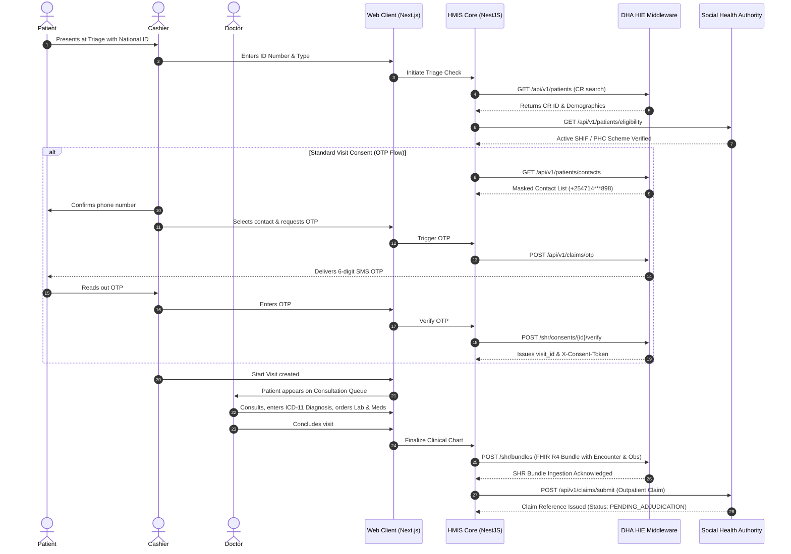
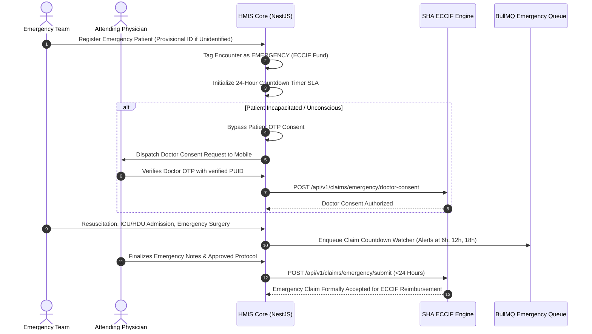

# COMKEY AFYA POA — External Integrations, Workflows & Background Processing Architecture

**Document Identifier:** `ARCH-INT-2026-V1`  
**System:** COMKEY AFYA POA (Multi-Tenant HMIS SaaS for Kenyan Healthcare Facilities)  
**Author:** Principal Software Architect & Healthcare Technology Compliance Researcher  
**Status:** Architecture Proposal (Awaiting Approval)  
**Date:** October 19, 2026  
**Pattern:** Hexagonal Ports & Adapters, Reactive State Machines, Event-Driven Queues  

---

## 1. Hexagonal Integration Architecture (Ports & Adapters)

To protect the internal clinical and financial core from external API changes, downtime, and protocol shifts in the **Digital Health Agency (DHA)** and **Social Health Authority (SHA)** platforms, all external communications are decoupled using the **Hexagonal Architecture (Ports and Adapters)** pattern.

```
+-----------------------------------------------------------------------------------------+
|                                    HEXAGONAL CORE BOUNDARY                              |
|                                                                                         |
|       [Clinical / Billing Domain]                                                       |
|                    |                                                                    |
|                    v                                                                    |
|       <<Port Interface>>                                                                |
|       - IDhaHieClient                                                                   |
|       - IShaClaimsClient                                                                |
|       - IKraEtimsClient                                                                 |
|                    |                                                                    |
+--------------------+--------------------------------------------------------------------+
                     |
         +-----------+-----------+
         |                       |
         v                       v
+------------------+    +-----------------------------------------------------------------+
| Mock / Unit Test |    | Live Adapter Implementation (NestJS Injectable)                 |
| Adapter Driver   |    |   - Automatically handles OAuth 2.0 token caching in Redis      |
| (Simulates live  |    |   - Dynamically injects multi-tenant X-Facility-Id headers      |
| responses &      |    |   - Routes to Mock, Sandbox/UAT, or Production based on config  |
| error codes)     |    |   - Translates internal domain exceptions to RFC 7807 payloads  |
+------------------+    +-----------------------------------------------------------------+
```

### 1.1 Switchable Environment Drivers
The application dynamically selects the adapter driver based on environment variables and tenant configuration:
* `HIE_DRIVER=mock`: Uses in-memory mock fixtures (used in local development and CI testing).
* `HIE_DRIVER=sandbox`: Routes requests to the official DHA/AfyaConnect Developer Sandbox (`https://hie-docs.dha.go.ke`).
* `HIE_DRIVER=production`: Routes requests to the production HIE gateway with client certificate authentication (mTLS) and production OAuth 2.0 keys.

---

## 2. Core Adapter Interfaces & Method Signatures

### 2.1 DHA HIE Port Interface (`IDhaHieClient`)

```typescript
export interface IDhaHieClient {
  /**
   * Searches the national Client Registry (CR) / Master Patient Index.
   */
  searchPatient(
    facilityKmflCode: string,
    idNumber: string,
    idType: 'NATIONAL_ID' | 'PASSPORT' | 'BIRTH_CERT' | 'SHA_ID'
  ): Promise<DhaPatientRegistryResult>;

  /**
   * Retrieves verified patient contacts for OTP consent.
   */
  getPatientContacts(
    facilityKmflCode: string,
    patientCrId: string
  ): Promise<DhaMaskedContact[]>;

  /**
   * Triggers an SMS OTP dispatch to the patient's verified contact.
   */
  requestConsentOtp(
    facilityKmflCode: string,
    patientCrId: string,
    contactId: number,
    visitType: 'OP' | 'IP'
  ): Promise<DhaConsentInitiationResult>;

  /**
   * Verifies the OTP entered by the patient and retrieves the visit consent token.
   */
  verifyConsentOtp(
    facilityKmflCode: string,
    consentId: string,
    otpRecord: string,
    otpCode: string
  ): Promise<DhaConsentVerificationResult>;

  /**
   * Submits a standardized FHIR R4 Collection Bundle to the Shared Health Record (SHR).
   */
  submitShrBundle(
    facilityKmflCode: string,
    bundle: FhirR4Bundle
  ): Promise<{ bundleId: string; status: 'INGESTED' | 'REJECTED'; errors?: string[] }>;

  /**
   * Reads clinical records from the SHR with visit-bound consent token.
   */
  fetchPatientShrRecords(
    facilityKmflCode: string,
    patientCrId: string,
    practitionerPuid: string,
    consentToken: string,
    resourceTypes: string[]
  ): Promise<FhirR4Resource[]>;
}
```

### 2.2 SHA Claims Port Interface (`IShaClaimsClient`)

```typescript
export interface IShaClaimsClient {
  /**
   * Evaluates patient eligibility and benefit entitlements across PHC, SHIF, ECCIF.
   */
  checkEligibility(
    facilityKmflCode: string,
    idNumber: string,
    idType: string
  ): Promise<ShaEligibilityResult>;

  /**
   * Fetches sub-benefits and intervention coverage rules.
   */
  getInterventionRules(
    facilityKmflCode: string,
    patientCrId: string,
    subBenefitCode: string
  ): Promise<ShaInterventionRule[]>;

  /**
   * Submits a normal or specialized pre-authorization request.
   */
  submitPreauthorization(
    facilityKmflCode: string,
    payload: ShaPreauthRequestPayload
  ): Promise<ShaPreauthResponse>;

  /**
   * Dispatches a finalized inpatient or outpatient claim to SHA adjudication.
   */
  submitClaim(
    facilityKmflCode: string,
    payload: ShaClaimSubmissionPayload
  ): Promise<ShaClaimSubmissionResponse>;

  /**
   * Initiates doctor consent OTP for emergency cases under ECCIF.
   */
  requestDoctorEmergencyConsent(
    facilityKmflCode: string,
    doctorPuid: string,
    emergencyCaseId: string
  ): Promise<{ status: 'DISPATCHED'; consentRecord: string }>;
}
```

---

## 3. Clinical Workflow & Data-Flow Diagrams

### 3.1 Standard Outpatient Workflow (PHC Capitation & SHIF Outpatient)



---

### 3.2 Emergency Department Workflow (ECCIF 24-Hour SLA)



---

## 4. Asynchronous Background Jobs & Queue Architecture (BullMQ)

High-volume operations, external API calls, and scheduled reconciliations are processed asynchronously via dedicated BullMQ queues backed by Redis:

```
+---------------------------------------------------------------------------------------+
|                                BULLMQ WORKER QUEUES                                   |
|                                                                                       |
|  [Queue 1: claims-dispatch]                                                           |
|    - Concurrency: 10                                                                  |
|    - Payloads: { tenantId, claimId, scenarioId, retryCount }                          |
|    - Backoff Strategy: Exponential (base: 2s, max: 5 retries)                         |
|    - Dead-Letter Queue (DLQ): claims-dispatch-dlq (triggers staff alert)              |
|                                                                                       |
|  [Queue 2: etims-fiscal-signing]                                                      |
|    - Concurrency: 5                                                                   |
|    - Payloads: { tenantId, invoiceId, items, grossAmount, vatAmount }                 |
|    - Behavior: Signs invoice payload with KRA VSCU API, writes back QR Control Code   |
|                                                                                       |
|  [Queue 3: shr-bundle-sync]                                                           |
|    - Concurrency: 8                                                                   |
|    - Payloads: { tenantId, encounterId, fhirBundleJson }                              |
|    - Behavior: Transmits FHIR R4 Bundle to DHA POST /shr/bundles                      |
|                                                                                       |
|  [Queue 4: sha-status-callback-processor]                                             |
|    - Concurrency: 15                                                                  |
|    - Payloads: Inbound webhook payloads from SHA                                      |
|    - Behavior: Updates claim status, notifies hospital credit controllers             |
|                                                                                       |
|  [Queue 5: emergency-sla-watcher] (Cron Scheduled)                                    |
|    - Runs every 15 minutes                                                            |
|    - Scans open ECCIF claims; triggers escalation SMS if age > 18 hours               |
+---------------------------------------------------------------------------------------+
```

---

## 5. Offline Continuity & Edge Store-and-Forward Pattern

Given internet reliability variability in Kenyan health facilities, COMKEY AFYA POA incorporates an offline edge resilience architecture:

```
+-------------------------------------------------------------------------------------+
|                      LOCAL BROWSER OFFLINE STORE-AND-FORWARD                        |
|                                                                                     |
|  [Point-of-Care Browser Client]                                                     |
|    - Service Worker intercepts requests when navigator.onLine === false             |
|    - Caches patient triage inputs into browser IndexedDB (AES-GCM encrypted)        |
|    - Applies local cryptographic timestamp                                          |
|                                                                                     |
|  [Connectivity Resumption]                                                          |
|    - Background Sync API fires                                                      |
|    - Replays queued triage admissions to API Gateway with original local timestamp  |
|    - API Gateway resolves conflicts using deterministic UUID generation (UUIDv5)    |
|    - Enqueues immediate priority sync to DHA/SHA                                    |
+-------------------------------------------------------------------------------------+
```

---

## 6. Financial Ledger & Remittance Advice Reconciliation

When SHA processes claims, remittance advice notifications are received via the status callback webhook:

1. **Callback Ingestion:** Webhook endpoint receives `REMITTANCE_ISSUED` containing `claim_id`, `approved_amount`, `deducted_amount`, `deduction_reasons[]`.
2. **Ledger Matching:** Billing folio transitions from `CLAIM_SUBMITTED` to `RECONCILED` or `PARTIALLY_RECONCILED`.
3. **Dispute Auto-Generation:** If `deducted_amount > 0`, the system automatically creates a draft appeal record pre-populated with clinical justification attachments for the facility claims officer to review and resubmit.
