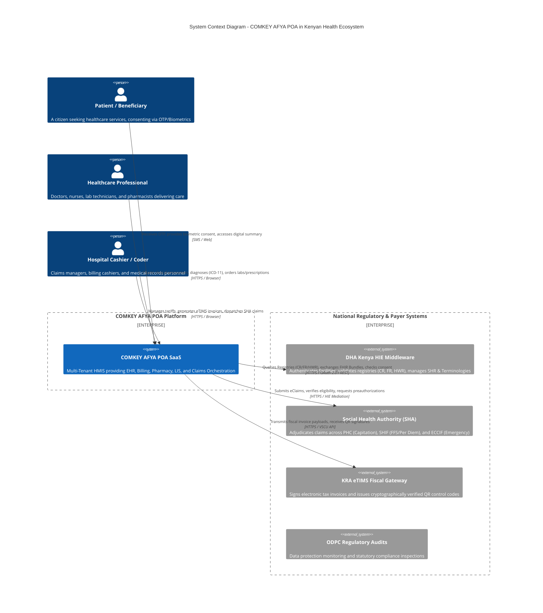
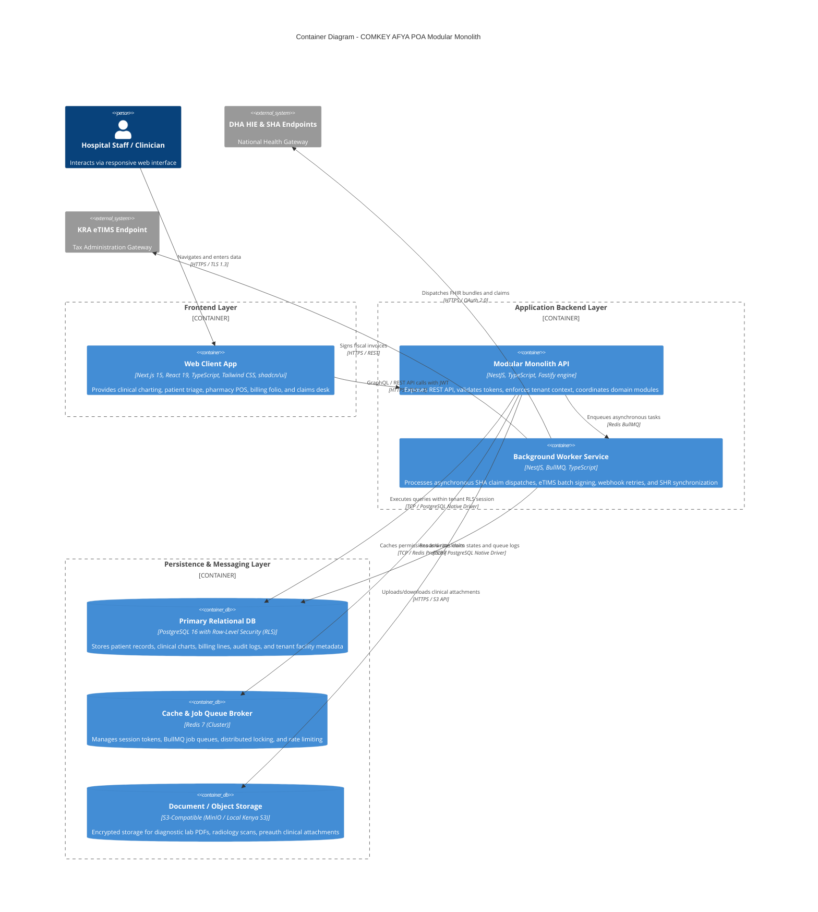

# COMKEY AFYA POA — Technical Architecture Overview & System Design

**Document Identifier:** `ARCH-OVW-2026-V1`  
**System:** COMKEY AFYA POA (Multi-Tenant HMIS SaaS for Kenyan Healthcare Facilities)  
**Author:** Principal Software Architect & Healthcare Technology Compliance Researcher  
**Status:** Architecture Proposal (Awaiting Approval)  
**Date:** October 19, 2026  
**Pattern:** Modular Monolith with Asynchronous Background Workers & Hexagonal Adapters  

---

## 1. Architectural Philosophy & Principles

COMKEY AFYA POA is engineered as an enterprise-grade, multi-tenant Hospital Management Information System (HMIS) software-as-a-service platform tailored to Kenyan healthcare facilities (Levels 2 through 6). The architecture is driven by six core design principles:

1. **Compliance by Design:** Strict technical alignment with the **Digital Health Act 2023**, **Social Health Insurance Act 2023**, **Data Protection Act 2019 (Regulation 26 data localization)**, and **Tax Procedures Act Section 23A (eTIMS)**.
2. **Modular Monolith First:** Domain boundaries are encapsulated within strict module boundaries sharing a single deployable unit for the core API, backed by dedicated BullMQ asynchronous workers. This avoids distributed transaction complexities and microservice overhead while enabling straightforward microservice extraction should scale demand it.
3. **FHIR R4 Semantic Native:** Healthcare entities are modeled internally with 1-to-1 semantic parity to HL7® FHIR® R4 and the national Kenya Core Implementation Guide (`fhir.dha.go.ke/core`), eliminating brittle impedance matching when interfacing with the national Shared Health Record (SHR).
4. **Resilient Multi-Tenancy:** Hard tenant isolation at the database layer utilizing PostgreSQL **Row-Level Security (RLS)** with session-level tenant variable binding, preventing accidental cross-tenant data contamination.
5. **Decoupled Payer Adapters (Hexagonal Architecture):** DHA Health Information Exchange (HIE) and SHA eClaims interfaces are implemented as ports-and-adapters with distinct Mock, Sandbox/UAT, and Production drivers, insulating the hospital core from external API volatility.
6. **Zero-Trust Security & Non-Repudiation:** Cryptographic audit trails, mandatory practitioner identification (`X-PUID`), visit-scoped consent tokens (`X-Consent-Token`), and field-level encryption for sensitive health parameters.

---

## 2. C4 Architecture Models

### 2.1 C4 Level 1: System Context Diagram

The System Context diagram illustrates how COMKEY AFYA POA fits within the Kenyan healthcare and regulatory ecosystem:



---

### 2.2 C4 Level 2: Container Diagram

The Container diagram reveals the high-level technology boundaries and storage components:



---

### 2.3 C4 Level 3: Component Diagram (Modular Monolith Core)

Inside the NestJS Modular Monolith, domain boundaries communicate via strictly defined internal interfaces, domain events, or direct service injections without cross-module database coupling:

```
+----------------------------------------------------------------------------------------------------+
|                                    NESTJS MODULAR MONOLITH CORE                                    |
|                                                                                                    |
|  +--------------------+   +---------------------+   +---------------------+   +-----------------+  |
|  | TenantContextModule|-->|  IdentityAuthModule |-->|    SecurityModule   |-->| AuditLogModule  |  |
|  | (RLS Session Inject|   |  (RBAC, MFA, JWT)   |   | (Field Encryption)  |   | (WORM Non-Repud)|  |
|  +--------------------+   +---------------------+   +---------------------+   +-----------------+  |
|            |                         |                         |                       |           |
|            +-------------------------+------------+------------+-----------------------+           |
|                                                   |                                                |
|                                                   v                                                |
|  +-----------------------------------------------------------------------------------------------+ |
|  |                                  CORE CLINICAL & HOSPITAL DOMAINS                             | |
|  |  +-------------------+  +-------------------+  +-------------------+  +--------------------+  | |
|  |  |  PatientRegistry  |  | EncounterEHRModule|  |  LaboratoryModule |  |   PharmacyModule   |  | |
|  |  |  (Master Index)   |  | (FHIR R4 Adapter) |  |   (LOINC Coding)  |  |  (PPB/HPT Catalog) |  | |
|  |  +-------------------+  +-------------------+  +-------------------+  +--------------------+  | |
|  |           |                      |                       |                       |            | |
|  |           v                      v                       v                       v            | |
|  |  +-----------------------------------------------------------------------------------------+  | |
|  |  |                                BillingFolioModule                                       |  | |
|  |  |  - Tracks patient folios, co-pays, fee-for-service items, capitation entitlements       |  | |
|  |  +-----------------------------------------------------------------------------------------+  | |
|  +------------------------------------------------+----------------------------------------------+ |
|                                                   |                                                |
|                                                   v                                                |
|  +-----------------------------------------------------------------------------------------------+ |
|  |                            OUTBOUND ADAPTERS & INTEGRATION SUBSYSTEMS                         | |
|  |  +------------------------------+  +------------------------------+  +---------------------+  | |
|  |  |       DhaHieAdapterModule    |  |      ShaClaimsAdapterModule  |  |   KraEtimsModule    |  | |
|  |  | - Client Registry Client     |  | - 8 Official Scenarios Engine|  | - VSCU Signer Client|  | |
|  |  | - Consent (OTP & Biometrics) |  | - Preauth State Machine      |  | - Tax Exempt Mapper |  | |
|  |  | - SHR FHIR Bundle Writer     |  | - 24h ECCIF Emergency Watcher|  | - Control Code / QR |  | |
|  |  | - Terminology Service Client |  | - Inpatient Discharge Hook   |  |                     |  | |
|  |  | - Multi-tenant Header Inject |  | - Asynchronous Callback Router| |                     |  | |
|  |  +------------------------------+  +------------------------------+  +---------------------+  | |
|  +-----------------------------------------------------------------------------------------------+ |
+----------------------------------------------------------------------------------------------------+
```

---

## 3. Monorepo Directory Structure

The project is structured as an industry-standard TypeScript monorepo using **Turborepo** and **pnpm workspaces**:

```
afya-poa/
├── .github/
│   └── workflows/
│       ├── ci.yml                 # Automated lint, test, FHIR conformance, contract verification
│       ├── cd-staging.yml         # Staging deployment to Kenyan VPC
│       └── cd-production.yml      # Blue/Green production deployment pipeline
├── apps/
│   ├── web/                       # Next.js 15 Web Client (Frontend)
│   │   ├── src/
│   │   │   ├── app/               # Next.js App Router pages (auth, triage, clinical, billing, claims)
│   │   │   ├── components/        # Reusable UI widgets built on shadcn/ui & Tailwind CSS
│   │   │   ├── hooks/             # Custom React hooks (useTenant, useDhaConsent, useShaClaim)
│   │   │   ├── lib/               # Client-side API clients, session management
│   │   │   └── styles/            # Tailwind theme tokens & global styles
│   │   ├── Dockerfile
│   │   └── package.json
│   ├── api/                       # NestJS Modular Monolith Backend (Primary API)
│   │   ├── src/
│   │   │   ├── app.module.ts      # Root application module orchestrating domain sub-modules
│   │   │   ├── main.ts            # Fastify entrypoint, OpenTelemetry bootstrapping, global filters
│   │   │   └── modules/           # Encapsulated Domain Modules (see Section 4)
│   │   ├── Dockerfile
│   │   └── package.json
│   └── worker/                    # NestJS / BullMQ Asynchronous Background Worker
│       ├── src/
│       │   ├── worker.module.ts
│       │   ├── main.ts
│       │   └── processors/        # Queue processors (claims dispatch, eTIMS signer, webhooks)
│       ├── Dockerfile
│       └── package.json
├── packages/
│   ├── fhir-types/                # Shared TypeScript definitions strictly aligned with FHIR R4 & Kenya Core
│   │   ├── src/
│   │   │   ├── bundle.ts
│   │   │   ├── encounter.ts
│   │   │   ├── patient.ts
│   │   │   ├── observation.ts
│   │   │   └── claims.ts
│   │   └── package.json
│   ├── database/                  # Prisma / Kysely ORM schemas, migrations, RLS initialization SQL
│   │   ├── migrations/            # Versioned SQL migrations including RLS policies
│   │   ├── schema.prisma          # Authoritative relational model specification
│   │   └── src/                   # Client factory injecting PostgreSQL tenant session settings
│   ├── logger/                    # Standardized OpenTelemetry + Pino structured JSON logger
│   ├── validation/                # Zod schemas for shared DTOs, eTIMS payloads, and DHA schemas
│   ├── eslint-config/             # Organization-wide linting and architectural boundaries
│   └── tsconfig/                  # Base TypeScript configurations
├── deploy/
│   ├── docker/                    # Local development docker-compose (PostgreSQL, Redis, MinIO)
│   └── terraform/                 # Infrastructure as Code (Kenyan data center / VPC provisioning)
│       ├── environments/
│       │   ├── dev/
│       │   ├── uat/
│       │   └── prod/
│       └── modules/
│           ├── compute/
│           ├── database/
│           └── storage/
├── docs/                          # Architecture, Regulatory, and Integration Specifications
│   ├── architecture/              # Complete System Architecture suite
│   ├── dha-requirements.md
│   ├── sha-integration-requirements.md
│   ├── regulatory-register.md
│   ├── open-questions.md
│   ├── assumptions-register.md
│   └── risks-register.md
├── pnpm-workspace.yaml
├── turbo.json
└── package.json
```

---

## 4. Domain Module Boundaries & Dependency Rules

To preserve structural integrity in the modular monolith, strict unidirectional dependency rules are enforced via ESLint boundaries (`eslint-plugin-import`):

```
+--------------------------------------------------------------------------------------+
|                           MODULE DEPENDENCY HIERARCHY RULES                          |
|                                                                                      |
|  [Core Platform Tier]          (TenantContext, Security, AuditLog, Common)           |
|          ^                                                                           |
|          | (Can be imported by any domain module)                                    |
|          |                                                                           |
|  [Clinical & Master Data Tier] (PatientRegistry, FacilityMaster, HealthWorkerMaster) |
|          ^                                                                           |
|          | (Can be imported by Clinical Encounter, Lab, and Pharmacy)                |
|          |                                                                           |
|  [Clinical Operations Tier]    (EncounterEHR, Laboratory, Pharmacy, Terminology)     |
|          ^                                                                           |
|          | (Can be imported by Billing Folio)                                        |
|          |                                                                           |
|  [Financial Operations Tier]   (BillingFolio, InvoiceEngine, eTIMS)                  |
|          ^                                                                           |
|          | (Can be imported by SHA Claims Orchestration)                             |
|          |                                                                           |
|  [External Integration Tier]   (DhaHieAdapter, ShaClaimsAdapter, KraEtimsAdapter)    |
|                                                                                      |
|  STRICT PROHIBITION: Outbound adapters MUST NEVER be imported by clinical core.     |
|  Domain operations publish Domain Events; adapters subscribe via EventBus.          |
+--------------------------------------------------------------------------------------+
```

### Module Responsibilities:
1. `TenantContextModule`: Extracts and validates the tenant facility from JWT or API gateway routing, binds `app.current_tenant_id` to the current PostgreSQL database transaction.
2. `PatientRegistryModule`: Maintains local patient records synchronized with the DHA Client Registry (`cr_id`).
3. `EncounterEHRModule`: Manages outpatient visits and inpatient admissions, clinical charting, vital signs, and FHIR collection bundle serialization.
4. `TerminologyModule`: Local caching and validation against ICD-11, LOINC, and ICHI catalogs, powering typeahead clinical search.
5. `BillingFolioModule`: Real-time accounting folio aggregating consults, bed-days, drug dispensations, and lab orders; segregates payer portions from patient co-pays.
6. `DhaHieAdapterModule`: Encapsulates OAuth 2.0 tenant tokens, `X-Facility-Id` header injection, consent checking, and Shared Health Record writes.
7. `ShaClaimsAdapterModule`: Implements the state machine for the 8 official integration scenarios, managing normal/specialized preauthorizations, doctor consent, and asynchronous status callbacks.
8. `KraEtimsModule`: Formats invoices into VSCU specification payloads, signs invoices, and retrieves QR verification control codes.
