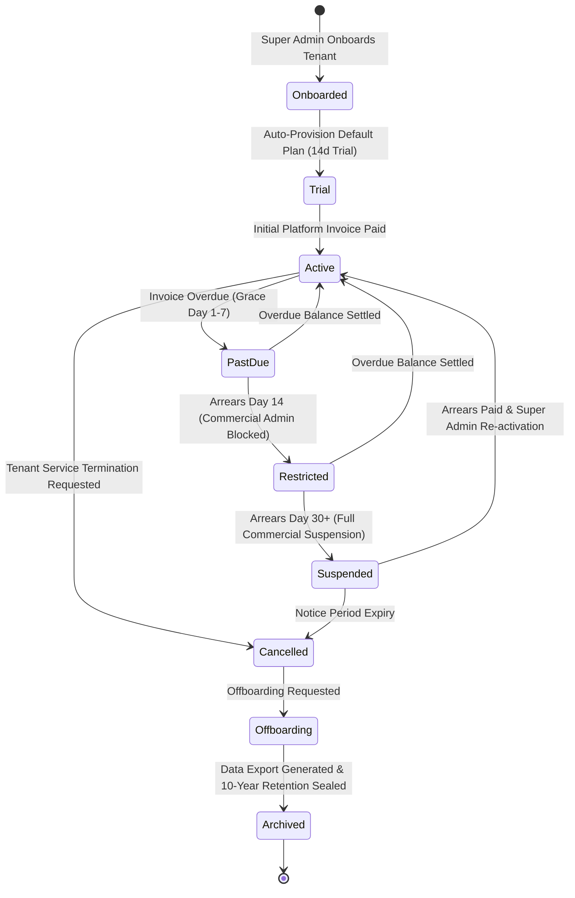
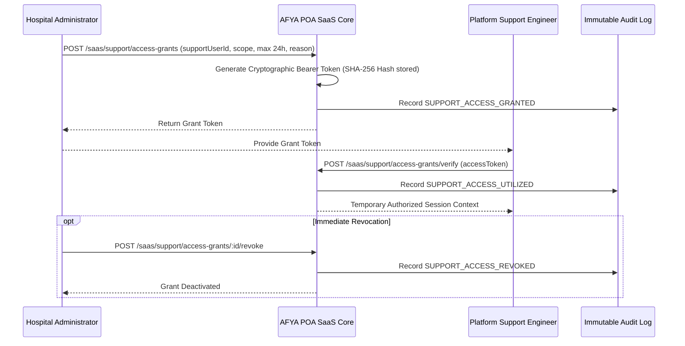

# COMKEY AFYA POA — Tenant Lifecycle, Service Suspension, & Statutory Patient Safety Policy

## 1. Executive Summary & Regulatory Authority

This policy defines the operational lifecycle, service suspension mechanisms, support access protocols, and data retention workflows for healthcare institutions operating on the COMKEY AFYA POA multi-tenant digital health platform.

**Statutory Compliance Foundations:**
- **Kenya Health Act, 2017 (Section 7)**: *"Every person has the right to emergency medical treatment... Health facilities shall not withhold emergency treatment on grounds of commercial or contractual disputes."*
- **Data Protection Act, 2019 (Sections 29 & 44)**: Lawful retention, secure processing, and controlled subject data portability for health records.
- **Digital Health Act, 2023**: Interoperability standards, client registry integrity, and health information exchange governance.

---

## 2. Tenant Onboarding & Facility Provisioning Lifecycle

### Onboarding Steps
1. **Tenant Organization Registration**: Super Admin creates the tenant entity with a unique alphanumeric code (`tenant-code`).
2. **Primary Facility Mapping**: Registers the primary health facility with its official Kenya Master Health Facility List (KMFL) code, KEPH Level (Level 2 to Level 6), County, and Sub-County.
3. **Primary Facility Administrator**: Creates the initial `FACILITY_ADMIN` account with temporary credentials and forced initial MFA enrollment.
4. **Automated Plan Assignment**: Automatically provisions the default subscription plan matching the facility's KEPH level and sets up initial feature entitlements.

---

## 3. Five-Stage Failed Payment Dunning Progression

When a recurring subscription renewal or platform invoice payment fails, the automated dunning engine executes a progressive, auditable 5-stage policy:

| Stage | Timing | Automated Action | Commercial Impact | Clinical Access Impact |
| :--- | :--- | :--- | :--- | :--- |
| **Stage 1: `INITIAL_FAILURE`** | Day 0 | Retry schedule initiated (3 retries across 48h) | Invoice flagged `PAST_DUE`; alert sent to Hospital Finance Officer | **No impact**; full clinical access |
| **Stage 2: `GRACE_DAY_3`** | Day 3 | First formal dunning notice dispatched to Admin and Finance | Commercial dashboard alert displayed | **No impact**; full clinical access |
| **Stage 3: `WARNING_DAY_7`** | Day 7 | Urgent dunning notice; escalation to Hospital Medical Superintendent | Warning banner displayed across administrative portals | **No impact**; full clinical access |
| **Stage 4: `RESTRICTED_DAY_14`** | Day 14 | Subscription transitioned to `RESTRICTED` | Commercial configuration locked: staff account creation, plan upgrades, and non-essential settings blocked | **No impact**; full clinical operations continue |
| **Stage 5: `SUSPENDED_DAY_30`** | Day 30 | Subscription transitioned to `SUSPENDED` | Commercial access suspended; billing and elective administrative modules disabled | **Protected under Section 7** (see below) |

---

## 4. Statutory Patient Safety & Lawful Record Access Policy

> [!IMPORTANT]
> **LEGAL & ETHICAL MANDATE (Section 7, Kenya Health Act, 2017)**:
> Under no circumstances shall COMKEY AFYA POA disable, revoke, or restrict clinician access to active patient records, allergy histories, medication profiles, diagnostic imaging, or emergency clinical workflows solely due to commercial subscription arrears or payment failure.

### Permitted Operational Restrictions During Suspension
When a tenant subscription is in `SUSPENDED` status:
- **BLOCKED (Commercial Administration)**:
  - Adding or onboarding new staff accounts.
  - Upgrading or changing subscription plan tiers.
  - Creating new operational branches or wards.
  - Commercial reporting and non-essential configuration.
- **PRESERVED (Clinical Safety & Record Access)**:
  - Reading existing patient medical records, encounter notes, and problem lists.
  - Documenting emergency triage and critical interventions.
  - Viewing active inpatient bed assignments and theatre procedure records.
  - Accessing critical laboratory and radiology diagnostic reports.
  - Generating continuity-of-care patient transfer summaries for inter-facility referral.

---

## 5. Account Recovery Procedures

A suspended or restricted tenant restores standard platform operations through the following recovery workflow:

1. **Self-Service M-Pesa Settlement**:
   - Hospital Finance Officer navigates to `/saas/invoices` and reviews outstanding balances.
   - Submits payment via M-Pesa STK push using the endpoint `/api/v1/saas/invoices/:id/pay`.
   - The platform adapter validates payment completion in real time.
2. **Automated Status Restoration**:
   - Upon payment confirmation, the invoice transitions to `PAID`.
   - The subscription status automatically reverts from `PAST_DUE` or `RESTRICTED` to `ACTIVE`.
   - Active entitlements are immediately re-enabled.
3. **Manual Administrative Release**:
   - For wire transfers or bank settlement reconciliations, the Super Admin verifies funds and executes `/api/v1/platform/subscriptions/:id/reactivate`.
   - Full audit event `SUBSCRIPTION_REACTIVATED` is permanently recorded.

---

## 6. Controlled, Auditable Support Access

COMKEY platform engineers do not possess ambient or permanent access to tenant clinical data. When troubleshooting technical issues, support access is granted exclusively through tenant authorization:

### Security Controls
- **Time-Bound**: Grants automatically expire after the requested duration (maximum 24 hours).
- **Scope-Constrained**: Scopes limited to `READ_ONLY`, `READ_WRITE`, or `TECHNICAL_CONFIG`.
- **Cryptographic Hashing**: Tokens are SHA-256 hashed at rest; raw tokens are never persisted in the database.
- **Immediate Revocation**: Hospital administrators can terminate an active grant instantly with one click.

---

## 7. Tenant Offboarding & 10-Year Data Retention Workflows

When a hospital facility disassociates from the platform (e.g., transition to a county referral trust):

1. **Formal Request**: Hospital Admin initiates an offboarding request with statutory retention parameters via `/api/v1/saas/offboarding/request`.
2. **Statutory 10-Year Archive Scheduling**:
   - Kenya Health Act 2017 requires hospital patient records to be retained for a minimum of **10 years** from date of creation.
   - The platform sets `clinicalDataRetentionUntil = Date.now() + 10 years`.
3. **Sealed Data Export Package**:
   - Super Admin triggers `/api/v1/platform/offboarding/requests/:id/export`.
   - An encrypted export bundle containing all clinical encounters, laboratory results, pharmacy orders, and patient demographics is packaged.
   - A cryptographic **SHA-256 checksum** is generated to ensure archival provenance and data integrity.
4. **Soft Archival**:
   - The tenant status transitions to `ARCHIVED`.
   - Active operational login access is disabled.
   - Read-only historical archive remains securely vaulted for the duration of the 10-year statutory window.
