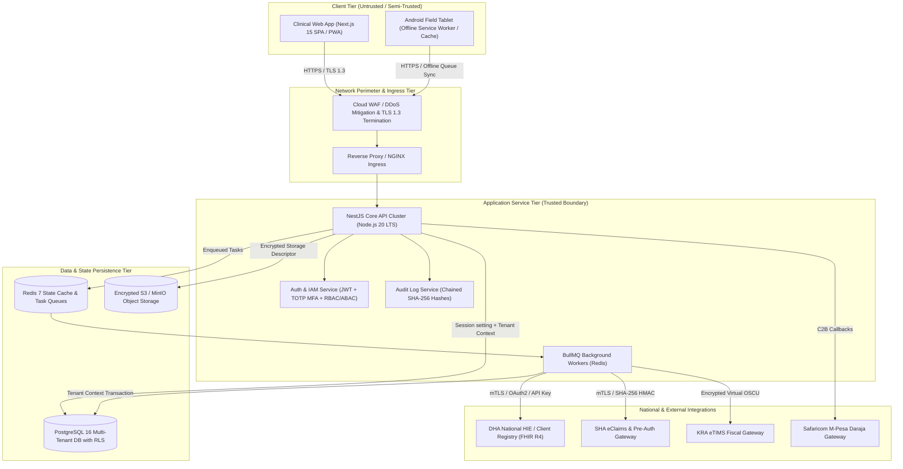

# COMKEY AFYA POA — Comprehensive Architecture Threat Model

**Document Reference:** SEC-TM-2026-V1  
**Target Baseline:** OWASP ASVS 4.0 Level 2 / STRIDE / Kenya Data Protection Act 2019 / Digital Health Act 2023  
**Classification:** Confidential — System Architecture & Security Assurance  

---

## 1. Executive Summary & Scope

COMKEY AFYA POA is a multi-tenant cloud-native Health Management Information System (HMIS) designed for Kenyan healthcare facilities across Levels 2 through 6 (Dispensaries, Health Centres, Sub-County Hospitals, County Referral Hospitals, and National Teaching & Referral Hospitals). 

The platform integrates directly with national health and revenue infrastructures:
- **Digital Health Agency (DHA) Health Information Exchange (HIE)** — Master Facility List (KMFL/MFL), Healthcare Worker Registry (HWR), and Client Registry (CR) utilizing FHIR R4 Core profiles.
- **Social Health Authority (SHA)** — eClaims, Benefit Packages, Pre-authorization, and Remittance reconciliation under the Social Health Insurance Act (SHIA) 2023.
- **Kenya Revenue Authority (KRA) electronic Tax Invoice Management System (eTIMS)** — Real-time and asynchronous invoice signing and cryptographically signed fiscal receipts under Section 23A of the Tax Procedures Act.
- **Telecommunications Mobile Money Gateways** — Safaricom Daraja M-Pesa C2B and STK Push endpoints.

This threat model identifies high-consequence threats across all architectural tiers, systematically evaluates threat actors and vectors using the **STRIDE** methodology, maps trust boundaries, and defines the controls required to prevent cross-tenant data leaks, unauthorized PHI disclosure, invoice fraud, and integration disruption.

---

## 2. System Decomposition & Data Flow Diagram (DFD)

### 2.1 Component Decomposition

### 2.2 Trust Boundaries

| Boundary ID | Demarcation | Protocol & Boundary Controls |
| :--- | :--- | :--- |
| **TB-01: Public Ingress** | Browser/PWA to Ingress WAF | Public Internet; TLS 1.3 strictly enforced; HSTS (31536000s, includeSubDomains, preload); Helmet CSP headers; Rate limiting (120 req/min per IP). |
| **TB-02: Tenant Isolation** | HTTP Request to Multi-Tenant Database | Header `x-tenant-id` untrusted unless caller is authenticated Platform Super-Admin. Non-superadmin requests resolve `tenantId` strictly from cryptographically verified JWT claims. In PostgreSQL, `FORCE ROW LEVEL SECURITY` isolates rows via `app.current_tenant_id`. |
| **TB-03: Asynchronous Queues** | NestJS Core API to Redis / BullMQ | Redis isolated on private VPC subnet with password authentication. Background payloads carry immutable `TenantJobPayload<T>` ensuring worker transactions re-bind to the designated tenant RLS session. |
| **TB-04: National Gateways** | Background Worker to DHA/SHA/eTIMS | Outbound egress through dedicated NAT gateway with static IP allowlisting. Mutual TLS (mTLS), asymmetric RSA/ECDSA signing, OAuth2 client credentials, and `assertSafeEnvironment()` guard blocking sandbox-to-production cross-calls. |
| **TB-05: Storage Perimeter** | API to Object Storage (S3/MinIO) | File storage keys enforced via `getTenantStoragePath()` prefixing `tenants/{tenantId}/` with recursive directory traversal sanitization. File content checksummed with SHA-256; AES-256-GCM server-side encryption. |

---

## 3. Threat Actor Profiling

| Threat Actor | Motivation | Capabilities | Target Assets |
| :--- | :--- | :--- | :--- |
| **External Cybercriminal / Ransomware Operator** | Financial extortion, sale of medical data on darknet | Advanced network scanning, credential stuffing, exploiting zero-day library vulnerabilities | PostgreSQL database, patient PHI, patient contact lists, storage buckets |
| **Malicious Insider (Disgruntled Staff / Nurse / Clinician)** | Curiosity, corporate espionage, revenge, unauthorized disclosure of VIP patient records | Legitimate internal credentials, physical access to clinic workstations | Patient records, VIP diagnoses, maternity records, prescription logs |
| **Corrupt Facility Administrator** | Financial fraud, cross-tenant data snooping, billing manipulation | Privileged tenant administrative account, user role assignment authority | Billing ledger, cash payments, claims pre-authorizations, audit trail records |
| **Rival Healthcare Provider / Commercial Espionage** | Competitor intelligence, market share analysis | Header spoofing, targeted phishing, tenant ID enumeration | Pricing catalogues, utilization metrics, patient volume, doctor rosters |
| **Compromised Field Device (Stolen Tablet / Unattended Terminal)** | Opportunistic data theft, session hijacking | Physical device access, browser local storage inspection, SQLite cache extraction | Cached patient demographics, pending offline triage notes, bearer tokens |

---

## 4. STRIDE Threat Analysis

### 4.1 Spoofing (Identity Threats)

| Threat ID | Threat Description | Attack Vector | Existing Controls & Verification | Residual Risk |
| :--- | :--- | :--- | :--- | :--- |
| **TM-S-01** | Attacker impersonates health worker using compromised credentials | Credential stuffing, brute-force against `/api/v1/auth/login` | Account lockout after 5 consecutive failures (15 min); TOTP MFA enforced for Super-Admin and Facility-Admin roles; Passwords hashed with bcrypt (salt cost 10). | Low (Medium if MFA is optional for basic nurses/clerks). |
| **TM-S-02** | Attacker impersonates another tenant via `x-tenant-id` header | Client injects `x-tenant-id: <Victim-Tenant-UUID>` in HTTP headers | `jwt.strategy.ts` line 72 ignores `x-tenant-id` unless `isSuperAdmin === true`. Authenticated tenant is locked to JWT `tenantId` claim. Verified by automated test 3.1. | Negligible. |
| **TM-S-03** | Attacker spoofs SHA callback endpoint to forge claim approvals | Forged webhook POST to `/api/v1/claims/sha/callback` | Webhook verification requires valid HMAC-SHA256 signature calculated with pre-shared integration secret. Unsigned callbacks rejected with 401. | Low. |

### 4.2 Tampering (Data Integrity Threats)

| Threat ID | Threat Description | Attack Vector | Existing Controls & Verification | Residual Risk |
| :--- | :--- | :--- | :--- | :--- |
| **TM-T-01** | Attacker tampers with clinical notes after consultation finalization | Direct SQL UPDATE or PUT request to finalized encounter note | `clinical_notes` uses append-only note amendments (`clinical_note_amendments`). Digital signature hash stored upon finalization; state transitions enforced via `workflow_state_transitions`. | Low. |
| **TM-T-02** | Attacker modifies audit trail to conceal unauthorized access | Direct SQL UPDATE or DELETE on `audit_events` | PostgreSQL `audit_events` table has WORM policies: `FOR SELECT` and `FOR INSERT` only. No UPDATE or DELETE policies exist. Each event has cryptographically chained SHA-256 hashes with advisory transaction locks. Verified by automated test 6.2. | Negligible. |
| **TM-T-03** | Attacker manipulates billing invoice line items before eTIMS signing | Tampering with prices or quantities in draft invoices | Financial transactions use optimistic concurrency locking via version counters. Adjustments require explicit supervisor authorization (`bill:adjust:authorize`). | Low. |

### 4.3 Repudiation (Accountability Threats)

| Threat ID | Threat Description | Attack Vector | Existing Controls & Verification | Residual Risk |
| :--- | :--- | :--- | :--- | :--- |
| **TM-R-01** | Clinician denies ordering a fatal dosage or accessing a patient file | Claiming someone else used workstation or denying click | Every clinical order records `orderingPractitionerId` and timestamp. Every patient record access logs user ID, purpose, IP address, and user agent to `patient_access_logs` and chained `audit_events`. | Low. Workstation auto-logout policy required on UI. |
| **TM-R-02** | Cashier denies receiving patient cash payment | Deleting payment record before end-of-day shift closure | Payments table is append-only with payment allocations and reversals. Daily cash drawer opening, closing, and supervisor sign-off recorded in `daily_reconciliations`. | Low. |

### 4.4 Information Disclosure (Confidentiality Threats)

| Threat ID | Threat Description | Attack Vector | Existing Controls & Verification | Residual Risk |
| :--- | :--- | :--- | :--- | :--- |
| **TM-I-01** | Cross-tenant patient record leakage via IDOR | Clinician in Tenant A queries `/api/v1/records/:id` with Tenant B record UUID | PostgreSQL `FORCE ROW LEVEL SECURITY` applies `tenant_id = current_setting('app.current_tenant_id')`. Tenant B row is invisible to database query, returning 404 Not Found. Verified by automated tests 2.3 & 2.4. | Negligible. |
| **TM-I-02** | Sensitive patient identifiers (National ID, Phone) leaked in database backup dump | Physical or unauthorized database dump compromise | All National IDs and phone numbers are encrypted with AES-256-GCM. Exact-match search uses deterministic HMAC-SHA256 blind indexing with a separate pepper key. Masked versions used for UI display. | Low (Subject to KMS key protection). |
| **TM-I-03** | PII and authentication credentials exposed in application logs | Error trace dumping request body or auth headers into Pino logs | `packages/logger` configures Pino redaction on `password`, `refreshToken`, `token`, `mfaSecret`, `pin`, `kraPin`, `authorization`, `phoneEncrypted`, `valueEncrypted`. Integration adapter logs use `sanitizeForLogging()`. | Low. |
| **TM-I-04** | Directory traversal in document storage allowing cross-tenant file download | Supplying `../../tenants/<other-id>/lab-report.pdf` | `getTenantStoragePath()` sanitizes all path inputs by stripping null bytes, normalizing slashes, and executing recursive while-loops eliminating `..` sequences before enforcing the `tenants/{tenantId}/` root prefix. Verified by automated test 7.1. | Negligible. |

### 4.5 Denial of Service (Availability Threats)

| Threat ID | Threat Description | Attack Vector | Existing Controls & Verification | Residual Risk |
| :--- | :--- | :--- | :--- | :--- |
| **TM-D-01** | API exhaustion via flood of unauthenticated requests | Distributed HTTP GET/POST flood against auth endpoints | Global NestJS `ThrottlerModule` configured with 120 req/min window. NGINX rate-limiting at ingress tier. Cloudflare WAF DDoS mitigation. | Low. |
| **TM-D-02** | Malicious compressed body crash in `body-parser` (CVE-2026-111181) | Single unauthenticated request with trailing bytes after compressed payload | Patched via pnpm overrides upgrading `body-parser` to `>=1.20.9`. NestJS ValidationPipe whitelisting enforced. | Negligible. |
| **TM-D-03** | Worker starvation via malformed FHIR payloads to HIE queue | Repeated submission of invalid bundles causing infinite retries | Circuit breaker pattern in `resilience.service.ts`; BullMQ jobs cap attempts at 3 before moving to Dead-Letter Queue (DLQ); Exponential backoff with jitter. | Low. |

### 4.6 Elevation of Privilege (Authorization Threats)

| Threat ID | Threat Description | Attack Vector | Existing Controls & Verification | Residual Risk |
| :--- | :--- | :--- | :--- | :--- |
| **TM-E-01** | Records officer escalates privileges to clinician or facility admin | Direct API call to modify own role in `/api/v1/users` | `PermissionsGuard` and `RolesGuard` verify required permissions (`user:role:assign`). Only `FACILITY_ADMIN` or `SUPER_ADMIN` can assign roles. Self-privilege modification is blocked. Verified by automated tests 4.1 & 4.2. | Negligible. |
| **TM-E-02** | Tenant administrator attempts to access SaaS platform management | Invoking `/api/v1/platform/tenants` | Protected by `@Roles(UserRole.SUPER_ADMIN)` and checked against `isSuperAdmin` boolean claim verified against database state in `JwtStrategy`. Rejected with 403. Verified by automated test 4.2. | Negligible. |
| **TM-E-03** | Emergency trauma bypass ("Break-Glass") exploited to inspect VIP records | Fraudulent use of Emergency Trauma Intake workflow | Emergency intake generates a distinct `isEmergencyUnknown: true` record with temporary pseudonym; does not grant retrospective access to existing sealed patient records. Cross-record merges require dual authorization. | Low. |

---

## 5. Threat Mitigation Matrix & Controls Mapping

| STRIDE Category | Threat Focus | Technical Mitigation Control | Primary Verification Mechanism |
| :--- | :--- | :--- | :--- |
| **S** | Tenant Spoofing | Strict JWT claim binding; `x-tenant-id` header ignored for all non-superadmin actors. | Vitest: `security-regression.spec.ts` (Test 3.1) |
| **T** | Audit Tampering | PostgreSQL RLS WORM policy (no UPDATE/DELETE); SHA-256 hash chaining with advisory locks. | Vitest: `security-regression.spec.ts` (Tests 6.1 & 6.2) |
| **R** | Action Repudiation | Mandatory `patient_access_logs` and `workflow_state_transitions` on all write and read actions. | Vitest: `patients.spec.ts` & `encounters.spec.ts` |
| **I** | Cross-Tenant Leakage | PostgreSQL `FORCE ROW LEVEL SECURITY` on all 87 tenant tables bound via `set_config('app.current_tenant_id', ...)`. | Vitest: `security-regression.spec.ts` (Tests 2.1 - 2.4) |
| **I** | PII at Rest Exposure | AES-256-GCM authenticated encryption; HMAC-SHA256 blind indexing for search; UI masking. | Vitest: `crypto.spec.ts` (16 tests) |
| **I** | Log Credential Leak | Pino structured logger configured with automatic PII/credential redaction paths. | Logger unit tests & security audit |
| **I** | File Path Traversal | Recursive traversal loop sanitization in `getTenantStoragePath()`. | Vitest: `security-regression.spec.ts` (Test 7.1) |
| **D** | DoS & Queue Poisoning | ThrottlerGuard (120 req/min); BullMQ retry caps (max 3); Circuit breakers on HIE/SHA adapters. | Vitest: `registry-resilience.spec.ts` |
| **E** | Privilege Escalation | NestJS `RolesGuard` & `PermissionsGuard` checking declarative `@RequirePermissions()`. | Vitest: `security-regression.spec.ts` (Tests 4.1 - 4.5) |

---

## 6. Review Cadence & Threat Model Governance

1. **Triggered Reviews:** This threat model must be updated whenever:
   - A new national integration endpoint is introduced (e.g., KEMSA supply chain integration, NHIF legacy migration).
   - Significant architectural refactoring occurs (e.g., transition from monolithic NestJS to microservices).
   - A critical security defect (CVSS >= 7.0) is identified during dynamic penetration testing or incident response.
2. **Periodic Reviews:** Conducted semi-annually by the Lead Security Architect and reviewed by the Data Protection Officer (DPO).
