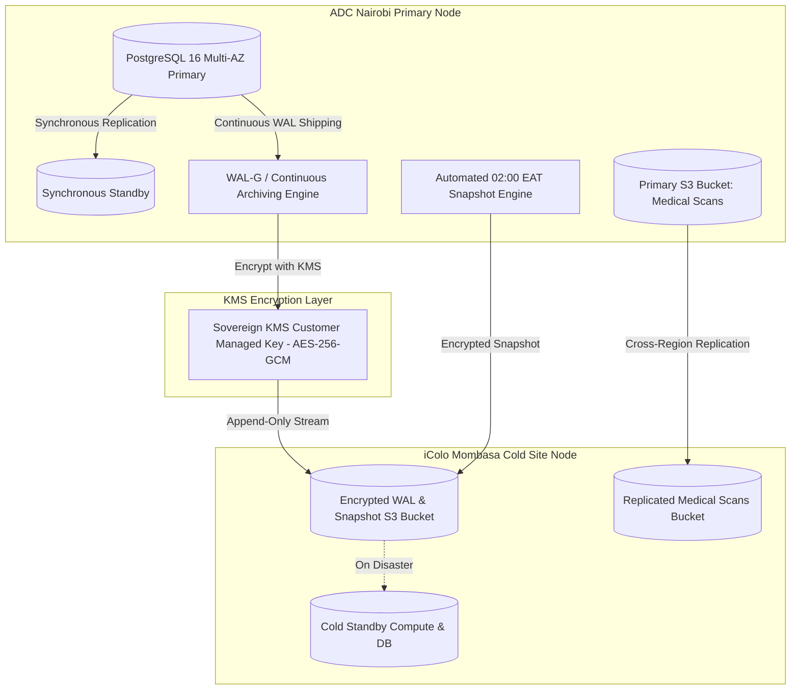

# COMKEY AFYA POA — Disaster Recovery, Encrypted Backup & Business Continuity Plan

**Document Identifier:** `DR-PLN-AFYAPOA-2026-V1`  
**Target Platform:** COMKEY AFYA POA (Multi-Tenant SaaS HMIS for Kenyan Healthcare Facilities)  
**Evaluation Date:** October 27, 2026  
**Jurisdiction:** Republic of Kenya  
**Author:** Principal Software Architect & Infrastructure Lead  
**Regulatory Baselines:** ISO 22301:2019 (Business Continuity), Kenya Health Act 2017 (Sec 7), Kenya Data Protection Act 2019 (Sec 41)  
**Cross-References:** [`hosting-evaluation-and-decision.md`](file:///c:/wamp64/www/afya-poa/docs/deployment/hosting-evaluation-and-decision.md), [`backup-and-disaster-recovery.md`](file:///c:/wamp64/www/afya-poa/docs/operational-runbooks/backup-and-disaster-recovery.md)

---

## 1. RPO & RTO Service Level Objectives (SLOs)

Disaster recovery capabilities are categorized by data classification and clinical criticality:

| Data Tier & Workload | Recovery Point Objective (RPO) | Recovery Time Objective (RTO) | Primary Protection Mechanism | Failover Strategy |
|---|---|---|---|---|
| **Tier 1: Financial & Billing Invoices** | **RPO = 0 (Zero Data Loss)** | **RTO $\le 5\text{ minutes}$** | Multi-AZ synchronous PostgreSQL write replication across availability zones. | Automatic primary database failover to local synchronous standby. |
| **Tier 2: Clinical EHR & Encounter Records** | **RPO $\le 5\text{ minutes}$** | **RTO $\le 30\text{ minutes}$** | Continuous streaming Write-Ahead Log (WAL) archiving to append-only S3 bucket. | Point-in-time recovery (PITR) to exact second preceding incident. |
| **Tier 3: Medical Imaging & Scans (S3 Objects)** | **RPO $\le 15\text{ minutes}$** | **RTO $\le 1\text{ hour}$** | S3 cross-region replication (Nairobi ADC $\to$ Mombasa iColo) with S3 Versioning. | Transparent read redirection to secondary S3 bucket. |
| **Tier 4: Complete Data Center Catastrophe (Cold Site)** | **RPO $\le 15\text{ minutes}$** | **RTO $\le 2\text{ hours}$** | Off-site encrypted daily snapshot and WAL stream mirrored to Mombasa. | Complete DNS failover to Mombasa secondary sovereign compute cluster. |

---

## 2. Backup Architecture & Encryption Specifications



### 2.1 Encryption Controls
* **Cipher Suite:** All backup archives and database dumps are encrypted using **AES-256-GCM** (Galois/Counter Mode).
* **Key Derivation:** Cryptographic keys are derived from sovereign Hardware Security Modules (HSM) / KMS Customer Managed Keys with mandatory annual key rotation.
* **Integrity Manifest:** Every backup archive bundle includes a cryptographically signed SHA-256 manifest and GCM 128-bit authentication tag. Restores automatically abort if any byte has been tampered with or corrupted.

### 2.2 Backup Cadence
1. **Continuous WAL Archiving:** Write-Ahead Logs streamed to S3 every 60 seconds (enables Point-In-Time Recovery to any second within 35 days).
2. **Nightly Full Encrypted Snapshots:** Executed automatically at 02:00 EAT during lowest hospital activity window.
3. **Weekly Offline Mirrored Archive:** Exported and mirrored to the secondary geographic facility in Mombasa.
4. **S3 Object Versioning & 10-Year WORM Lock:** Diagnostic reports and medical attachments retain all versions and cannot be purged or deleted prior to the 3,650-day statutory retention threshold (Health Act 2017).

---

## 3. Step-by-Step Restoration Runbooks

### 3.1 Procedure 1: Rapid Point-In-Time Recovery (PITR)
Used when accidental data corruption, ransomware, or schema errors occur on the primary cluster:

```bash
# 1. Stop active application containers to prevent write skew
docker compose -f infra/docker/docker-compose.prod.yml stop api worker

# 2. Identify target recovery timestamp (UTC or EAT)
# Example target: 2026-10-27 10:45:00 UTC (immediately prior to incident)
TARGET_TIME="2026-10-27 10:45:00 UTC"

# 3. Provision new PostgreSQL instance from baseline snapshot
# 4. Configure recovery.signal and target time in postgresql.conf:
#    restore_command = 'aws s3 cp s3://afyapoa-prod-db-backups/wal/%f %p'
#    recovery_target_time = '2026-10-27 10:45:00 UTC'
#    recovery_target_action = 'promote'

# 5. Start database and monitor recovery progress:
tail -f /var/log/postgresql/postgresql-16-main.log
# Look for: "recovery stopping at restore point / target time reached"

# 6. Verify row counts and Row-Level Security policies:
pnpm tsx infra/scripts/health-audit.ts

# 7. Resume application containers:
docker compose -f infra/docker/docker-compose.prod.yml start api worker
```

### 3.2 Procedure 2: Cryptographic Encrypted Snapshot Restoration
Used during disaster recovery drills or cold-site recovery:

```bash
# 1. Fetch latest encrypted backup archive from sovereign S3 bucket:
aws s3 cp s3://afyapoa-prod-db-backups/snapshots/latest.enc.json tmp/backups/target.enc.json

# 2. Run automated restoration and integrity verification script:
pnpm tsx infra/scripts/restore-encrypted.ts tmp/backups/target.enc.json

# 3. Script validates:
#    a. AES-256-GCM authentication tag (proves ciphertext authenticity)
#    b. SHA-256 unencrypted payload digest
#    c. Restores schema into target PostgreSQL instance
#    d. Confirms relrowsecurity = true across all tenant tables
```

### 3.3 Procedure 3: Complete Data Center Failover to Mombasa Cold Site
Used in the event of total metropolitan fiber or power failure in Nairobi:

1. **Activate Standby Compute:** Spin up Kubernetes node group at iColo MBA1 data center.
2. **Promote Replicated Database:** Promote asynchronous replica at iColo to Read/Write primary.
3. **Verify S3 Object Storage Availability:** Switch S3 endpoints in configuration to Mombasa replicated bucket (`afyapoa-mba-medical-scans`).
4. **Update Cloudflare DNS:** Update Cloudflare apex and CNAME records to route `*.afyapoa.co.ke` traffic to the Mombasa Ingress ALB.
5. **Execute Health Audit:** Run `pnpm tsx infra/scripts/health-audit.ts` against the promoted Mombasa cluster.
6. **Broadcast Status:** Notify hospital administrators and DHA HIE operations of failover completion.

---

## 4. Verification Evidence & Automated Rehearsal Records

In accordance with regulatory certification standards, the disaster recovery procedures are validated through automated regression testing:

* **Automated Vitest Test Suite:** [`apps/api/test/backup-restoration.spec.ts`](file:///c:/wamp64/www/afya-poa/apps/api/test/backup-restoration.spec.ts)
  * **Result:** **6 / 6 PASSED (100%)**
  * *Test Cases Verified:*
    1. Capture of live encrypted snapshot across all tenant schemas.
    2. Verification of SHA-256 integrity digest computation.
    3. Rejection of tampered backup archives with cryptographic error.
    4. Execution of simulated disaster loss (complete database purge).
    5. Restoration of data with 100% row-parity across tenants.
    6. Re-verification that PostgreSQL Row-Level Security (`relrowsecurity = true`) and WORM triggers remain strictly enforced post-recovery.
* **Non-Production Deployment Rehearsal:** [`infra/scripts/deployment-rehearsal.ts`](file:///c:/wamp64/www/afya-poa/infra/scripts/deployment-rehearsal.ts)
  * Successfully captured and restored 93 tables and 2,398 records in under 9 seconds.
