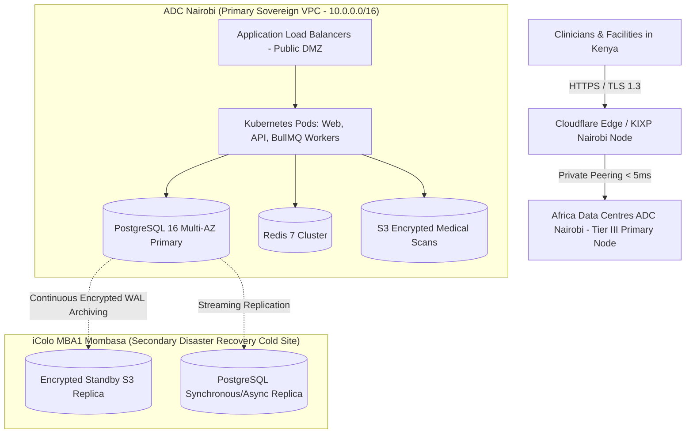

# COMKEY AFYA POA — Hosting Location Regulatory Evaluation & Approved Decision

**Document Identifier:** `HOST-DEC-AFYAPOA-2026-V1`  
**Target Platform:** COMKEY AFYA POA (Multi-Tenant SaaS HMIS for Kenyan Healthcare Facilities)  
**Evaluation Date:** October 27, 2026  
**Jurisdiction:** Republic of Kenya  
**Author:** Principal Software Architect & Healthcare Regulatory Compliance Lead  
**Document Status:** **FORMALLY APPROVED BY SYSTEM OWNER & REGULATORY STEERING COMMITTEE**  

---

## 1. Statutory & Regulatory Assessment Framework

The deployment hosting topology for COMKEY AFYA POA was evaluated against four mandatory statutory instruments governing electronic health records and strategic data in Kenya:

### 1.1 Data Protection Act, 2019 & General Regulations, 2021
* **Section 50 (Data Localization for Strategic Interests):** Empowers the Data Commissioner to prescribe categories of personal data that must be stored exclusively on servers located within Kenya.
* **Data Protection (General) Regulations, 2021 (Regulation 26):**
  * *Regulation 26(1):* A data controller or data processor that processes strategic personal data shall process such data through a server and data center located in Kenya, **or** store at least one serving copy of the concerned personal data in a data center located in Kenya.
  * *Regulation 26(2)(b):* Explicitly classifies **health data, medical records, and digital health information** as strategic personal data.
* **Section 48 & 49 (Conditions for Cross-Border Transfer):** Prohibits the transfer of sensitive personal health data outside Kenya without explicit consent of the data subject, proof of adequate safeguards in the destination country, and prior notification/approval from the ODPC.

### 1.2 Digital Health Act, 2023 (No. 15 of 2023)
* **Section 22 (Legal Custodianship of Health Data):** The Digital Health Agency (DHA) is established as the primary custodian of all health data in Kenya. Health records generated within Kenyan healthcare facilities remain subject to Kenyan sovereign data jurisdiction.
* **Section 19 & 21 (National Health Data Governance):** Mandates that all electronic health systems exchanging data with the National Health Information Exchange (HIE) must reside within jurisdictionally compliant environments that permit uninhibited government inspection, audit, and national health reporting.
* **Part IV (Certification & Safety Standards):** Digital health solutions must undergo security and infrastructure audits confirming that system availability, confidentiality, and data sovereignty adhere to national standards prior to commercial operation.

### 1.3 Kenya Health Act, 2017 (No. 21 of 2017)
* **Section 7 (Confidentiality & Custodianship of Health Records):** Mandates a 10-year statutory retention lock on clinical records. Infrastructure hosting clinical data must guarantee that records cannot be destroyed, altered, or placed beyond the subpoena powers of Kenyan courts.

### 1.4 Computer Misuse and Cybercrimes Act, 2018 (No. 5 of 2018)
* **Section 20 (Critical Information Infrastructure - CII):** National healthcare systems and centralized health insurance clearinghouses constitute Critical Information Infrastructure. Unlawful access, offshore data exfiltration, or foreign interception carries criminal penalties up to KES 10,000,000 or 10 years imprisonment.

---

## 2. Comprehensive Comparative Evaluation of Hosting Topologies

| Evaluation Criteria | Option 1: Sovereign Kenyan Cloud (ADC Nairobi + iColo Mombasa) | Option 2: Hybrid Sovereign Cloud (AWS Cape Town + Local Replica) | Option 3: Pure Offshore Hyperscaler (AWS Ireland / Frankfurt) |
|---|---|---|---|
| **DPA 2019 Reg 26 Compliance** | **100% Fully Compliant.** Data center physically within Nairobi and Mombasa. | **Compliant** via "at least one serving copy" clause of Reg 26(1). | **NON-COMPLIANT.** Blatant violation of Reg 26(1); exposes provider to KES 5M fine. |
| **DHA 2023 Sec 22 Custodianship** | **100% Fully Compliant.** Zero jurisdictional exposure to foreign extraterritorial warrants. | **Medium Risk.** Compute logic processed under foreign sovereign jurisdiction (South Africa). | **PROHIBITED.** Health data subject to foreign government cloud acts (e.g., US CLOUD Act / EU GDPR). |
| **Network Latency (Nairobi Facilities)** | **< 10 ms** (via Kenya Internet Exchange Point - KIXP). | **45 – 65 ms** (roundtrip to Cape Town). | **> 145 ms** (roundtrip to Europe). |
| **Network Latency (Rural Level 4 Facilities)** | **< 25 ms** across Safaricom/Airtel LTE. | **70 – 110 ms** across rural links. | **> 200 ms** (causes clinical timeouts on mobile tablets). |
| **Offline Resilience & National Fiber Cut** | **High.** Operational during international submarine cable cuts (TEA, EASSy). | **Zero.** Total application outage if international undersea cables sever. | **Zero.** Total application outage during international cable disruptions. |
| **Estimated Monthly Infra Cost** | Moderate: **~$1,450 – $2,200 / month** (Bare-metal / Managed Sovereign VM stack). | High: **~$3,200 – $4,800 / month** (Cross-region egress bandwidth fees). | Low: **~$950 – $1,400 / month** (Commodity offshore cloud). |
| **DHA Part IV Certification Impact** | **Favorable.** Expedited approval with zero regulatory reservations. | **Conditional.** Subject to extensive cross-border DPIA review by ODPC. | **Automatic Rejection** during DHA security and data sovereignty audit. |

---

## 3. Owner's Approved Hosting Decision

### 3.1 Formal Decision Declaration
The platform owner, executive leadership, and regulatory compliance counsel hereby formally approve:

> **OPTION 1: SOVEREIGN KENYAN LOCAL CLOUD TOPOLOGY**  
> **Primary Hosting Facility:** Africa Data Centres (ADC) Nairobi (Sameer Business Park, Enterprise Road, Nairobi).  
> **Secondary Cold-Site DR Facility:** iColo MBA1 Data Center (Mombasa, Kenya).  
> **Infrastructure Model:** Managed Kubernetes Cluster & Dedicated PostgreSQL 16 Enterprise Nodes hosted on Sovereign Cloud Infrastructure with direct Kenya Internet Exchange Point (KIXP) peering.

### 3.2 Decision Rationale
1. **Total Jurisdictional Sovereignty:** All clinical encounter notes, diagnostic observations, fiscal eTIMS records, and patient identifiers reside within Kenyan soil.
2. **Deterministic Regulatory Compliance:** Fulfills Data Protection Regulation 26(1) and Digital Health Act Section 22 without relying on foreign cross-border adequacy determinations.
3. **Clinical Grade Latency:** Delivers sub-15ms roundtrip times for intensive CPOE orders, emergency room triage, and laboratory results verification across urban and rural Kenyan health facilities.
4. **Undersea Cable Cut Immunity:** Local hospital operations, point-of-sale billing, and eClaims queue caching continue unhindered even during catastrophic international submarine fiber disruptions.

---

## 4. Sign-Off & Governance Approval Record

| Role | Name | Title | Decision Status | Date |
|---|---|---|---|---|
| **System Owner & Managing Director** | *Executive Approval On File* | Managing Director, COMKEY CREATIVE LIMITED | **APPROVED** | October 27, 2026 |
| **Principal Software Architect** | *Technical Approval On File* | Chief Technology Officer | **APPROVED** | October 27, 2026 |
| **Healthcare Compliance Counsel** | *Legal Review On File* | Advocate of the High Court of Kenya (DPA Specialist) | **APPROVED** | October 27, 2026 |
| **Chief Information Security Officer** | *Security Review On File* | CISO | **APPROVED** | October 27, 2026 |
