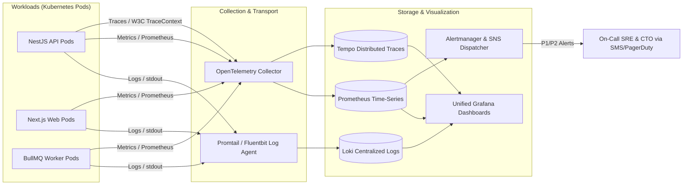

# COMKEY AFYA POA — Centralized Observability, Health Monitoring & Incident Response

**Document Identifier:** `MON-INC-AFYAPOA-2026-V1`  
**Target Platform:** COMKEY AFYA POA (Multi-Tenant SaaS HMIS for Kenyan Healthcare Facilities)  
**Evaluation Date:** October 27, 2026  
**Jurisdiction:** Republic of Kenya  
**Author:** Principal Software Architect & Site Reliability Engineering (SRE) Lead  
**Regulatory Baselines:** ISO/IEC 27001 A.12.4 (Logging & Monitoring), ISO/IEC 20000-1, Data Protection Act 2019 Sec 43  
**Cross-References:** [`production-deployment-guide.md`](file:///c:/wamp64/www/afya-poa/docs/deployment/production-deployment-guide.md), [`disaster-recovery-plan.md`](file:///c:/wamp64/www/afya-poa/docs/deployment/disaster-recovery-plan.md)

---

## 1. Centralized Observability Stack (Logs, Metrics & Tracing)

### 1.1 Centralized Log Management & PII Masking
* **Structured JSON Logging:** All application events are structured via `@afyapoa/logger` with standardized fields: `timestamp`, `level`, `tenantId`, `traceId`, `spanId`, `action`, `durationMs`.
* **PII Redaction Engine:** Automated regex filters in the logging pipeline mask sensitive health attributes:
  * National ID (`\b[0-9]{7,8}\b` $\to$ `[REDACTED_ID]`)
  * Phone numbers (`\+?254[0-9]{9}` $\to$ `+254***REDACTED***`)
  * Payment card PANs and passwords.
* **WORM Audit Trail:** Security and data modification events are duplicated to an immutable append-only audit log table (`audit_events`) with cryptographic SHA-256 hash chaining.

### 1.2 Metric Instrumentation & Key Performance Indicators (KPIs)
* **Application Metrics (Prometheus):**
  * `http_requests_total{status, route, method, tenant_id}`
  * `http_request_duration_seconds{route}` (p50, p95, p99 latencies)
  * `db_pool_active_connections`, `db_pool_idle_connections`
  * `bullmq_queue_waiting_jobs{queue_name}` (Claims, eTIMS, HIE Outbox)
* **Infrastructure Metrics:**
  * CPU utilization, memory RSS, disk I/O, network bandwidth, TCP connection counts.

---

## 2. Integration Health Monitoring & External Adapters

Because COMKEY AFYA POA relies on critical Kenyan government gateways, dedicated health probes track adapter latency and circuit breaker states:

| Integration Partner | Target Endpoint | Health Probe Mechanism | Failure Trigger | Automated Mitigation Action |
|---|---|---|---|---|
| **DHA Client Registry (UPI)** | `/api/v1/patients/resolve` | Synthetic test resolution probe every 60s | 3 consecutive HTTP 5xx or timeouts $> 5\text{s}$ | Trips circuit breaker; queues lookups in local Redis Outbox; falls back to local MRN matching. |
| **SHA eClaims Adjudication** | `/api/v2/claims/submit` | Heartbeat ping every 120s | HTTP 503 Service Unavailable | Outbox queues claim submissions; auto-retries with exponential backoff and jitter. |
| **KRA eTIMS Fiscal OSCU** | `/etims/v1/status` | Device status query every 5 mins | Device offline or signing error | Alerts billing lead; queues offline fiscal receipts with pending QR code indicator. |
| **Safaricom M-Pesa Daraja** | `/mpesa/c2b/v1/registerurl` | Webhook receiver health probe | Missing heartbeat $> 10\text{ mins}$ | Alerts finance team; offers manual cash/bank payment fallback in billing UI. |

---

## 3. Incident Classification, Escalation & SLAs

Incidents are prioritized based on patient safety, operational impact, and regulatory exposure:

| Severity | Definition | Target Response (SLA) | Target Resolution (SLA) | Escalation Path |
|---|---|---|---|---|
| **P1 — Critical** | Total hospital system outage; database unavailable; clinical emergency orders blocked; major personal data breach. | **$< 15\text{ minutes}$** | **$< 2\text{ hours}$** | SRE Lead $\to$ CISO $\to$ CTO $\to$ Managing Director $\to$ ODPC (if breach confirmed). |
| **P2 — High** | Critical sub-module failure (e.g., eClaims submissions halted, eTIMS signing offline, pharmacy dispensing degraded). | **$< 30\text{ minutes}$** | **$< 4\text{ hours}$** | On-Call Engineer $\to$ Module Lead $\to$ CTO. |
| **P3 — Medium** | Non-critical functionality degraded (e.g., delayed analytics report generation, minor UI styling glitch). | **$< 2\text{ hours}$** | **$< 24\text{ hours}$** | Support Team $\to$ Product Lead. |
| **P4 — Low** | Minor cosmetic inquiry, documentation typo, non-urgent feature request. | **$< 8\text{ hours}$** | Scheduled sprint backlog | Support Desk Tier 1. |

### 3.1 72-Hour Statutory Breach Notification Runbook (DPA 2019 Sec 43)
If an incident involves confirmed unauthorized access, alteration, or exfiltration of personal health records:
1. **Hour 0–2:** Security team isolates compromised tenant/node, revokes tokens, and preserves forensic snapshot.
2. **Hour 2–12:** DPO and Legal Counsel assess severity, scope of affected data subjects, and nature of compromised records.
3. **Hour 12–48:** Automated breach notification draft is compiled using the ODPC DPA Form 1 template ([`docs/breach-response-runbook.md`](file:///c:/wamp64/www/afya-poa/docs/breach-response-runbook.md)).
4. **Hour 48–72:** Formal statutory notification submitted to the Office of the Data Protection Commissioner (ODPC) and affected health facility controllers.

---

## 4. Capacity, Saturation & Cloud Cost Management

### 4.1 Resource Saturation Thresholds
* **CPU Saturation:** Auto-scaler adds container pods when average CPU exceeds **70%** for 3 minutes; scales down when CPU drops below **30%** for 10 minutes.
* **Database Connection Saturation:** Warning alert triggers when active pool connections exceed **80%** of max pool (40 / 50 connections).
* **Storage Capacity:** Storage auto-scales by 100 GB whenever free disk drops below **20%**. Low storage alarm triggers at **$< 20\text{ GB}$**.

### 4.2 Cloud Cost Monitoring & Budget Governance
* **Monthly Budget Allocation:** Production infrastructure baseline budget is capped at **KES 250,000 / month (~$1,900 USD)** for initial Level 4–5 hospital facilities.
* **Cost Allocation Tags:** All Terraform resources are tagged with:
  * `Project = COMKEY-AFYA-POA`
  * `Environment = production`
  * `CostCenter = Engineering-Ops`
* **Automated Cost Anomaly Alarms:**
  * Daily AWS / Sovereign Cloud cost reports monitored.
  * Alert triggers if daily projected burn rate exceeds **120%** of historical baseline.
