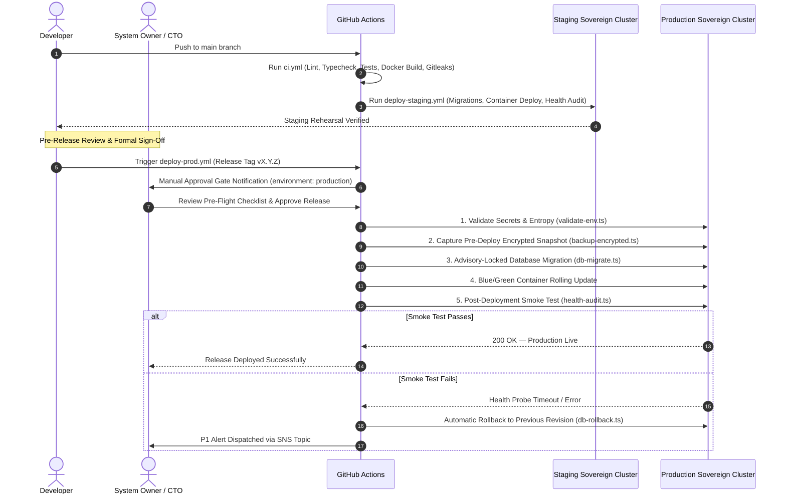

# COMKEY AFYA POA — Production Deployment Guide & Infrastructure Runbook

**Document Identifier:** `DEP-GDE-AFYAPOA-2026-V1`  
**Target Platform:** COMKEY AFYA POA (Multi-Tenant SaaS HMIS for Kenyan Healthcare Facilities)  
**Evaluation Date:** October 27, 2026  
**Jurisdiction:** Republic of Kenya  
**Author:** Principal Software Architect & DevOps Lead  
**Cross-References:** [`hosting-evaluation-and-decision.md`](file:///c:/wamp64/www/afya-poa/docs/deployment/hosting-evaluation-and-decision.md), [`disaster-recovery-plan.md`](file:///c:/wamp64/www/afya-poa/docs/deployment/disaster-recovery-plan.md), [`production-readiness-checklist.md`](file:///c:/wamp64/www/afya-poa/docs/deployment/production-readiness-checklist.md)

---

## 1. Environment Architecture & Isolation Hierarchy

COMKEY AFYA POA enforces strict multi-tier environment isolation across infrastructure, network, database, and integration boundaries:

| Environment | Purpose | Hosting Topology | Integration Mode | Database & State | Network Isolation |
|---|---|---|---|---|---|
| **Local Dev** | Developer workstation | Local Docker Compose | `MOCK` | Ephemeral `afyapoa_db` seeded with synthetic test data | `localhost`, loopback ports |
| **UAT Sandbox** | Automated regressions & hospital client walkthroughs | Isolated VPC (10.2.0.0/16) | `MOCK` (Simulated DHA/SHA/KRA) | `afyapoa_uat_db` with synthetic Kenya MOH patient profiles | Private subnet; mock APIs on internal ports |
| **Staging** | Pre-production rehearsal & connectathons | Staging VPC (10.1.0.0/16) | `UAT` (DHA/SHA staging sandboxes) | `afyapoa_staging_db` (Anonymized synthetic data only) | Private compute subnets with egress NAT to government sandboxes |
| **Production** | Live hospital clinical and financial operations | Sovereign VPC (10.0.0.0/16) ADC Nairobi Tier III | `PROD` (Live verified gateways) | `afyapoa_prod_db` Multi-AZ HA with KMS CMK encryption at rest | Strict DMZ, private compute, isolated database (zero direct internet) |

> [!CAUTION]
> **Strict Patient Data Isolation Mandate:**  
> Real patient health data, national identification numbers, and fiscal receipts must **NEVER** be imported into or processed within Local, UAT, or Staging environments. Staging and UAT rely exclusively on synthetic data generated via the approved synthetic patient journey toolchain.

---

## 2. Infrastructure as Code (Terraform) Deployment Workflow

The sovereign cloud infrastructure is immutably managed via Terraform under [`infra/terraform/`](file:///c:/wamp64/www/afya-poa/infra/terraform/).

### 2.1 Directory Structure
```
infra/terraform/
├── modules/
│   ├── vpc/             # Sovereign VPC, DMZ, Private & Isolated Subnets, Flow Logs
│   ├── kms/             # Customer Managed Keys (CMK) with automated annual rotation
│   ├── database/        # PostgreSQL 16 Multi-AZ HA Cluster with RLS & SCRAM-SHA-256
│   ├── redis/           # Redis 7 In-Memory Cluster with TLS & Auth
│   ├── object_storage/  # S3 Encrypted Medical Scans, 10-Yr Retention & Backup Buckets
│   ├── compute/         # ALB Ingress, TLS 1.3 Termination, Container Security Groups
│   └── monitoring/      # CloudWatch Logs, SNS Incident Alerting & Metric Alarms
└── environments/
    ├── prod/            # Production environment composition
    ├── staging/         # Staging environment composition
    └── uat/             # UAT environment composition
```

### 2.2 Terraform Provisioning Sequence
```bash
# 1. Navigate to target environment
cd infra/terraform/environments/prod

# 2. Initialize remote state backend and required providers
terraform init

# 3. Format and validate syntax
terraform fmt -check
terraform validate

# 4. Generate speculative execution plan
terraform plan -var-file="terraform.tfvars" -out="tfplan-prod"

# 5. Review plan and apply infrastructure changes (Requires SRE Lead credentials)
terraform apply "tfplan-prod"
```

---

## 3. Container Build, Hardening & Security Specifications

Container images for `@afyapoa/api`, `@afyapoa/web`, and `@afyapoa/worker` follow hardened multi-stage Docker builds:

### 3.1 Hardening Rules
1. **Unprivileged Non-Root User:** Containers execute as unprivileged user `appuser` (UID 10001, GID 10001) or `nextjs`. Running as root is strictly prevented.
2. **Process Reaper (`dumb-init`):** All containers use `/usr/bin/dumb-init` as PID 1 to ensure graceful propagation of `SIGTERM` and `SIGINT` signals, preventing zombie processes.
3. **Stripped Runtime Dependencies:** Development packages (`drizzle-kit`, `typescript`, `tsx`, `vitest`) are stripped via `pnpm prune --prod` prior to final container assembly.
4. **Standalone Next.js Bundle:** The frontend utilizes `output: 'standalone'` in Next.js, packaging only required server modules and eliminating the need for full `node_modules` in the web container.
5. **Read-Only Root Filesystems:** Container runtimes mount root partitions as read-only, using dedicated `/tmp` `tmpfs` mounts for temporary scratch files.
6. **No Stored Secrets:** No API keys, passwords, or pepper secrets exist in image layers. All configurations are injected dynamically at runtime via environment variables or secret volumes.

---

## 4. GitHub Actions CI/CD with Owner Approval Gates

The deployment pipeline is orchestrated via `.github/workflows/`:



### 4.1 Manual Owner Approval Enforcement
* The production workflow specifies `environment: production`.
* In GitHub Repository Settings $\to$ Environments $\to$ `production`:
  * **Required Reviewers:** Must include designated System Owner (Managing Director) and Chief Information Security Officer (CISO).
  * **Wait Timer:** 5-minute cooldown period between approval and deployment execution.
  * **Deployment Branches:** Restricted to protected release tags matching `refs/tags/v*.*.*`.

---

## 5. Zero-Downtime Database Migration & Rollback Runbook

### 5.1 Advisory-Locked Migration Execution
Database migrations are executed via [`infra/scripts/db-migrate.ts`](file:///c:/wamp64/www/afya-poa/infra/scripts/db-migrate.ts).
1. The runner attempts to acquire PostgreSQL session advisory lock `987654321`:
   ```sql
   SELECT pg_try_advisory_lock(987654321);
   ```
2. If another instance is running migrations, the process aborts immediately without race conditions.
3. Migrations apply non-blocking schema modifications (`CREATE TABLE IF NOT EXISTS`, `ADD COLUMN IF NOT EXISTS`, `CREATE INDEX CONCURRENTLY`).
4. Migration timestamp and execution duration are audited in the `schema_migrations` table.
5. Advisory lock is released in the `finally` block.

### 5.2 Rollback Safety Rules
* In accordance with Kenya Health Act 2017 (10-Year Record Retention) and DPA 2019:
  * **Destructive schema rollbacks (`DROP TABLE`, `DROP COLUMN`) are strictly forbidden in production.**
  * If a migration introduces a software defect, the deployment executes a **forward-fix migration** or sets redundant columns to nullable.
  * [`infra/scripts/db-rollback.ts`](file:///c:/wamp64/www/afya-poa/infra/scripts/db-rollback.ts) verifies that clinical tables (`patients`, `encounters`, `clinical_notes`, `claims`, `invoices`) are never dropped.

---

## 6. TLS, Secure Network Configuration & Access Restrictions

1. **Edge DDoS & WAF Protection:**
   * All ingress traffic passes through Cloudflare Enterprise with edge caching in Nairobi (KIXP).
   * Web Application Firewall (WAF) enforces OWASP Core Rule Set (CRS 3.3).
   * Rate limiting: Max 100 requests / minute per IP for public endpoints; max 10 requests / minute for authentication routes (`/auth/login`, `/auth/refresh`).
2. **TLS 1.3 Termination:**
   * Ingress Application Load Balancers enforce `ELBSecurityPolicy-TLS13-1-2-2021-06`.
   * Deprecated ciphers (TLS 1.0, 1.1, RC4, 3DES) are disabled.
   * HTTP port 80 requests are automatically redirected with `301 Moved Permanently` to HTTPS port 443 with `Strict-Transport-Security: max-age=63072000; includeSubDomains; preload` (HSTS).
3. **Database & Storage Network Isolation:**
   * PostgreSQL and Redis reside in private isolated subnets with **zero 0.0.0.0/0 internet gateway routing**.
   * Security groups permit ingress only from the compute security group on dedicated ports (5432 for Postgres, 6379 for Redis).

---

## 7. Centralized Logging, Observability & Tracing

* **Centralized Logs:**
  * Node.js application logs formatted in JSON via `@afyapoa/logger` and shipped to CloudWatch Logs / Loki (`/afyapoa/prod/api`, `/afyapoa/prod/web`, `/afyapoa/prod/worker`).
  * Sensitive PII fields (`nationalId`, `phone`, `password`, `cardNumber`) are masked before log output.
* **Metrics & Health Probes:**
  * Real-time metrics collected via Prometheus and displayed in Grafana dashboards.
  * Health endpoints:
    * `/health/live`: Container process liveness probe.
    * `/health/ready`: Dependency readiness probe (Postgres connection, Redis ping, disk storage).
* **Distributed Tracing:**
  * OpenTelemetry instrumentation traces transactions across Web $\to$ API $\to$ Database $\to$ DHA/SHA external adapters.

---

## 8. Deployment Verification Checklists

### 8.1 Pre-Deployment Verification Checklist
- [ ] Manual Owner Approval obtained in GitHub Actions environment.
- [ ] Change Request (CR) reference documented in ticketing system.
- [ ] Clean build and test pass on CI pipeline (`ci.yml`).
- [ ] Pre-flight environment validation passed (`pnpm tsx infra/scripts/validate-env.ts .env.production`).
- [ ] Pre-deployment encrypted snapshot captured and verified (`pnpm tsx infra/scripts/backup-encrypted.ts --tag pre-deploy`).
- [ ] Sovereign cloud hosting contracts active at Africa Data Centres Nairobi.

### 8.2 Post-Deployment Verification Checklist
- [ ] Container blue/green transition completed; 0 unhealthy targets reported on ALB.
- [ ] Health audit executed successfully (`pnpm tsx infra/scripts/health-audit.ts`).
- [ ] Synthetic test login verified on clinician dashboard.
- [ ] Outbox processor actively processing background jobs with latency $< 5\text{s}$.
- [ ] Error budgets and 5xx alarms normal on CloudWatch / Alertmanager.
- [ ] Release broadcast sent to hospital facility administrators.
