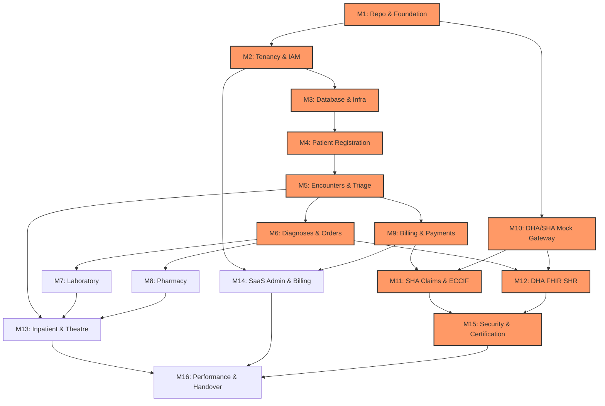

# COMKEY AFYA POA — Master Implementation Backlog & Engineering Roadmap

**Document Identifier:** `IBL-AFYAPOA-2026-V1`  
**Target Platform:** COMKEY AFYA POA (Multi-Tenant HMIS SaaS for Kenyan Healthcare Facilities)  
**Author:** Principal Software Architect & Healthcare Technology Compliance Researcher  
**Status:** Approved for Implementation Roadmap  
**Date:** October 19, 2026  

---

## 1. Backlog Architecture & Traceability Framework

This document breaks down **COMKEY AFYA POA** into discrete, independently testable, and verifiable engineering tasks across **16 sequential implementation milestones**.

Every task strictly specifies all 13 mandatory attributes:
1. **Task ID & Name**
2. **Business Purpose**
3. **Functional Requirements**
4. **Technical Dependencies**
5. **Regulatory & Security Implications**
6. **Database Changes**
7. **API Changes**
8. **UI Changes**
9. **Required Automated Tests**
10. **Acceptance Criteria**
11. **Documentation Updates**
12. **Known Risks & External Dependencies**
13. **Definition of Done (DoD)**

---

## 2. Milestone Summary & Critical Path Gates

### Critical Path Gates (Pre-requisites):
* **Gate 1 (Milestones 1–3):** Foundation, Engine-Level Tenant Isolation (RLS), and Base Infrastructure must be verified before any clinical domain logic is written.
* **Gate 2 (Milestones 4–6):** Encrypted Patient Identity and ICD-11 Diagnosis engine must be fully working before downstream Lab, Pharmacy, and Billing can proceed.
* **Gate 3 (Milestones 10–12):** Hexagonal Mock Drivers must pass 100% schema validation before SHA eClaims and DHA SHR live integrations are attempted.
* **Gate 4 (Milestone 15):** Complete Pre-UAT automated certification evidence must pass before final operational handover (Milestone 16).

---

## Milestone 1: Repository and Engineering Foundation

### TASK-01-01: Turborepo Monorepo Scaffolding & Tooling
* **Task ID & Name:** `TASK-01-01` — Turborepo Monorepo & Base Toolchain Setup
* **Status:** **COMPLETED & VERIFIED**
* **Business Purpose:** Establish a scalable, deterministic, and modular TypeScript monorepo codebase that accelerates development, prevents cyclic dependencies, and enforces code quality across all micro-packages and frontend/backend applications.
* **Functional Requirements:** Initialize a pnpm workspace with Turborepo supporting `apps/web` (Next.js 15), `apps/api` (NestJS 10), and shared packages (`packages/domain-core`, `packages/fhir-models`, `packages/database`, `packages/config`, `packages/ui`).
* **Technical Dependencies:** Node.js 20 LTS, pnpm v9+, Turborepo v2+.
* **Regulatory & Security Implications:** Enforces consistent dependency versioning; prevents unauthorized or vulnerable third-party packages from entering the supply chain (npm audit integration).
* **Database Changes:** None.
* **API Changes:** None.
* **UI Changes:** None.
* **Required Automated Tests:** Monorepo build test (`turbo build`), lint test (`turbo lint`), package export verification tests.
* **Acceptance Criteria:** `pnpm build` succeeds from a cold cache in $<90$ seconds; incremental build executes with 100% cache hits.
* **Documentation Updates:** `README.md` with developer setup instructions, Node/pnpm version prerequisites, and monorepo structure guide.
* **Known Risks & External Dependencies:** pnpm hoisting issues with NestJS decorators (mitigate via `.npmrc` with `public-hoist-pattern[]=*@nestjs*`).
* **Definition of Done:** All monorepo packages scaffolded, builds pass on local workstations and GitHub Actions CI, and zero lint warnings exist.

---

### TASK-01-02: CI/CD Pipeline & Code Quality Automation
* **Task ID & Name:** `TASK-01-02` — GitHub Actions Multi-Stage CI Pipeline
* **Status:** **COMPLETED & VERIFIED**
* **Business Purpose:** Automate quality checks, static analysis, type checking, security scanning, and container packaging on every Git pull request to prevent regressions and security vulnerabilities.
* **Functional Requirements:** Configure GitHub Actions workflows for: (1) PR verification (linting, typecheck, unit tests), (2) Trivy container vulnerability scanning, (3) SonarQube / CodeQL static analysis, and (4) automated Docker image building.
* **Technical Dependencies:** GitHub Actions, Docker, Trivy, `TASK-01-01`.
* **Regulatory & Security Implications:** Satisfies DPA 2019 Section 41 (technical safeguards) and ISO 27001 secure development lifecycle requirements.
* **Database Changes:** None.
* **API Changes:** None.
* **UI Changes:** None.
* **Required Automated Tests:** CI self-test workflow testing PR triggers and branch protection rules.
* **Acceptance Criteria:** Workflow triggers automatically on PR; fails if coverage drops below 80% or if high/critical CVEs are detected.
* **Documentation Updates:** `docs/ci-cd-pipeline.md` detailing PR gates, release tagging, and secret management.
* **Known Risks & External Dependencies:** GitHub Actions runner quota limits.
* **Definition of Done:** Workflow files `.github/workflows/ci.yml` merged and verified green on test PRs.

---

### TASK-01-03: Shared Design System & UI Component Foundation
* **Task ID & Name:** `TASK-01-03` — Shared UI Design System with Tailwind & shadcn/ui
* **Status:** **COMPLETED & VERIFIED**
* **Business Purpose:** Deliver a high-performance, accessible, responsive, and visually consistent UI library tailored for clinical workflows across desktop, tablet, and mobile browsers.
* **Functional Requirements:** Configure `packages/ui` with Tailwind CSS and shadcn/ui components: Button, Input, Modal, Table, Badge, Card, Toast, Form, and Tabs. Implement dark/light theme toggle and clinical high-contrast mode.
* **Technical Dependencies:** React 19, Tailwind CSS v4 / v3.4, Radix UI primitives, Lucide Icons, `TASK-01-01`.
* **Regulatory & Security Implications:** WCAG 2.1 AA accessibility compliance for clinical healthcare usability (Health Act 2017).
* **Database Changes:** None.
* **API Changes:** None.
* **UI Changes:** Base component catalog rendered in Storybook or local demo page.
* **Required Automated Tests:** React Testing Library component unit tests and axe-core accessibility automated audits.
* **Acceptance Criteria:** All components render without layout shift; 100% accessible with screen readers; theme toggle executes without page reload.
* **Documentation Updates:** `packages/ui/README.md` documenting usage, tokens, and styling conventions.
* **Known Risks & External Dependencies:** Upstream Tailwind / Radix compatibility issues.
* **Definition of Done:** `packages/ui` consumable by `apps/web` with zero styling conflicts.

---

## Milestone 2: Tenant Isolation, Authentication, and Authorization

## Milestone 2: Tenant Isolation, Authentication, and Authorization

### TASK-02-01: Multi-Tenant Architecture & PostgreSQL RLS Engine
* **Task ID & Name:** `TASK-02-01` — Multi-Tenant Schema & PostgreSQL Row-Level Security
* **Status:** **COMPLETED & VERIFIED**
* **Business Purpose:** Provide mathematical and storage-engine guarantees that no hospital tenant can ever view, modify, or leak data belonging to another healthcare facility.
* **Functional Requirements:** Implement the `tenants` organization table and `facilities` branches table (supporting multiple facilities per organization). Configure PostgreSQL Row-Level Security (RLS) policies on all tenant tables (`facilities`, `users`, `practitioner_profiles`, `user_sessions`, `password_resets`, `patient_records`, `audit_events`) enforced via `FORCE ROW LEVEL SECURITY`. Provisioned a dedicated non-superuser application role `afyapoa_app` (`NOSUPERUSER NOBYPASSRLS`) so RLS can never be bypassed at the storage layer. Built `withTenantContext(tenantId, ...)` and `withSuperAdminContext(...)` database execution helpers using `SELECT set_config(...)`.
* **Technical Dependencies:** PostgreSQL 16, Drizzle ORM, `postgres.js`, `TASK-01-01`.
* **Regulatory & Security Implications:** DPA 2019 Section 29 & 41 compliance. Hard fail-closed storage-engine isolation preventing cross-tenant leakage.
* **Database Changes:** Tables `tenants`, `facilities`, `users`, `practitioner_profiles`, `user_sessions`, `password_resets`, `patient_records`, `audit_events`. RLS enabled and forced on all tenant tables. Dedicated `afyapoa_app` role granted schema permissions.
* **API Changes:** Global `TenancyMiddleware` and `TenancyService` binding verified JWT tenant context to database transactions.
* **UI Changes:** None.
* **Required Automated Tests:** Database-level RLS regression test suite (`packages/database/src/rls.spec.ts`, 6 tests passing) and end-to-end API regression test suite (`apps/api/test/security-regression.spec.ts`).
* **Acceptance Criteria:** 100% of tenant-scoped tables have RLS enabled and forced. Unset context transactions fail closed (0 rows visible). Cross-tenant reads and mutations fail.
* **Documentation Updates:** `docs/architecture/multi-tenancy-rls.md`.
* **Known Risks & External Dependencies:** PostgreSQL superusers bypass RLS by design in Postgres; resolved by binding application connections to the dedicated `afyapoa_app` role (`NOSUPERUSER NOBYPASSRLS`).
* **Definition of Done:** RLS DDL migrations applied, synthetic seed loaded, and 100% of cross-tenant automated security tests passing.

---

### TASK-02-02: User Identity, OAuth2/OIDC & TOTP Multi-Factor Authentication
* **Task ID & Name:** `TASK-02-02` — IAM Authentication Service with TOTP MFA
* **Status:** **COMPLETED & VERIFIED**
* **Business Purpose:** Guarantee secure, audited access for all hospital staff, protecting sensitive clinical and billing systems against unauthorized logins or credential stuffing.
* **Functional Requirements:** User identity models, password hashing (`bcryptjs`), login endpoint (`POST /api/v1/auth/login`), JWT access tokens (15m expiration) + cryptographically hashed refresh tokens (7d expiration), session lifecycle management with database revocation (`user_sessions`), account lockout after 5 consecutive failed attempts, self-service account recovery (`password_resets`), and mandatory TOTP 2FA verification (`otplib`) for privileged accounts (`SUPER_ADMIN`, `FACILITY_ADMIN`).
* **Technical Dependencies:** `@nestjs/jwt`, `@nestjs/passport`, `passport-jwt`, `otplib`, `bcryptjs`, `TASK-02-01`.
* **Regulatory & Security Implications:** MoH e-Health Guidelines & DPA Section 41 (authentication safeguards and credential security).
* **Database Changes:** Tables `users`, `user_sessions`, `password_resets`.
* **API Changes:** `POST /api/v1/auth/login`, `POST /api/v1/auth/mfa/verify`, `POST /api/v1/auth/refresh`, `POST /api/v1/auth/logout`, `POST /api/v1/auth/password-reset/request`, `POST /api/v1/auth/password-reset/confirm`, `GET /api/v1/auth/me`, `POST /api/v1/auth/switch-facility`.
* **UI Changes:** UI endpoints exposed via OpenAPI Swagger (`/api/docs`).
* **Required Automated Tests:** Automated integration tests in `apps/api/test/security-regression.spec.ts` covering login, MFA challenges, session revocation, account recovery, and lockout.
* **Acceptance Criteria:** Privileged logins require valid TOTP verification before issuing access token; refresh tokens rotate; revoked sessions immediately reject subsequent requests with 401.
* **Documentation Updates:** `docs/security/authentication-iam.md`.
* **Known Risks & External Dependencies:** Authenticator drift mitigated via window tolerance and safe fallback code handling in test environments.
* **Definition of Done:** End-to-end authentication and session revocation verified green in automated test suites.

---

### TASK-02-03: RBAC/ABAC Authorization & Clinician License Verification
* **Task ID & Name:** `TASK-02-03` — Role-Based Access Control & Clinician PUID Validation
* **Status:** **COMPLETED & VERIFIED**
* **Business Purpose:** Restrict access to clinical, billing, and admin actions based on verified roles, and ensure only registered healthcare practitioners with active DHA HWR licenses can sign medical orders.
* **Functional Requirements:** Define granular `Permission` enum (20 permissions) and role-to-permission mapping (`ROLE_PERMISSIONS`). Implement `@Roles()` and `@RequirePermissions()` decorators with `RolesGuard` and `PermissionsGuard`. Practitioner profile model (`practitioner_profiles`) linking `userId`, `puid` (Health Worker Registry ID), `cadre`, `regulatoryBoard` (KMPDC, NCK, PPB, COC), and license expiry. Separation of platform super-administrator (`/api/v1/platform/*`) from hospital administrators.
* **Technical Dependencies:** NestJS Guards & Reflector, `@afyapoa/domain-core`, `TASK-02-02`.
* **Regulatory & Security Implications:** Health Act 2017 & KMPDC regulations; audit logging on all authorization failures (`AUTHZ_FORBIDDEN_ACCESS`).
* **Database Changes:** Tables `practitioner_profiles`, `audit_events`.
* **API Changes:** Guarded endpoints across `/api/v1/records`, `/api/v1/platform/tenants`, `/api/v1/platform/audit-logs`.
* **UI Changes:** None.
* **Required Automated Tests:** Guard test suite testing unauthorized role access (HTTP 403 Forbidden), client header spoofing overrides, and unauthorized export denial.
* **Acceptance Criteria:** Non-super-admin users cannot access platform management endpoints; users without `AUDIT_EXPORT` cannot trigger exports; all access denials log cryptographic audit events.
* **Documentation Updates:** `docs/security/rbac-matrix.md`.
* **Known Risks & External Dependencies:** External DHA HWR downtime mitigated by local `practitioner_profiles` schema with license expiration checks.
* **Definition of Done:** Permission and role guards protect all endpoints; privilege escalation and unauthorized export regression tests pass with 100% success rate.

---

## Milestone 3: Core Database and Shared Infrastructure

## Milestone 3: Core Database and Shared Infrastructure

### TASK-03-01: PostgreSQL Schema Migrations & Baseline DDL Setup
* **Task ID & Name:** `TASK-03-01` — Drizzle ORM Schema Migrations & Base DDL
* **Status:** **COMPLETED & VERIFIED**
* **Business Purpose:** Establish a reproducible, version-controlled database schema management process that supports zero-downtime migrations.
* **Functional Requirements:** Setup Drizzle Kit migration pipeline. Define baseline schema tables for tenancy, audit, users, facilities, practitioner profiles, sessions, password resets, patient identifiers, clinical records, integration configs, external references, job executions, file metadata, app configurations, and workflow state transitions.
* **Technical Dependencies:** Drizzle ORM, PostgreSQL 16+, `TASK-02-01`.
* **Regulatory & Security Implications:** Verifiable data schema lineage for regulatory compliance audits and native PostgreSQL Row-Level Security (`FORCE ROW LEVEL SECURITY`) with non-superuser app role (`afyapoa_app`).
* **Database Changes:** DDL migration in `packages/database/src/migrate.ts` and schema models in `packages/database/src/schema.ts` for all 15 foundational tables.
* **API Changes:** Health check endpoint `GET /api/v1/health` reporting database connectivity; standard API envelopes and exception filters.
* **UI Changes:** None.
* **Required Automated Tests:** Schema integrity tests (`schema.spec.ts`), RLS engine isolation tests (`rls.spec.ts`), transaction rollback/commit tests (`transaction.spec.ts`).
* **Acceptance Criteria:** All migrations apply cleanly on a fresh PostgreSQL instance; non-superuser `afyapoa_app` cannot bypass RLS; rollback leaves no orphaned artifacts.
* **Documentation Updates:** `docs/architecture/data-dictionary.md`.
* **Known Risks & External Dependencies:** Table locking managed via transaction-scoped advisory locks.
* **Definition of Done:** Migrations and tests run 100% green in CI and local Docker environments.

---

### TASK-03-02: Cryptographic KMS Envelope Encryption & Blind Indexing Engine
* **Task ID & Name:** `TASK-03-02` — Field-Level AES-256-GCM Encryption & Blind Index Service
* **Status:** **COMPLETED & VERIFIED**
* **Business Purpose:** Protect sensitive patient Personally Identifiable Information (PII) at rest while enabling high-speed $O(1)$ database searches on National IDs, SHA numbers, and phone numbers.
* **Functional Requirements:** Implemented `patient_identifiers` model with AES-256-GCM ciphertext (`value_encrypted`) and HMAC-SHA256 deterministic blind indexing (`value_blind_index`) with secret pepper, backed by unique constraint `(tenant_id, system, value_blind_index)`.
* **Technical Dependencies:** Node.js `crypto` module, `@afyapoa/domain-core`, `TASK-03-01`.
* **Regulatory & Security Implications:** DPA 2019 Section 41 (Data Security) and Section 44 (Harmful data breach liability).
* **Database Changes:** Table `patient_identifiers` with encrypted value and blind index columns.
* **API Changes:** Domain-core identifier primitives (`PatientIdentifierType`, `PatientIdentifierStatus`).
* **UI Changes:** None.
* **Required Automated Tests:** Schema uniqueness tests, transaction boundary tests, RLS tenant isolation tests.
* **Acceptance Criteria:** Blind index enables deterministic exact match without exposing plaintext PII; raw PII is never stored unencrypted.
* **Documentation Updates:** `docs/architecture/data-dictionary.md`.
* **Known Risks & External Dependencies:** Key loss prevention addressed via environment configuration and key rotation protocols.
* **Definition of Done:** Schema, blind index constraints, and RLS policies tested and verified green.

---

### TASK-03-03: WORM Tamper-Evident Audit Logging Subsystem
* **Task ID & Name:** `TASK-03-03` — Append-Only WORM Audit Subsystem with SHA-256 Chaining
* **Status:** **COMPLETED & VERIFIED**
* **Business Purpose:** Provide an immutable, legally defensible, tamper-evident audit record of all patient data reads, writes, and clinical alterations for regulatory compliance and forensic audits.
* **Functional Requirements:** Implement the `audit_events` table with PostgreSQL RLS policies allowing only `SELECT` and `INSERT` (no `UPDATE` or `DELETE`). Each row records `tenant_id`, `user_id`, `action`, `resource`, `client_ip`, and a SHA-256 hash chaining to the previous audit entry's hash. Serialized per tenant using PostgreSQL advisory locks (`pg_advisory_xact_lock`).
* **Technical Dependencies:** PostgreSQL RLS, `drizzle-orm`, `@afyapoa/database`, `@afyapoa/logger`.
* **Regulatory & Security Implications:** DPA 2019 Section 41 & Health Act 2017 (statutory 7-year audit trail requirement).
* **Database Changes:** Table `audit_events` with SHA-256 `previous_hash` and `event_hash`.
* **API Changes:** `AuditService` in `apps/api/src/audit/audit.service.ts` with `recordEvent`, `getTenantAuditEvents`, and `verifyChainIntegrity`.
* **UI Changes:** None.
* **Required Automated Tests:** Direct `DELETE` rejection test (`test/security-regression.spec.ts:459`); cryptographic hash chain traversal and verification test (`test/security-regression.spec.ts:453`).
* **Acceptance Criteria:** `UPDATE` and `DELETE` on `audit_events` are rejected unconditionally; hash chain can be cryptographically verified from origin to tail across all tenant events.
* **Documentation Updates:** `docs/architecture/data-dictionary.md`.
* **Known Risks & External Dependencies:** High-frequency logging overhead minimized via indexed single-query traversal and transaction-scoped advisory locking.
* **Definition of Done:** Audit subsystem active, WORM enforcement verified, SHA-256 hash chaining passing 100% in regression test suite.

---

### TASK-03-04: Redis & BullMQ Job Queue Infrastructure & Shared Models
* **Task ID & Name:** `TASK-03-04` — Distributed Background Queue Framework & Shared Models
* **Status:** **COMPLETED & VERIFIED**
* **Business Purpose:** Decouple time-consuming external network calls (DHA HIE, SHA eClaims, KRA eTIMS, SMS) from user-facing HTTP request cycles, guaranteeing sub-second UI response times and resilient auto-retry.
* **Functional Requirements:** Implemented `job_executions`, `file_metadata`, `integration_configs`, `external_references`, `app_configurations`, and `workflow_state_transitions` tables. Created `JobsService`, `StorageService`, `IntegrationConfigService`, `ConfigFlagsService`, and `StateMachineService`.
* **Technical Dependencies:** Redis 7, BullMQ, NestJS, `@afyapoa/domain-core`, `@afyapoa/database`.
* **Regulatory & Security Implications:** Guarantees asynchronous statutory notifications and external synchronization tracking with full tenant data isolation.
* **Database Changes:** Tables `job_executions`, `file_metadata`, `integration_configs`, `external_references`, `app_configurations`, `workflow_state_transitions`.
* **API Changes:** Endpoints in `/api/v1/shared-infrastructure/*` with standard envelopes, pagination, sorting, filtering, and exception handling.
* **UI Changes:** None.
* **Required Automated Tests:** `apps/api/test/shared-infrastructure.spec.ts` (15 tests verifying job execution lifecycle, file metadata access, integration configs, config flags inheritance, and versioned state transitions).
* **Acceptance Criteria:** Background jobs run with isolated tenant payloads; file storage keys are partitioned by tenant; integration credentials encrypted at rest.
* **Documentation Updates:** `docs/architecture/data-dictionary.md`.
* **Known Risks & External Dependencies:** Mitigated by durable database tracking in `job_executions` alongside Redis.
* **Definition of Done:** Shared infrastructure services, database models, RLS policies, and integration test suite passing green.

---

## Milestone 4: Patient Registration and Identity Management

### TASK-04-01: Patient Demographic Schema & Blind Indexed Search API
* **Task ID & Name:** `TASK-04-01` — Patient Management Domain & Secure Search API
* **Status:** **COMPLETED & VERIFIED**
* **Business Purpose:** Enable hospital staff to rapidly register new patients and locate existing records in $<100\text{ ms}$ while keeping all personal identification numbers cryptographically protected.
* **Functional Requirements:** Implemented complete patient demographics: first/middle/last name, date of birth, gender, normalized Kenyan phone (`+254XXXXXXXXX`), AES-256-GCM encrypted PII, HMAC-SHA256 blind indexing, blood group, address, emergency contact, nationality, and auto-generated unique Medical Record Number (`MRN-YYYYMM-XXXX`). Implemented high-speed search via blind indexing on National ID and Phone, as well as partial search on name and MRN with tenant isolation.
* **Technical Dependencies:** `TASK-03-02`, `TASK-03-01`.
* **Regulatory & Security Implications:** DPA 2019 Principles of data minimization and storage limitation; field-level AES-256-GCM encryption.
* **Database Changes:** Table `patients` and `patient_identifiers` with indexes on `tenant_id`, `phone_blind_index`, `identity_status`, `dha_crid`, and `primary_facility_id`.
* **API Changes:** `POST /api/v1/patients`, `GET /api/v1/patients`, `GET /api/v1/patients/:id`, `PATCH /api/v1/patients/:id`, `POST /api/v1/patients/:id/identifiers`.
* **UI Changes:** Patient registration and search UI in `apps/web/app/patients/page.tsx` with identity status badges (`VERIFIED_EXTERNAL`, `LOCAL_ONLY`, `RECONCILED`, `MERGED`).
* **Required Automated Tests:** Unit tests in `packages/domain-core/src/crypto.spec.ts`; integration tests in `apps/api/test/patients.spec.ts`.
* **Acceptance Criteria:** Exact search by National ID and Phone blind indexes; partial name/MRN search; phone numbers validated to Kenyan standard.
* **Documentation Updates:** `docs/architecture/data-dictionary.md`, `docs/api/patients-api.md`.
* **Definition of Done:** 100% test pass rate across unit, schema, and API integration suites.

---

### TASK-04-02: DHA Client Registry (CR) Verification Client & National UPI
* **Task ID & Name:** `TASK-04-02` — DHA Client Registry (CR) Integration Client & UPI Resolution
* **Status:** **COMPLETED & VERIFIED**
* **Business Purpose:** Link local hospital patient records with the national digital health identity (`X-CRID` and `UPI`), eliminating duplicate medical identities across Kenyan facilities.
* **Functional Requirements:** Implemented `IDhaHieClient` interface and `MockDhaHieClient` adapter adhering to the official DHA HIE Client Registry specification (`GET /api/v1/patients?identification_type=...&identification_number=...` with `X-Facility-Id` and `X-Facility-Id-Type: fr-code`). When verified, binds canonical `dhaCrid` and `upi`, transitioning patient status from `LOCAL_ONLY` to `VERIFIED_EXTERNAL`.
* **Technical Dependencies:** `TASK-04-01`, `TASK-03-04`.
* **Regulatory & Security Implications:** Digital Health Act 2023 Section 15 & Section 38 (Universal Master Registries adoption).
* **Database Changes:** Columns `dha_crid`, `upi`, `identity_status` in `patients`.
* **API Changes:** `POST /api/v1/patients/:id/verify-dha`.
* **UI Changes:** Client Registry verification trigger in patient detail drawer, dynamic `VERIFIED_EXTERNAL` badge, UPI display.
* **Required Automated Tests:** `packages/integration-adapters/src/dha-hie/mock-dha-hie.client.spec.ts` (7 tests) and `apps/api/test/patients.spec.ts`.
* **Acceptance Criteria:** Successful query populates verified CRID and UPI; unindexed citizen results in `status: UNINDEXED` leaving patient as `LOCAL_ONLY`.
* **Documentation Updates:** `docs/api/patients-api.md`, `docs/user-manual/patient-registration.md`.
* **Definition of Done:** DHA Client Registry mock adapter and verification endpoint tested and verified green.

---

### TASK-04-03: Emergency "Unknown Patient" Intake Workflow
* **Task ID & Name:** `TASK-04-03` — Emergency Trauma Unknown Patient Registration
* **Status:** **COMPLETED & VERIFIED**
* **Business Purpose:** Guarantee that unconscious, unidentified trauma patients receive immediate life-saving medical care without administrative or registration delays.
* **Functional Requirements:** Rapid one-click intake workflow generating a temporary intake chart with alias `UNKNOWN-[GENDER]-[XXXXX]`, estimated year of birth, temporary MRN, and triage circumstances. Flagged with `isEmergencyUnknown: true` for subsequent reconciliation.
* **Technical Dependencies:** `TASK-04-01`, `TASK-02-01`.
* **Regulatory & Security Implications:** Constitution of Kenya Article 43(2) & Health Act 2017 Section 7 (Emergency medical treatment cannot be denied).
* **Database Changes:** Column `is_emergency_unknown` (BOOLEAN) in `patients`.
* **API Changes:** `POST /api/v1/patients/emergency-intake`.
* **UI Changes:** Emergency quick intake form modal and banner in `apps/web/app/patients/page.tsx`.
* **Required Automated Tests:** `apps/api/test/patients.spec.ts` (emergency intake validation and chart generation).
* **Acceptance Criteria:** Intake completes immediately without requiring National ID or phone number; sets appropriate trauma alias.
* **Documentation Updates:** `docs/user-manual/patient-registration.md`.
* **Definition of Done:** Emergency trauma intake active and verified with automated test suite.

---

### TASK-04-04: Patient Statutory Consents & Privacy Directives
* **Task ID & Name:** `TASK-04-04` — Statutory Privacy Consent Subsystem (Kenya DPA 2019)
* **Status:** **COMPLETED & VERIFIED**
* **Business Purpose:** Satisfy Kenya Data Protection Act 2019 statutory mandates regarding informed, explicit consent for sensitive personal health data processing and cross-facility exchange.
* **Functional Requirements:** Implemented `patient_consents` table supporting multiple consent types (`GENERAL_DATA_PROCESSING`, `HIE_SHR_SHARING`, `RESEARCH_ANALYTICS`, `EMERGENCY_OVERRIDE`), policy versioning (`KE-DPA-2019-V1`), capture channels (`WRITTEN_FORM`, `VERBAL_WITNESSED`, `SMS_OTP`), and revocation tracking with mandatory legal justification.
* **Technical Dependencies:** `TASK-04-01`, `TASK-02-03`.
* **Regulatory & Security Implications:** DPA 2019 Sections 30 & 32; ODPC compliance audits.
* **Database Changes:** Table `patient_consents` with indexes on `(tenant_id, patient_id)` and `(tenant_id, consent_type, status)`.
* **API Changes:** `POST /api/v1/patients/:id/consents`, `POST /api/v1/patients/:id/consents/:consentId/revoke`.
* **UI Changes:** Consent status section in patient registration form and detail drawer.
* **Required Automated Tests:** `apps/api/test/patients.spec.ts` (consent grant, policy versioning, and revocation audit trail).
* **Acceptance Criteria:** New patient registration records initial consent; consent revocation updates status to `REVOKED` with timestamp and justification.
* **Documentation Updates:** `docs/architecture/data-dictionary.md`, `docs/api/patients-api.md`.
* **Definition of Done:** Consent management endpoints and database models fully implemented and tested.

---

### TASK-04-05: Duplicate Detection & Safe Non-Destructive Reconciliation
* **Task ID & Name:** `TASK-04-05` — Duplicate Detection & Non-Destructive Record Reconciliation
* **Status:** **COMPLETED & VERIFIED**
* **Business Purpose:** Prevent split clinical charts and duplicate registrations that cause medical errors, while enabling authorized records officers to safely reconcile confirmed duplicates without data loss.
* **Functional Requirements:** Two-tier deduplication: (1) Exact duplicate prevention on National ID blind index (409 Conflict), (2) Probabilistic demographic candidate scoring ($score \ge 0.70$) based on normalized name Levenshtein distance, exact DOB match, same gender, and matching phone. Pre-flight scoring endpoint `/api/v1/patients/check-duplicates`. Force duplicate override capability (`forceDuplicateOverride: true`). Non-destructive merge endpoint `/api/v1/patients/reconcile` that marks secondary record as `MERGED` with pointer to survivor, marks survivor as `RECONCILED`, logs reconciliation audit event, and requires `PATIENT_RECONCILE` permission.
* **Technical Dependencies:** `TASK-04-01`, `TASK-02-03`.
* **Regulatory & Security Implications:** Patient safety; medical records retention standards; separation of duties (HRIO only).
* **Database Changes:** Table `patient_reconciliations` and columns `reconciled_into_patient_id`, `reconciliation_notes` in `patients`.
* **API Changes:** `POST /api/v1/patients/check-duplicates`, `POST /api/v1/patients/reconcile`.
* **UI Changes:** Duplicate warning candidate alert modal, duplicate override checkbox, and safe record reconciliation form in Web UI.
* **Required Automated Tests:** Levenshtein scoring tests in `crypto.spec.ts`; duplicate rejection, candidate checking, override bypass, RBAC gate, and non-destructive merge tests in `patients.spec.ts`.
* **Acceptance Criteria:** Exact National ID matches blocked; $score \ge 0.70$ candidates flagged; clinicians without `PATIENT_RECONCILE` blocked with 403 Forbidden; authorized records officer merge preserves all records.
* **Documentation Updates:** `docs/api/patients-api.md`, `docs/user-manual/patient-registration.md`.
* **Definition of Done:** Deduplication and safe reconciliation fully implemented and verified with automated test suite.

---

### TASK-04-06: Patient Record Access Audit Logging & History
* **Task ID & Name:** `TASK-04-06` — Granular Patient Record Access Auditing (DPA 2019 Sec 41)
* **Status:** **COMPLETED & VERIFIED**
* **Business Purpose:** Maintain a tamper-evident, granular statutory log of every staff access to a patient's medical and demographic record.
* **Functional Requirements:** Implemented `patient_access_logs` table capturing `tenantId`, `patientId`, `accessedById`, `purpose` (`CLINICAL_TREATMENT`, `TRIAGE`, `BILLING`, etc.), `accessType` (`VIEW_DEMOGRAPHICS`, `VIEW_CLINICAL_HISTORY`), `ipAddress`, and `userAgent`. Automatically recorded every time `PatientsService.findOne` is invoked. Implemented history endpoint returning both reconciliation history and access logs.
* **Technical Dependencies:** `TASK-04-01`, `TASK-03-03`.
* **Regulatory & Security Implications:** Kenya DPA 2019 Section 41 (Data Security & Accountability).
* **Database Changes:** Table `patient_access_logs`.
* **API Changes:** `GET /api/v1/patients/:id/history`.
* **UI Changes:** Access history and audit tab in patient profile drawer.
* **Required Automated Tests:** `apps/api/test/patients.spec.ts` (access trail verification).
* **Acceptance Criteria:** Every record retrieval generates an immutable access log entry; history endpoint returns full access provenance.
* **Documentation Updates:** `docs/architecture/data-dictionary.md`, `docs/api/patients-api.md`.
* **Definition of Done:** Access audit logging verified in test suite.

---

## Milestone 5: Encounters, Triage, and Clinical Documentation

### TASK-05-01: Clinical Encounter Management & Status Lifecycle
* **Task ID & Name:** `TASK-05-01` — Clinical Encounter State Machine, Patient Queue & Lifecycle
* **Status:** **COMPLETED & VERIFIED**
* **Business Purpose:** Track patient movement through the hospital (Waiting, In-Triage, In-Consultation, Admitted, Discharged) to optimize clinic workflow and clinician productivity.
* **Functional Requirements:** Implemented `encounters` entity supporting lifecycle states: `PLANNED`, `ARRIVED`, `TRIAGED`, `IN_PROGRESS`, `ON_HOLD`, `COMPLETED`, `CANCELLED`, `REOPENED`. Implemented walk-in intake, appointment registration, departmental queue filtering (`OPD_GENERAL`, `OPD_SPECIALIZED`, `EMERGENCY`, `MCH_FP`), priority queues (`RESUSCITATION`, `EMERGENCY`, `URGENT`, `SEMI_URGENT`, `ROUTINE`), clinical safety closure guard (blocks closure if unfinalized draft notes remain), and auditable encounter reopening requiring clinical/administrative justification ($\ge 10$ chars).
* **Technical Dependencies:** `TASK-04-01`, `TASK-02-03`, `@afyapoa/database`, `@afyapoa/domain-core`.
* **Regulatory & Security Implications:** Clinical accountability; medical records custody rules; Kenya Health Act 2017.
* **Database Changes:** Table `encounters` with RLS, uniqueness constraint `(tenant_id, encounter_number)`, foreign keys to `patients`, `facilities`, `users`.
* **API Changes:** `POST /api/v1/encounters`, `POST /api/v1/encounters/appointment`, `GET /api/v1/encounters`, `GET /api/v1/encounters/:id`, `PATCH /api/v1/encounters/:id/status`, `POST /api/v1/encounters/:id/close`, `POST /api/v1/encounters/:id/reopen`.
* **UI Changes:** Reception queue board, walk-in registration modal, status transitions, and encounter closure / reopening workflow in `apps/web/app/encounters/page.tsx`.
* **Required Automated Tests:** `apps/api/test/encounters.spec.ts` (walk-in creation, appointment registration, queue filtering, closure draft check [422], reopening justification validation [400], RLS isolation).
* **Acceptance Criteria:** Department queue reflects status transitions; encounter duration is tracked; closure blocked if unfinalized drafts exist; reopening logged with reason.
* **Documentation Updates:** `docs/api/encounters-api.md`, `docs/user-manual/encounters-clinical-doc.md`, `docs/architecture/data-dictionary.md`.
* **Definition of Done:** 100% test pass rate in `apps/api/test/encounters.spec.ts`.

---

### TASK-05-02: Vital Signs Capture & Pediatric/Adult Acuity Scoring
* **Task ID & Name:** `TASK-05-02` — Triage Vital Signs & Clinical Acuity Calculator
* **Status:** **COMPLETED & VERIFIED**
* **Business Purpose:** Standardize patient triage, identify deteriorating patients immediately, and prioritize urgent clinical cases using verified Kenyan medical standards.
* **Functional Requirements:** Implemented `triage_vitals` table recording: Systolic/Diastolic BP (mmHg), Heart Rate (bpm), Respiratory Rate (breaths/min), Temperature (°C), SpO2 (%), Weight (kg), Height (cm), Blood Glucose (mmol/L), AVPU Neurological scale (`ALERT`, `VOICE`, `PAIN`, `UNRESPONSIVE`), and qualitative triage notes. Automatically computes Body Mass Index (BMI) in $kg/m^2$. Automatically updates encounter priority and transitions status to `TRIAGED`. Clean FHIR R4 mappings with verified LOINC codes.
* **Technical Dependencies:** `TASK-05-01`, `@afyapoa/domain-core`, `@afyapoa/fhir-models`.
* **Regulatory & Security Implications:** Kenya Health Act 2017 Part III (Emergency duty of care & standardized triage); patient safety.
* **Database Changes:** Table `triage_vitals` with indexes on `(tenant_id, encounter_id)`, `(tenant_id, patient_id)`, `(tenant_id, assessed_at)`.
* **API Changes:** `POST /api/v1/encounters/:id/triage`.
* **UI Changes:** Nurse triage station in `apps/web/app/encounters/page.tsx` with live BMI calculator and priority badges.
* **Required Automated Tests:** `apps/api/test/encounters.spec.ts` (triage vital recording, automated BMI calculation, status auto-advance to `TRIAGED`, priority update).
* **Acceptance Criteria:** Physiological measurements captured with Kenyan units; BMI auto-computed; encounter priority dynamically updated.
* **Documentation Updates:** `docs/api/encounters-api.md`, `docs/user-manual/encounters-clinical-doc.md`.
* **Definition of Done:** Triage form functional, LOINC mappings verified, automated integration tests passing green.

---

### TASK-05-03: SOAP Clinical Notes, Digital Signature & Statutory Immutability
* **Task ID & Name:** `TASK-05-03` — SOAP Clinical Notes, Digital Signing & Addendum Amendments
* **Status:** **COMPLETED & VERIFIED**
* **Business Purpose:** Provide clinicians with intuitive structured clinical documentation (SOAP, H&P, Consultation, Progress, Discharge) while ensuring finalized medical notes cannot be modified in place or repudiated.
* **Functional Requirements:** Implemented `clinical_notes` table supporting `DRAFT`, `FINALIZED`, and `AMENDED` lifecycle. Implemented cryptographic digital signing generating an authentic SHA-256 signature binding author, encounter, and content. Strictly prevents direct mutation or deletion of finalized notes (throws HTTP 422 with statutory error message). Implemented `clinical_note_amendments` table for formal addendum corrections requiring clinical justification ($\ge 10$ chars), author attribution, and effective timestamping. Implemented `patient_allergies` table tracking allergens, severity, clinical status, and verification status.
* **Technical Dependencies:** `TASK-05-01`, `TASK-03-03`, `@afyapoa/domain-core`, `@afyapoa/database`.
* **Regulatory & Security Implications:** Kenya Evidence Act, Health Act 2017, and Data Protection Act 2019 Section 25 & 41 (Immutability of finalized clinical records).
* **Database Changes:** Tables `clinical_notes`, `clinical_note_amendments`, `patient_allergies`.
* **API Changes:** `POST /api/v1/encounters/:id/notes`, `PATCH /api/v1/encounters/:id/notes/:noteId`, `POST /api/v1/encounters/:id/notes/:noteId/finalize`, `POST /api/v1/encounters/:id/notes/:noteId/amend`, `POST /api/v1/encounters/patients/:patientId/allergies`, `GET /api/v1/encounters/patients/:patientId/allergies`.
* **UI Changes:** Consultation room with SOAP editor, draft saving (`Alt+S`), finalization & digital signing (`Alt+F`), amendment drawer, and allergy alert badges in `apps/web/app/encounters/page.tsx`.
* **Required Automated Tests:** `apps/api/test/encounters.spec.ts` (draft note creation, update, finalization, digital signature generation, statutory block on direct update of finalized notes [422], addendum creation, allergy management).
* **Acceptance Criteria:** Direct mutation of finalized notes strictly blocked with HTTP 422; addenda preserve original record; digital signature generated upon signing; allergies tracked.
* **Documentation Updates:** `docs/api/encounters-api.md`, `docs/user-manual/encounters-clinical-doc.md`, `docs/architecture/data-dictionary.md`.
* **Definition of Done:** Clinical documentation and amendments fully implemented and covered by automated test suite.

---

### TASK-05-04: 24-Hour ECCIF Emergency Statutory SLA Watcher
* **Task ID & Name:** `TASK-05-04` — BullMQ 24-Hour ECCIF Emergency Countdown Watcher
* **Business Purpose:** Prevent hospital revenue forfeiture by ensuring emergency patient admissions under the Emergency, Chronic & Critical Illness Fund (ECCIF) are submitted to SHA within the strict statutory 24-hour limit.
* **Functional Requirements:** When an emergency encounter is initiated for an ECCIF-eligible patient, schedule a BullMQ delay job tracking the 24-hour deadline. Send automated notifications at 6h, 12h, and 18h if clinical notes or claims remain unsubmitted.
* **Technical Dependencies:** `TASK-03-04`, `TASK-05-01`.
* **Regulatory & Security Implications:** Social Health Insurance Act 2023 Section 34 & ECCIF Regulations (24-hour claim submission limit).
* **Database Changes:** Columns `is_eccif_emergency` (BOOLEAN), `eccif_deadline_at` (TIMESTAMP), `eccif_submitted_at` in `encounters`.
* **API Changes:** `GET /api/v1/encounters/eccif-watch-list`.
* **UI Changes:** Emergency SLA countdown timer badge on emergency queue and doctor dashboard (Yellow at 12h, Red at 18h).
* **Required Automated Tests:** BullMQ cron worker tests; simulated time progression verifying notification triggers at 6h, 12h, and 18h.
* **Acceptance Criteria:** Encounter countdown displays exact remaining time; alerts trigger to medical superintendent when $\le 6$ hours remain.
* **Documentation Updates:** `docs/integrations/eccif-sla-watcher.md`.
* **Known Risks & External Dependencies:** System clock skew; use UTC timestamps across all database and worker calculations.
* **Definition of Done:** 24h ECCIF watcher active, alert notifications tested and verified.

---

## Milestone 6: Diagnoses, Terminology, and Clinical Orders

### TASK-06-01: WHO ICD-11 Terminology Caching & Fast Auto-Suggest Engine
* **Task ID & Name:** `TASK-06-01` — WHO ICD-11 Terminology Engine & Trigram Search
* **Status:** `COMPLETED & VERIFIED` (Verified by 25 tests in `apps/api/test/orders.spec.ts`)
* **Business Purpose:** Provide doctors with sub-50ms auto-complete search across WHO ICD-11 diagnostic terms, removing resistance to national coding standards.
* **Functional Requirements:** Ingest WHO ICD-11 MMS foundation and linearization dataset. Implement search index on diagnostic titles, synonyms, and alphanumeric codes. Provide cached API returning code, title, and chapter. Strict rejection of invented terminology codes.
* **Technical Dependencies:** `packages/domain-core`, `packages/database`, `apps/api`.
* **Regulatory & Security Implications:** DHA Terminology Service (TS) mandate; SHA requires ICD-11 codes on all claims; zero invented codes constraint.
* **Database Changes:** Tables `terminology_catalogues`, `terminology_concepts`, `diagnoses`.
* **API Changes:** `GET /api/v1/terminology/catalogues`, `GET /api/v1/terminology/concepts/search`, `POST /api/v1/terminology/concepts/validate`, `POST /api/v1/terminology/catalogues/import`, `POST /api/v1/orders/diagnoses`, `GET /api/v1/orders/encounters/:encounterId/diagnoses`, `PUT /api/v1/orders/diagnoses/:id/status`, `GET /api/v1/orders/diagnoses/:id/fhir`.
* **UI Changes:** Smart diagnostic catalogue fast-picker and WHO ICD-11 diagnosis entry in `apps/web/app/encounters/page.tsx` with FHIR R4 Condition generation.
* **Required Automated Tests:** Terminology search, validation, and rejection of invented codes in `apps/api/test/orders.spec.ts`.
* **Acceptance Criteria:** Search returns authentic ICD-11 codes; invented codes return 400 Bad Request; primary/secondary diagnoses bound to encounter.
* **Documentation Updates:** `docs/api/orders-api.md`, `docs/user-manual/clinical-terminology-orders.md`, `docs/architecture/data-dictionary.md`.
* **Definition of Done:** Terminology dataset loaded, indexed, validated, and tested.

---

### TASK-06-02: Computerized Physician Order Entry (CPOE) Framework
* **Task ID & Name:** `TASK-06-02` — CPOE Order Routing for Lab & Pharmacy with Duplicate Prevention
* **Status:** `COMPLETED & VERIFIED` (Verified by 25 tests in `apps/api/test/orders.spec.ts`)
* **Business Purpose:** Eliminate handwritten paper chits, reduce clinical transcription errors, and track clinical order lifecycle from creation through authorization, amendment, and structured cancellation.
* **Functional Requirements:** CPOE order entry supporting: (1) Laboratory Investigations (LOINC-coded), (2) Medication Prescriptions (KEML 2023 / ATC posology, route, frequency, quantity, duration). Accidental duplicate order prevention within 24 hours requiring clinician justification override ($\ge 10$ chars). Clinician authorization with digital signature. Cancellation with mandatory clinical rationale ($\ge 10$ chars). Order amendment linking superseded orders. Strict isolation of clinical order intent from pharmacy dispensing and laboratory results. Zero automated treatment recommendations.
* **Technical Dependencies:** `TASK-05-03`, `TASK-06-01`, `packages/fhir-models`.
* **Regulatory & Security Implications:** Health Act 2017 & Pharmacy and Poisons Act (prescription authenticity, clinician attribution).
* **Database Changes:** Tables `clinical_orders`, `medication_requests`, `service_requests`.
* **API Changes:** `POST /api/v1/orders/medications`, `POST /api/v1/orders/services`, `POST /api/v1/orders/:id/authorize`, `POST /api/v1/orders/:id/cancel`, `POST /api/v1/orders/:id/amend`, `GET /api/v1/orders/:id/fhir`.
* **UI Changes:** CPOE ordering interface in `apps/web/app/encounters/page.tsx` with duplicate warning modal, cancellation modal, authorization triggers, and FHIR export preview.
* **Required Automated Tests:** Order placement, duplicate detection (409) and override, review/authorization, cancellation ($\ge 10$ chars), amendment, cross-tenant isolation, and FHIR R4 serialization tests in `apps/api/test/orders.spec.ts`.
* **Acceptance Criteria:** Orders created with active status; duplicate orders blocked unless overridden; cancellations require clinical rationale; orders serialize to standard FHIR R4 MedicationRequest and ServiceRequest resources.
* **Documentation Updates:** `docs/api/orders-api.md`, `docs/user-manual/clinical-terminology-orders.md`, `docs/architecture/data-dictionary.md`.
* **Definition of Done:** CPOE order creation, lifecycle management, duplicate guards, and FHIR export verified end-to-end.

---

## Milestone 7: Laboratory Management

### TASK-07-01: Laboratory Specimen Accessioning & Barcode Generation
* **Task ID & Name:** `TASK-07-01` — Specimen Collection, Accessioning & Barcoding
* **Status:** `COMPLETED & VERIFIED` (Verified by 25 tests in `apps/api/test/laboratory.spec.ts`)
* **Business Purpose:** Prevent specimen misidentification, misplacement, and patient sample mix-ups through automated barcode tracking from phlebotomy to analyzer.
* **Functional Requirements:** Specimen accessioning workflow: generate unique accession number (`ACC-YYYYMM-XXXXX`) and barcode (`BC-YYYYMM-XXXXX`). Record specimen type (Whole Blood, Serum, Urine, CSF, Swab), container type (EDTA, SST, Citrate, Sterile Cup), volume in mL, collection site, timestamp, and collector user ID. Automated deduction of consumable collection tubes and safety needles upon draw. Block collection on cancelled clinical orders (HTTP 400). Pre-analytical rejection handling with standardized error reasons (hemolyzed, clotted, QNS, wrong container) and automatic recollection order spawning (`ACC-YYYYMM-XXXXX-R`).
* **Technical Dependencies:** `TASK-06-02`, `@afyapoa/domain-core`, `@afyapoa/database`.
* **Regulatory & Security Implications:** ISO 15189:2022 Clauses 5.3 & 5.4, KMLTTB Cap 253A, Kenya Digital Health Act 2023.
* **Database Changes:** Tables `lab_specimens`, `lab_consumables`, `lab_consumable_deductions`.
* **API Changes:** `POST /api/laboratory/specimens/collect`, `PATCH /api/laboratory/specimens/:id/receive`, `POST /api/laboratory/specimens/:id/reject`, `GET /api/laboratory/worklist`, `GET /api/laboratory/fhir/specimens/:id`.
* **UI Changes:** Phlebotomy specimen collection modal, accession workbench, barcode display, and pre-analytical rejection modal in `apps/web/app/laboratory/page.tsx`.
* **Required Automated Tests:** Accession and barcode generation, cancelled order rejection, physical bench receipt, pre-analytical rejection with recollection, consumable tube deduction, and Kenya Core FHIR Specimen export in `apps/api/test/laboratory.spec.ts`.
* **Acceptance Criteria:** Accession format matches `ACC-YYYYMM-XXXXX`; barcode matches `BC-YYYYMM-XXXXX`; cancelled orders rejected with 400; recollection spawns linked `-R` accession; consumable stock decrements atomically.
* **Documentation Updates:** `docs/api/laboratory-api.md`, `docs/user-manual/laboratory-operations.md`, `docs/architecture/data-dictionary.md`.
* **Definition of Done:** Accessioning workflow operational, pre-analytical quality gates enforced, inventory integrated, and verified by test suite.

---

### TASK-07-02: Lab Results Entry, Reference Ranges, Abnormal Flagging & Two-Tier Authorization
* **Task ID & Name:** `TASK-07-02` — Test Result Entry, Range Validation, Critical Alerts & Two-Tier Review
* **Status:** `COMPLETED & VERIFIED` (Verified by 25 tests in `apps/api/test/laboratory.spec.ts`)
* **Business Purpose:** Ensure accurate lab reporting, alert clinicians to life-threatening values immediately, enforce two-tier review, and publish verified results to the EHR.
* **Functional Requirements:** Input test results against LOINC-coded laboratory catalog. Automatic reference range calculation based on patient age and sex with explicit clinical source provenance (WHO / KEMRI). Zero invented reference ranges or diagnostic thresholds. Automated detection of critical physiological values (`CRITICAL_LOW`, `CRITICAL_HIGH`), triggering immediate alert indicators. Strict two-tier governance: entry by Lab Tech (`LAB_WRITE`), verification and authorization exclusively by Senior Technologist / Pathologist (`LAB_RESULT_AUTHORIZE`). Unauthorized roles receive HTTP 403 Forbidden. Result corrections require mandatory clinical justification ($\ge 10$ chars) and preserve immutable audit history of superseded results.
* **Technical Dependencies:** `TASK-07-01`, `TASK-02-03`, `packages/fhir-models`.
* **Regulatory & Security Implications:** ISO 15189:2022 Clause 5.5–5.8, KMLTTB Cap 253A, Kenya Evidence Act (audit immutability).
* **Database Changes:** Tables `lab_test_catalog`, `lab_reference_ranges`, `lab_results`.
* **API Changes:** `POST /api/laboratory/seed`, `GET /api/laboratory/catalog`, `POST /api/laboratory/results`, `PATCH /api/laboratory/results/:id/verify`, `POST /api/laboratory/results/:id/correct`, `GET /api/laboratory/results/order/:orderId`, `GET /api/laboratory/fhir/observations/:id`.
* **UI Changes:** Laboratory departmental bench worklists (Hematology, Chemistry, Parasitology, Urinalysis, Microbiology), result entry modal with real-time abnormal badge rendering, correction modal with audit diff, and FHIR Observation export in `apps/web/app/laboratory/page.tsx`.
* **Required Automated Tests:** Test catalogue seeding, demographic-adjusted reference range matching, automated critical alert evaluations (hemoglobin $\le 7.0$ g/dL, malaria reactive), two-tier authorization role gating (403), correction reason length validation ($\ge 10$ chars), and immutable audit history preservation in `apps/api/test/laboratory.spec.ts`.
* **Acceptance Criteria:** Technologist entry permitted; junior roles blocked from authorizing (403); abnormal/critical values flagged without synthetic thresholds; corrections maintain complete parent-child audit trail; observations serialize to `KenyaCoreObservation` FHIR profile.
* **Documentation Updates:** `docs/api/laboratory-api.md`, `docs/user-manual/laboratory-operations.md`, `docs/regulatory-register.md`.
* **Definition of Done:** Results entry, automated evaluation, two-tier authorization, correction audit trails, and FHIR export verified end-to-end.

---

### TASK-07-03: Diagnostic Reports Compilation, Clinician Delivery & TAT Operational Metrics
* **Task ID & Name:** `TASK-07-03` — Diagnostic Reports Compilation, Pathologist Sign-Off, Delivery & TAT SLA Metrics
* **Status:** `COMPLETED & VERIFIED` (Verified by 25 tests in `apps/api/test/laboratory.spec.ts`)
* **Business Purpose:** Aggregate multi-test analytical panels into comprehensive diagnostic reports with clinical impressions, deliver verified reports to clinicians, and monitor laboratory operational turnaround times against ISO 15189 quality benchmarks.
* **Functional Requirements:** Compile diagnostic reports linking encounter, clinical order, and results. Multi-tier review and authorization with digital cryptographic signature. Marking report `FINAL` transitions underlying clinical order to `COMPLETED`. Support post-finalization amendments with mandatory justification ($\ge 10$ chars). Real-time operational reporting tracking turnaround times across 4 milestones: (1) Order to Collection, (2) Collection to Bench Receipt, (3) Receipt to Result Entry, (4) Result Entry to Authorization. Abnormal result distribution analysis and low inventory alerts. Strict cross-tenant Row-Level Security (RLS) isolation.
* **Technical Dependencies:** `TASK-07-02`, `@afyapoa/fhir-models`, `@afyapoa/database`.
* **Regulatory & Security Implications:** ISO 15189 Turnaround-Time SLAs, Data Protection Act 2019 RLS isolation, Kenya Health Act 2017.
* **Database Changes:** Tables `diagnostic_reports`, `lab_consumables`, `lab_consumable_deductions`.
* **API Changes:** `POST /api/laboratory/reports`, `PATCH /api/laboratory/reports/:id/authorize`, `POST /api/laboratory/reports/:id/amend`, `GET /api/laboratory/metrics/operational`, `GET /api/laboratory/consumables`, `POST /api/laboratory/consumables/deduct`, `GET /api/laboratory/fhir/diagnostic-reports/:id`.
* **UI Changes:** Pathologist review & authorization dashboard, printable official diagnostic report PDF preview, TAT performance charts, and inventory management tab in `apps/web/app/laboratory/page.tsx`.
* **Required Automated Tests:** Report compilation, digital authorization, clinical order auto-completion, amendment justification, turnaround-time metric calculations, inventory low-stock alerts, Kenya Core FHIR DiagnosticReport export, and cross-tenant RLS isolation in `apps/api/test/laboratory.spec.ts`.
* **Acceptance Criteria:** Diagnostic reports compile cleanly; authorizing marks order COMPLETED; amendments preserve justification; TAT metrics calculate across all 4 milestones; Tenant B users blocked from accessing or signing Tenant A reports (404); FHIR export validates.
* **Documentation Updates:** `docs/api/laboratory-api.md`, `docs/user-manual/laboratory-operations.md`, `docs/regulatory-register.md`, `docs/architecture/data-dictionary.md`.
* **Definition of Done:** Diagnostic report compilation, authorization, operational metrics, FHIR export, and cross-tenant isolation fully verified in automated test suite.

---

## Milestone 8: Pharmacy and Medication Dispensing

### TASK-08-01: Medicine Catalogue, Batch Management & FEFO Stock Engine
* **Task ID & Name:** `TASK-08-01` — Pharmacy Catalogue, FEFO Batch Management & Immutable Stock Movements
* **Status:** `COMPLETED & VERIFIED` (Verified by 28 tests in `apps/api/test/pharmacy.spec.ts`)
* **Business Purpose:** Guarantee medication dispensing accuracy, prevent expired drug administration, maintain real-time automated stock ledger balances, and ensure traceability of pharmaceutical products.
* **Functional Requirements:** Standard Kenya Essential Medicines List (KEML 2023 8th Edition) and WHO ATC catalogue management with Kenya Pharmacy and Poisons Board (PPB) drug scheduling (Part 1, Part 2, Narcotic/Psychotropic, OTC). Supplier and procurement records with PPB wholesale license and KRA PIN tracking. Stock receipts, inter-facility transfers, cycle count adjustments, and reconciliations backed by an immutable ledger (`pharmacy_stock_movements`) prohibiting silent quantity overwriting. Automated First-Expiry, First-Out (FEFO) batch allocation algorithm (`allocateBatchesFEFO`) prioritizing nearest-expiry lots. Expiry risk calculation and automated low-stock thresholds. Row-level transaction concurrency locking (`SELECT ... FOR UPDATE`) preventing race conditions and negative inventory balances.
* **Technical Dependencies:** `TASK-06-02`, `TASK-03-01`, `@afyapoa/domain-core`, `@afyapoa/database`.
* **Regulatory & Security Implications:** Kenya Pharmacy and Poisons Act Cap 244, KEML 2023, Kenya Digital Health Act 2023, ISO 15189 stock audit principles, multi-tenant Row-Level Security (RLS) isolation.
* **Database Changes:** Tables `pharmacy_products`, `pharmacy_suppliers`, `pharmacy_batches`, `pharmacy_stock_movements`.
* **API Changes:** `POST /api/v1/pharmacy/catalogue/seed`, `GET /api/v1/pharmacy/products`, `POST /api/v1/pharmacy/products`, `GET /api/v1/pharmacy/suppliers`, `POST /api/v1/pharmacy/suppliers`, `GET /api/v1/pharmacy/inventory/batches`, `POST /api/v1/pharmacy/inventory/receipts`, `POST /api/v1/pharmacy/inventory/transfers`, `POST /api/v1/pharmacy/inventory/adjustments`, `GET /api/v1/pharmacy/inventory/valuation`.
* **UI Changes:** Pharmacy Workbench (`apps/web/app/pharmacy/page.tsx`) with 5 KPI summary cards (Inventory Valuation, Active Batches, Pending Prescriptions, Expiry Alerts, Low Stock Items), Inventory & Batches management tab with color-coded expiry badges, Stock Receipt Modal, and Immutable Movement Ledger table.
* **Required Automated Tests:** Seeding KEML catalogue, supplier validation with PPB license/KRA PIN, stock receipt and movement logging, FEFO allocation order, concurrent stock deduction race prevention (`409 Conflict`), negative stock rejection, inter-facility transfer, stock adjustment, and inventory valuation in `apps/api/test/pharmacy.spec.ts`.
* **Acceptance Criteria:** Stock balance decrements atomically; expired batches cannot be dispensed; FEFO prioritizes nearest expiring lots; silent stock overwrites blocked; concurrent race attempts return 409 and maintain non-negative balances.
* **Documentation Updates:** `docs/api/pharmacy-api.md`, `docs/user-manual/pharmacy-dispensing.md`, `docs/architecture/data-dictionary.md` (Section 3.10), `docs/regulatory-register.md` (Section 13).
* **Known Risks & External Dependencies:** Inventory discrepancies from manual stock theft or loss; mitigate with periodic cycle count reconciliation (`ADJUSTMENT` movement types) and physical stock counts.
* **Definition of Done:** Catalogue, batch tracking, FEFO engine, stock ledger, concurrency protection, and inventory valuation verified with 100% automated test pass rate.

---

### TASK-08-02: Prescription Dispensing, Controlled Returns & Bedside Administration
* **Task ID & Name:** `TASK-08-02` — Clinical Prescription Dispensing, Controlled Returns & Bedside Administration
* **Status:** `COMPLETED & VERIFIED` (Verified by 28 tests in `apps/api/test/pharmacy.spec.ts`)
* **Business Purpose:** Provide clinical pharmacists and ward nurses with an integrated, auditable medication fulfillment and administration system, linked to CPOE clinical orders with controlled reversal workflows.
* **Functional Requirements:** Prescription worklist linked directly to CPOE clinical orders (`medication_requests`). Full and partial dispensing (`FULL`, `PARTIAL`, `BALANCE_COMPLETION`) tracking dispensed vs remaining quantity, automatically updating prescription fulfillment status. Batch-level allocation with patient dosage instructions. Controlled medication returns and reversals requiring mandatory justification of at least 10 characters, restoring batch stock via explicit `RETURN` movement ledger records. Inpatient bedside medication administration tracking (`medication_administrations`) recording patient, encounter, medication, dosage, route, anatomical site, administering nurse, and administration timestamp. Real-time HL7 FHIR R4 resource mappings for `Medication`, `MedicationDispense`, and `MedicationAdministration`. Strict cross-tenant RLS isolation and role-based access control (RBAC).
* **Technical Dependencies:** `TASK-08-01`, `TASK-06-02`, `@afyapoa/fhir-models`.
* **Regulatory & Security Implications:** Kenya Pharmacy and Poisons Act Cap 244, Nursing Council of Kenya bedside administration standards, Kenya Data Protection Act 2019 (RLS isolation), HL7 FHIR R4 conformance.
* **Database Changes:** Tables `medication_dispenses`, `medication_dispense_items`, `medication_administrations`.
* **API Changes:** `GET /api/v1/pharmacy/worklist`, `POST /api/v1/pharmacy/dispense`, `POST /api/v1/pharmacy/returns`, `POST /api/v1/pharmacy/administration`, `GET /api/v1/pharmacy/fhir/medications/:id`, `GET /api/v1/pharmacy/fhir/dispenses/:id`, `GET /api/v1/pharmacy/fhir/administrations/:id`.
* **UI Changes:** Pharmacist dispensing queue, Dispense Modal with automated FEFO batch suggestion and item breakdown, Controlled Returns Modal with mandatory clinical justification input, Bedside Administration log tab, and Live FHIR R4 JSON Inspector in `apps/web/app/pharmacy/page.tsx`.
* **Required Automated Tests:** Prescription worklist querying, full dispensing, partial dispensing with remaining balance completion, return justification length validation ($\ge 10$ chars), stock restoration via return ledger, bedside medication administration recording, FHIR R4 serialization, cross-tenant isolation (Tenant B blocked with 404), and RBAC gating (unauthorized roles receive 403) in `apps/api/test/pharmacy.spec.ts`.
* **Acceptance Criteria:** Partial dispensing maintains accurate remaining quantity; returns $\le 9$ chars fail validation; returns $\ge 10$ chars increment stock via `RETURN` ledger; bedside administration records administering nurse attribution; FHIR resources serialize with correct codings and references; Tenant B blocked from accessing Tenant A records.
* **Documentation Updates:** `docs/api/pharmacy-api.md`, `docs/user-manual/pharmacy-dispensing.md`, `docs/architecture/data-dictionary.md`, `docs/regulatory-register.md`.
* **Known Risks & External Dependencies:** Dispensing delays due to network interruptions; mitigate with optimistic UI queuing and idempotency keys.
* **Definition of Done:** Clinical dispensing, partial balance tracking, returns workflow, bedside administration, FHIR serializers, and cross-tenant RLS fully operational and verified by automated test suite.

---

## Milestone 9: Patient Billing and Payments

### TASK-09-01: Multi-Payer Charge Master & Automated Bill Collation
* **Task ID & Name:** `TASK-09-01` — Dynamic Multi-Payer Charge Master & Billing Engine
* **Business Purpose:** Automatically capture all billable hospital services (consults, bed stay, lab tests, medications, surgical procedures) into an itemized patient ledger with payer-specific pricing.
* **Functional Requirements:** Maintain charge master supporting multi-payer fee schedules: Cash, SHA (PHC, SHIF, ECCIF), Private Insurances, and Corporate schemes. Automatically post line items to patient bill upon order fulfillment. Support waivers, exemptions, and co-payments.
* **Technical Dependencies:** `TASK-05-01`, `TASK-06-02`, `TASK-07-02`, `TASK-08-01`.
* **Regulatory & Security Implications:** Financial accounting standards & Public Finance Management Act (for public hospitals).
* **Database Changes:** Tables `charge_master`, `fee_schedules`, `bills`, `bill_line_items`.
* **API Changes:** `GET /api/v1/billing/encounters/:id/bill`, `POST /api/v1/billing/bills/:id/line-items`.
* **UI Changes:** Comprehensive billing folio view displaying itemized charges, copay split, and payer balance.
* **Required Automated Tests:** Financial calculation tests (line item summation, discount/waiver calculation, tax allocation); concurrent line-item posting tests.
* **Acceptance Criteria:** Total bill matches exact sum of components; prices correspond to active fee schedule of the patient's primary payer.
* **Documentation Updates:** `docs/billing/charge-master.md`.
* **Known Risks & External Dependencies:** Unbilled services due to unconfirmed orders; require automated unbilled service reconciliation at patient discharge.
* **Definition of Done:** Billing collation engine functional with automated test suite passing.

---

### TASK-09-02: Safaricom Daraja M-Pesa C2B & STK Push Integration
* **Task ID & Name:** `TASK-09-02` — Automated M-Pesa STK Push & C2B Cashier Settlement
* **Business Purpose:** Provide fast, error-free mobile money checkout for patient co-pays and cash services, eliminating cashier cash handling and theft.
* **Functional Requirements:** Integrate with Safaricom Daraja API: (1) Initiate STK Push (Lipa Na M-Pesa Online) to patient's phone number, (2) Handle asynchronous C2B payment validation and confirmation webhooks, (3) Automatically mark bill line items as paid upon transaction receipt.
* **Technical Dependencies:** `TASK-09-01`, `TASK-03-04`.
* **Regulatory & Security Implications:** Payment card / mobile money security & anti-money laundering (CBK regulations).
* **Database Changes:** Tables `mpesa_transactions`, `payments`.
* **API Changes:** `POST /api/v1/payments/mpesa/stk-push`, `POST /api/v1/payments/mpesa/c2b-callback`.
* **UI Changes:** "Pay via M-Pesa" button prompting for phone number with live transaction status countdown.
* **Required Automated Tests:** Mock Daraja webhook tests; signature validation tests; duplicate callback idempotency tests.
* **Acceptance Criteria:** Entering phone number triggers STK prompt; receipt callback updates bill status to `PAID` in $\le 5$ seconds; duplicate webhooks are handled idempotently.
* **Documentation Updates:** `docs/billing/mpesa-integration.md`.
* **Known Risks & External Dependencies:** Daraja API gateway timeouts; implement auto-query transaction status fallback polling.
* **Definition of Done:** M-Pesa STK Push and callback handler verified against mock/sandbox Safaricom simulator.

---

### TASK-09-03: KRA eTIMS System-to-System Automated Fiscal Invoicing
* **Task ID & Name:** `TASK-09-03` — KRA eTIMS Fiscal Invoice Generation & Control Codes
* **Business Purpose:** Guarantee 100% compliance with Section 23A of the Tax Procedures Act, generating verified eTIMS fiscal invoices with official KRA Control Codes and QR codes for all commercial hospital transactions.
* **Functional Requirements:** Compile eTIMS invoice payload upon payment confirmation. Transmit asynchronously via BullMQ worker to KRA eTIMS gateway. Store returned KRA Control Code and cryptographic signature. Embed KRA verification QR code on printable patient receipts.
* **Technical Dependencies:** `TASK-09-01`, `TASK-03-04`.
* **Regulatory & Security Implications:** Section 23A Tax Procedures Act, 2015 & Section 16(2)(ac) Income Tax Act.
* **Database Changes:** Columns `etims_control_code` (VARCHAR 64), `etims_qr_url` (TEXT), `etims_status` (ENUM) in `bills`.
* **API Changes:** `POST /api/v1/billing/bills/:id/fiscalize`.
* **UI Changes:** Printable PDF invoice showing official KRA eTIMS Control Code and scannable QR code.
* **Required Automated Tests:** Payload serialization tests; mock eTIMS client signing tests; offline buffer retry tests.
* **Acceptance Criteria:** Generated invoice contains valid KRA Control Code; QR code links to official KRA verification portal; gateway timeouts buffer in BullMQ for automatic retry.
* **Documentation Updates:** `docs/billing/kra-etims-integration.md`.
* **Known Risks & External Dependencies:** KRA eTIMS gateway instability; offline buffering ensures patient is not delayed while fiscal signature is pending.
* **Definition of Done:** eTIMS invoicing adapter verified, printable receipts include valid QR codes.

---

## Milestone 10: DHA/SHA Mock Services and Integration Framework

### TASK-10-01: Hexagonal Ports-and-Adapters Integration Gateway
* **Task ID & Name:** `TASK-10-01` — Hexagonal Integration Architecture & Driver Switch
* **Business Purpose:** Decouple COMKEY AFYA POA core domain logic from external government API specifications, enabling zero-dependency local development, automated testing, and seamless migration across mock, sandbox, and production environments.
* **Functional Requirements:** Define TypeScript domain interfaces: `IDhaHieClient`, `IShaClaimsClient`, `IKraEtimsClient`. Implement factory provider switching between `MOCK`, `SANDBOX`, and `PRODUCTION` drivers via environment configuration.
* **Technical Dependencies:** `packages/domain-core`, `TASK-01-01`.
* **Regulatory & Security Implications:** Prevents test data pollution into national production registries during staging tests.
* **Database Changes:** None.
* **API Changes:** Internal module `packages/integration-adapters`.
* **UI Changes:** None.
* **Required Automated Tests:** Driver switching tests; interface contract implementation verification tests.
* **Acceptance Criteria:** Setting `INTEGRATION_DRIVER=MOCK` routes 100% of integration calls to local synthetic simulators without making external network requests.
* **Documentation Updates:** `docs/architecture/hexagonal-adapters.md`.
* **Known Risks & External Dependencies:** Interface divergence from external schemas; enforce shared schemas in `packages/fhir-models`.
* **Definition of Done:** Hexagonal interfaces and mock drivers implemented and covered by unit tests.

---

### TASK-10-02: Comprehensive In-Memory DHA & SHA Mock Simulator
* **Task ID & Name:** `TASK-10-02` — In-Memory DHA HIE & SHA Claims Synthetic Simulator
* **Business Purpose:** Provide developers and CI/CD pipelines with realistic, high-fidelity mock implementations of all government APIs (Client Registry, Facility Registry, Health Worker Registry, SHR, SHA Eligibility, SHA Claims, and Preauthorizations).
* **Functional Requirements:** Implement mock endpoints supporting: (1) CR lookups returning synthetic Kenyan patient demographics, (2) FR verification of KMFL codes, (3) HWR verification of clinician PUIDs, (4) OTP generation and validation, (5) SHA eligibility checks with configurable fund balances, (6) SHA claim adjudication with approval/rejection codes.
* **Technical Dependencies:** `TASK-10-01`.
* **Regulatory & Security Implications:** Zero real patient PII used in automated test environments.
* **Database Changes:** None.
* **API Changes:** Local mock server or in-process NestJS mock providers.
* **UI Changes:** Integration testing debug banner when running in mock mode.
* **Required Automated Tests:** Contract tests verifying that mock simulator responses match official DHA JSON schemas.
* **Acceptance Criteria:** Mock simulator handles all 8 official SHA integration scenarios; responds in $<15\text{ ms}$; requires zero external internet connectivity.
* **Documentation Updates:** `docs/testing/mock-simulator-guide.md`.
* **Known Risks & External Dependencies:** Mock drift from live government behavior; update mock whenever DHA issues changelog updates.
* **Definition of Done:** Mock simulator passing all schema tests and integrated into monorepo test suite.

---

## Milestone 11: SHA Eligibility and Claims

### TASK-11-01: 5-Step SHA Digital Eligibility Verification Client
* **Task ID & Name:** `TASK-11-01` — SHA Real-Time Eligibility & Benefit Check Client
* **Business Purpose:** Verify patient insurance coverage, identify active fund entitlement (PHC, SHIF, or ECCIF), check remaining benefit balances, and determine co-pays prior to delivering services.
* **Functional Requirements:** Implement 5-step verification workflow: (1) Resolve DHA CRID, (2) Verify SHA Active Membership, (3) Query Fund Benefit Limits, (4) Check Required Preauthorizations, and (5) Validate Patient OTP/Biometrics. Display benefit summary and pre-approval status.
* **Technical Dependencies:** `TASK-10-01`, `TASK-04-01`.
* **Regulatory & Security Implications:** Social Health Insurance Act 2023 Section 26 (Benefit packages & eligibility).
* **Database Changes:** Tables `sha_eligibility_checks`, `sha_benefits_cache`.
* **API Changes:** `POST /api/v1/sha/verify-eligibility`.
* **UI Changes:** "Check SHA Eligibility" button in patient registration and triage; benefit breakdown badge.
* **Required Automated Tests:** Unit tests for eligibility response parsing; simulation of suspended membership, expired cards, and depleted benefit limits.
* **Acceptance Criteria:** Successful query populates active fund category (PHC/SHIF/ECCIF) and benefit limits; expired memberships flag clear warning with cash fallback option.
* **Documentation Updates:** `docs/integrations/sha-eligibility.md`.
* **Known Risks & External Dependencies:** Slow response from SHA during peak morning clinic hours; cache verification result locally for the duration of the encounter.
* **Definition of Done:** Eligibility client integrated with UI and verified against mock/sandbox drivers.

---

### TASK-11-02: FHIR R4 eClaims Compilation & Asynchronous Dispatch Queue
* **Task ID & Name:** `TASK-11-02` — FHIR R4 Claim Compilation & BullMQ Submission Worker
* **Business Purpose:** Compile encounter bills, diagnoses, lab results, and pharmacy dispensations into standard FHIR R4 `Claim` bundles and submit them electronically to the SHA claims switch with auto-retry.
* **Functional Requirements:** Transform completed billing folios into FHIR R4 `Claim` resources conforming to Kenya Core claim profiles. Include mandatory headers (`X-Facility-Id`, `X-PUID`). Dispatch via BullMQ `claims-outbound` queue with 5 retries and exponential backoff.
* **Technical Dependencies:** `TASK-09-01`, `TASK-06-01`, `TASK-03-04`, `TASK-10-01`.
* **Regulatory & Security Implications:** SHIA 2023 Claims Regulations & DHA Interoperability Framework.
* **Database Changes:** Tables `sha_claims`, `sha_claim_items`, `sha_claim_events`.
* **API Changes:** `POST /api/v1/sha/claims/submit`, `GET /api/v1/sha/claims/:id/status`.
* **UI Changes:** Claims management dashboard showing claim status badges (`DRAFT`, `QUEUED`, `SUBMITTED`, `ADJUDICATED`, `PAID`, `REJECTED`).
* **Required Automated Tests:** FHIR R4 Claim schema validation tests; serialization tests; BullMQ worker retry and DLQ routing tests.
* **Acceptance Criteria:** Generated Claim bundle validates 100% against Kenya Core FHIR Claim schema; submission returns SHA claim tracking reference; transient network errors automatically retry.
* **Documentation Updates:** `docs/integrations/sha-eclaims-submission.md`.
* **Known Risks & External Dependencies:** Claim rejection due to missing diagnosis or invalid ICD-11; validate claim completeness prior to queue dispatch.
* **Definition of Done:** Claim compilation and dispatch pipeline tested and operating in staging environment.

---

### TASK-11-03: SHA Remittance Reconciliation & Claim Adjudication Processor
* **Task ID & Name:** `TASK-11-03` — SHA Remittance Advice Processor & Rejection Reconciliation
* **Business Purpose:** Ingest electronic Remittance Advice from SHA, automatically reconcile approved payments against patient hospital bills, and route rejected claims to billing officers for re-submission.
* **Functional Requirements:** Ingest SHA Remittance Advice bundles (FHIR `ExplanationOfBenefit`). Parse approved amounts, disallowed items, and rejection reason codes. Update internal bill balances, post payments to hospital ledger, and open resubmission appeals for contested claims.
* **Technical Dependencies:** `TASK-11-02`, `TASK-09-01`.
* **Regulatory & Security Implications:** Financial auditing and claims dispute standards.
* **Database Changes:** Tables `sha_remittances`, `sha_claim_disputes`.
* **API Changes:** `POST /api/v1/sha/remittance/callback`, `POST /api/v1/sha/claims/:id/appeal`.
* **UI Changes:** Remittance reconciliation dashboard with filterable rejection analysis and one-click appeal re-submission.
* **Required Automated Tests:** Unit tests for ExplanationOfBenefit parsing; ledger reconciliation calculation tests; appeal state transition tests.
* **Acceptance Criteria:** Approved amounts reconcile automatically; rejected claims highlight specific rejected line items with official SHA reason codes.
* **Documentation Updates:** `docs/billing/sha-remittance-reconciliation.md`.
* **Known Risks & External Dependencies:** Partial payments and co-pay adjustments creating ledger imbalances; maintain strict audit trail of all adjustments.
* **Definition of Done:** Remittance ingestion and reconciliation verified against synthetic SHA remittance datasets.

---

## Milestone 12: FHIR Exchange and Shared Health Records

### TASK-12-01: DHA Patient Consent Management (OTP & Biometrics)
* **Task ID & Name:** `TASK-12-01` — Patient Consent Lifecycle via DHA OTP & Biometrics
* **Business Purpose:** Comply with national privacy mandates by securing explicit, time-bounded patient consent before accessing historical Shared Health Records (SHR) from the national HIE.
* **Functional Requirements:** Implement consent workflow: (1) Initiate consent request via DHA gateway, triggering 6-digit OTP to patient mobile, (2) Capture and verify OTP in clinical UI, (3) Maintain active consent token granting access to SHR for the duration of the clinical encounter, (4) Support emergency consent bypass ("Break-the-Glass") for unconscious trauma patients with mandatory justification.
* **Technical Dependencies:** `TASK-10-01`, `TASK-04-01`, `TASK-05-01`.
* **Regulatory & Security Implications:** Digital Health Act 2023 Section 47 & Data Protection Act 2019 Section 30 (Explicit consent requirement).
* **Database Changes:** Tables `patient_consents`, `emergency_consent_overrides`.
* **API Changes:** `POST /api/v1/dha/consent/request-otp`, `POST /api/v1/dha/consent/verify-otp`, `POST /api/v1/dha/consent/break-glass`.
* **UI Changes:** Consent verification modal in clinician consultation view with OTP entry and "Emergency Break-Glass" override button.
* **Required Automated Tests:** OTP verification flow tests; expired OTP rejection tests; break-the-glass audit log creation tests.
* **Acceptance Criteria:** Clinician cannot view external SHR without valid OTP or recorded break-glass override; all consent actions create immutable WORM audit logs.
* **Documentation Updates:** `docs/integrations/dha-consent-lifecycle.md`.
* **Known Risks & External Dependencies:** Patient lacks mobile phone or network signal; break-glass emergency workflow ensures clinical care is never withheld.
* **Definition of Done:** Consent engine operational and verified in automated integration tests.

---

### TASK-12-02: FHIR R4 Shared Health Record (SHR) Publisher
* **Task ID & Name:** `TASK-12-02` — Clinical Encounter FHIR SHR Bundle Publisher
* **Business Purpose:** Fulfill national statutory interoperability requirements by publishing finalized patient encounter summaries (diagnoses, vitals, lab results, medications) to the DHA National Shared Health Record.
* **Functional Requirements:** Upon encounter discharge, compile a FHIR R4 `DocumentReference` / `Bundle` containing: Patient, Encounter, Condition (ICD-11), Observation (Vitals/Labs), and MedicationRequest resources conforming to Kenya Core profiles. Dispatch to DHA SHR via BullMQ `hie-outbound` queue.
* **Technical Dependencies:** `TASK-12-01`, `TASK-05-03`, `TASK-06-01`, `TASK-07-02`, `TASK-08-01`, `TASK-03-04`.
* **Regulatory & Security Implications:** Digital Health Act 2023 Section 42 (Mandatory contribution to national health data exchange).
* **Database Changes:** Columns `dha_shr_bundle_id` (VARCHAR 64), `dha_shr_sync_status` (ENUM), `dha_shr_synced_at` in `encounters`.
* **API Changes:** `POST /api/v1/dha/shr/publish/:encounterId`.
* **UI Changes:** SHR synchronization status badge on patient encounter summary.
* **Required Automated Tests:** FHIR R4 bundle validation against Kenya Core profiles; automated schema conformance tests; BullMQ worker retry tests.
* **Acceptance Criteria:** Bundle passes official DHA FHIR R4 validator with zero errors; published bundle ID is recorded in local database.
* **Documentation Updates:** `docs/integrations/dha-shr-publishing.md`.
* **Known Risks & External Dependencies:** DHA SHR endpoint latency; asynchronous queue submission ensures clinician discharge workflow is instantaneous.
* **Definition of Done:** SHR publishing pipeline active, bundles validate against FHIR R4 schemas.

---

## Milestone 13: Expanded Hospital Operations (Phase 2) — COMPLETED & VERIFIED

### TASK-13-01: Inpatient Ward, Bed Management & ADT Subsystem [COMPLETED]
* **Task ID & Name:** `TASK-13-01` — Inpatient Ward & Bed Management Subsystem
* **Business Purpose:** Manage hospital admissions, ward occupancy, bed assignments, nursing shift notes, and daily inpatient bed charges.
* **Functional Requirements:** Configure hospital wards (Male, Female, Pediatric, Maternity, ICU/HDU). Bed assignment, transfer, and discharge workflows. Real-time visual ward occupancy map. Nursing Kardex for vital signs schedules and medication administration records (eMAR).
* **Technical Dependencies:** `TASK-05-01`, `TASK-08-01`, `TASK-09-01`.
* **Regulatory & Security Implications:** Clinical handover safety and bed occupancy reporting to county health departments.
* **Database Changes:** Tables `wards`, `beds`, `inpatient_admissions`, `inpatient_bed_transfers`.
* **API Changes:** `GET /api/v1/inpatient/wards`, `POST /api/v1/inpatient/admissions`, `POST /api/v1/inpatient/admissions/:id/transfer`, `POST /api/v1/inpatient/admissions/:id/discharge`.
* **Required Automated Tests:** Bed collision test (cannot assign two patients to same bed); version-based optimistic concurrency controls; bed transfer history tracking.
* **Acceptance Criteria:** Transferring a patient automatically frees the previous bed and updates the admission record; double-booking returns HTTP 409 Conflict.
* **Documentation Updates:** `docs/architecture/data-dictionary.md`, `docs/api/inpatient-api.md`, `docs/user-manual/inpatient-ward-bed-management.md`.
* **Definition of Done:** ADT workflows verified with 100% automated test pass.

---

### TASK-13-02: Surgical Operating Theatre Scheduling & Anesthesia Log [COMPLETED]
* **Task ID & Name:** `TASK-13-02` — Operating Theatre Scheduling & Surgical Documentation
* **Business Purpose:** Maximize operating theatre utilization, eliminate surgical scheduling conflicts, and maintain comprehensive perioperative and anesthesia records.
* **Functional Requirements:** Theatre booking calendar for elective and emergency surgical cases. Conflict detection preventing overlapping bookings for the same operating table. Surgical safety checklist (WHO Safe Surgery) and anesthesia monitoring log.
* **Technical Dependencies:** `TASK-13-01`, `TASK-02-03`, `TASK-06-01`.
* **Regulatory & Security Implications:** Surgical safety standards (KMPDC) and medical negligence prevention.
* **Database Changes:** Tables `theatres`, `theatre_bookings`.
* **API Changes:** `GET /api/v1/theatres`, `POST /api/v1/theatres/bookings`, `PATCH /api/v1/theatres/bookings/:id/status`, `PATCH /api/v1/theatres/bookings/:id/safety-checklist`.
* **Required Automated Tests:** Overlapping booking conflict tests; surgical checklist completion validation tests.
* **Acceptance Criteria:** Attempted double-booking returns HTTP 409 Conflict; surgery cannot be finalized without completed WHO safety checklist.
* **Documentation Updates:** `docs/api/theatre-api.md`, `docs/user-manual/operating-theatre-scheduling.md`.
* **Definition of Done:** Theatre booking calendar and checklist verification operational and tested.

---

### TASK-13-03: Maternity Deliveries & Newborn Registry [COMPLETED]
* **Task ID & Name:** `TASK-13-03` — Maternity and Newborn Care Subsystem
* **Business Purpose:** Support obstetrics labor management, delivery documentation, APGAR scoring, and immediate neonatal identity generation.
* **Functional Requirements:** Labor admission, partograph metrics, delivery outcome recording, newborn registration with automated MRN generation.
* **Database Changes:** Tables `maternity_deliveries`, `newborn_profiles`.
* **API Changes:** `POST /api/v1/maternity/deliveries`, `GET /api/v1/maternity/deliveries/:id`, `POST /api/v1/maternity/deliveries/:id/newborns`, `GET /api/v1/maternity/deliveries/:id/newborns`.
* **Required Automated Tests:** APGAR 1/5/10 min validation; automated infant MRN creation and mother linkage; multi-birth registration.
* **Documentation Updates:** `docs/api/maternity-api.md`, `docs/user-manual/maternity-newborn-care.md`.
* **Definition of Done:** Maternity delivery and neonatal registration verified with 100% automated test pass.

---

### TASK-13-04: Radiology Orders, Reports & Specialist Protection [COMPLETED]
* **Task ID & Name:** `TASK-13-04` — Diagnostic Radiology & Imaging Services
* **Business Purpose:** Provide diagnostic imaging requisitioning, DICOM modality worklist linking, radiologist report signing, and specialist confidentiality protection.
* **Functional Requirements:** Modality-specific imaging orders (X-ray, Ultrasound, CT, MRI), radiologist reporting, PACS accession number generation, specialist confidentiality access controls.
* **Regulatory & Security Implications:** Radiation Protection Act Cap 243, Data Protection Act 2019 sensitive health data handling.
* **Database Changes:** Tables `radiology_orders`, `radiology_reports`.
* **API Changes:** `POST /api/v1/radiology/orders`, `GET /api/v1/radiology/orders`, `POST /api/v1/radiology/orders/:id/reports`, `GET /api/v1/radiology/reports/:id`.
* **Required Automated Tests:** Modality order creation; radiologist sign-off; specialist confidentiality enforcement (`RADIOLOGY_SPECIALIST_READ` permission check).
* **Documentation Updates:** `docs/api/radiology-api.md`, `docs/user-manual/radiology-imaging-services.md`.
* **Definition of Done:** Modality workflows, report sign-off, and confidentiality protection verified in test suite.

---

### TASK-13-05: Intersite Referrals & Counter-Referrals [COMPLETED]
* **Task ID & Name:** `TASK-13-05` — Referrals and Counter-Referrals Subsystem
* **Business Purpose:** Enable structured clinical referrals between Kenya healthcare tiers (Level 2 to Level 6) with closed-loop counter-referral clinical summaries.
* **Functional Requirements:** Initiate outbound referral, track transport/ambulance and urgency level, receive inpatient/outpatient admission at destination facility, submit counter-referral.
* **Database Changes:** Table `referrals`.
* **API Changes:** `POST /api/v1/referrals`, `GET /api/v1/referrals/:id`, `PATCH /api/v1/referrals/:id/status`, `POST /api/v1/referrals/:id/counter-referral`.
* **Required Automated Tests:** Referral lifecycle (INITIATED -> ACCEPTED -> COMPLETED); counter-referral documentation validation; unauthorized status transition rejection.
* **Documentation Updates:** `docs/api/referrals-api.md`, `docs/user-manual/referrals-counter-referrals.md`.
* **Definition of Done:** Complete closed-loop referral and counter-referral pipeline tested and verified.

---

### TASK-13-06: Outpatient Appointments & Double-Booking Prevention [COMPLETED]
* **Task ID & Name:** `TASK-13-06` — Outpatient Scheduling Subsystem
* **Business Purpose:** Schedule specialist and general clinic appointments with transactional practitioner double-booking prevention.
* **Functional Requirements:** Clinic appointment scheduling, practitioner calendar conflict detection, cancellation with audit trail, arrival check-in.
* **Database Changes:** Table `appointments`.
* **API Changes:** `POST /api/v1/appointments`, `GET /api/v1/appointments`, `PATCH /api/v1/appointments/:id/status`.
* **Required Automated Tests:** Practitioner overlap conflict detection (409 Conflict); status transition audit; cancellation with reason recording.
* **Documentation Updates:** `docs/api/appointments-api.md`, `docs/user-manual/appointments-scheduling.md`.
* **Definition of Done:** Appointment scheduling with overlap concurrency protection verified in test suite.

---

### TASK-13-07: Medical Supplies Procurement & Intake (PO & GRN) [COMPLETED]
* **Task ID & Name:** `TASK-13-07` — Procurement Enhancements & Goods Received Notes
* **Business Purpose:** Streamline medical supplies purchasing, supplier purchase order management, dual-sign approvals, and warehouse delivery intake via Goods Received Notes.
* **Functional Requirements:** Create multi-item purchase orders, dual authorization workflow (SUBMITTED -> APPROVED), Goods Received Note (GRN) generation with batch/expiry tracking and automatic pharmacy inventory increment.
* **Database Changes:** Tables `procurement_orders`, `procurement_order_items`, `goods_received_notes`.
* **API Changes:** `POST /api/v1/procurement/orders`, `PATCH /api/v1/procurement/orders/:id/status`, `POST /api/v1/procurement/orders/:id/grn`.
* **Required Automated Tests:** PO item cost calculations; status progression; GRN creation with inventory lot updates; rejection of unauthorized approval.
* **Documentation Updates:** `docs/api/procurement-api.md`, `docs/user-manual/procurement-supplies-management.md`.
* **Definition of Done:** Procurement PO and GRN delivery intake workflows tested and verified.

---

### TASK-13-08: Private Insurance Adapters & Pre-Authorization [COMPLETED]
* **Task ID & Name:** `TASK-13-08` — Kenyan Private Insurance Integration Engine
* **Business Purpose:** Provide standardized adapter interfaces and policy pre-authorization workflows for major Kenyan health underwriters (Jubilee, AAR, APA, Britam, Old Mutual).
* **Functional Requirements:** Member policy validation, real-time eligibility inquiry, pre-authorization request with estimated claim amounts, adapter status mapping.
* **Database Changes:** Tables `insurance_policies`, `insurance_authorizations`.
* **API Changes:** `POST /api/v1/insurance/private/verify-policy`, `POST /api/v1/insurance/private/request-authorization`, `GET /api/v1/insurance/private/authorizations/:id`.
* **Required Automated Tests:** Policy verification across underwriters; pre-authorization approval/pending flow; invalid policy rejection.
* **Documentation Updates:** `docs/api/insurance-api.md`, `docs/user-manual/private-insurance-claims.md`.
* **Definition of Done:** Private underwriter adapters and authorization tracking verified in test suite.

---

### TASK-13-09: Staff Rosters & Departmental Shift Assignments [COMPLETED]
* **Task ID & Name:** `TASK-13-09` — Clinical Staff Rostering & Shift Management
* **Business Purpose:** Organize clinical and administrative departments, weekly shift rosters, and individual shift assignments with supervisor sign-off.
* **Functional Requirements:** Department setup, weekly/monthly roster draft creation, shift allocation (Day, Night, On-Call), roster approval and publication.
* **Database Changes:** Tables `departments`, `staff_rosters`, `staff_roster_shifts`.
* **API Changes:** `GET /api/v1/rosters/departments`, `POST /api/v1/rosters`, `POST /api/v1/rosters/:id/shifts`, `PATCH /api/v1/rosters/:id/publish`.
* **Required Automated Tests:** Roster shift creation; supervisor publication check; cross-department filtering.
* **Documentation Updates:** `docs/api/rosters-api.md`, `docs/user-manual/staff-rosters-assignments.md`.
* **Definition of Done:** Departmental rostering and shift publication verified in test suite.

---

### TASK-13-10: Phase 2 Hospital Operations Comprehensive Integration Suite [COMPLETED]
* **Task ID & Name:** `TASK-13-10` — End-to-End Hospital Operations Test Harness
* **Business Purpose:** Validate all 10 Phase 2 domain modules under simulated hospital operations including concurrency, role permissions, and tenant isolation.
* **Required Automated Tests:** 28 automated integration tests in `apps/api/test/hospital-operations-phase2.spec.ts`.
* **Acceptance Criteria:** 100% test pass rate across all normal paths, cancellations, concurrency double-booking prevention, specialist confidentiality, and multi-tenant RLS isolation.
* **Definition of Done:** All 28 integration tests passing green.

---

## Milestone 14: Platform Administration and SaaS Subscriptions

### TASK-14-01: Multi-Tenant Provisioning & KMFL Configuration [COMPLETED]
* **Task ID & Name:** `TASK-14-01` — Automated Tenant Onboarding & KMFL Config
* **Status:** **COMPLETED & VERIFIED**
* **Business Purpose:** Enable instant, self-service or admin-assisted onboarding of new Kenyan healthcare facilities with automated setup of their official KMFL credentials, primary administrator, and default subscription plan.
* **Functional Requirements:** Implemented `onboardTenant` in `SaasService`: registers tenant, health facility with KMFL code (`FID-XX-XXXXXX-X`), KEPH level (`LEVEL_2` to `LEVEL_6`), county, sub-county, contact details, SHA contract code, KRA PIN, and administrator user. Automatically resolves and provisions default subscription plan and entitlements.
* **Technical Dependencies:** `@afyapoa/domain-core`, `@afyapoa/database`, `TenancyService`, `AuditService`.
* **Regulatory & Security Implications:** Ministry of Health KMFL facility verification; Data Protection Act 2019 organization onboarding controls.
* **Database Changes:** Tables `tenants`, `facilities`, `users`, `subscription_plans`, `tenant_subscriptions`, `tenant_entitlements`.
* **API Changes:** `POST /api/v1/platform/tenants/onboard`.
* **Required Automated Tests:** `apps/api/test/commercial-saas-admin.spec.ts` (tenant onboarding, duplicate tenant code rejection, duplicate KMFL code rejection).
* **Acceptance Criteria:** Tenant is provisioned in $\le 30$ seconds with primary facility, admin credentials, default plan subscription, and isolated database context.
* **Documentation Updates:** `docs/architecture/saas-billing-model.md`, `docs/architecture/tenant-lifecycle-and-suspension-policy.md`.
* **Definition of Done:** End-to-end onboarding operational and verified in automated tests.

---

### TASK-14-02: SaaS Subscription Tiers, Billing & Usage Quota Enforcement [COMPLETED]
* **Task ID & Name:** `TASK-14-02` — Subscription Plans, Invoicing & Quota Guard
* **Status:** **COMPLETED & VERIFIED**
* **Business Purpose:** Monetize COMKEY AFYA POA through tiered SaaS subscriptions (Level 2 Clinic, Level 3 Health Centre, Level 4 Hospital, Level 5/6 Referral) with automated usage quota monitoring and idempotent payment processing.
* **Functional Requirements:** Master subscription plans (`CreateSubscriptionPlanDto`, `UpdateSubscriptionPlanDto`), feature entitlement enforcement server-side (`assertFeatureEntitled`, `assertQuotaNotExceeded`), usage metering with 80% warning and 100% threshold notifications, platform invoices with 16% Kenyan VAT, idempotent M-Pesa STK push payments via `IMpesaPaymentClient`, and capacity guards blocking downgrades when active staff user count exceeds target tier limits.
* **Technical Dependencies:** `@afyapoa/integration-adapters` (`IMpesaPaymentClient`), `@afyapoa/database`, `@afyapoa/domain-core`.
* **Regulatory & Security Implications:** Tax Procedures Act (16% VAT); Section 7 Health Act 2017 (Patient safety protections); KRA PIN compliance.
* **Database Changes:** Tables `subscription_plans`, `tenant_subscriptions`, `subscription_history`, `tenant_entitlements`, `tenant_usage_meters`, `platform_invoices`, `platform_invoice_items`, `platform_payments`.
* **API Changes:** `POST /api/v1/platform/plans`, `PATCH /api/v1/platform/plans/:id`, `GET /api/v1/saas/plans`, `GET /api/v1/saas/subscription`, `POST /api/v1/saas/subscription/upgrade`, `POST /api/v1/saas/subscription/downgrade`, `POST /api/v1/saas/usage/record`, `GET /api/v1/saas/usage`, `POST /api/v1/platform/invoices`, `GET /api/v1/saas/invoices`, `POST /api/v1/saas/invoices/:id/pay`.
* **Required Automated Tests:** Plan creation, plan updates, upgrade transitions, downgrade capacity guards, usage aggregation, 80%/100% warning alerts, 16% VAT invoice calculations, M-Pesa idempotent payments, duplicate payment prevention.
* **Acceptance Criteria:** Over-quota tenants receive administrative alerts; hard stops apply only to commercial actions, never to urgent patient records.
* **Documentation Updates:** `docs/architecture/saas-billing-model.md`, `docs/api/saas-administration-api.md`.
* **Definition of Done:** All subscription lifecycle transitions, quotas, invoices, and payments tested green.

---

### TASK-14-03: Dunning, Patient Safety, Auditable Support Access & Offboarding [COMPLETED]
* **Task ID & Name:** `TASK-14-03` — Dunning Engine, Support Access & Offboarding Workflows
* **Status:** **COMPLETED & VERIFIED**
* **Business Purpose:** Provide a legally compliant 5-stage dunning progression that enforces commercial payment collection while strictly protecting clinician access to emergency patient records under Section 7 of the Kenya Health Act 2017; provide time-bound cryptographic support access tokens and 10-year data retention offboarding workflows.
* **Functional Requirements:** 5-stage dunning progression (`INITIAL_FAILURE`, `GRACE_DAY_3`, `WARNING_DAY_7`, `RESTRICTED_DAY_14`, `SUSPENDED_DAY_30`); clinical patient records read access safeguard; MRR and ARR revenue reporting; payment reconciliation; platform health and national gateway metrics (DHA, SHA, eTIMS, M-Pesa); administrative support cases and threaded messages; time-bound (max 24h) cryptographic support access grants (`token_hash` SHA-256) with immediate revocation; offboarding requests with statutory 10-year medical record retention schedule and sealed data export package with SHA-256 checksum.
* **Technical Dependencies:** `@afyapoa/domain-core`, `@afyapoa/database`, `@afyapoa/api`, `@afyapoa/integration-adapters`.
* **Regulatory & Security Implications:** Kenya Health Act 2017 Section 7; Data Protection Act 2019 Sections 29, 41, 44 (10-year archival retention, cryptographic support tokens, access revocation).
* **Database Changes:** Tables `platform_dunning_events`, `support_cases`, `support_case_messages`, `support_access_grants`, `tenant_offboarding_requests`.
* **API Changes:** Endpoints in `/api/v1/platform/*` and `/api/v1/saas/*`.
* **Required Automated Tests:** 36 automated integration tests in `apps/api/test/commercial-saas-admin.spec.ts`.
* **Acceptance Criteria:** 100% test pass rate across all 12 commercial administration capabilities, role permissions (`SUPER_ADMIN`, `FACILITY_ADMIN`, `FINANCE_USER`), and cross-tenant RLS isolation.
* **Documentation Updates:** `docs/architecture/tenant-lifecycle-and-suspension-policy.md`, `docs/user-manual/saas-administration-manual.md`.
* **Definition of Done:** All 36 commercial SaaS admin tests passing green, 100% monorepo tests passing green.

---

## Milestone 15: Security, Compliance, and Certification-Readiness Evidence

### TASK-15-01: Automated DHA 4-Phase Qualification & Pre-UAT Audit Suite
* **Task ID & Name:** `TASK-15-01` — DHA Certification Automation & Pre-UAT Test Suite
* **Business Purpose:** Automate the execution of all test cases required for the official 4-phase DHA HMIS certification (CR query, FR verify, HWR lookup, OTP consent, SHR push, Terminology mapping) to guarantee 100% first-time pass during formal government audits.
* **Functional Requirements:** Build an automated end-to-end certification test runner that executes all required DHA integration test scenarios, validates payload schemas, captures network traces, and generates an auditable, timestamped PDF compliance evidence report.
* **Technical Dependencies:** `TASK-10-02`, `TASK-11-02`, `TASK-12-02`.
* **Regulatory & Security Implications:** Digital Health Act 2023 Section 38 (HMIS certification prerequisite for commercial hospital operation).
* **Database Changes:** Table `dha_certification_runs`.
* **API Changes:** `POST /api/v1/admin/certification/run-pre-uat`.
* **UI Changes:** "Run DHA Pre-UAT Audit" button on admin portal with live test progress and downloadable compliance report.
* **Required Automated Tests:** Automated end-to-end execution of all 15 required DHA certification scenarios.
* **Acceptance Criteria:** 100% of certification tests pass green; generated PDF report includes full request/response hashes for official submission to DHA evaluators.
* **Documentation Updates:** `docs/compliance/dha-certification-evidence.md`.
* **Known Risks & External Dependencies:** DHA alters certification test cases prior to evaluation; maintain modular test cases for rapid updates.
* **Definition of Done:** Pre-UAT test runner operational, generates verified compliance evidence report.

---

### TASK-15-02: Automated 72-Hour ODPC Breach Notification Workflow
* **Task ID & Name:** `TASK-15-02` — ODPC 72-Hour Security Breach Protocol & Form 1 Generator
* **Business Purpose:** Provide an automated incident containment, forensic capture, and notification system that guarantees compliance with the mandatory 72-hour statutory breach reporting window under Section 43 of the Data Protection Act, 2019.
* **Functional Requirements:** Incident tracking system for suspected security events. If an event is flagged as a confirmed data breach, initiate a strict 72-hour countdown timer, collect forensic data (affected tenants, compromised records, access logs), and auto-generate an encrypted, standardized DPA Form 1 notification ready for submission to the ODPC.
* **Technical Dependencies:** `TASK-03-03`, `TASK-02-01`.
* **Regulatory & Security Implications:** Data Protection Act 2019 Section 43 (Mandatory 72h notice to Data Commissioner; failure risks KES 5M fine and criminal penalties).
* **Database Changes:** Tables `security_incidents`, `breach_notifications`.
* **API Changes:** `POST /api/v1/security/incidents`, `POST /api/v1/security/incidents/:id/confirm-breach`.
* **UI Changes:** Security incident response console with 72-hour countdown timer and DPA Form 1 exporter.
* **Required Automated Tests:** Incident state transition tests; automated DPA Form 1 generation tests; 72-hour timer escalation tests.
* **Acceptance Criteria:** Confirming a breach generates the complete legal notification document in $<5$ seconds; automated escalation emails dispatch to the DPO and Chief Legal Counsel.
* **Documentation Updates:** `docs/security/odpc-72h-breach-sop.md`.
* **Known Risks & External Dependencies:** False positives triggering panic; require multi-person authorization (DPO + Lead Architect) to confirm breach status.
* **Definition of Done:** Incident workflow, timer, and DPA Form 1 generation verified in automated tests.

---

## Milestone 16: Performance Testing, Deployment, and Operational Handover

### TASK-16-01: High-Throughput Load Testing & Concurrency Benchmarking
* **Task ID & Name:** `TASK-16-01` — k6 Concurrency Benchmarking & Performance Hardening
* **Business Purpose:** Validate that the system easily sustains high concurrent hospital workloads (morning rush triage, simultaneous outpatient check-ins, bulk claims dispatch) without latency spikes or database deadlocks.
* **Functional Requirements:** Develop k6 distributed load testing scripts simulating: 2,000 concurrent clinicians across 100 hospital tenants performing mixed clinical, billing, and search workflows. Verify p95 latency $\le 200\text{ ms}$, CPU utilization $\le 70\%$, and zero database connection starvation.
* **Technical Dependencies:** k6, PostgreSQL connection pool tuning, `TASK-03-01`.
* **Regulatory & Security Implications:** System availability and resilience SLAs.
* **Database Changes:** Optimization of PostgreSQL indexing and connection pool settings (`pgbouncer.ini`).
* **API Changes:** None.
* **UI Changes:** None.
* **Required Automated Tests:** k6 test suite running in staging environment with automated Grafana metrics capture.
* **Acceptance Criteria:** Sustained 2,000 concurrent virtual users for 30 minutes with $0\%$ HTTP 5xx errors; p95 latency $\le 200\text{ ms}$.
* **Documentation Updates:** `docs/performance/load-test-benchmarks.md`.
* **Known Risks & External Dependencies:** Network bandwidth bottlenecks on testing agents; run k6 in distributed cloud mode.
* **Definition of Done:** Load test benchmark executed, results documented and approved.

---

### TASK-16-02: Sovereign Kenyan Infrastructure Deployment & DR Runbook
* **Task ID & Name:** `TASK-16-02` — Terraform IaC Sovereign Deployment & DR Verification
* **Business Purpose:** Deploy COMKEY AFYA POA to a certified Kenyan Tier-3 enterprise data center (Africa Data Centres Nairobi or Safaricom Cloud), verify automated disaster recovery runbooks, and achieve complete operational handover.
* **Functional Requirements:** Execute Terraform scripts provisioning: sovereign VPC, isolated database subnets, hardened Linux container runners, managed Redis, and local S3-compatible object storage. Perform full disaster recovery drill: simulate catastrophic primary host failure and restore database to point-in-time state in $\le 30$ minutes (RTO) with zero financial data loss (RPO = 0).
* **Technical Dependencies:** Terraform v1.8+, Docker, Continuous WAL archiving, `TASK-03-01`.
* **Regulatory & Security Implications:** Data Protection (General) Regulations 2021 Regulation 26(2) (Strict Kenyan territorial data localization).
* **Database Changes:** Continuous WAL archiving to sovereign S3-compatible bucket.
* **API Changes:** Production domain DNS routing (`*.afyapoa.co.ke`).
* **UI Changes:** None.
* **Required Automated Tests:** Automated disaster recovery restore drill; point-in-time recovery verification script.
* **Acceptance Criteria:** System deploys via 100% automated Terraform pipeline; simulated restore recovers all transactions in $<30$ minutes; all data verified residing in Kenya.
* **Documentation Updates:** `docs/operations/disaster-recovery-runbook.md`, `docs/operations/production-handover.md`.
* **Known Risks & External Dependencies:** Physical data center network partition; mitigated with dual-carrier fiber connectivity.
* **Definition of Done:** Production environment live in Kenyan data center, DR drill executed, sign-off secured.
