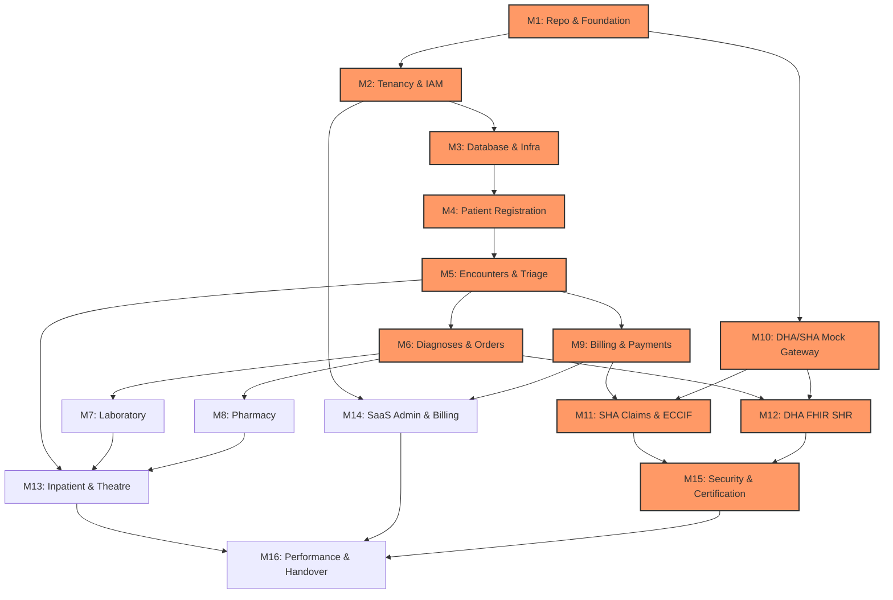

# COMKEY AFYA POA — Master Implementation Backlog & Engineering Roadmap

**Document Identifier:** `IBL-AFYAPOA-2026-V1`  
**Target Platform:** COMKEY AFYA POA (Multi-Tenant HMIS SaaS for Kenyan Healthcare Facilities)  
**Author:** Principal Software Architect & Healthcare Technology Compliance Researcher  
**Status:** Approved for Implementation Roadmap  
**Date:** October 19, 2026  

---

## 1. Backlog Architecture & Traceability Framework

This document breaks down **COMKEY AFYA POA** into discrete, independently testable, and verifiable engineering tasks across **16 sequential implementation milestones**.

Every task strictly specifies all 13 mandatory attributes:
1. **Task ID & Name**
2. **Business Purpose**
3. **Functional Requirements**
4. **Technical Dependencies**
5. **Regulatory & Security Implications**
6. **Database Changes**
7. **API Changes**
8. **UI Changes**
9. **Required Automated Tests**
10. **Acceptance Criteria**
11. **Documentation Updates**
12. **Known Risks & External Dependencies**
13. **Definition of Done (DoD)**

---

## 2. Milestone Summary & Critical Path Gates

### Critical Path Gates (Pre-requisites):
* **Gate 1 (Milestones 1–3):** Foundation, Engine-Level Tenant Isolation (RLS), and Base Infrastructure must be verified before any clinical domain logic is written.
* **Gate 2 (Milestones 4–6):** Encrypted Patient Identity and ICD-11 Diagnosis engine must be fully working before downstream Lab, Pharmacy, and Billing can proceed.
* **Gate 3 (Milestones 10–12):** Hexagonal Mock Drivers must pass 100% schema validation before SHA eClaims and DHA SHR live integrations are attempted.
* **Gate 4 (Milestone 15):** Complete Pre-UAT automated certification evidence must pass before final operational handover (Milestone 16).

---

## Milestone 1: Repository and Engineering Foundation

### TASK-01-01: Turborepo Monorepo Scaffolding & Tooling
* **Task ID & Name:** `TASK-01-01` — Turborepo Monorepo & Base Toolchain Setup
* **Business Purpose:** Establish a scalable, deterministic, and modular TypeScript monorepo codebase that accelerates development, prevents cyclic dependencies, and enforces code quality across all micro-packages and frontend/backend applications.
* **Functional Requirements:** Initialize a pnpm workspace with Turborepo supporting `apps/web` (Next.js 15), `apps/api` (NestJS 10), and shared packages (`packages/domain-core`, `packages/fhir-models`, `packages/database`, `packages/config`, `packages/ui`).
* **Technical Dependencies:** Node.js 20 LTS, pnpm v9+, Turborepo v2+.
* **Regulatory & Security Implications:** Enforces consistent dependency versioning; prevents unauthorized or vulnerable third-party packages from entering the supply chain (npm audit integration).
* **Database Changes:** None.
* **API Changes:** None.
* **UI Changes:** None.
* **Required Automated Tests:** Monorepo build test (`turbo build`), lint test (`turbo lint`), package export verification tests.
* **Acceptance Criteria:** `pnpm build` succeeds from a cold cache in $<90$ seconds; incremental build executes with 100% cache hits.
* **Documentation Updates:** `README.md` with developer setup instructions, Node/pnpm version prerequisites, and monorepo structure guide.
* **Known Risks & External Dependencies:** pnpm hoisting issues with NestJS decorators (mitigate via `.npmrc` with `public-hoist-pattern[]=*@nestjs*`).
* **Definition of Done:** All monorepo packages scaffolded, builds pass on local workstations and GitHub Actions CI, and zero lint warnings exist.

---

### TASK-01-02: CI/CD Pipeline & Code Quality Automation
* **Task ID & Name:** `TASK-01-02` — GitHub Actions Multi-Stage CI Pipeline
* **Business Purpose:** Automate quality checks, static analysis, type checking, security scanning, and container packaging on every Git pull request to prevent regressions and security vulnerabilities.
* **Functional Requirements:** Configure GitHub Actions workflows for: (1) PR verification (linting, typecheck, unit tests), (2) Trivy container vulnerability scanning, (3) SonarQube / CodeQL static analysis, and (4) automated Docker image building.
* **Technical Dependencies:** GitHub Actions, Docker, Trivy, `TASK-01-01`.
* **Regulatory & Security Implications:** Satisfies DPA 2019 Section 41 (technical safeguards) and ISO 27001 secure development lifecycle requirements.
* **Database Changes:** None.
* **API Changes:** None.
* **UI Changes:** None.
* **Required Automated Tests:** CI self-test workflow testing PR triggers and branch protection rules.
* **Acceptance Criteria:** Workflow triggers automatically on PR; fails if coverage drops below 80% or if high/critical CVEs are detected.
* **Documentation Updates:** `docs/ci-cd-pipeline.md` detailing PR gates, release tagging, and secret management.
* **Known Risks & External Dependencies:** GitHub Actions runner quota limits.
* **Definition of Done:** Workflow files `.github/workflows/ci.yml` merged and verified green on test PRs.

---

### TASK-01-03: Shared Design System & UI Component Foundation
* **Task ID & Name:** `TASK-01-03` — Shared UI Design System with Tailwind & shadcn/ui
* **Business Purpose:** Deliver a high-performance, accessible, responsive, and visually consistent UI library tailored for clinical workflows across desktop, tablet, and mobile browsers.
* **Functional Requirements:** Configure `packages/ui` with Tailwind CSS and shadcn/ui components: Button, Input, Modal, Table, Badge, Card, Toast, Form, and Tabs. Implement dark/light theme toggle and clinical high-contrast mode.
* **Technical Dependencies:** React 19, Tailwind CSS v4 / v3.4, Radix UI primitives, Lucide Icons, `TASK-01-01`.
* **Regulatory & Security Implications:** WCAG 2.1 AA accessibility compliance for clinical healthcare usability (Health Act 2017).
* **Database Changes:** None.
* **API Changes:** None.
* **UI Changes:** Base component catalog rendered in Storybook or local demo page.
* **Required Automated Tests:** React Testing Library component unit tests and axe-core accessibility automated audits.
* **Acceptance Criteria:** All components render without layout shift; 100% accessible with screen readers; theme toggle executes without page reload.
* **Documentation Updates:** `packages/ui/README.md` documenting usage, tokens, and styling conventions.
* **Known Risks & External Dependencies:** Upstream Tailwind / Radix compatibility issues.
* **Definition of Done:** `packages/ui` consumable by `apps/web` with zero styling conflicts.

---

## Milestone 2: Tenant Isolation, Authentication, and Authorization

### TASK-02-01: Multi-Tenant Architecture & PostgreSQL RLS Engine
* **Task ID & Name:** `TASK-02-01` — Multi-Tenant Schema & PostgreSQL Row-Level Security
* **Business Purpose:** Provide mathematical and storage-engine guarantees that no hospital tenant can ever view, modify, or leak data belonging to another healthcare facility.
* **Functional Requirements:** Implement the `tenants` table with KMFL code and subscription status. Configure PostgreSQL Row-Level Security (RLS) policies on all tenant tables (`tenant_id = current_setting('app.current_tenant_id')::uuid`). Create a NestJS RLS interceptor setting tenant context per database transaction.
* **Technical Dependencies:** PostgreSQL 16, Drizzle / Kysely ORM, `TASK-01-01`.
* **Regulatory & Security Implications:** DPA 2019 Section 29 & 41 compliance. Cross-tenant leakage constitutes an immediate statutory violation with KES 5M liability.
* **Database Changes:** Tables `tenants`, `facility_profiles`. RLS policy creation DDL script.
* **API Changes:** Global NestJS middleware extracting `x-tenant-id` from authenticated JWT and executing `SET LOCAL app.current_tenant_id`.
* **UI Changes:** None.
* **Required Automated Tests:** Multi-tenant penetration test: simulate concurrent transactions from Tenant A and Tenant B, verifying that Tenant A cannot query Tenant B records even with raw unconstrained SQL queries.
* **Acceptance Criteria:** 100% of tenant-scoped tables have RLS enabled. Unset context transactions fail closed with a database exception.
* **Documentation Updates:** `docs/architecture/multi-tenancy-rls.md` with DDL examples and connection pooling setup rules.
* **Known Risks & External Dependencies:** Connection pooling leakage with PgBouncer; mitigated by using `SET LOCAL` within explicit transactions (`BEGIN ... COMMIT`).
* **Definition of Done:** RLS DDL script executed in migrations; automated cross-tenant data leak tests pass with 100% test coverage.

---

### TASK-02-02: User Identity, OAuth2/OIDC & TOTP Multi-Factor Authentication
* **Task ID & Name:** `TASK-02-02` — IAM Authentication Service with TOTP MFA
* **Business Purpose:** Guarantee secure, audited access for all hospital staff, protecting sensitive clinical and billing systems against unauthorized logins or credential stuffing.
* **Functional Requirements:** User registration, password hashing (Argon2id), login with email/username, JWT issue/refresh, and mandatory TOTP 2FA setup using standard authenticator apps (Google Authenticator, Microsoft Authenticator).
* **Technical Dependencies:** `@nestjs/passport`, `passport-jwt`, `otplib`, `argon2`, `TASK-02-01`.
* **Regulatory & Security Implications:** MoH e-Health Guidelines & DPA Section 41 (authentication safeguards).
* **Database Changes:** Tables `users`, `user_credentials`, `mfa_factors`, `user_sessions`.
* **API Changes:** `POST /api/v1/auth/login`, `POST /api/v1/auth/mfa/verify`, `POST /api/v1/auth/refresh`, `POST /api/v1/auth/logout`.
* **UI Changes:** Login page, MFA verification screen, TOTP QR setup modal in `apps/web`.
* **Required Automated Tests:** Unit tests for Argon2id hashing, TOTP verification algorithms, and integration tests for JWT token lifecycles and expiration.
* **Acceptance Criteria:** Login requires TOTP verification before issuing access token; refresh tokens rotate on every use; revoked sessions immediately invalidate tokens.
* **Documentation Updates:** `docs/security/authentication-iam.md`.
* **Known Risks & External Dependencies:** Clock drift on server causing TOTP verification errors (mitigate with $\pm 1$ step window).
* **Definition of Done:** End-to-end login flow verified from web UI to backend API with MFA enabled.

---

### TASK-02-03: RBAC/ABAC Authorization & Clinician License Verification
* **Task ID & Name:** `TASK-02-03` — Role-Based Access Control & Clinician PUID Validation
* **Business Purpose:** Restrict access to clinical, billing, and admin actions based on verified roles, and ensure only registered healthcare practitioners with active DHA HWR licenses can sign medical orders.
* **Functional Requirements:** Define roles (`SUPER_ADMIN`, `FACILITY_ADMIN`, `CLINICIAN`, `TRIAGE_NURSE`, `LAB_TECH`, `PHARMACIST`, `BILLING_CLERK`, `RECORDS_OFFICER`). Implement `@Roles()` and `@Permissions()` NestJS guards. Validate clinician license against simulated DHA HWR registry and assign `puid`.
* **Technical Dependencies:** NestJS Guards & Reflector, `TASK-02-02`.
* **Regulatory & Security Implications:** Health Act 2017 & KMPDC regulations; prevents non-licensed individuals from practicing medicine or issuing e-prescriptions.
* **Database Changes:** Tables `roles`, `permissions`, `user_roles`, `practitioner_licenses`.
* **API Changes:** `GET /api/v1/users/me/permissions`, `POST /api/v1/practitioners/verify-license`.
* **UI Changes:** Role-conditional navigation drawer and action button permissions in UI.
* **Required Automated Tests:** Guard test suite testing unauthorized role access (HTTP 403 Forbidden); license verification validator tests.
* **Acceptance Criteria:** Clinicians without verified PUID cannot sign clinical encounter notes or submit orders.
* **Documentation Updates:** `docs/security/rbac-matrix.md`.
* **Known Risks & External Dependencies:** External DHA HWR downtime; mitigated by caching verified license status with a 30-day grace period.
* **Definition of Done:** Permission guards protect all clinical and billing endpoints; RBAC integration tests pass.

---

## Milestone 3: Core Database and Shared Infrastructure

### TASK-03-01: PostgreSQL Schema Migrations & Baseline DDL Setup
* **Task ID & Name:** `TASK-03-01` — Drizzle ORM Schema Migrations & Base DDL
* **Business Purpose:** Establish a reproducible, version-controlled database schema management process that supports zero-downtime migrations.
* **Functional Requirements:** Setup Drizzle Kit migration pipeline. Define baseline schema tables for tenancy, audit, users, patients, encounters, billing, inventory, and integration queues.
* **Technical Dependencies:** Drizzle ORM, Drizzle Kit, PostgreSQL 16, `TASK-02-01`.
* **Regulatory & Security Implications:** Verifiable data schema lineage for regulatory compliance audits.
* **Database Changes:** Master migration files in `packages/database/migrations/`.
* **API Changes:** Health check endpoint `GET /api/v1/health` reporting database connectivity.
* **UI Changes:** None.
* **Required Automated Tests:** Migration up and rollback tests; schema drift validation tests in CI.
* **Acceptance Criteria:** All migrations apply cleanly on a fresh PostgreSQL instance in $<10$ seconds; rollback leaves no orphaned artifacts.
* **Documentation Updates:** `packages/database/README.md` with migration creation and execution guidelines.
* **Known Risks & External Dependencies:** Long-running table locks during production migrations.
* **Definition of Done:** Migrations run cleanly in local Docker and CI PostgreSQL containers.

---

### TASK-03-02: Cryptographic KMS Envelope Encryption & Blind Indexing Engine
* **Task ID & Name:** `TASK-03-02` — Field-Level AES-256-GCM Encryption & Blind Index Service
* **Business Purpose:** Protect sensitive patient Personally Identifiable Information (PII) at rest while enabling high-speed $O(1)$ database searches on National IDs and phone numbers.
* **Functional Requirements:** Create a crypto service providing: (1) AES-256-GCM envelope encryption/decryption using tenant data keys, (2) HMAC-SHA256 deterministic blind indexing with a secret pepper for exact lookups.
* **Technical Dependencies:** Node.js `crypto` module, Cloud KMS / Vault mock, `TASK-03-01`.
* **Regulatory & Security Implications:** DPA 2019 Section 41 (Data Security) and Section 44 (Harmful data breach liability).
* **Database Changes:** Columns `national_id_ciphertext`, `national_id_bindex`, `phone_ciphertext`, `phone_bindex` in `patients` table.
* **API Changes:** Internal crypto utilities exported from `packages/domain-core`.
* **UI Changes:** None.
* **Required Automated Tests:** Round-trip encryption/decryption tests; blind index determinism test; ciphertext entropy verification tests.
* **Acceptance Criteria:** Decryption of invalid ciphertext fails authentication tag check; blind index matches exact search input; raw PII is never stored in plaintext columns.
* **Documentation Updates:** `docs/security/encryption-and-blind-indexing.md`.
* **Known Risks & External Dependencies:** Key loss results in permanent data loss (mitigate with automated KMS key backup policies).
* **Definition of Done:** Crypto module tested with 100% test coverage and integrated into patient entity hooks.

---

### TASK-03-03: WORM Tamper-Evident Audit Logging Subsystem
* **Task ID & Name:** `TASK-03-03` — Append-Only WORM Audit Subsystem with SHA-256 Chaining
* **Business Purpose:** Provide an immutable, legally defensible, tamper-evident audit record of all patient data reads, writes, and clinical alterations for regulatory compliance and forensic audits.
* **Functional Requirements:** Implement the `audit_events` table with PostgreSQL trigger preventing `UPDATE` and `DELETE`. Each row records `tenant_id`, `user_id`, `patient_id`, `action`, `resource`, `client_ip`, and a SHA-256 hash chaining to the previous audit entry's hash.
* **Technical Dependencies:** PostgreSQL procedural language (PL/pgSQL), `TASK-03-01`.
* **Regulatory & Security Implications:** DPA 2019 Section 41 & Health Act 2017 (statutory 7-year audit trail requirement).
* **Database Changes:** Table `audit_events`, trigger `prevent_audit_tampering_trg`.
* **API Changes:** Interceptor automatically creating audit entries on all mutating API calls.
* **UI Changes:** None.
* **Required Automated Tests:** Automated test attempting `DELETE FROM audit_events` and verifying transaction rollback with PostgreSQL error; hash chain continuity test.
* **Acceptance Criteria:** `UPDATE` and `DELETE` on `audit_events` are rejected unconditionally; hash chain can be cryptographically verified from origin to tail.
* **Documentation Updates:** `docs/architecture/audit-logging.md`.
* **Known Risks & External Dependencies:** Rapid table growth over years; mitigate with monthly table partitioning.
* **Definition of Done:** Audit triggers active; automated audit tamper tests pass in CI.

---

### TASK-03-04: Redis & BullMQ Job Queue Infrastructure
* **Task ID & Name:** `TASK-03-04` — Distributed Background Queue Framework with BullMQ
* **Business Purpose:** Decouple time-consuming external network calls (DHA HIE, SHA eClaims, KRA eTIMS, SMS) from user-facing HTTP request cycles, guaranteeing sub-second UI response times and resilient auto-retry.
* **Functional Requirements:** Configure BullMQ connection with Redis. Define queues: `hie-outbound`, `claims-outbound`, `etims-invoicing`, `notifications`, `sla-watcher`. Implement exponential backoff, dead-letter queue (DLQ) storage, and job status tracking.
* **Technical Dependencies:** Redis 7, BullMQ v5+, `TASK-01-01`.
* **Regulatory & Security Implications:** Ensures asynchronous statutory notifications (e.g., 24h ECCIF claim submissions) are never lost during server restarts.
* **Database Changes:** Table `failed_job_dlq` for permanent dead-letter job logging.
* **API Changes:** Worker module initialized in `apps/api`.
* **UI Changes:** None.
* **Required Automated Tests:** Queue enqueue/dequeue tests; retry on network failure tests; dead-letter queue routing tests.
* **Acceptance Criteria:** Jobs survive Redis restart (AOF enabled); failed jobs automatically retry 5 times with jitter before moving to DLQ.
* **Documentation Updates:** `docs/architecture/queue-architecture.md`.
* **Known Risks & External Dependencies:** Redis memory saturation during prolonged external gateway downtime; mitigate with max-memory policies and disk archiving.
* **Definition of Done:** BullMQ queues initialized and operational with health check endpoints.

---

## Milestone 4: Patient Registration and Identity Management

### TASK-04-01: Patient Demographic Schema & Blind Indexed Search API
* **Task ID & Name:** `TASK-04-01` — Patient Management Domain & Secure Search API
* **Business Purpose:** Enable hospital staff to rapidly register new patients and locate existing records in $<100\text{ ms}$ while keeping all personal identification numbers cryptographically protected.
* **Functional Requirements:** CRUD operations for patients: Full Name, DOB, Sex, Encrypted National ID, Encrypted Phone, Address, Emergency Contact, and Blood Group. Search endpoint accepting National ID or Phone Number, computing HMAC blind index, and querying via B-Tree index.
* **Technical Dependencies:** `TASK-03-02`, `TASK-03-01`.
* **Regulatory & Security Implications:** DPA 2019 Principles of data minimization and storage limitation.
* **Database Changes:** Table `patients` with indices on `tenant_id`, `national_id_bindex`, `phone_bindex`, `created_at`.
* **API Changes:** `POST /api/v1/patients`, `GET /api/v1/patients`, `GET /api/v1/patients/:id`, `GET /api/v1/patients/search?nationalId=...`.
* **UI Changes:** Patient registration form and instant search bar in `apps/web`.
* **Required Automated Tests:** Unit tests for patient validation (valid Kenyan phone numbers, National ID formats); integration tests for blind-indexed search; benchmark test verifying $<50\text{ ms}$ query time.
* **Acceptance Criteria:** Exact search by National ID returns single matching record; partial name search utilizes PostgreSQL trigram index scoped by `tenant_id`.
* **Documentation Updates:** `docs/api/patients-api.md`.
* **Known Risks & External Dependencies:** Duplicate patient registrations; mitigate with duplicate detection warning modal.
* **Definition of Done:** Patient CRUD APIs verified with 100% test pass rate and integrated with Web UI.

---

### TASK-04-02: DHA Client Registry (CR) Verification Client
* **Task ID & Name:** `TASK-04-02` — DHA Client Registry (CR) Integration Client
* **Business Purpose:** Link local hospital patient records with the national digital health identity (`X-CRID`), eliminating duplicate medical identities across Kenyan facilities.
* **Functional Requirements:** Service client querying DHA Client Registry API by National ID / Alien ID / Birth Certificate. Parse verified national demographics and update patient's `crid` field.
* **Technical Dependencies:** `TASK-04-01`, `TASK-03-04`.
* **Regulatory & Security Implications:** Digital Health Act 2023 Section 38 (Universal Master Registries adoption).
* **Database Changes:** Column `dha_crid` (VARCHAR 64), `cr_sync_status` (ENUM), `cr_last_synced_at` in `patients`.
* **API Changes:** `POST /api/v1/patients/:id/sync-cr`.
* **UI Changes:** "Verify with DHA Registry" button on patient profile showing green badge when synchronized.
* **Required Automated Tests:** Mock HTTP client tests for DHA CR query; error handling for unindexed national IDs; timeout fallback tests.
* **Acceptance Criteria:** Successful query populates verified CRID; offline/unresponsive registry sets sync status to `PENDING_RETRY` without blocking local registration.
* **Documentation Updates:** `docs/integrations/dha-cr-client.md`.
* **Known Risks & External Dependencies:** DHA CR API downtime or slow response times; mitigate with 3-second timeout and asynchronous background sync.
* **Definition of Done:** DHA CR adapter fully tested against mock gateway and integrated into registration workflow.

---

### TASK-04-03: Emergency "Unknown Patient" Intake Workflow
* **Task ID & Name:** `TASK-04-03` — Emergency Trauma Unknown Patient Registration
* **Business Purpose:** Guarantee that unconscious, unidentified trauma patients receive immediate life-saving medical care without administrative or registration delays.
* **Functional Requirements:** One-click emergency intake generating a temporary record: `UNKNOWN-MALE-[UUID]` or `UNKNOWN-FEMALE-[UUID]`, estimated age, and immediate encounter creation. Provide downstream workflow to reconcile and merge the temporary record into the patient's permanent identity once identified.
* **Technical Dependencies:** `TASK-04-01`, `TASK-02-01`.
* **Regulatory & Security Implications:** Constitution of Kenya Article 43(2) & Health Act 2017 Section 7 (Emergency medical treatment cannot be denied).
* **Database Changes:** Column `is_emergency_unknown` (BOOLEAN), `reconciled_patient_id` (UUID) in `patients`.
* **API Changes:** `POST /api/v1/patients/emergency-intake`, `POST /api/v1/patients/merge`.
* **UI Changes:** Red "Emergency Quick Intake" button on registration dashboard; patient record merge dialog.
* **Required Automated Tests:** Unit test for emergency intake ID generation; integration test verifying clinical records transfer cleanly during patient merge.
* **Acceptance Criteria:** Intake creates encounter in $<3$ seconds; merging patient correctly re-points encounters, lab results, and bills to the permanent identity with full audit log.
* **Documentation Updates:** `docs/clinical/emergency-intake.md`.
* **Known Risks & External Dependencies:** Accidental merging of incorrect patient records; mitigate with two-clinician authorization requirement for merges.
* **Definition of Done:** Emergency intake and merge flows verified end-to-end with automated test suite.

---

## Milestone 5: Encounters, Triage, and Clinical Documentation

### TASK-05-01: Clinical Encounter Management & Status Lifecycle
* **Task ID & Name:** `TASK-05-01` — Clinical Encounter State Machine & Queue
* **Business Purpose:** Track patient movement through the hospital (Waiting, In-Triage, In-Consultation, Admitted, Discharged) to optimize clinic workflow and clinician productivity.
* **Functional Requirements:** Encounter entity supporting lifecycle states: `PLANNED`, `ARRIVED`, `TRIAGED`, `IN_PROGRESS`, `ON_HOLD`, `DISCHARGED`, `CANCELLED`. Queue management dashboard for outpatient and emergency departments.
* **Technical Dependencies:** `TASK-04-01`, `TASK-02-03`.
* **Regulatory & Security Implications:** Clinical accountability; medical records custody rules.
* **Database Changes:** Table `encounters` with foreign keys to `patients`, `practitioners`, `tenants`.
* **API Changes:** `POST /api/v1/encounters`, `GET /api/v1/encounters/active`, `PATCH /api/v1/encounters/:id/status`.
* **UI Changes:** Real-time departmental patient queue board with waiting time indicators.
* **Required Automated Tests:** State machine transition tests (e.g., cannot transition from `DISCHARGED` to `IN_PROGRESS`); tenant filtering tests.
* **Acceptance Criteria:** Department queue reflects status transitions in real-time; encounter duration and wait times are accurately computed.
* **Documentation Updates:** `docs/clinical/encounter-lifecycle.md`.
* **Known Risks & External Dependencies:** Concurrent status updates causing race conditions (mitigate with optimistic concurrency locking).
* **Definition of Done:** Encounter state machine validated with unit and integration tests.

---

### TASK-05-02: Vital Signs Capture & Pediatric/Adult Acuity Scoring
* **Task ID & Name:** `TASK-05-02` — Triage Vital Signs & Clinical Acuity Calculator
* **Business Purpose:** Standardize patient triage, identify deteriorating patients immediately, and prioritize urgent clinical cases.
* **Functional Requirements:** Record vitals: Systolic/Diastolic BP, Heart Rate, Respiration Rate, Temperature, SpO2, Weight, Height, Blood Glucose. Compute BMI and automatic Emergency Severity Index (ESI Level 1–5). Highlight critical out-of-range vitals in red.
* **Technical Dependencies:** `TASK-05-01`, `TASK-01-03`.
* **Regulatory & Security Implications:** Emergency clinical standards and patient safety.
* **Database Changes:** Table `triage_vitals`.
* **API Changes:** `POST /api/v1/encounters/:id/vitals`, `GET /api/v1/encounters/:id/vitals`.
* **UI Changes:** Nurse triage input sheet with visual abnormal range badges and ESI acuity selector.
* **Required Automated Tests:** Unit tests for BMI calculator and abnormal range flagging algorithms (e.g., pediatric hypothermia, hypertensive crisis).
* **Acceptance Criteria:** Abnormal vitals trigger visual alerts; Level 1/2 acuity auto-escalates encounter to top of doctor queue.
* **Documentation Updates:** `docs/clinical/triage-vitals-guide.md`.
* **Known Risks & External Dependencies:** Human error entering out-of-bounds numbers; mitigate with sanity range validation (e.g., SpO2 between 1 and 100).
* **Definition of Done:** Triage form functional, validated against automated range test suite.

---

### TASK-05-03: SOAP Clinical Notes & Electronic Signature Immutability
* **Task ID & Name:** `TASK-05-03` — SOAP Clinical Notes & Cryptographic Addenda
* **Business Purpose:** Provide clinicians with an intuitive SOAP documentation interface while ensuring that finalized medical notes cannot be tampered with or repudiated.
* **Functional Requirements:** SOAP editor (Subjective, Objective, Assessment, Plan). Clinician electronic signature with PIN/password verification. Upon signature, the note becomes immutable; modifications must be appended as signed addenda.
* **Technical Dependencies:** `TASK-05-01`, `TASK-02-03`, `TASK-03-03`.
* **Regulatory & Security Implications:** Kenya Evidence Act & Health Act 2017 (admissibility of electronic medical records in court).
* **Database Changes:** Tables `clinical_notes`, `clinical_note_addenda`.
* **API Changes:** `POST /api/v1/encounters/:id/notes`, `POST /api/v1/encounters/:id/notes/sign`, `POST /api/v1/encounters/:id/notes/addenda`.
* **UI Changes:** Clinician SOAP documentation view with rich text formatting and signature confirmation dialog.
* **Required Automated Tests:** Immutability test: verify that direct `UPDATE` on signed notes is rejected; addendum ordering and timestamp verification tests.
* **Acceptance Criteria:** Once signed, note status is `FINALIZED`; editing creates a child addendum referencing parent note ID; original text remains intact.
* **Documentation Updates:** `docs/clinical/soap-documentation.md`.
* **Known Risks & External Dependencies:** Clinician fatigue with multi-step signature; streamline with session-cached PIN prompt.
* **Definition of Done:** Clinical notes editor and addenda workflow verified and covered by integration tests.

---

### TASK-05-04: 24-Hour ECCIF Emergency Statutory SLA Watcher
* **Task ID & Name:** `TASK-05-04` — BullMQ 24-Hour ECCIF Emergency Countdown Watcher
* **Business Purpose:** Prevent hospital revenue forfeiture by ensuring emergency patient admissions under the Emergency, Chronic & Critical Illness Fund (ECCIF) are submitted to SHA within the strict statutory 24-hour limit.
* **Functional Requirements:** When an emergency encounter is initiated for an ECCIF-eligible patient, schedule a BullMQ delay job tracking the 24-hour deadline. Send automated notifications at 6h, 12h, and 18h if clinical notes or claims remain unsubmitted.
* **Technical Dependencies:** `TASK-03-04`, `TASK-05-01`.
* **Regulatory & Security Implications:** Social Health Insurance Act 2023 Section 34 & ECCIF Regulations (24-hour claim submission limit).
* **Database Changes:** Columns `is_eccif_emergency` (BOOLEAN), `eccif_deadline_at` (TIMESTAMP), `eccif_submitted_at` in `encounters`.
* **API Changes:** `GET /api/v1/encounters/eccif-watch-list`.
* **UI Changes:** Emergency SLA countdown timer badge on emergency queue and doctor dashboard (Yellow at 12h, Red at 18h).
* **Required Automated Tests:** BullMQ cron worker tests; simulated time progression verifying notification triggers at 6h, 12h, and 18h.
* **Acceptance Criteria:** Encounter countdown displays exact remaining time; alerts trigger to medical superintendent when $\le 6$ hours remain.
* **Documentation Updates:** `docs/integrations/eccif-sla-watcher.md`.
* **Known Risks & External Dependencies:** System clock skew; use UTC timestamps across all database and worker calculations.
* **Definition of Done:** 24h ECCIF watcher active, alert notifications tested and verified.

---

## Milestone 6: Diagnoses, Terminology, and Clinical Orders

### TASK-06-01: WHO ICD-11 Terminology Caching & Fast Auto-Suggest Engine
* **Task ID & Name:** `TASK-06-01` — WHO ICD-11 Terminology Engine & Trigram Search
* **Business Purpose:** Provide doctors with sub-50ms auto-complete search across 30,000+ WHO ICD-11 diagnostic terms, removing resistance to national coding standards.
* **Functional Requirements:** Ingest WHO ICD-11 MMS foundation and linearization dataset. Implement PostgreSQL trigram search (`pg_trgm`) index on diagnostic titles, synonyms, and alphanumeric codes. Provide cached API returning code, title, and chapter.
* **Technical Dependencies:** PostgreSQL `pg_trgm` extension, `TASK-03-01`.
* **Regulatory & Security Implications:** DHA Terminology Service (TS) mandate; SHA requires ICD-11 codes on all claims.
* **Database Changes:** Table `terminology_icd11` with GIN trigram index on `search_vector`.
* **API Changes:** `GET /api/v1/terminology/icd11?query=...&limit=10`.
* **UI Changes:** Smart diagnostic auto-complete dropdown in clinical consultation interface.
* **Required Automated Tests:** Search benchmark test ($<50\text{ ms}$ for 3-character prefix); synonym matching test (e.g., "heart attack" matches `BA41 Acute myocardial infarction`).
* **Acceptance Criteria:** Search returns ranked matches in $<50\text{ ms}$; clinician can select primary and secondary diagnoses.
* **Documentation Updates:** `docs/clinical/icd11-terminology-guide.md`.
* **Known Risks & External Dependencies:** Database size of terminology dictionary (~50MB); preload and cache in Redis memory for ultra-fast lookup.
* **Definition of Done:** Terminology dataset loaded, indexed, and API search latency verified.

---

### TASK-06-02: Computerized Physician Order Entry (CPOE) Framework
* **Task ID & Name:** `TASK-06-02` — CPOE Order Routing for Lab, Pharmacy & Imaging
* **Business Purpose:** Eliminate handwritten paper chits, reduce clinical transcription errors, and instantly route doctor orders to relevant hospital service points.
* **Functional Requirements:** CPOE order entry supporting: (1) Laboratory Investigations (LOINC-coded), (2) Medication Prescriptions (dosage, route, frequency, duration), and (3) Radiology/Procedures (ICHI-coded). Automatically route orders to Pharmacy and Lab departmental queues.
* **Technical Dependencies:** `TASK-05-03`, `TASK-06-01`.
* **Regulatory & Security Implications:** Health Act 2017 & Pharmacy and Poisons Act (prescription authenticity).
* **Database Changes:** Tables `orders`, `order_items`.
* **API Changes:** `POST /api/v1/encounters/:id/orders`, `GET /api/v1/orders/department/:dept`.
* **UI Changes:** Order entry panel with multi-order cart (Medications, Lab, Imaging) and one-click submission.
* **Required Automated Tests:** Unit test for order serialization; integration test verifying split routing to lab and pharmacy worklists.
* **Acceptance Criteria:** Submitting an order bundle containing 1 lab test and 2 drugs immediately populates both the lab accessioning queue and the pharmacy dispensing queue.
* **Documentation Updates:** `docs/clinical/cpoe-ordering.md`.
* **Known Risks & External Dependencies:** Duplicate order entry by multiple clinicians; show active orders on screen to prevent duplication.
* **Definition of Done:** CPOE order creation and departmental dispatch verified end-to-end.

---

## Milestone 7: Laboratory Management

### TASK-07-01: Laboratory Specimen Accessioning & Barcode Generation
* **Task ID & Name:** `TASK-07-01` — Specimen Collection, Accessioning & Barcoding
* **Business Purpose:** Prevent specimen misidentification, misplacement, and patient sample mix-ups through automated barcode tracking from phlebotomy to analyzer.
* **Functional Requirements:** Specimen accessioning workflow: generate unique 12-character accession number (Code 128 / QR format). Record specimen type (Whole Blood, Serum, Urine, CSF, Swab), collection timestamp, and collector user ID. Support specimen rejection with standardized rejection reasons (clotted, hemolyzed, wrong tube).
* **Technical Dependencies:** `TASK-06-02`, `TASK-01-03`.
* **Regulatory & Security Implications:** ISO 15189 laboratory quality standards & patient safety.
* **Database Changes:** Tables `lab_specimens`, `lab_specimen_rejections`.
* **API Changes:** `POST /api/v1/lab/orders/:id/collect`, `POST /api/v1/lab/specimens/:id/reject`.
* **UI Changes:** Phlebotomy specimen collection screen with printable barcode label sheet.
* **Required Automated Tests:** Barcode uniqueness tests; rejection state transition tests.
* **Acceptance Criteria:** Barcode label formats fit standard thermal label printers ($50\times 25\text{ mm}$); specimen status updates to `COLLECTED` or `REJECTED`.
* **Documentation Updates:** `docs/laboratory/specimen-accessioning.md`.
* **Known Risks & External Dependencies:** Hardware printer compatibility; use standard ZPL / ESC-POS / PDF print formatting.
* **Definition of Done:** Accessioning workflow operational and barcode generation verified.

---

### TASK-07-02: Lab Results Entry, Reference Ranges & Critical Alerts
* **Task ID & Name:** `TASK-07-02` — Test Result Entry, Range Validation & Critical Alerts
* **Business Purpose:** Ensure accurate lab reporting, alert clinicians to life-threatening values immediately, and publish verified results to the EHR.
* **Functional Requirements:** Input test results against LOINC-coded laboratory catalog. Automatic reference range calculation based on patient age and sex. Automated detection of critical physiological values, triggering push notifications to attending doctor. Require two-tier review: entry by Lab Tech, electronic sign-off by Senior Technologist / Pathologist.
* **Technical Dependencies:** `TASK-07-01`, `TASK-02-03`.
* **Regulatory & Security Implications:** Clinical diagnostic standards (KMLTTB).
* **Database Changes:** Tables `lab_results`, `lab_test_catalog`, `lab_reference_ranges`.
* **API Changes:** `POST /api/v1/lab/specimens/:id/results`, `POST /api/v1/lab/results/:id/verify`.
* **UI Changes:** Laboratory bench result entry sheet with colored normal/abnormal/critical indicators.
* **Required Automated Tests:** Unit tests for age/sex-adjusted reference range evaluation; critical value alarm trigger tests; role authorization tests (only authorized techs can verify).
* **Acceptance Criteria:** Verified results immediately appear in the patient's clinical encounter and EHR; critical results dispatch SMS/push alert to ordering doctor.
* **Documentation Updates:** `docs/laboratory/results-verification.md`.
* **Known Risks & External Dependencies:** Clinician misses critical alert; require explicit clinical acknowledgment of critical lab results in UI.
* **Definition of Done:** Results entry, authorization, and critical alerting verified in automated test suite.

---

## Milestone 8: Pharmacy and Medication Dispensing

### TASK-08-01: Medication Dispensing & FEFO Inventory Batch Management
* **Task ID & Name:** `TASK-08-01` — Pharmacy Dispensing & First-Expiry, First-Out Stock Engine
* **Business Purpose:** Guarantee medication dispensing accuracy, prevent expired drug administration, and maintain real-time automated stock ledger balances.
* **Functional Requirements:** Pharmacist dispensing verification against e-prescription. Enforce First-Expiry, First-Out (FEFO) batch allocation: system selects stock from nearest expiring lot. Record batch number, manufacturer, expiry date, quantity dispensed, and patient instructions.
* **Technical Dependencies:** `TASK-06-02`, `TASK-03-01`.
* **Regulatory & Security Implications:** Pharmacy and Poisons Board (PPB) regulations & Good Dispensing Practices.
* **Database Changes:** Tables `pharmacy_inventory`, `pharmacy_batches`, `pharmacy_dispensations`.
* **API Changes:** `GET /api/v1/pharmacy/prescriptions/pending`, `POST /api/v1/pharmacy/dispense`.
* **UI Changes:** Pharmacist dispensing queue, prescription fulfillment modal with batch selector.
* **Required Automated Tests:** Unit tests for FEFO sorting algorithm; concurrent inventory deduction race condition tests.
* **Acceptance Criteria:** Stock balance decrements atomically; expired batches cannot be dispensed (blocked by validation logic).
* **Documentation Updates:** `docs/pharmacy/dispensing-fefo.md`.
* **Known Risks & External Dependencies:** Inventory discrepancies from manual stock theft or loss; mitigate with periodic cycle count reconciliation.
* **Definition of Done:** Dispensing workflow and batch inventory management validated with zero concurrency race errors.

---

### TASK-08-02: Automated Drug-Drug Interaction & Allergy Interception
* **Task ID & Name:** `TASK-08-02` — Drug-Drug Interaction (DDI) & Allergy Interceptor
* **Business Purpose:** Protect patient safety by catching dangerous drug interactions, duplicate therapies, or known allergic reactions before prescription or dispensing.
* **Functional Requirements:** Real-time screening engine checking new prescriptions against: (1) Patient documented drug allergies, (2) Active medications for severe Drug-Drug Interactions (DDIs). Display severity classification (Contraindicated, Major, Moderate). Require clinician justification to override.
* **Technical Dependencies:** `TASK-08-01`, `TASK-06-02`.
* **Regulatory & Security Implications:** Patient safety; professional negligence liability mitigation.
* **Database Changes:** Tables `drug_interactions`, `patient_allergies`.
* **API Changes:** `POST /api/v1/pharmacy/screen-interactions`.
* **UI Changes:** High-visibility safety warning modal in doctor prescription entry and pharmacist dispensing screen.
* **Required Automated Tests:** Unit tests for common drug interactions (e.g., Warfarin + Aspirin, Sildenafil + Nitrates); allergy cross-reactivity tests (e.g., Penicillin $\to$ Cephalosporins).
* **Acceptance Criteria:** Contraindicated combinations block checkout unless clinical override reason is recorded; override reasons logged in audit trail.
* **Documentation Updates:** `docs/pharmacy/safety-screening.md`.
* **Known Risks & External Dependencies:** Alert fatigue causing doctors to ignore warnings; stratify alerts into hard stops (contraindicated) and passive badges (minor).
* **Definition of Done:** Interaction screening engine operational and verified with test cases.

---

## Milestone 9: Patient Billing and Payments

### TASK-09-01: Multi-Payer Charge Master & Automated Bill Collation
* **Task ID & Name:** `TASK-09-01` — Dynamic Multi-Payer Charge Master & Billing Engine
* **Business Purpose:** Automatically capture all billable hospital services (consults, bed stay, lab tests, medications, surgical procedures) into an itemized patient ledger with payer-specific pricing.
* **Functional Requirements:** Maintain charge master supporting multi-payer fee schedules: Cash, SHA (PHC, SHIF, ECCIF), Private Insurances, and Corporate schemes. Automatically post line items to patient bill upon order fulfillment. Support waivers, exemptions, and co-payments.
* **Technical Dependencies:** `TASK-05-01`, `TASK-06-02`, `TASK-07-02`, `TASK-08-01`.
* **Regulatory & Security Implications:** Financial accounting standards & Public Finance Management Act (for public hospitals).
* **Database Changes:** Tables `charge_master`, `fee_schedules`, `bills`, `bill_line_items`.
* **API Changes:** `GET /api/v1/billing/encounters/:id/bill`, `POST /api/v1/billing/bills/:id/line-items`.
* **UI Changes:** Comprehensive billing folio view displaying itemized charges, copay split, and payer balance.
* **Required Automated Tests:** Financial calculation tests (line item summation, discount/waiver calculation, tax allocation); concurrent line-item posting tests.
* **Acceptance Criteria:** Total bill matches exact sum of components; prices correspond to active fee schedule of the patient's primary payer.
* **Documentation Updates:** `docs/billing/charge-master.md`.
* **Known Risks & External Dependencies:** Unbilled services due to unconfirmed orders; require automated unbilled service reconciliation at patient discharge.
* **Definition of Done:** Billing collation engine functional with automated test suite passing.

---

### TASK-09-02: Safaricom Daraja M-Pesa C2B & STK Push Integration
* **Task ID & Name:** `TASK-09-02` — Automated M-Pesa STK Push & C2B Cashier Settlement
* **Business Purpose:** Provide fast, error-free mobile money checkout for patient co-pays and cash services, eliminating cashier cash handling and theft.
* **Functional Requirements:** Integrate with Safaricom Daraja API: (1) Initiate STK Push (Lipa Na M-Pesa Online) to patient's phone number, (2) Handle asynchronous C2B payment validation and confirmation webhooks, (3) Automatically mark bill line items as paid upon transaction receipt.
* **Technical Dependencies:** `TASK-09-01`, `TASK-03-04`.
* **Regulatory & Security Implications:** Payment card / mobile money security & anti-money laundering (CBK regulations).
* **Database Changes:** Tables `mpesa_transactions`, `payments`.
* **API Changes:** `POST /api/v1/payments/mpesa/stk-push`, `POST /api/v1/payments/mpesa/c2b-callback`.
* **UI Changes:** "Pay via M-Pesa" button prompting for phone number with live transaction status countdown.
* **Required Automated Tests:** Mock Daraja webhook tests; signature validation tests; duplicate callback idempotency tests.
* **Acceptance Criteria:** Entering phone number triggers STK prompt; receipt callback updates bill status to `PAID` in $\le 5$ seconds; duplicate webhooks are handled idempotently.
* **Documentation Updates:** `docs/billing/mpesa-integration.md`.
* **Known Risks & External Dependencies:** Daraja API gateway timeouts; implement auto-query transaction status fallback polling.
* **Definition of Done:** M-Pesa STK Push and callback handler verified against mock/sandbox Safaricom simulator.

---

### TASK-09-03: KRA eTIMS System-to-System Automated Fiscal Invoicing
* **Task ID & Name:** `TASK-09-03` — KRA eTIMS Fiscal Invoice Generation & Control Codes
* **Business Purpose:** Guarantee 100% compliance with Section 23A of the Tax Procedures Act, generating verified eTIMS fiscal invoices with official KRA Control Codes and QR codes for all commercial hospital transactions.
* **Functional Requirements:** Compile eTIMS invoice payload upon payment confirmation. Transmit asynchronously via BullMQ worker to KRA eTIMS gateway. Store returned KRA Control Code and cryptographic signature. Embed KRA verification QR code on printable patient receipts.
* **Technical Dependencies:** `TASK-09-01`, `TASK-03-04`.
* **Regulatory & Security Implications:** Section 23A Tax Procedures Act, 2015 & Section 16(2)(ac) Income Tax Act.
* **Database Changes:** Columns `etims_control_code` (VARCHAR 64), `etims_qr_url` (TEXT), `etims_status` (ENUM) in `bills`.
* **API Changes:** `POST /api/v1/billing/bills/:id/fiscalize`.
* **UI Changes:** Printable PDF invoice showing official KRA eTIMS Control Code and scannable QR code.
* **Required Automated Tests:** Payload serialization tests; mock eTIMS client signing tests; offline buffer retry tests.
* **Acceptance Criteria:** Generated invoice contains valid KRA Control Code; QR code links to official KRA verification portal; gateway timeouts buffer in BullMQ for automatic retry.
* **Documentation Updates:** `docs/billing/kra-etims-integration.md`.
* **Known Risks & External Dependencies:** KRA eTIMS gateway instability; offline buffering ensures patient is not delayed while fiscal signature is pending.
* **Definition of Done:** eTIMS invoicing adapter verified, printable receipts include valid QR codes.

---

## Milestone 10: DHA/SHA Mock Services and Integration Framework

### TASK-10-01: Hexagonal Ports-and-Adapters Integration Gateway
* **Task ID & Name:** `TASK-10-01` — Hexagonal Integration Architecture & Driver Switch
* **Business Purpose:** Decouple COMKEY AFYA POA core domain logic from external government API specifications, enabling zero-dependency local development, automated testing, and seamless migration across mock, sandbox, and production environments.
* **Functional Requirements:** Define TypeScript domain interfaces: `IDhaHieClient`, `IShaClaimsClient`, `IKraEtimsClient`. Implement factory provider switching between `MOCK`, `SANDBOX`, and `PRODUCTION` drivers via environment configuration.
* **Technical Dependencies:** `packages/domain-core`, `TASK-01-01`.
* **Regulatory & Security Implications:** Prevents test data pollution into national production registries during staging tests.
* **Database Changes:** None.
* **API Changes:** Internal module `packages/integration-adapters`.
* **UI Changes:** None.
* **Required Automated Tests:** Driver switching tests; interface contract implementation verification tests.
* **Acceptance Criteria:** Setting `INTEGRATION_DRIVER=MOCK` routes 100% of integration calls to local synthetic simulators without making external network requests.
* **Documentation Updates:** `docs/architecture/hexagonal-adapters.md`.
* **Known Risks & External Dependencies:** Interface divergence from external schemas; enforce shared schemas in `packages/fhir-models`.
* **Definition of Done:** Hexagonal interfaces and mock drivers implemented and covered by unit tests.

---

### TASK-10-02: Comprehensive In-Memory DHA & SHA Mock Simulator
* **Task ID & Name:** `TASK-10-02` — In-Memory DHA HIE & SHA Claims Synthetic Simulator
* **Business Purpose:** Provide developers and CI/CD pipelines with realistic, high-fidelity mock implementations of all government APIs (Client Registry, Facility Registry, Health Worker Registry, SHR, SHA Eligibility, SHA Claims, and Preauthorizations).
* **Functional Requirements:** Implement mock endpoints supporting: (1) CR lookups returning synthetic Kenyan patient demographics, (2) FR verification of KMFL codes, (3) HWR verification of clinician PUIDs, (4) OTP generation and validation, (5) SHA eligibility checks with configurable fund balances, (6) SHA claim adjudication with approval/rejection codes.
* **Technical Dependencies:** `TASK-10-01`.
* **Regulatory & Security Implications:** Zero real patient PII used in automated test environments.
* **Database Changes:** None.
* **API Changes:** Local mock server or in-process NestJS mock providers.
* **UI Changes:** Integration testing debug banner when running in mock mode.
* **Required Automated Tests:** Contract tests verifying that mock simulator responses match official DHA JSON schemas.
* **Acceptance Criteria:** Mock simulator handles all 8 official SHA integration scenarios; responds in $<15\text{ ms}$; requires zero external internet connectivity.
* **Documentation Updates:** `docs/testing/mock-simulator-guide.md`.
* **Known Risks & External Dependencies:** Mock drift from live government behavior; update mock whenever DHA issues changelog updates.
* **Definition of Done:** Mock simulator passing all schema tests and integrated into monorepo test suite.

---

## Milestone 11: SHA Eligibility and Claims

### TASK-11-01: 5-Step SHA Digital Eligibility Verification Client
* **Task ID & Name:** `TASK-11-01` — SHA Real-Time Eligibility & Benefit Check Client
* **Business Purpose:** Verify patient insurance coverage, identify active fund entitlement (PHC, SHIF, or ECCIF), check remaining benefit balances, and determine co-pays prior to delivering services.
* **Functional Requirements:** Implement 5-step verification workflow: (1) Resolve DHA CRID, (2) Verify SHA Active Membership, (3) Query Fund Benefit Limits, (4) Check Required Preauthorizations, and (5) Validate Patient OTP/Biometrics. Display benefit summary and pre-approval status.
* **Technical Dependencies:** `TASK-10-01`, `TASK-04-01`.
* **Regulatory & Security Implications:** Social Health Insurance Act 2023 Section 26 (Benefit packages & eligibility).
* **Database Changes:** Tables `sha_eligibility_checks`, `sha_benefits_cache`.
* **API Changes:** `POST /api/v1/sha/verify-eligibility`.
* **UI Changes:** "Check SHA Eligibility" button in patient registration and triage; benefit breakdown badge.
* **Required Automated Tests:** Unit tests for eligibility response parsing; simulation of suspended membership, expired cards, and depleted benefit limits.
* **Acceptance Criteria:** Successful query populates active fund category (PHC/SHIF/ECCIF) and benefit limits; expired memberships flag clear warning with cash fallback option.
* **Documentation Updates:** `docs/integrations/sha-eligibility.md`.
* **Known Risks & External Dependencies:** Slow response from SHA during peak morning clinic hours; cache verification result locally for the duration of the encounter.
* **Definition of Done:** Eligibility client integrated with UI and verified against mock/sandbox drivers.

---

### TASK-11-02: FHIR R4 eClaims Compilation & Asynchronous Dispatch Queue
* **Task ID & Name:** `TASK-11-02` — FHIR R4 Claim Compilation & BullMQ Submission Worker
* **Business Purpose:** Compile encounter bills, diagnoses, lab results, and pharmacy dispensations into standard FHIR R4 `Claim` bundles and submit them electronically to the SHA claims switch with auto-retry.
* **Functional Requirements:** Transform completed billing folios into FHIR R4 `Claim` resources conforming to Kenya Core claim profiles. Include mandatory headers (`X-Facility-Id`, `X-PUID`). Dispatch via BullMQ `claims-outbound` queue with 5 retries and exponential backoff.
* **Technical Dependencies:** `TASK-09-01`, `TASK-06-01`, `TASK-03-04`, `TASK-10-01`.
* **Regulatory & Security Implications:** SHIA 2023 Claims Regulations & DHA Interoperability Framework.
* **Database Changes:** Tables `sha_claims`, `sha_claim_items`, `sha_claim_events`.
* **API Changes:** `POST /api/v1/sha/claims/submit`, `GET /api/v1/sha/claims/:id/status`.
* **UI Changes:** Claims management dashboard showing claim status badges (`DRAFT`, `QUEUED`, `SUBMITTED`, `ADJUDICATED`, `PAID`, `REJECTED`).
* **Required Automated Tests:** FHIR R4 Claim schema validation tests; serialization tests; BullMQ worker retry and DLQ routing tests.
* **Acceptance Criteria:** Generated Claim bundle validates 100% against Kenya Core FHIR Claim schema; submission returns SHA claim tracking reference; transient network errors automatically retry.
* **Documentation Updates:** `docs/integrations/sha-eclaims-submission.md`.
* **Known Risks & External Dependencies:** Claim rejection due to missing diagnosis or invalid ICD-11; validate claim completeness prior to queue dispatch.
* **Definition of Done:** Claim compilation and dispatch pipeline tested and operating in staging environment.

---

### TASK-11-03: SHA Remittance Reconciliation & Claim Adjudication Processor
* **Task ID & Name:** `TASK-11-03` — SHA Remittance Advice Processor & Rejection Reconciliation
* **Business Purpose:** Ingest electronic Remittance Advice from SHA, automatically reconcile approved payments against patient hospital bills, and route rejected claims to billing officers for re-submission.
* **Functional Requirements:** Ingest SHA Remittance Advice bundles (FHIR `ExplanationOfBenefit`). Parse approved amounts, disallowed items, and rejection reason codes. Update internal bill balances, post payments to hospital ledger, and open resubmission appeals for contested claims.
* **Technical Dependencies:** `TASK-11-02`, `TASK-09-01`.
* **Regulatory & Security Implications:** Financial auditing and claims dispute standards.
* **Database Changes:** Tables `sha_remittances`, `sha_claim_disputes`.
* **API Changes:** `POST /api/v1/sha/remittance/callback`, `POST /api/v1/sha/claims/:id/appeal`.
* **UI Changes:** Remittance reconciliation dashboard with filterable rejection analysis and one-click appeal re-submission.
* **Required Automated Tests:** Unit tests for ExplanationOfBenefit parsing; ledger reconciliation calculation tests; appeal state transition tests.
* **Acceptance Criteria:** Approved amounts reconcile automatically; rejected claims highlight specific rejected line items with official SHA reason codes.
* **Documentation Updates:** `docs/billing/sha-remittance-reconciliation.md`.
* **Known Risks & External Dependencies:** Partial payments and co-pay adjustments creating ledger imbalances; maintain strict audit trail of all adjustments.
* **Definition of Done:** Remittance ingestion and reconciliation verified against synthetic SHA remittance datasets.

---

## Milestone 12: FHIR Exchange and Shared Health Records

### TASK-12-01: DHA Patient Consent Management (OTP & Biometrics)
* **Task ID & Name:** `TASK-12-01` — Patient Consent Lifecycle via DHA OTP & Biometrics
* **Business Purpose:** Comply with national privacy mandates by securing explicit, time-bounded patient consent before accessing historical Shared Health Records (SHR) from the national HIE.
* **Functional Requirements:** Implement consent workflow: (1) Initiate consent request via DHA gateway, triggering 6-digit OTP to patient mobile, (2) Capture and verify OTP in clinical UI, (3) Maintain active consent token granting access to SHR for the duration of the clinical encounter, (4) Support emergency consent bypass ("Break-the-Glass") for unconscious trauma patients with mandatory justification.
* **Technical Dependencies:** `TASK-10-01`, `TASK-04-01`, `TASK-05-01`.
* **Regulatory & Security Implications:** Digital Health Act 2023 Section 47 & Data Protection Act 2019 Section 30 (Explicit consent requirement).
* **Database Changes:** Tables `patient_consents`, `emergency_consent_overrides`.
* **API Changes:** `POST /api/v1/dha/consent/request-otp`, `POST /api/v1/dha/consent/verify-otp`, `POST /api/v1/dha/consent/break-glass`.
* **UI Changes:** Consent verification modal in clinician consultation view with OTP entry and "Emergency Break-Glass" override button.
* **Required Automated Tests:** OTP verification flow tests; expired OTP rejection tests; break-the-glass audit log creation tests.
* **Acceptance Criteria:** Clinician cannot view external SHR without valid OTP or recorded break-glass override; all consent actions create immutable WORM audit logs.
* **Documentation Updates:** `docs/integrations/dha-consent-lifecycle.md`.
* **Known Risks & External Dependencies:** Patient lacks mobile phone or network signal; break-glass emergency workflow ensures clinical care is never withheld.
* **Definition of Done:** Consent engine operational and verified in automated integration tests.

---

### TASK-12-02: FHIR R4 Shared Health Record (SHR) Publisher
* **Task ID & Name:** `TASK-12-02` — Clinical Encounter FHIR SHR Bundle Publisher
* **Business Purpose:** Fulfill national statutory interoperability requirements by publishing finalized patient encounter summaries (diagnoses, vitals, lab results, medications) to the DHA National Shared Health Record.
* **Functional Requirements:** Upon encounter discharge, compile a FHIR R4 `DocumentReference` / `Bundle` containing: Patient, Encounter, Condition (ICD-11), Observation (Vitals/Labs), and MedicationRequest resources conforming to Kenya Core profiles. Dispatch to DHA SHR via BullMQ `hie-outbound` queue.
* **Technical Dependencies:** `TASK-12-01`, `TASK-05-03`, `TASK-06-01`, `TASK-07-02`, `TASK-08-01`, `TASK-03-04`.
* **Regulatory & Security Implications:** Digital Health Act 2023 Section 42 (Mandatory contribution to national health data exchange).
* **Database Changes:** Columns `dha_shr_bundle_id` (VARCHAR 64), `dha_shr_sync_status` (ENUM), `dha_shr_synced_at` in `encounters`.
* **API Changes:** `POST /api/v1/dha/shr/publish/:encounterId`.
* **UI Changes:** SHR synchronization status badge on patient encounter summary.
* **Required Automated Tests:** FHIR R4 bundle validation against Kenya Core profiles; automated schema conformance tests; BullMQ worker retry tests.
* **Acceptance Criteria:** Bundle passes official DHA FHIR R4 validator with zero errors; published bundle ID is recorded in local database.
* **Documentation Updates:** `docs/integrations/dha-shr-publishing.md`.
* **Known Risks & External Dependencies:** DHA SHR endpoint latency; asynchronous queue submission ensures clinician discharge workflow is instantaneous.
* **Definition of Done:** SHR publishing pipeline active, bundles validate against FHIR R4 schemas.

---

## Milestone 13: Expanded Hospital Operations

### TASK-13-01: Inpatient Ward, Bed Management & Nursing Kardex
* **Task ID & Name:** `TASK-13-01` — Inpatient Ward & Bed Management Subsystem
* **Business Purpose:** Manage hospital admissions, ward occupancy, bed assignments, nursing shift notes, and daily inpatient bed charges.
* **Functional Requirements:** Configure hospital wards (Male, Female, Pediatric, Maternity, ICU/HDU). Bed assignment, transfer, and discharge workflows. Real-time visual ward occupancy map. Nursing Kardex for vital signs schedules and medication administration records (eMAR).
* **Technical Dependencies:** `TASK-05-01`, `TASK-08-01`, `TASK-09-01`.
* **Regulatory & Security Implications:** Clinical handover safety and bed occupancy reporting to county health departments.
* **Database Changes:** Tables `wards`, `beds`, `admissions`, `nursing_notes`, `emar_records`.
* **API Changes:** `GET /api/v1/wards/occupancy`, `POST /api/v1/admissions`, `PATCH /api/v1/admissions/:id/transfer-bed`.
* **UI Changes:** Interactive graphical bed layout view with color-coded bed statuses (`VACANT`, `OCCUPIED`, `CLEANING`, `MAINTENANCE`).
* **Required Automated Tests:** Bed collision test (cannot assign two patients to same bed); daily room charge collation tests.
* **Acceptance Criteria:** Transferring a patient automatically frees the previous bed and updates the running inpatient billing folio.
* **Documentation Updates:** `docs/operations/inpatient-bed-management.md`.
* **Known Risks & External Dependencies:** Nurses forgetting to mark beds vacant upon discharge; provide automated bed release on billing discharge.
* **Definition of Done:** Inpatient admission, bed transfer, and eMAR workflows verified in test suite.

---

### TASK-13-02: Surgical Operating Theatre Scheduling & Anesthesia Log
* **Task ID & Name:** `TASK-13-02` — Operating Theatre Scheduling & Surgical Documentation
* **Business Purpose:** Maximize operating theatre utilization, eliminate surgical scheduling conflicts, and maintain comprehensive perioperative and anesthesia records.
* **Functional Requirements:** Theatre booking calendar for elective and emergency surgical cases. Conflict detection preventing overlapping bookings for the same operating table. Surgical safety checklist (WHO Safe Surgery) and anesthesia monitoring log.
* **Technical Dependencies:** `TASK-13-01`, `TASK-02-03`, `TASK-06-01`.
* **Regulatory & Security Implications:** Surgical safety standards (KMPDC) and medical negligence prevention.
* **Database Changes:** Tables `theatres`, `surgical_bookings`, `anesthesia_records`, `who_safety_checklists`.
* **API Changes:** `GET /api/v1/theatres/schedule`, `POST /api/v1/theatres/bookings`.
* **UI Changes:** Theatre calendar booking view with timeline grid and WHO checklist modal.
* **Required Automated Tests:** Overlapping booking conflict tests; surgical checklist completion validation tests.
* **Acceptance Criteria:** Attempted double-booking returns HTTP 409 Conflict; surgery cannot be finalized without completed WHO safety checklist.
* **Documentation Updates:** `docs/operations/theatre-scheduling.md`.
* **Known Risks & External Dependencies:** Emergency surgeries preempting elective bookings; implement emergency priority bump workflow with automated notifications.
* **Definition of Done:** Theatre booking calendar and checklist verification operational and tested.

---

## Milestone 14: Platform Administration and SaaS Subscriptions

### TASK-14-01: Multi-Tenant Provisioning & KMFL Configuration
* **Task ID & Name:** `TASK-14-01` — Automated Tenant Onboarding & KMFL Config
* **Business Purpose:** Enable instant, self-service or admin-assisted onboarding of new Kenyan healthcare facilities with automated setup of their official KMFL credentials and feature sets.
* **Functional Requirements:** Tenant provisioning wizard: facility name, KMFL code (`FID-XX-XXXXXX-X`), county, facility level (2–6), primary administrator details, and feature toggles. Initialize tenant schema, seed default charge masters, and assign admin credentials.
* **Technical Dependencies:** `TASK-02-01`, `TASK-01-01`.
* **Regulatory & Security Implications:** Verification of genuine healthcare facility status via Ministry of Health KMFL registry.
* **Database Changes:** Tables `tenants`, `tenant_feature_flags`, `tenant_configs`.
* **API Changes:** `POST /api/v1/admin/tenants`, `GET /api/v1/admin/tenants/:id`.
* **UI Changes:** Super-admin tenant management portal in `apps/web`.
* **Required Automated Tests:** Provisioning automation tests; KMFL code format validation tests; default data seeding tests.
* **Acceptance Criteria:** New tenant is fully provisioned in $\le 30$ seconds with functional admin login and isolated database context.
* **Documentation Updates:** `docs/admin/tenant-onboarding.md`.
* **Known Risks & External Dependencies:** Unauthorized entity registering a fake health facility; require manual super-admin verification of KMFL registration.
* **Definition of Done:** Tenant provisioning wizard operational and tested in CI.

---

### TASK-14-02: SaaS Subscription Tiers, Billing & Usage Quota Enforcement
* **Task ID & Name:** `TASK-14-02` — Subscription Plans, Invoicing & Quota Guard
* **Business Purpose:** Monetize COMKEY AFYA POA through tiered SaaS subscriptions (Level 2 Clinic, Level 3 Health Centre, Level 4 Hospital, Level 5/6 Referral) with automated usage quota monitoring.
* **Functional Requirements:** Define subscription plans with encounter, storage, and user quotas. Track monthly billable encounters per tenant. Automate monthly subscription invoicing via M-Pesa / Bank transfer. Issue automated warnings when quotas exceed 80%.
* **Technical Dependencies:** `TASK-14-01`, `TASK-09-02`.
* **Regulatory & Security Implications:** Commercial contract enforcement and fair usage policies.
* **Database Changes:** Tables `subscriptions`, `subscription_plans`, `tenant_usage_metrics`.
* **API Changes:** `GET /api/v1/admin/subscriptions`, `POST /api/v1/admin/subscriptions/:id/upgrade`.
* **UI Changes:** Subscription billing dashboard and plan upgrade modal.
* **Required Automated Tests:** Quota calculation tests; plan upgrade/downgrade state transition tests.
* **Acceptance Criteria:** Over-quota tenants receive administrative warning emails; hard stops apply only to administrative features (never to urgent clinical patient care).
* **Documentation Updates:** `docs/admin/saas-subscriptions.md`.
* **Known Risks & External Dependencies:** Subscription non-payment; healthcare ethics prevent locking out active inpatient records (grace period policy required).
* **Definition of Done:** Subscription billing and quota tracking verified with automated tests.

---

## Milestone 15: Security, Compliance, and Certification-Readiness Evidence

### TASK-15-01: Automated DHA 4-Phase Qualification & Pre-UAT Audit Suite
* **Task ID & Name:** `TASK-15-01` — DHA Certification Automation & Pre-UAT Test Suite
* **Business Purpose:** Automate the execution of all test cases required for the official 4-phase DHA HMIS certification (CR query, FR verify, HWR lookup, OTP consent, SHR push, Terminology mapping) to guarantee 100% first-time pass during formal government audits.
* **Functional Requirements:** Build an automated end-to-end certification test runner that executes all required DHA integration test scenarios, validates payload schemas, captures network traces, and generates an auditable, timestamped PDF compliance evidence report.
* **Technical Dependencies:** `TASK-10-02`, `TASK-11-02`, `TASK-12-02`.
* **Regulatory & Security Implications:** Digital Health Act 2023 Section 38 (HMIS certification prerequisite for commercial hospital operation).
* **Database Changes:** Table `dha_certification_runs`.
* **API Changes:** `POST /api/v1/admin/certification/run-pre-uat`.
* **UI Changes:** "Run DHA Pre-UAT Audit" button on admin portal with live test progress and downloadable compliance report.
* **Required Automated Tests:** Automated end-to-end execution of all 15 required DHA certification scenarios.
* **Acceptance Criteria:** 100% of certification tests pass green; generated PDF report includes full request/response hashes for official submission to DHA evaluators.
* **Documentation Updates:** `docs/compliance/dha-certification-evidence.md`.
* **Known Risks & External Dependencies:** DHA alters certification test cases prior to evaluation; maintain modular test cases for rapid updates.
* **Definition of Done:** Pre-UAT test runner operational, generates verified compliance evidence report.

---

### TASK-15-02: Automated 72-Hour ODPC Breach Notification Workflow
* **Task ID & Name:** `TASK-15-02` — ODPC 72-Hour Security Breach Protocol & Form 1 Generator
* **Business Purpose:** Provide an automated incident containment, forensic capture, and notification system that guarantees compliance with the mandatory 72-hour statutory breach reporting window under Section 43 of the Data Protection Act, 2019.
* **Functional Requirements:** Incident tracking system for suspected security events. If an event is flagged as a confirmed data breach, initiate a strict 72-hour countdown timer, collect forensic data (affected tenants, compromised records, access logs), and auto-generate an encrypted, standardized DPA Form 1 notification ready for submission to the ODPC.
* **Technical Dependencies:** `TASK-03-03`, `TASK-02-01`.
* **Regulatory & Security Implications:** Data Protection Act 2019 Section 43 (Mandatory 72h notice to Data Commissioner; failure risks KES 5M fine and criminal penalties).
* **Database Changes:** Tables `security_incidents`, `breach_notifications`.
* **API Changes:** `POST /api/v1/security/incidents`, `POST /api/v1/security/incidents/:id/confirm-breach`.
* **UI Changes:** Security incident response console with 72-hour countdown timer and DPA Form 1 exporter.
* **Required Automated Tests:** Incident state transition tests; automated DPA Form 1 generation tests; 72-hour timer escalation tests.
* **Acceptance Criteria:** Confirming a breach generates the complete legal notification document in $<5$ seconds; automated escalation emails dispatch to the DPO and Chief Legal Counsel.
* **Documentation Updates:** `docs/security/odpc-72h-breach-sop.md`.
* **Known Risks & External Dependencies:** False positives triggering panic; require multi-person authorization (DPO + Lead Architect) to confirm breach status.
* **Definition of Done:** Incident workflow, timer, and DPA Form 1 generation verified in automated tests.

---

## Milestone 16: Performance Testing, Deployment, and Operational Handover

### TASK-16-01: High-Throughput Load Testing & Concurrency Benchmarking
* **Task ID & Name:** `TASK-16-01` — k6 Concurrency Benchmarking & Performance Hardening
* **Business Purpose:** Validate that the system easily sustains high concurrent hospital workloads (morning rush triage, simultaneous outpatient check-ins, bulk claims dispatch) without latency spikes or database deadlocks.
* **Functional Requirements:** Develop k6 distributed load testing scripts simulating: 2,000 concurrent clinicians across 100 hospital tenants performing mixed clinical, billing, and search workflows. Verify p95 latency $\le 200\text{ ms}$, CPU utilization $\le 70\%$, and zero database connection starvation.
* **Technical Dependencies:** k6, PostgreSQL connection pool tuning, `TASK-03-01`.
* **Regulatory & Security Implications:** System availability and resilience SLAs.
* **Database Changes:** Optimization of PostgreSQL indexing and connection pool settings (`pgbouncer.ini`).
* **API Changes:** None.
* **UI Changes:** None.
* **Required Automated Tests:** k6 test suite running in staging environment with automated Grafana metrics capture.
* **Acceptance Criteria:** Sustained 2,000 concurrent virtual users for 30 minutes with $0\%$ HTTP 5xx errors; p95 latency $\le 200\text{ ms}$.
* **Documentation Updates:** `docs/performance/load-test-benchmarks.md`.
* **Known Risks & External Dependencies:** Network bandwidth bottlenecks on testing agents; run k6 in distributed cloud mode.
* **Definition of Done:** Load test benchmark executed, results documented and approved.

---

### TASK-16-02: Sovereign Kenyan Infrastructure Deployment & DR Runbook
* **Task ID & Name:** `TASK-16-02` — Terraform IaC Sovereign Deployment & DR Verification
* **Business Purpose:** Deploy COMKEY AFYA POA to a certified Kenyan Tier-3 enterprise data center (Africa Data Centres Nairobi or Safaricom Cloud), verify automated disaster recovery runbooks, and achieve complete operational handover.
* **Functional Requirements:** Execute Terraform scripts provisioning: sovereign VPC, isolated database subnets, hardened Linux container runners, managed Redis, and local S3-compatible object storage. Perform full disaster recovery drill: simulate catastrophic primary host failure and restore database to point-in-time state in $\le 30$ minutes (RTO) with zero financial data loss (RPO = 0).
* **Technical Dependencies:** Terraform v1.8+, Docker, Continuous WAL archiving, `TASK-03-01`.
* **Regulatory & Security Implications:** Data Protection (General) Regulations 2021 Regulation 26(2) (Strict Kenyan territorial data localization).
* **Database Changes:** Continuous WAL archiving to sovereign S3-compatible bucket.
* **API Changes:** Production domain DNS routing (`*.afyapoa.co.ke`).
* **UI Changes:** None.
* **Required Automated Tests:** Automated disaster recovery restore drill; point-in-time recovery verification script.
* **Acceptance Criteria:** System deploys via 100% automated Terraform pipeline; simulated restore recovers all transactions in $<30$ minutes; all data verified residing in Kenya.
* **Documentation Updates:** `docs/operations/disaster-recovery-runbook.md`, `docs/operations/production-handover.md`.
* **Known Risks & External Dependencies:** Physical data center network partition; mitigated with dual-carrier fiber connectivity.
* **Definition of Done:** Production environment live in Kenyan data center, DR drill executed, sign-off secured.
