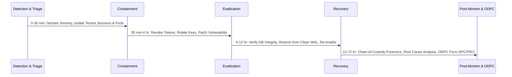

# COMKEY AFYA POA — Security Incident Response Framework

**Document Reference:** SEC-IR-2026-V1  
**Classification:** Confidential — Security Operations & Business Continuity  
**Target Compliance:** OWASP ASVS Level 2 / ISO/IEC 27035 / Kenya Data Protection Act 2019 / National Cybersecurity Strategy  

---

## 1. Overview & Objectives

This framework defines the formal procedures for detecting, triaging, containing, eradicating, and recovering from security and data privacy incidents across the COMKEY AFYA POA cloud platform and tenant healthcare facilities.

The core objectives are:
1. **Protect Patient Safety and Privacy:** Prevent unauthorized disclosure, alteration, or loss of Protected Health Information (PHI) and clinical records.
2. **Preserve Tenant Boundary Integrity:** Rapidly contain any threat attempting to violate PostgreSQL Row-Level Security (RLS) or cross-tenant data isolation.
3. **Fulfill Statutory Obligations:** Guarantee immediate reporting to affected healthcare facility Data Controllers (within 48 hours) and compliance with the mandatory **72-hour notification window** to the Office of the Data Protection Commissioner (ODPC) under Section 43 of the Data Protection Act 2019.
4. **Maintain Forensic Chain of Custody:** Capture tamper-evident digital forensic evidence admissible in regulatory reviews or legal proceedings.

---

## 2. Incident Classification & Severity Levels

| Severity Level | Definition | Impact Examples | Maximum Triage Time | Internal Escalation |
| :--- | :--- | :--- | :---: | :--- |
| **SEV-1: CRITICAL** | Catastrophic incident compromising patient safety, widespread PHI breach, cross-tenant RLS failure, or systemic data destruction. | - Cross-tenant database leakage.<br>- Unauthorized mass export of patient clinical files.<br>- Active ransomware locking PostgreSQL or Redis.<br>- Compromise of national master encryption key or JWT secret. | **< 15 minutes** | Executive Management, Lead Security Architect, Data Protection Officer (DPO), Legal Counsel. |
| **SEV-2: HIGH** | Severe security event affecting an isolated tenant or critical national integration without cross-tenant spillover. | - Single facility administrator credential compromised.<br>- Disruption or compromise of SHA eClaims or KRA eTIMS signing keys.<br>- Tampered cryptographic hash chain detected in audit logs.<br>- Malicious file upload executing in worker pool. | **< 30 minutes** | Lead Security Architect, Infrastructure Lead, Tenant Facility Administrator, DPO. |
| **SEV-3: MEDIUM** | Localized security anomaly or unauthorized access attempt blocked by controls. | - Repeated brute force / credential stuffing against staff logins.<br>- Failure of external DHA HIE endpoint triggering circuit breaker.<br>- Isolated unauthorized role-change attempt blocked by RBAC.<br>- Outdated library vulnerability detected in dev dependencies. | **< 4 hours** | Security Engineer, On-call Application Developer. |
| **SEV-4: LOW** | Minor security alert or operational anomaly with minimal risk. | - Single failed login attempt.<br>- Port scan detected at Cloudflare WAF perimeter.<br>- Discredited phishing report from hospital receptionist. | **< 24 hours** | Security Analyst. |

---

## 3. Incident Command Structure (ICS)

During a SEV-1 or SEV-2 incident, normal operational hierarchy is suspended in favor of the **Cyber Incident Response Team (CIRT)**:

```
                  +--------------------------------+
                  |       Incident Commander       |
                  | (Chief Technology Officer / CISO)|
                  +--------------------------------+
                                  |
         +------------------------+------------------------+
         |                        |                        |
+------------------+    +------------------+     +-------------------+
|  Technical Lead  |    | Privacy Officer  |     |  Communications   |
| (Sec Architect)  |    |     (DPO)        |     |     & Legal       |
+------------------+    +------------------+     +-------------------+
         |                        |
+------------------+    +------------------+
| Forensics & SRE  |    | Tenant Liaison   |
|   Investigators  |    | (Hospital Admins)|
+------------------+    +------------------+
```

### Roles & Responsibilities:
- **Incident Commander (IC):** Has absolute operational command over incident containment, technical downtime decisions, and post-mortem sign-off.
- **Lead Technical Investigator:** Coordinates log extraction, forensic memory captures, container isolation, database inspection, and code patches.
- **Data Protection Officer (DPO):** Evaluates privacy impact under Kenya DPA 2019, determines statutory breach notification triggers, and liaises directly with the ODPC and facility Data Protection Officers.
- **Tenant Liaison & Communications Lead:** Manages communication with affected hospital directors, ensuring non-technical clinical staff receive clear, actionable operational instructions.

---

## 4. Incident Response Lifecycle



### Phase 1: Preparation
- Continuous logging with Pino and cryptographic audit hash chaining in PostgreSQL.
- Isolated staging and mock environments enforcing `assertSafeEnvironment()`.
- Immutable database backups with point-in-time recovery (PITR) WAL archiving.
- 24/7 on-call rotation with authenticated out-of-band communication channels (Signal/ProtonMail).

### Phase 2: Identification & Triage
- Ingestion of alerts from:
  - Application audit events (`CROSS_TENANT_VIOLATION_ATTEMPT`, `AUTHZ_FORBIDDEN_ACCESS`).
  - Web Application Firewall (WAF) rate limit threshold breaches.
  - PostgreSQL transaction error spikes or RLS permission denials.
  - Direct whistleblowing / reports from hospital clinical users.
- Verification that the event is a genuine security incident (not an integration timeout or test script).
- Classification into SEV-1 through SEV-4 and appointment of the Incident Commander.

### Phase 3: Containment (Immediate Quarantine)
- **Short-Term Containment:**
  - Revoke active user sessions in database:
    ```sql
    UPDATE user_sessions SET is_revoked = true WHERE tenant_id = :targetTenantId;
    ```
  - Lock affected user accounts (`locked_until = NOW() + INTERVAL '24 HOURS'`).
  - Invalidate active JWTs by incrementing the token epoch or rotating `JWT_SECRET`.
  - Isolate compromised container pods from the Kubernetes/Docker service mesh.
- **Long-Term Containment:**
  - Place affected tenant organization into **SUSPENDED / READ-ONLY** state to prevent ongoing data modification while allowing read access for active in-patients.
  - Block malicious client IP addresses at the WAF / Cloudflare perimeter.

### Phase 4: Eradication (Root Cause Removal)
- Analyze application and database logs to determine the exact vulnerability exploited (e.g., path traversal, dependency flaw, credential theft).
- Deploy verified code fix or hotpatch to production through the CI/CD pipeline.
- Rotate all compromised credentials:
  - Database application user passwords (`afyapoa_app`).
  - Master field encryption keys and HMAC blind index peppers.
  - National gateway credentials (DHA OAuth secrets, SHA API keys, KRA eTIMS PINs).

### Phase 5: Recovery & Verification
- Restore database to the clean transaction state preceding the compromise using PostgreSQL point-in-time recovery (PITR).
- Execute automated security regression suite:
  ```bash
  pnpm --filter @afyapoa/api test test/security-regression.spec.ts
  ```
- Verify cryptographic audit chain integrity using `verifyChainIntegrity(tenantId)`.
- Re-enable tenant access gradually with enhanced monitoring and verbosity.

### Phase 6: Post-Incident Activity & Regulatory Reporting
- Conduct a "Blameless Post-Mortem" within 5 business days.
- Complete the statutory **ODPC Personal Data Breach Notification Form** within **72 hours** of breach confirmation.
- Archive all digital forensic evidence in read-only WORM storage for 7 years.

---

## 5. Technical Incident Response Playbooks

### Playbook A: Cross-Tenant Data Leak / RLS Failure (SEV-1)
1. **Trigger:** Alert indicating a user in Tenant A read or mutated a record belonging to Tenant B.
2. **Immediate Actions:**
   - Execute emergency database lockdown:
     ```sql
     -- Force immediate strict RLS check
     SET app.current_tenant_id = '';
     SET app.is_super_admin = 'false';
     ```
   - Temporarily suspend public API traffic at reverse proxy, serving HTTP 503 Maintenance.
3. **Forensic Investigation:**
   - Query `audit_events` for `CROSS_TENANT_VIOLATION_ATTEMPT` or anomalies:
     ```sql
     SELECT * FROM audit_events 
     WHERE details LIKE '%CROSS_TENANT%' OR action = 'AUTHZ_FORBIDDEN_ACCESS' 
     ORDER BY created_at DESC LIMIT 100;
     ```
   - Inspect PostgreSQL connection pool logs to verify whether a pooled connection failed to reset `app.current_tenant_id` between client requests.
4. **Remediation:**
   - Verify transaction boundary wrappers (`withTenantContext`) guarantee `set_config('app.current_tenant_id', :id, true)` with `is_local = true`.
   - Run Vitest Suite 2 (`test/security-regression.spec.ts`) against the hotpatch.
   - Re-enable services and notify DPO for ODPC 72-hour filing.

### Playbook B: Compromised Staff Account & Unauthorized Bulk Export (SEV-1/SEV-2)
1. **Trigger:** Alert `PATIENT_EXPORT` or `AUDIT_EXPORT` executed outside normal clinic operating hours or for an abnormally large patient cohort.
2. **Immediate Actions:**
   - Terminate session and lock user account:
     ```sql
     UPDATE users SET status = 'SUSPENDED', locked_until = NOW() + INTERVAL '7 DAYS' WHERE id = :targetUserId;
     UPDATE user_sessions SET is_revoked = true WHERE user_id = :targetUserId;
     ```
   - Terminate active background export jobs in BullMQ / Redis.
3. **Investigation:**
   - Review `patient_access_logs` to establish the exact scope of patient records exported.
   - Correlate client IP address against known hospital subnet ranges and VPN endpoints.
4. **Remediation & Notification:**
   - Enforce mandatory hardware security key / TOTP MFA re-enrollment for the compromised staff member.
   - Generate exact list of compromised patient MRNs for the hospital Data Controller to inform affected data subjects under Section 43 DPA.

### Playbook C: Compromised Integration Gateway Key (SHA / DHA / eTIMS) (SEV-2)
1. **Trigger:** Unexpected outbound requests detected from unauthorized hosts using hospital integration credentials, or notification from SHA/KRA of anomalous billing traffic.
2. **Immediate Actions:**
   - Switch integration driver to `MOCK` or safe isolation mode in `integration_configs`.
   - Contact national agency Security Operations Center (DHA CIRT / KRA Security Desk) to revoke existing API keys and certificate thumbprints.
3. **Investigation:**
   - Search source control and server logs to determine how the secret was disclosed.
   - Verify that no fraudulent claims or eTIMS invoices were signed during the exposure window.
4. **Remediation:**
   - Issue fresh credentials from national agency portal.
   - Encrypt new credentials using AES-256-GCM before writing to `integration_configs`.

### Playbook D: Cryptographic Audit Hash Chain Desynchronization (SEV-2)
1. **Trigger:** `verifyChainIntegrity(tenantId)` returns `valid: false` during routine automated integrity checks.
2. **Immediate Actions:**
   - Alert Lead Security Architect and DPO immediately.
   - Capture full disk snapshot and write-ahead log (WAL) records of the PostgreSQL instance.
3. **Investigation:**
   - Locate the exact event where `event.previous_hash !== prevEvent.event_hash`.
   - Determine if the break was caused by:
     - Direct unauthorized database manipulation bypassing application APIs.
     - Database connection failure mid-transaction before hash calculation completed.
4. **Remediation:**
   - Document discrepancy in the Incident Register.
   - Re-anchor the cryptographic chain with a signed supervisor reconciliation event noting the precise disruption timeframe.

---

## 6. Digital Forensics & Evidence Preservation

1. **Volatile Memory & Container Snapshots:**
   - Never reboot or terminate a compromised container pod without first capturing container memory (`docker commit <container_id> snapshot_image`).
2. **Database State Freezing:**
   - Create an immediate forensic snapshot of PostgreSQL:
     ```bash
     pg_dump -h localhost -U afyapoa_user -d afyapoa_db -F c -b -v -f /forensics/afyapoa_forensic_$(date +%Y%m%d_%H%M%S).dump
     ```
3. **Log Immutability & Hashing:**
   - Immediately compute SHA-256 checksums of all raw NGINX, Pino, and PostgreSQL logs:
     ```bash
     sha256sum /var/log/afyapoa/*.log > /forensics/logs_checksum.sha256
     ```
   - Copy logs and checksums to read-only off-site WORM S3 bucket (`s3://afyapoa-forensic-vault/incident-YYYYMMDD/`).
4. **Chain of Custody Documentation:**
   - Every forensic investigator must record:
     - Date, exact time (EAT UTC+3), and system hostname.
     - Tool used (version, command line arguments).
     - Hash of extracted artifact before and after analysis.

---

## 7. Regulatory & Public Escalation Guidelines

| Stakeholder / Body | Notification Window | Responsible Officer | Method |
| :--- | :---: | :--- | :--- |
| **Affected Healthcare Facility (Data Controller)** | **< 48 hours** | Comkey DPO / CEO | Written notification via encrypted email to Hospital CEO & Legal Counsel. |
| **Office of the Data Protection Commissioner (ODPC)** | **< 72 hours** | Data Controller (supported by Comkey DPO) | Statutory Form DPC/PR/1 via ODPC Portal (`complaints@odpc.go.ke`). |
| **National Computer and Cybercrimes Coordination Committee (NC4 / KE-CERT)** | **< 24 hours** (if critical infrastructure) | Incident Commander | Secure filing via `incidents@ke-cert.go.ke` under Computer Misuse and Cybercrimes Act 2018. |
| **Digital Health Agency (DHA) / MoH** | **< 48 hours** | Interoperability Lead | Formal technical dispatch to DHA HIE Operations Division. |
| **Social Health Authority (SHA)** | **< 48 hours** (if claims impacted) | Claims Lead | Formal disclosure to SHA ICT Security Directorate. |
